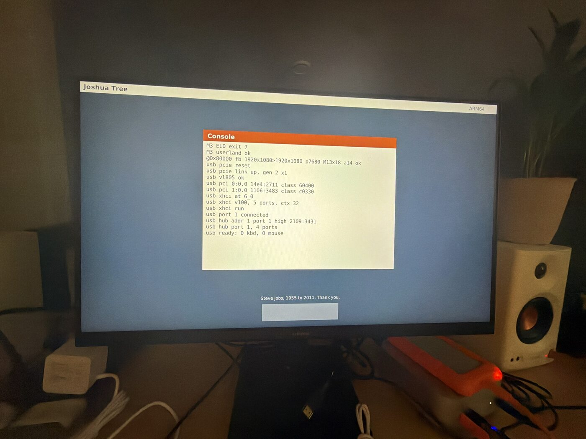
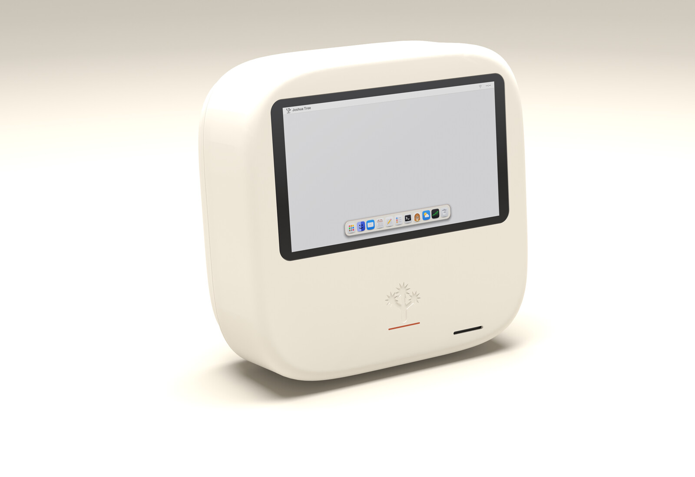
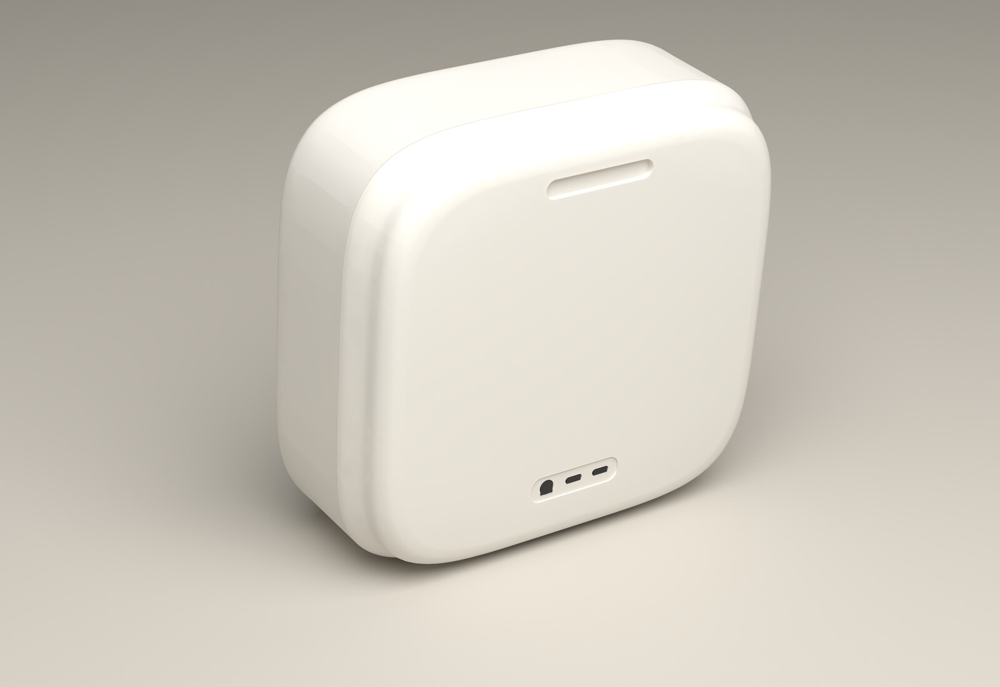
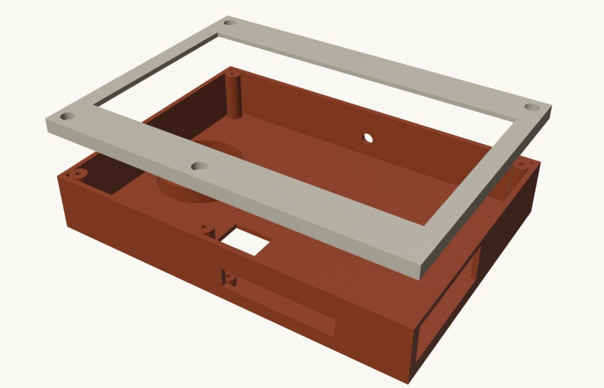
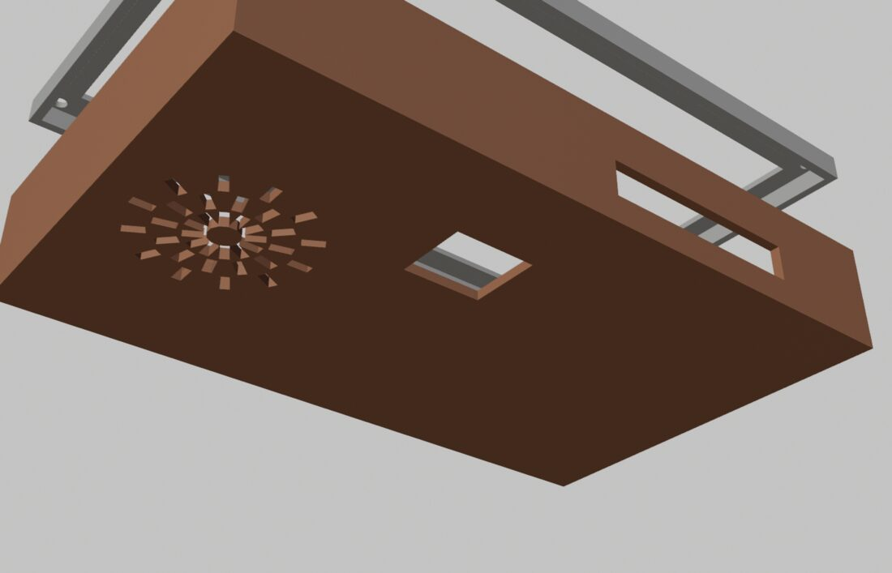

# Joshua Tree guide

How to use it, put it on a Raspberry Pi, and build the hardware.

## Contents

- [User guide](#user-guide)
- [Terminal](#terminal)
- [Samantha's agent loop on the Pi](#samanthas-agent-loop-on-the-pi)
- [The Claude app](#the-claude-app)
- [Encrypted Pi relay](#encrypted-pi-relay)
- [Raspberry Pi](#raspberry-pi)
- [Board test](#board-test)
- [Local model on the Pi](#local-model-on-the-pi)
- [Hardware plan](#hardware-plan)
- [Samantha box](#samantha-box)
- [Breadboard prototype](#breadboard-prototype)

## User guide

Joshua Tree is a small operating system. On a Raspberry Pi 4 it draws its own desktop, reads a USB keyboard and a Bluetooth mouse, joins Wi-Fi and lets you ask Samantha questions in Terminal.

Every app and command below passes its checks in QEMU. Only some have been seen on the real board. The Pi row of [the architecture picture](../architecture.svg) shows which.

Your files live in the card's `JT/` folder. Open any app with F1 and its name.

### Boot: from the card to the desktop

The Pi's firmware reads `config.txt` on the card and loads `kernel8.img`. Raspberry Pi OS is not involved. The first instructions pick one CPU core, set up its stack and clear empty variables while the other cores wait. The kernel then sets up memory, the screen, input and networking, and draws the desktop.

While it boots, the Pi shows a splash: the tree mark and a thin line that glides forward as the screen, card, Wi-Fi, clock and Bluetooth finish. The desktop paints once, when Wi-Fi has joined or given up, the clock has synced or given up, and the radio is up (or has said it will not be).

Any FAIL or oom line ends the splash at once, so a failure is never hidden. A crash draws its red panel over it. The boot log is kept. A click on a dock tile with no app of its own (Mail, for one) opens the Console.

A failed Wi-Fi join does not mean the OS failed: local apps still work. A desktop picture proves the screen and boot path work, not every app, key, network request or driver.

The card holds the boot image. Terminal conversations stay in memory and vanish when power is removed.

Files behind boot: `tools/pi-config.txt` (tells the firmware how to load), `arch/arm64/start.S` (prepares the CPU), `arch/arm64/linker.ld` (places code, data and stack), `arch/arm64/main.c` (starts the drivers and draws the desktop).

### The desktop and the keyboard

**Spotlight.** F1 or Cmd+Space opens it (a Mac keyboard may need Fn for F1). Type an app name and press Enter. Up and Down choose another match, Escape closes. With nothing typed it lists every app.

**Dock.** A small dark dot under a tile means that app has a window open, like the Mac. The Terminal's tile counts the Console too, since they share one window.

**Calendar.** The dock tile shows the month and day. Views: 1 Day, 2 Week, 3 Month, 4 Year. Left, Right, Up and Down step by the view's unit, T jumps to today, the square brackets move the selected day by one. Enter edits the one event for the selected day. Events are lines in `JT/EVENTS.TXT`, one per day.

**Clock.** Time, date and the Vancouver label, refreshed each minute. The timezone is fixed, permanent UTC-7 since March 8, 2026. Before the network clock is known it shows `--:--` and `Waiting for network time`. No alarms or timers yet.

**Windows.** Press on a title bar between the dots and move the mouse to drag. This works for the Console, Terminal, Browser, Clock, Brick, Calculator, Calendar, Notes, Music and Books (the first five since 3.6.0, the rest since 3.12.0). A window stops at the menu bar, the screen edges and the dock.

To resize, press within 12 pixels of a right, bottom or left edge (below the title bar) and move. That edge follows the pointer. The bottom-right corner moves two edges at once. The minimum is 320 by 220 for the Console, Terminal, Browser and Clock, 220 by 260 for the Calculator and 400 by 300 for an app. The maximum is the screen above the dock.

Content lays itself out again to fit: the Console and Terminal change columns and rows, the Browser re-wraps, the Calculator spreads its keys, Calendar, Notes, Music and Books redraw. Brick has a fixed field and keeps its first size as its smallest. On a 720p, 768p or 4K screen an app's window also stops growing at about 376,000 pixels of content (it needs that much memory). A 1080p Pi never gets there.

**Copy and paste.** Cmd is the Windows or Super key on a PC keyboard, and Ctrl does the same. One clipboard serves the whole Pi: plain text, 4 KB. Cmd+A selects all in a note, Cmd+C copies, Cmd+X cuts, Cmd+V pastes. This works in Notes, on the Terminal's input line and in the Browser's address bar (there the whole line is what copy and cut take). A longer copy keeps the first 4 KB. A paste takes what fits, turns line breaks into spaces and never runs a command. Cmd+W closes the front window and Cmd+Q quits the front app (both do what the red dot does). Cmd+N starts a new note in Notes, saving the open one first. Cmd+Tab (or Ctrl+Tab) brings the app window behind to the front; tap it again to walk through every open one.

**Menu bar messages.** A Wi-Fi join and a Brick result show beside the clock for four seconds. A new message replaces the old one and never takes the keyboard or mouse from your app.

**Power.** Type `reboot` or `shutdown` in Terminal (typing the word is the confirmation). Or press Ctrl+Alt+Delete to restart and Ctrl+Alt+End to shut down; Terminal asks first (Enter proceeds, Escape cancels). On a Mac keyboard Alt is Option and End may need Fn+Right. Both are refused while Samantha is answering. Both write every open file to the card first, so a note you were saving is kept. Shutdown powers down the SD interface and shows "It is safe to unplug the power now."; it does not cut the board's power. The same two items, Restart and Shut Down, sit in the tree menu at the left of the menu bar. With accounts, neither needs sudo or a password: it is the signed-in person's own machine.

**Screen sleep.** Five minutes without keyboard or mouse blanks the HDMI picture. A key or mouse move wakes it and still reaches the app. Brick and an active Samantha request keep the screen awake. Apps, USB and networking keep running. This is not suspend and saves nothing. HDMI sleep and wake still need a physical Pi test.

### Wi-Fi: from switching on to asking a question

The Pi needs a network name and password before it can join, and there is no Wi-Fi settings screen yet. So you prepare a development card on the Mac.

**Prepare the card.**
1. Create `~/.config/joshuatree/wifi.conf` with two lines: `ssid=YOUR_NETWORK_NAME` (up to 32 bytes) and `psk=YOUR_NETWORK_PASSWORD` (8 to 63 characters).
2. Run `chmod 600` on it. Never put it in the repository.
3. Run `tools/flash-pi.sh "/Volumes/PI"` with the mounted card's path. Check first that it is your development card.

The script replaces the card's boot files, keeps the previous kernel and settings as `.bak`, does not format the card and ejects it when done. It writes the network name, a key derived from the password and the relay token if one is configured on the Mac. The password itself is not in the image, but the derived key can still let someone join your network, so keep the card and its image private.

A normal release build includes neither the Wi-Fi key nor the default relay token. An explicitly supplied relay token file is a development override (checks use it too).

**What happens at start.** The Pi wakes its Wi-Fi chip, loads its firmware, scans, finds the configured name, proves it knows the password through a WPA2 handshake and asks the router for an address. The menu bar shows a Wi-Fi fan: flat ink once joined, dimmed grey until then. Open the Console for `wifi` status lines if joining fails.

With an address, the Pi fetches a network clock from a verified HTTPS reply that cannot move behind the build date or an already accepted time (the first check still relies on the build date; see the Encrypted Pi relay section). Without a configured network the Pi scans but does not join, Samantha cannot reach the relay, and the desktop still works.

**Ask Samantha or read a web page.** Open Terminal with F2 or Ctrl+T, or the Terminal and Samantha dock tiles.
- The prompt is `joshua@tree % `, zsh style (`ann@tree % ` once ann is signed in). A word that is not a command prints `zsh: command not found`.
- F3 switches between two sessions. Each keeps its typed line, scrollback and conversation until reboot. Finish or stop a request before switching.
- Console shows boot messages and network errors and takes no questions. Escape from an idle Terminal returns to it. While Samantha works, Escape asks her to stop between action steps.
- `browse example.com` reads a page as text (a bare host uses HTTPS).

For Samantha, the Mac must be on the same reachable network with its relay running (port 8765).
- Before flashing, set `CLAUDE_RELAY_HOST` to the Mac's local address as a first guess. If the router moves the Mac, the Pi finds the relay on the LAN itself.
- The Pi-to-relay connection requires HTTPS. Follow the Encrypted Pi relay section to give the Mac a certificate and put its public CA on the card. An old HTTP relay fails until updated.
- Keep the relay on your trusted network. Never expose its port to the public internet.
- See the Claude app section for the shared token and the Claude Code or API-backed relay.

| What you see | What to check |
|---|---|
| Wi-Fi scans but never joins | Check the network name and password on the Mac, then reflash the development card. |
| `claude: no network` | Check Console's Wi-Fi lines and whether the router gave the Pi an address. |
| `claude: no token` | Configure the relay token on the Mac, then rebuild the development card. |
| `claude: error -401` | The Pi's token and the running relay's token do not match. |
| `claude: timeout` | Check that the Mac is awake, the relay is running and the configured address is reachable. |
| A web page fails with a TLS error | The certificate, host name or clock may be wrong. Do not disable certificate checks. |

Files behind it: `tools/flash-pi.sh` (builds and copies the image), `arch/arm64/wifi_cfg.sh` (private settings to a key), `tools/wifi-fw.sh` (chip firmware), `arch/arm64/wifi.c` (scans and joins), `drivers/net.c` and `arch/arm64/ip.c` (addresses and packets), `arch/arm64/clock.c` (verified network time, refuses rollback), `drivers/http.c` and `arch/arm64/tls.c` (web requests and certificates), `arch/arm64/browser.c` (page to text and numbered links), `arch/arm64/claude_cfg.sh` (relay address and token), `arch/arm64/ask.c` (your question and her answer), `tools/claude-relay/relay.py` (the Mac side).

### The apps and tools, one at a time

**Terminal and the shell.** Page Up, Page Down, Home and End scroll. Commands:

| Command | What it does |
|---|---|
| `help` | Lists the commands. |
| `sam QUESTION`, `sam` | Asks Samantha, or opens the chat view when you type `sam` alone. |
| `ls`, `ls DIR`, `cat NAME` | List the card's files and print the first 4096 bytes of one. |
| `write NAME.EXT TEXT`, `rm NAME`, `mkdir NAME` | Make a text file, remove a file, make a folder. Inside `JT/` only, names in the old 8.3 shape with a dot. |
| `browse`, `open`, `back`, `forward`, `reload`, `links`, `more`, `up`, `down`, `top`, `bottom`, `find` | The text browser. |
| `bt` | Bluetooth (below). |
| `beep`, `vol` | `beep` plays a short tone. `vol 40`, `vol up`, `vol down` set the volume 0 to 100. |
| `mic`, `mic 5` | Listens through a USB microphone for 3 seconds (or 1 to 5) and shows how loud it was. Nothing is saved or sent. |
| Double-tap Space, hold | Speak to Samantha, like Claude Code's voice mode. Tap Space, then tap again and hold: a mic mark and a level bar show while you talk (at most 10 s); let go and it goes to the Mac's words service, prints what it heard as `you: ...` and asks her. A quick double tap without the hold is just two spaces. |
| hold Space | Talk to Samantha: tap Space twice and keep it held the second time. A mic mark shows in the menu bar and the prompt row shows a level bar; let go to send. Needs a USB microphone and the words service on the Mac. |
| `sam` | Opens the chat view: her face at the top, the conversation below, your line at the bottom. Her mouth moves while she speaks. Esc closes it. |
| `sam QUESTION` | Ask Samantha. When her answer carries a `[[say ...]]` line she says it out loud through the jack, with the words printed as `say: ...`. |
| `userrun NAME` | Starts a user program by name, for testing. |
| `llm PROMPT` | Asks the tiny model in the kernel. A normal release has none and stays quiet. |
| `reboot`, `shutdown` | Restart or switch off. |

While Samantha is answering, the network commands (`browse`, `open`, `back`, `forward`, `reload`, `llm`, `bt`, `userrun`) wait and print `zsh: sam is using the network, try again when she answers`. The rest keep working.

**Samantha.** She does not run on the Pi. The Pi sends your question to the relay on your Mac, which asks the model and sends the answer back over HTTPS with a pinned certificate and a shared token. If the Mac is off or Wi-Fi is down, she cannot answer.
- `sam QUESTION` hands the question over and returns the prompt at once. Her answer prints as `sam: ...` above the prompt, followed by a line like `sam: 27.4s (find 0.0, tls 0.8, wait 26.6)` saying where the time went (finding the relay, the secure connection, waiting).
- `sam` with nothing after it turns the Terminal window into a chat. The top row says `Samantha` and the relay she will use (`local only` before one has answered), your lines (`you: ...`) and her answers (`sam: ...`) scroll up below it, and the bottom row is where you type. Enter sends, sums come back at once, a question shows `thinking...` and you can keep typing meanwhile. Up, Down, Page Up, Page Down, Home and End scroll back, and Esc or `/quit` returns to the shell prompt (if she is mid-answer the chat closes once the answer is in). The chat uses the same path as `sam QUESTION`, so the relay, the 30 second limit and the slash commands behave the same. The Samantha dock tile opens the Terminal with `sam ` typed, so pressing Enter there lands in the chat. F3 is held while the chat is open.
- The Samantha tile in the dock opens that chat across the whole screen, from the menu bar to the dock, with her face big at the top and her mouth moving as she talks.
- One question flies at a time (`sam: still thinking`). Plain sums such as `sam 10+10` are answered on the Pi at once.
- `/status` shows the model, effort and whether the relay answered last time. `/clear` starts over. `/model haiku` selects the smaller model and `/model auto` restores routing. `/effort low` asks for a shorter, cheaper API answer (ignored in Claude Code relay mode). `/help` lists the controls.

**Browser.** Open it from Spotlight, type an address, press Enter. Tab picks the next link and scrolls it into view (wraps). Enter or a click follows it. Up and Down move a line, Page Up and Page Down a page, Home and End jump, the wheel scrolls three lines. Alt+Left goes back, Alt+Right forward, F5 or Ctrl+R reloads. Ctrl+L or typing a letter starts a new address. Esc leaves the address bar, Esc again closes the window. Alt+Left back, Alt+Right forward, F5 or Ctrl+R reload, Ctrl+L or typing a letter starts a new address; Esc leaves the address bar, again closes the window. The star at the right of the address bar (or Ctrl+D) saves the open page to `JT/BOOKMARK.TXT`, up to 12 of them; with no page open the Browser lists the saved ones, Tab then Enter or a click opens one, and a star on a saved page takes it off.

HTTPS knows 37 root certificates. A site signed by anyone else fails with a TLS error, on purpose. There is no JavaScript, no images and no styled layout. It keeps up to 8 KB of text, 32 links and 8 pages of history, and the status line says plainly when a page did not load.

**Books.** Reads plain text. Lists every `.TXT` in `JT/BOOKS/` (drop your own in from the Mac). Up and Down pick, Enter opens, Right or Space turns a page, Left goes back, Esc returns then closes. The page is saved next to the book as `NAME.POS`. A book over 3 MB is refused.

**Music.** Plays `.WAV` and `.MP3` from `JT/` and `JT/MUSIC/`, showing title, artist, length and cover. Space plays and pauses, Left and Right seek 5 seconds, Up and Down change volume, N and P go next and previous, S shuffles, R cycles repeat (off, all, one). You can click songs and buttons, click or drag the seek and volume bars, and scroll with the wheel. A song over 3 MB is refused. Sound comes out of the headphone jack, which a real board has not yet confirmed.

**Notes.** Plain text files in `JT/NOTES/`. Folders on the left, notes on the right, each showing its first line. Up and Down pick, Enter opens, Tab swaps columns, N makes a note, F a folder, D then D deletes the selected note. In a note, Shift with the arrows selects, Ctrl+A selects all, copy, cut and paste work. It saves a second or two after you stop typing. Esc saves and goes back, Ctrl+S saves and stays.

**Brick.** An original brick-breaker. Move the paddle with Left and Right, A and D, or the mouse. Space or a click launches the ball and also pauses and resumes. R starts a new game. Escape or the red button closes it. Clear all 32 bricks before losing three lives. Scores are not saved, it is silent, and play on the real board is still pending.

**Games.** All of them open from Spotlight or the Launchpad on both the PC and the Pi, and Esc closes each one. The newer five wait for your first key, so they never start without you.
- **Chess.** You play White against the computer. Pick a piece with the arrows and Enter (or a click), then its square the same way, or type the move, `e2e4`. A pawn that reaches the end becomes a queen. N starts a new game. The computer looks two to four moves ahead and answers in about a second.
- **Solitaire.** Klondike, drawing one card. D or Space draws, W or 1 to 7 picks a pile, then 1 to 7 or F moves it, A sends every card it can to the foundations, R deals again.
- **Paddle.** You against the computer, first to 7. Up and Down move your paddle, Space serves, P pauses.
- **Bricks.** Clear the wall with three balls. Left and Right move, Space launches, P pauses.
- **Depths.** A first-person maze in the spirit of Doom, all our own. Up and Down walk, Left and Right turn, Space fires. Find the pale door to get out.
- **Snake.** An arrow starts it and steers; it grows with every apple and the walls end it. P pauses.
- **Mines, Toroid, Hamurapi, Keyrate.** Minesweeper, the Game of Life on a torus, the 1968 city game with a drawn city, and a typing test.

**Bluetooth.** The Pi can pair one Bluetooth mouse.
1. Put the mouse in pairing mode.
2. `bt scan` (5 seconds, numbered, mice first).
3. `bt pair 1` (`bt pair` alone picks the strongest mouse, `bt pair NAME` picks by name).
4. Move the mouse.

The pairing is written to `JT/BTPAIR.BIN`. On every boot the Pi reconnects by itself with no scan, trying 12 seconds at a time with growing pauses up to 30 tries, and again whenever the mouse drops off, so a sleeping mouse comes back when woken. `bt status` shows the radio state (searching, connected or idle), the saved mouse with only the last byte of its address, the tries and the last error. `bt forget` deletes the saved pairing so you can pair a different mouse.

### Other ways to run it

- **PC USB stick:** download the latest ISO and `SHA256SUMS` from the [release page](https://github.com/nulljosh/joshuatree/releases/latest), which has the copy steps. BIOS boot is checked in QEMU. UEFI and real PC hardware are not verified.
- **Talk to Samantha on a Mac:** `make talk`, then hold F2. It needs a mic (see `user/samantha.c`). Voice on the real Pi is not verified.
- **Samantha on the Pi:** she answers through a relay on your Mac that uses your own Claude API key. The key stays on the Mac and never goes on the Pi.
- **Ask Claude Code:** run the relay on your Mac and open Claude from the Launchpad (the Claude app section).
- **Other make targets:** `make samantha`, `make talk`, `make iso`.
- **Version 3.0** was the Pi release, cut the day the board booted the desktop and you could type and click on it.

## Terminal

The ARM desktop has a Console and two Terminal sessions in the same spot. One is in front at a time.

**Console: logs only.** Boot messages, Wi-Fi and errors. It has no input row, and typing with it in front does nothing (key echoes go to the UART only). It opens at boot, because on a Pi with no serial cable it is the only debug view. Page Up, Page Down, Home and End scroll it.

**Terminal: the command line.** Its bottom row is a zsh style prompt, `joshua@tree % ` (`NAME@tree % ` once someone is signed in). Every command runs and prints here, above the prompt, in 53-column lines. Page Up, Page Down, Home and End scroll it too. F3 switches between Terminal 1 and 2. Each keeps its own typed line, scrollback, relay conversation, model and effort. A running request must finish or be stopped before switching. These are two views in one window. Side-by-side panes remain future work.

The commands are in the User guide section. The Samantha dock tile and Spotlight's Samantha entry open this same Terminal on the ARM build and the tile types `sam ` for you, so just add the question. The chat view on the i386 build is unchanged.

### Keys

No mouse is needed. These keys are in `arch/arm64/main.c` (`ui_key`), and `tools/checks/arm64-keys-check.py` presses each one.

| Key | Does |
|---|---|
| F1, Cmd+Space | Toggle Spotlight: press again to close. Type to filter app names, including Clock (prefix or any part). Up and Down choose, Enter opens, Esc closes |
| A letter or digit | With no pane holding the keys, opens Spotlight with that character already typed |
| Enter, Space, Tab | With no pane holding the keys and no dock label, opens Spotlight, empty |
| F2, Ctrl+T | The Terminal, at once, closing Spotlight if open. It has the keyboard |
| F11, F12 | Volume down and up by 10 (0 to 100), before any pane. The menu bar says "Volume N" and the speaker clicks. The Mac media keys Volume Down, Volume Up and Mute do the same (Mute toggles 0 and the last level) |
| F3 | Switch Terminal session when no request is running |
| Left, Right | With no pane holding the keys, move the dock's label along the tiles |
| Enter | Open the labelled tile |
| Esc | Clear the label. With the Terminal in front, back to the Console. While a question runs it stops the agent instead. With nothing open it does nothing |
| Caps Lock | Letters come out capital until you press it again, and Shift flips them back. Digits and punctuation ignore it. It works in the Terminal, the Calculator and Spotlight. No keyboard light yet |
| A key held down | A letter, digit, Space or Backspace types again after 400 ms, then every 80 ms, in whatever got the first press, until you let go or press another key. F-keys, Enter, Esc, arrows and Ctrl, Cmd or Alt chords never repeat. A USB keyboard sends a held key once, so `main.c` does the repeating |
| Page Up, Page Down, Home, End | Scroll the window in front |

Mac-style USB keyboards: Cmd is the GUI modifier (0x08 left, 0x80 right in the boot report). A top row in Mac mode sends F1 and F2 as brightness down and up on a second HID interface, and `xhci.c` listens there and turns those into F1 and F2. A keyboard that sends a report ID in front of its report (9 bytes) is read past the ID. `tools/checks/arm64-keydbg-check.py` covers all of it over USB.

A dev card (`JT_WIFI_DEV=1`) shows the last raw HID report in hex, and the key's name, in the menu bar for 3 seconds after each key. Release builds leave it out. A release build has no relay token (see Keys and release builds under Samantha's agent loop).

### Code and checks

`arch/arm64/main.c` holds the two windows, F1 and the dock tile. `arch/arm64/ask.c` holds the prompt and the commands. `tools/checks/arm64-claude-console-check.py` proves typing at the Console asks nothing and the Terminal answers. `arm64-mouse-check.py` proves the Terminal tile opens it.

Click the Terminal or Samantha tile, or press F2 or Ctrl+T. Esc with no question running goes back to the Console. With no screen at all, F2 still moves the keyboard to the Terminal, and the UART shows everything (it gets every line from both windows, which the QEMU checks read). Browser navigation state is shared between sessions. AI conversation state is separate. Sessions reset on reboot.

## Samantha's agent loop on the Pi

Samantha answers at the Terminal prompt through the relay (`tools/claude-relay/relay.py`). Since the agent loop she can also act on the Pi and see what happened. This page says what she can do and where it stops.

### The loop

1. You type a question. The Pi posts it to the relay with its live status (address, clock, Wi-Fi bars).
2. The answer is printed. If it ends with action lines, the Pi runs them in order and prints each outcome.
3. What the actions printed goes back to the relay as the next turn, in the same session ("The Pi ran your actions. Results: ..."). Samantha answers again, with or without more actions.
4. This repeats until an answer has no actions, or the step limit is reached.

Every step prints `agent: step N` in the Terminal, so a photo of the screen or the UART log shows how far it went.

### Actions

Each action is alone on its own line at the end of an answer, inside `[[ ]]`, at most 80 characters.

| Action | What the Pi does |
|---|---|
| `[[note TEXT]]` | Prints TEXT as `pi: TEXT`. |
| `[[say TEXT]]` | Prints TEXT as `say: TEXT` and says it out loud through the relay's voice. |
| `[[led blink]]` | Blinks the green light (on QEMU: `pi: no green light on QEMU`). |
| `[[open APP]]` | Opens any app Spotlight lists, by its name (Notes, Music, Calculator, Mines). Other names print `pi: no app named ...`. |
| `[[browse URL]]` | Fetches an `http://` or `https://` page through the Terminal browser and prints it as text. Any other scheme is unknown. |
| `[[calc EXPR]]` | Works out EXPR with the Calculator's evaluator and prints `calc: EXPR = RESULT`. |
| `[[status]]` | Prints the Pi's address, clock and Wi-Fi bars. |
| `[[save NAME]]` | Saves the answer's first ``` code block to `JT/NAME` on the SD card, so `cat JT/NAME` shows it. Only a name the person typed in the question, only an 8.3 name, never a boot file. |
| `[[list]]` | Lists the files in `JT/` on the SD card, one line each with its size, and sends the list back to her. Read only. |
| `[[read NAME]]` | Prints the first 4 KB of `JT/NAME` (an 8.3 name, no path) and sends it back to her, so she can read, explain or edit what she saved. Read only. |

Only `[[save]]` changes a file, and only one the person named in their own question, inside `JT/` (boot files are refused). Nothing changes a file on the Mac. For anything else the relay's prompt tells Samantha to ask first and explain what would change.

### Limits

- 4 actions per answer. A fifth stays in the text and does not run.
- 5 steps per question. The fifth ends with `agent: step limit`.
- 80 characters per action. Longer ones stay in the text.
- Results sent back are cut at 1200 characters.
- An unknown action prints `agent: ignored [[...]]` and does nothing.
- Esc, or typing `stop` and Enter, while a question runs ends the loop at the next step with `agent: stopped`. At rest, `stop` says `agent: nothing running`.

### The relay side

In `--turing` and `--api-key-file` mode the relay keeps the last 24 messages of each session, so a result turn lands in its own conversation. In `claude -p` mode the session resumes as before. The `SAMANTHA` prompt lists the actions, says when each helps (browse for a live page, calc for sums, status when asked about the Pi), and states the ask-before-changing-files rule.

### Model and effort

These controls run on the Pi and are never sent. A value not on the list prints one line and sends nothing.

- `/model` lists `auto haiku sonnet opus`, the current one in brackets. `auto` keeps the relay's `pick_model`: short and easy to Haiku, hard words or a long question to Sonnet, design and security to Opus.
- `/effort` lists `low medium high` (`medium` default).
- `/status` shows model, effort, the prompt text, whether the relay answered last time and steps used since `/clear`.
- `/clear` empties the window and starts a new relay session. `/help` lists them.

The prompt shows the model that answered last, and the effort only when it is not the default (`Claude Opus 5.5 high $`).

On the wire, the request carries `"model"` and `"effort"` only when they are not `auto` and `medium`. The relay accepts exactly those words (400 `Unknown model or effort.` otherwise) and takes the real ids from its flags: `--api-model` haiku, `--api-model-hard` sonnet, `--api-model-top` opus. In `--api-key-file` mode effort sets the thinking budget and max tokens: low none and 300, medium none and 600, high 2048 and 4096. In `claude -p` mode the model word becomes `--model` and effort has no effect.

### Keys and release builds

A Pi image carries the relay token only when built with `JT_WIFI_DEV=1`, the same flag that carries the Wi-Fi key (`tools/flash-pi.sh` sets it for the dev card). A release image has no relay config. The Console says `claude: no token`, Claude answers `samantha: no token`, and the other commands still work. The token comes from a file outside the repo and is never printed. QEMU builds are unchanged.

### Checks

- `tools/checks/pi-actions-check.py`: the parser, compiled on the host.
- `tools/checks/arm64-agent-check.py`: the loop under QEMU against a fake relay (browse then answer, the two caps, Esc, unknown actions).
- `tools/checks/arm64-model-check.py`: `/model`, `/effort`, `/status`, `/clear` under QEMU against a fake relay, including a refused value that is never sent.
- `tools/checks/claude-relay-check.py`: also the relay's model and effort whitelist and the thinking budget it sends.
- `tools/checks/pi-release-notoken-check.sh`: the release rule.
- `tools/checks/arm64-claude-console-check.py`: the `sam QUESTION` path still works.

## The Claude app

Claude is an app in the Launchpad. You type a question and Claude Code answers in the window. Ask it about the code in this repo and it reads the files to answer.

### How it works

The i386 app has no native TLS or Node, and Claude Code needs both. So Claude Code runs on your Mac, and Joshua Tree talks to it through the relay, `tools/claude-relay/relay.py`: one Python file, standard library only. Joshua Tree sends a plain HTTP POST. The relay runs `claude -p` (headless Claude Code, on your own logged-in plan) and sends the answer back as plain text.

```
Claude app (ring 3) -> kernel, SYS_HTTP_POST -> relay on your Mac -> claude -p -> answer
```

The relay keeps a session id per conversation, so a follow-up knows what came before. Type `/new` in the app to start over.

Pick one of three backends when you start the relay:

- No flag: `claude -p`, on your logged-in Claude plan.
- `--turing`: Samantha, Joshua's own model from the turing repo. Start `./.venv/bin/python app/serve.py` there first. The relay talks to it at `http://127.0.0.1:8127` (or the URL after the flag). No account and no credit. `/status` on the Pi says Samantha. If Turing is not running, the relay answers 502: "Samantha is not running on the relay machine."
- `--api-key-file FILE`: the Messages API, paid from a Claude Platform credit. It refuses to start unless `--allow-api-spend` is also given, so an old script cannot spend a topped-up credit. With both `--turing` and `--api-key-file`, Turing answers.

### Run it

Make a token once and keep it private:

```sh
openssl rand -hex 24 > ~/.claude-relay-token && chmod 600 ~/.claude-relay-token
```

Start the relay from the repo root:

```sh
python3 tools/claude-relay/relay.py --token-file ~/.claude-relay-token

For speech, run the words service next to it with the same token: `python3 tools/claude-relay/stt.py --token-file ~/.claude-relay-token` (port 8766, whisper.cpp from Homebrew and its base English model, nothing leaves the Mac). The Pi posts what its microphone heard and gets the words back.
```

It listens on `127.0.0.1:8765`. QEMU's network reaches your Mac's loopback at `10.0.2.2`, so boot with a network card:

```sh
make kernel.elf
qemu-system-i386 -kernel kernel.elf -vga std -net nic,model=rtl8139 -net user
```

In Joshua Tree open Settings, then Assistant. Set **Claude relay** to `10.0.2.2` and port `8765`. Set **Claude token** to the text in `~/.claude-relay-token`. Open Claude from the Launchpad and ask.

To skip Settings, the boot line can carry the three values for one boot: `-append "open=claude claudehost=10.0.2.2 claudeport=8765 claudetoken=$(cat ~/.claude-relay-token)"`. That puts the token in your shell history and process list, so use it for testing only.

### Security

The relay is a command-capable agent behind an HTTP port. Anyone with the token can make Claude read your files and spend your plan. Treat the token like a password.

What keeps that small:

- **Loopback only.** The relay binds `127.0.0.1` unless you pass `--lan`. QEMU does not need the LAN.
- **A token, checked in constant time.** No token, no start: it must be 16 to 63 characters, from a file or an environment variable, never the command line. A wrong or missing token gets 401 and Claude never starts.
- **The app never holds the token.** Settings keeps it and the kernel adds the `Authorization` header itself, only for `/api/claude` on the relay host. The relay host is its own setting, never the Samantha host, so the token cannot leak to the internet by default.
- **Read-only tools.** Claude gets Read, Grep and Glob, scoped to the repo. Everything else is denied, not asked. None of your MCP servers, hooks or plugins load.
- **Limits.** One question at a time. A 4 KB request cap. A hard timeout, default 150 seconds, after which the whole Claude process tree is killed.
- **Quiet logs.** One line per request: method, path, status, sizes, seconds. Never the token, never a prompt.

What it does not protect against:

- **Your repo is readable.** Claude can read every file under the relay's `--cwd`. Keep secrets out of it, or point `--cwd` somewhere smaller.
- **LAN requires TLS.** `--lan` is refused without `--tls-cert` and `--tls-key`. The Pi uses HTTPS with no HTTP fallback. See [encrypted Pi relay](#encrypted-pi-relay) to update the relay and card together. Default loopback HTTP remains for i386 and QEMU. The i386 app cannot use a TLS LAN relay yet.
- **The token sits in `SETTINGS.TXT`.** Like the Mail token, it is plain text on the Joshua Tree disk. See `docs/ARCHITECTURE.md` (Threat model).
- **`--tools` can widen it.** Passing write tools turns it into an agent that changes files. The relay warns you, loudly.

### What it cannot do yet

Claude Code runs on the host through the relay, and Joshua Tree is the front end. So:
- No tools on Joshua Tree itself (that needs real TLS on the OS or a trusted callback protocol).
- Not in the browser demo (the app says so in one red line).
- One answer at a time, no streaming (Weather and Stocks refreshes wait meanwhile).
- Answers are cut at 8 KB, with curly quotes and dashes turned into ASCII.
- Sessions live in the relay, so a restart starts a fresh conversation.

### Samantha's voice (text to speech)

The relay can turn text into speech for the Pi. The Pi side that plays it comes later. The relay half works now.

`POST /api/tts` takes the same `Authorization: Bearer` token and TLS rules as `/api/claude`. Send `{"text": "..."}` (or plain text). A good answer is raw audio: signed 16-bit little-endian, mono, 22050 Hz, no header. This is ElevenLabs' `pcm_22050`. The reply carries `X-Sample-Rate: 22050`.

- **The key stays on the Mac.** Put it in `~/.config/joshuatree/elevenlabs.key` and run `chmod 600` on it. The relay refuses a key file that others can read. Use `--tts-key-file` for another path. The key is never in a request, a reply or a log. If ElevenLabs fails, the Pi only sees a status code.
- **Caps.** Defaults are 400 characters per request and 5000 per day (`--tts-max-chars`, `--tts-daily-chars`). Over the per-request cap is 413. Past the daily cap is 429. Neither calls ElevenLabs. The day is the Mac's local date. The count lives in `~/.config/joshuatree/tts-usage.json` (`--tts-usage-file`), so a restart does not reset it. A failed ElevenLabs call gives its characters back.
- **Voice.** Samantha's voice id, `EXAVITQu4vr4xnSDxMaL`, is the default. Change it with `--tts-voice`. The model is `eleven_flash_v2_5` (`--tts-model`).
- **Other statuses.** 400 for empty text, 503 when the key file is missing or not private, 502 when ElevenLabs fails, 429 while another voice request runs.
- `--tts-base` points the relay at a stub for tests. It must be https, or http on loopback.

### On ARM64: Claude in Terminal

The Pi uses HTTPS for its relay requests (certificate setup and clock limits are in the Encrypted Pi relay section). QEMU defaults to loopback HTTP, and `CLAUDE_RELAY_TLS=1` exercises the HTTPS path. The ARM build asks from its Terminal with `sam QUESTION`, and `/status` names the model that last answered.

### Checks

Each runs against a stub `claude` or stub server (details in the Testing section).
- `tools/checks/claude-relay-check.py`: token refused and accepted, session resume, the exact read-only command line, the prompt on stdin, the timeout kill, the size cap, one at a time, clean logs, the second reply line `M <model>` that the Pi's prompt shows. It also runs a copy with the token check removed and proves a tokenless request then gets through.
- `tools/checks/arm64-claude-console-check.py`: the ARM build with the real relay. `sam QUESTION` answers in 53-column `sam: ...` lines, a follow-up resumes the session, `/status` names the model, and a wrong token, no network and no token each print their own line.
- `tools/checks/ring3claude-check.py`: QEMU with the real relay. The answer is drawn, the session resumes, and a wrong token, a stopped relay and no relay each show the red line.
- `tools/checks/relay-tts-check.py`: the voice endpoint. PCM returned, both caps refused without a call, the count kept across a restart, the key never in a response, header or log, a tokenless request refused.

## Encrypted Pi relay

The Pi's Terminal sends its relay token over HTTPS. It refuses a plain HTTP relay. It never retries with an unencrypted request.

The i386 app and the default QEMU Terminal still use HTTP on the Mac's loopback address. The i386 app cannot connect to a TLS LAN relay. Its remote LAN use needs a separate transport upgrade.

Do not restart your existing relay or reflash a card until the change is approved and its checks pass. The old development card uses HTTP. It will need updating together with the relay.

### Prepare certificates on the Mac

Use a private certificate authority (CA). Give the Pi only its public certificate. Keep the CA key and server key on the Mac.

The commands below use OpenSSL. They create files under `~/.config/joshuatree/relay-tls`.

The server certificate names `jt-relay`, not an address.
- The Pi checks that name and our CA, whatever IP the relay answers from.
- So the Mac's address no longer has to match anything.
- Since 2.46.0 the relay is trusted only through this CA (`TLS_TA`).
- A certificate from a public root is refused, even if it names `jt-relay`.

```sh
mkdir -p ~/.config/joshuatree/relay-tls
chmod 700 ~/.config/joshuatree/relay-tls
cd ~/.config/joshuatree/relay-tls
umask 077
openssl req -x509 -newkey rsa:2048 -nodes -days 365 -subj '/CN=Joshua Tree relay CA' -addext 'basicConstraints=critical,CA:TRUE' -addext 'keyUsage=critical,keyCertSign,cRLSign' -keyout ca.key -out ca.pem
openssl req -new -newkey rsa:2048 -nodes -subj '/CN=jt-relay' -keyout server.key -out server.csr
```

Create `server.ext` in that folder:

```text
basicConstraints=critical,CA:FALSE
keyUsage=critical,digitalSignature,keyEncipherment
extendedKeyUsage=serverAuth
subjectAltName=DNS:jt-relay
```

Then sign the server certificate:

```sh
openssl x509 -req -in server.csr -CA ca.pem -CAkey ca.key -CAcreateserial -days 30 -sha256 -extfile server.ext -out server.pem
```

A certificate made for an IP before 2.46.0 is refused now, even from the right CA. Mint this one before reflashing.

Do not copy either private key onto the card or into git.

`tools/checks/arm64-relay-discovery-check.py` makes its throwaway certificates with these same commands.

### Update the relay and card together

From the repository root, start the reviewed relay with TLS:

```sh
python3 tools/claude-relay/relay.py --lan --turing --token-file ~/.claude-relay-token --tls-cert ~/.config/joshuatree/relay-tls/server.pem --tls-key ~/.config/joshuatree/relay-tls/server.key
python3 tools/claude-relay/stt.py --lan --token-file ~/.claude-relay-token --tls-cert ~/.config/joshuatree/relay-tls/server.pem --tls-key ~/.config/joshuatree/relay-tls/server.key
```

- `--turing` answers as Samantha from Turing's `app/serve.py`, so start that first. Leave it off to use `claude -p`.
- `--api-key-file` uses the Messages API and spends its credit, so it also needs `--allow-api-spend`. The backends are described in the Claude app section.
- `--lan` without both certificate flags is refused.
- Default loopback HTTP still works for existing i386 and QEMU checks.

Flash your development card with the public CA. `CLAUDE_RELAY_HOST` is now only a first guess. The Mac's current address saves one probe.

```sh
CLAUDE_RELAY_HOST=192.168.1.10 TLS_TA="$HOME/.config/joshuatree/relay-tls/ca.pem" tools/flash-pi.sh "/Volumes/PI"
```

Use your actual development-card path. The script replaces its boot files.

A Pi build always uses TLS for relay requests. For a QEMU TLS build, set `CLAUDE_RELAY_TLS=1` as well. Its default remains loopback HTTP.

### When the Mac's address changes

Nothing to do.

Before a relay request, the Pi tries the relay that answered last, else `CLAUDE_RELAY_HOST`. If that will not connect or will not prove itself, it broadcasts one small UDP probe to the relay's port on the LAN.

A relay running with TLS answers on the same port number with that port and nothing else. The Pi then tries the address the answer came from. The Terminal says `claude: relay found at <address>`. If no relay answers, it says `claude: no relay answered on the LAN`.

The answer is not trusted.
- Anyone on the LAN can send one. All it does is say where to try.
- The token goes out only after a handshake that proves `jt-relay` and our CA.
- A failed request is never resent, so Claude never runs twice.
- A LAN host that answers faster than the relay can stop the Pi from reaching it. It cannot read the token.

Renew the server certificate before it expires. Never work around a TLS error by disabling certificate checks.

### Where the clock comes from

The Pi checks the time server's certificate at the image's build time. It then takes the Date header from a verified HTTPS reply from `www.google.com`.

It refuses:
- malformed dates
- duplicate Date headers
- dates before the build
- dates before a time already accepted this boot

An unsuccessful sync leaves the clock unset or preserves its previous time. There is no HTTP time fallback.

This is a bootstrap improvement, not a battery clock.
- Before the first sync, a certificate valid at build time can still be accepted, even if it has expired since then.
- A stale image can also reject a newer time-server certificate and need rebuilding.
- A persistent trusted clock or signed fresh time is still needed to remove that bootstrap window.

Pi TLS seeds come from the BCM2711 RNG200 hardware FIFO.
- A health fault or one-second timeout wipes the seed and refuses the connection.
- There is no timer fallback on the Pi.
- QEMU virt keeps a timer provider for tests only. It is not a secure deployment target.
- `tools/checks/arm64-rng-check.py` checks the driver with fake registers.
- Register definitions follow the [upstream RNG200 register map](https://github.com/torvalds/linux/blob/master/drivers/char/hw_random/iproc-rng200.c). The implementation is independent.
- Hardware output still needs a board test.

### Checks

- `tools/checks/arm64-clock-check.py`: the clock, with sanitizers and stubbed HTTPS responses.
- `tools/checks/claude-relay-check.py`: TLS startup, authenticated HTTPS, refusal of plaintext requests.
- `tools/checks/arm64-claude-console-check.py --tls`: the real relay and a stub Claude through QEMU, including a raw port that must see a TLS handshake and no bearer.
- `tools/checks/arm64-tls-check.py`: rejects an untrusted chain, a wrong name, an expired certificate and a certificate not yet valid.
- `tools/checks/arm64-relay-discovery-check.py`: builds with a dead `CLAUDE_RELAY_HOST`, finds the relay by its probe, and refuses a certificate from the right CA that names the old IP instead of `jt-relay`.

The real Pi, Wi-Fi timing, the probe crossing a real router and certificate renewal need a board test before calling the deployment verified.

## Raspberry Pi

Joshua Tree booted on a real Pi 4 on 2026-10-06.

This section says:
- what works
- what to buy
- how to flash the card
- how to test on the board
- what happened on the first boots

Shortened on 2026-10-12: the per-version board test lists and the dated log of intermediate builds are in git history. The plan and milestones are in the ARM64 section of ARCHITECTURE.md.

### Apps currently implemented on ARM

The Pi runs the same user programs as the PC, built for its processor. Each runs in user mode, in its own window, and cannot touch the kernel or another app.

- From the dock: Finder (the Burrow tile), Mail, Calendar, Notes, Reminders, Terminal, Samantha (the Terminal with `sam ` typed), Weather and Stocks.
- From Spotlight (F1) or the Launchpad (the Apps tile): all of those, plus Music, Books, the Browser, the Calculator, Settings, Clock, Brick and the ten games (Mines, Toroid, Hamurapi, Keyrate, Solitaire, Paddle, Bricks, Depths, Snake, Chess). With nothing typed, Spotlight shows its first 20; typing finds the rest.
- The Launchpad is a cream card in the middle of the screen, seven across. Click one, or move with the arrow keys and press Enter. Esc or a click outside closes it.
- F2 opens the Terminal. The Trash tile has no ARM app yet and says so.
- Files live on the card in `JT/`.

The dock and Spotlight dispatch is in `arch/arm64/windows.c` (`dock_activate`) and `arch/arm64/keys.c` (Spotlight and the Launchpad). It is not a claim that every app passed a physical-board test.

### What works today

| | Status |
|---|---|
| Boots under QEMU's generic ARM machine, and as a Pi image on QEMU's Pi 4B model (enters at EL2, drops to EL1) | Works. `make -C arch/arm64 run` and `run-pi` |
| Boots on a real Pi 4, a picture on a monitor at its own size | **Works, 2026-10-06.** See below |
| Console text on the real board | Fixed and seen 2026-10-06. See below |
| Console scrollback | See below |
| USB keyboard and mouse | **Keyboard works on the real board, 2026-10-06.** See below |
| Wi-Fi (CYW43455) | Joins and holds on the board (see the log). See below |
| Bluetooth (same chip) | `bt scan` and `bt pair` connect a mouse. Not yet seen on the board. See Bluetooth below |
| Sound out of the 3.5 mm jack | Not yet heard on the board. See below |
| Files on the SD card | Pass on QEMU. Not yet seen on the board. See Files on the card |
| Wired Ethernet | Not yet (M4) |

Details for the rows above:

- **Real Pi 4 picture.** The kernel asks the GPU for a screen through the mailbox, and asks the firmware how big the monitor is. A 4K monitor gets exactly half each way, so it stays sharp. This is proven in QEMU with a faked 1080p and 4K monitor (`tools/checks/arm64-m1c-check.py`).
- **Console text.** The first boot showed one thin mark per line, because drawing never left the CPU cache. Every glyph is now cleaned out to memory as it is drawn.
- **Console scrollback.** Page Up and Page Down move half a page. Home jumps to the first line and End to the newest. A pinned row under the text always shows the latest `wifi` and `usb` line, so Wi-Fi lines survive a photo.
- **USB.** A USB mouse moves an arrow. The dock label follows it. The red button closes the Console and a dock click opens it (QEMU: `tools/checks/arm64-mouse-check.py`).
  - Each hub port prints one status line, and every port is rescanned once a second. So a keyboard plugged in after boot is found.
  - Steps print `usb pcie link up`, `usb vl805 ok`, `usb xhci run`, `usb port N connected`, `usb kbd addr N`, then `usb key 0x04 a` per key.
  - The last line on a photo is where it stopped.
- **Wi-Fi.** QEMU has no SDIO card, so it proves only the failure path. That is `wifi FAIL cmd5`, and boot carries on (`tools/checks/arm64-wifi-check.py`).
- **Sound.** Test with `beep` (or `beep 880 500`) with headphones in. It uses PWM1 on GPIO 40 and 41. An app's sound goes out through DMA, so the desktop never waits. Volume is 0 to 100, default 70 (commands and keys are in the User guide). Defaults are `AUDIO_DEFAULT_VOLUME` in `audio.h` and `TICK_HZ`, `TICK_MS` in `cmd.c`: tune them on the real speaker. HDMI audio is not done.
- **Files on the SD card.** Reads, writes and apps pass on QEMU's Pi 4B model with a FAT32 card across a reboot (`arm64-sd-check.py`, `arm64-notes-check.py`).

On day one, watch two things:
- the text in a serial terminal
- with a monitor plugged in, a simple desktop with the same boot lines in its white window

If the serial cable is wrong, the monitor still tells you how far the kernel got. If both are blank, suspect the SD card or `config.txt`.

### What to buy

- **Raspberry Pi 4 Model B, 4 GB.** The port targets the 4B first. The Pi 5 comes after.
- **A USB-C power supply, 5 V 3 A.** The official one is the safe pick.
- **A microSD card, 16 GB or more.**
- **A USB to serial cable, 3.3 V** (CP2102, FTDI or CH340), plus **three female to female jumper wires**. Make sure it says 3.3 V, not 5 V. The Mac mini only has USB-C, so search "USB-C to TTL serial 3.3V".
- A micro-HDMI to HDMI cable and a monitor, plugged into the HDMI port next to the USB-C power port (HDMI 0).

A local store may have the Pi in stock: Canada Computers and Memory Express in Vancouver. PiShop.ca ships from Canada.

### Wire the serial cable

Turn the Pi off. Never connect the adapter's 5 V or VCC pin.

- Pi pin 6 (ground) goes to adapter GND.
- Pin 8 (GPIO14, the Pi's TX) goes to adapter RX.
- Pin 10 (GPIO15, the Pi's RX) goes to adapter TX.

Transmit goes to receive. If you see nothing later, swapping the two data wires is the first fix.

### Build, flash and boot

You need `clang`, `ld.lld` and `qemu-system-aarch64`. The Mac already has them.

- `make -C arch/arm64 pi` makes `arch/arm64/kernel8.img`.
- `make -C arch/arm64 run-pi` tries it on QEMU's Pi 4B model first.

You do not need Raspberry Pi OS. The Pi's firmware boots any `kernel8.img` on a FAT32 card, next to five files from the official [raspberrypi/firmware](https://github.com/raspberrypi/firmware/tree/stable/boot) repo.

One script does the job. `tools/flash-pi.sh` finds the one mounted FAT32 card, or name it, as in `tools/flash-pi.sh "/Volumes/NO NAME"`. It:
- builds `kernel8.img`
- downloads `bootcode.bin`, `start4.elf`, `fixup4.dat` and `bcm2711-rpi-4-b.dtb` (cached in `build/pifw`)
- copies `tools/pi-config.txt` over as `config.txt`
- keeps an existing `kernel8.img` or `config.txt` as `.bak` first
- strips the macOS `._` files
- ejects the card

This is the `config.txt` it writes, the one copy in `tools/pi-config.txt`:

```
arm_64bit=1
kernel=kernel8.img
kernel_address=0x80000
disable_overscan=1
enable_uart=1
uart_2ndstage=1
```

- `kernel_address` puts the kernel where it is built to run. Newer firmware would load it at 0x200000.
- `disable_overscan` stops the firmware shrinking the picture inside a black border.
- There is no `dtoverlay=disable-bt` (since 2.51.0). The good UART, the PL011, belongs to the Bluetooth radio.

To start from Raspberry Pi OS Lite (64-bit) instead, flash it with Imager. Replace `kernel8.img` on the boot partition. Append the lines of `tools/pi-config.txt` to its `config.txt`.

The serial cable is optional on day one. The screen shows the same boot lines.

With a serial cable, the adapter shows up as `/dev/cu.usbserial-something`. Run `ls /dev/cu.usb*`, then `screen /dev/cu.usbserial-0001 115200`. Leave `screen` with Ctrl-A then K. Power the Pi and you should see:

```
Joshua Tree on ARM64
booted at EL2
EL1
M0 ok
M1 vectors set
M1b mmu on
M1b heap ok
M1 svc ok
tick 1
tick 2
tick 3
M1a ok
M1c fb ok
```

What the lines mean:
- The lines after `M0 ok` are the exception table, the memory map with caches on, a small heap and the timer.
- On a real board the interrupt controller setup is the part most likely to need a fix. If output stops after `M1 vectors set`, the memory map is the likely cause.
- After the userland lines, the last line is a measurement. For example: `@0x80000 fb 1920x1080>1920x1080 p7680 M13x18 a14 ok`.
  - It gives where the firmware loaded the kernel.
  - It gives the monitor size reported and the screen we got.
  - It gives the bytes per row.
  - It gives the console font's self-test.
- `M1c fb ok` means the GPU gave us a screen and the desktop is drawn. If the text says so and the monitor stays black, the picture is in memory but the GPU is not showing it.

The kernel guards against two things a real board may do differently from QEMU:
- If the firmware leaves the timer speed unset, it assumes 54 MHz.
- Every wait on the GPU mailbox gives up after a moment and prints `M1c mailbox framebuffer refused` instead of hanging.

The Pi has no battery clock. The menu bar clock reads `--:--` and the Calendar tile shows a red dash for the month and a dark dash for the day, until Wi-Fi gives it the time.

**If nothing prints:**
1. Swap the two data wires.
2. Check the speed is 115200.
3. Check the adapter is 3.3 V and ground is on pin 6.
4. Check `config.txt` matches `tools/pi-config.txt` and the card is fully ejected.
5. `uart_2ndstage=1` makes the Pi's firmware print before ours. If you see that and not ours, the kernel is not starting. If neither, it is the wiring.
6. Look at the LEDs. Steady red is power. Flickering green is the card being read. A repeating green pattern is the firmware counting out an error (four means no `start4.elf`, seven means no `kernel8.img`). Re-run `tools/flash-pi.sh`.

If it still fails, send the exact lines you see, even garbage. Garbage means the speed or clock is off. Nothing means wiring or boot files.

**Why the serial cable matters.**
- Without it, every test is: build, swap the card, photograph the monitor, guess.
- With it, the Pi prints every step even on a blank screen.
- A tiny loader on the card lets each new build be sent down the cable with no card swaps. This is the "auto update" path. Pulling updates from GitHub needs networking and TLS in the kernel.
- The Mac's terminal can be the keyboard before USB works.

**Milestones.**
- M0: text over serial.
- M1: a picture over HDMI.
- M2: keyboard, mouse, network card and disk (in QEMU first).
- M3: every app on ARM.
- M4: the same on the real Pi with SD card, USB, Ethernet and sound last.
- M5: the Pi 5.

### Files on the card

The kernel reads the SD card it booted from (2.53.0). It writes it too (2.57.0). So a file you make is still there after a reboot.

The slot is wired to EMMC2, the Pi 4's own SD controller, never the Wi-Fi chip's. At boot the Console shows `sd card sdhc <size> MB, base clock <rate> MHz` and `sd fat32 partition ... writes go in JT/`.

The Terminal commands for files are in the User guide. `ls` lists the boot partition's top folder (short names with sizes, folders with a slash), and `ls JT` lists the OS's folder. `write NAME.EXT TEXT` makes or replaces `JT/NAME.EXT`. The name needs a dot, so `write me a poem` still goes to Claude. Names are the short 8.3 ones `ls` shows (`bcm2711-rpi-4-b.dtb` is `BCM271~1.DTB`), one folder down at most.

Apps see `JT/` as their whole disk (2.58.0).
- Notes asks for `NOTES/NOTES/N0000001.TXT` and gets `JT/NOTES/NOTES/N0000001.TXT`.
- Calendar's `EVENTS.TXT` is `JT/EVENTS.TXT`.
- An app's path has no leading slash and no `..`, so nothing outside `JT/` is reachable.

The OS writes only inside `JT/`, made on the first write. It never writes a file the firmware boots from. These are refused by name (`sd refused NAME, the firmware boots from it`):
- `bootcode.bin`
- `start*.elf`
- `fixup*.dat`
- any `.dtb`
- `config.txt`
- `cmdline.txt`
- `kernel*.img`
- `armstub*`
- the `overlays` folder

The ten minute pass for 3.0 is the Board test section. The longer SD test after flashing goes like this:
1. The Console shows the two `sd` lines. Photograph both.
2. `ls` shows `BOOTCODE.BIN`, `START4.ELF`, `FIXUP4.DAT`, `BCM271~1.DTB`, `CONFIG.TXT`, `KERNEL8.IMG` and `OVERLAYS/`, plus the `.BAK` files.
3. `cat config.txt` prints the lines of `tools/pi-config.txt`.
4. `write NOTE.TXT hello from the pi` says `wrote JT/NOTE.TXT, 18 bytes`.
5. `write config.txt x` is refused.
6. Pull the power and boot again. `cat JT/NOTE.TXT` still prints it. This is the photo that matters.
7. `rm NOTE.TXT`, then put the card in the Mac. `JT` is there, `config.txt` is unchanged, and the Pi still boots.

For Notes: press n, type a line, Esc, Esc, pull the power, boot, open Notes. The line is still listed.

### Accounts

The Terminal keeps user accounts on the card. `users` lists the names, `adduser NAME PASSWORD` makes one and `deluser NAME PASSWORD` removes one (it needs the right password). A name is 1 to 24 of a to z, 0 to 9, `_` and `-`; a password is 4 to 64 characters with no spaces; eight accounts at most. The password is stored only as a salted hash in `JT/USERS.TXT`, and the Terminal shows it as stars as you type and in the echoed line. With no SD card `adduser` says so and keeps nothing. With at least one account the Pi boots to a login screen before the desktop: type a name, press Return (or Tab) and type the password, then Return. A wrong password says `Wrong name or password.`, clears the password and makes you wait a second, so guessing is slow. The name you signed in as shows in the menu bar. `logout` in the Terminal, or Log Out in the tree menu, closes every window and returns to the login screen. With no account the Pi boots straight to the desktop as before. The mouse does nothing on the login screen, and there is no way to shut down from it yet; pull the power if you must. Admins (4.10.0): the first account ever made is an admin, and `admins` lists them. A normal user is told "you are not an admin; try sudo" for `adduser`, `deluser` of someone else, `write`, `rm`, `mkdir`, `makeadmin` and `unadmin`; an admin runs them as `sudo COMMAND` (for example `sudo adduser bob hunter22`). `sudo` asks for your own password on the next line, shown as stars; Esc cancels. A right password is remembered for five minutes, `sudo -k` forgets it, and a wrong one waits a second. `passwd` changes your own password (the old one, then the new one twice); an admin resets someone else's with `sudo passwd NAME`, and removes an account with `sudo deluser NAME`. `sudo makeadmin NAME` and `sudo unadmin NAME` change who is an admin; the last admin cannot be removed. Admin names live in `JT/SUDOERS.TXT`, which the commands keep, not you. Only an admin's Settings changes are saved to the card, except your wallpaper (6.0): it is yours, saved in `~/WALL.TXT` by anyone, and it comes up when you sign in. The login screen, and anyone who never picked one, get the card's. Home folders (4.11.0): with accounts, a signed-in person's files live in `JT/HOME/NAME` (a name over 8 letters is shortened to five letters, a tilde and two digits). Notes, Music and every other app save there instead of in the shared `JT/`, Samantha's `[[save NAME]]` writes `~/NAME` for whoever is signed in, and in the Terminal `~` means your folder: `write ~/NOTE.TXT TEXT`, `cat ~/NOTE.TXT`, `ls ~`, `mkdir ~/DOCS` and `rm ~/NOTE.TXT` need no sudo. Another person's folder is closed to `cat`, `ls`, `write`, `rm` and to apps, an admin included, until `sudo` (for example `sudo cat jt/home/bob/NOTE.TXT`). `adduser` makes the folder; `deluser` leaves it on the card and says so, and a new account with the same name would see those files. With no accounts nothing changes. Snapshots (4.12.0): `snapshot` copies your home folder into `~/SNAP/N` (the newest three are kept), `snapshots` lists them, and `restore N yes` makes the folder exactly as snapshot N was; plain `restore N` only explains what it would do. Files over 32 KB, and more than 24 entries in one folder, are skipped and counted. Crash safe (4.13.0): if the power goes mid-write, a file you were saving is either the old one or the new one, never half of each, and the next boot quietly frees any space the cut left stranded.

Settings has a Users section too (4.14.0), the same accounts without the Terminal. It lists them and marks the admins. Open a name to change its password, make or remove an admin, or remove it (it asks you to confirm); Add user takes a name and the password twice. Up and Down pick, Return does it, Esc goes back, and the mouse works too. An admin's password is asked for each change like `sudo` and then remembered for five minutes. Anyone else sees the list and can change only their own password, with the old one. With no accounts it says so and Add user makes the first, an admin. Passwords show as stars.

**Backups to the Mac** (5.2.0). `backup` in the Terminal sends your home folder to the relay on your Mac in one go, so a lost card does not lose your notes. It takes what a snapshot takes: files up to 32 KB, 512 KB in all, and says how many it left out. The relay keeps backups only when you start it with `--backup-dir FOLDER`; each one lands in `FOLDER/<your name>/<date and time>/`, written to a hidden folder first and renamed when every file is in, so a cut-off backup leaves nothing half done. It checks every name before it writes anything (8.3 names only, nothing that climbs out of the folder) and never runs Claude for it.

**Restore from the Mac** (5.3.0). `restore mac yes` brings your newest backup back from the relay (plain `restore mac` only says what it will do). It takes a snapshot first, so `restore N yes` with that number undoes it, then writes each file over the one of the same name. Files the backup lacks stay where they are, and a file over 32 KB or a folder in the way is left alone and counted. The relay sends only names the Pi takes, and the Pi checks them again before it writes a byte.

### Music on the Pi

The Pi plays songs from its card out of the 3.5 mm jack. It uses the PC's own `user/music.c` in user mode. It has no dock tile: press F1 and type music.

Put songs in `JT/MUSIC` from the Mac. Music makes the folder the first time it opens.
- Copy WAV or MP3 files with short names (`SONG.MP3`). The Pi lists 8.3 names, and a long one shows as `MYLONG~1`.
- Then run `dot_clean /Volumes/<card>/JT/MUSIC`, or copy with `cp -X`. This removes the `._` files Finder leaves, which otherwise show as songs that will not play.

What it plays:
- WAV (8 or 16 bit, mono or stereo).
- MP3 from 4000 to 44100 Hz. A 48 kHz file is refused.
- A song is read whole into memory, so 3 MB is the most. A three minute MP3 at 128 kbps fits.
- The sound is mono out of both sides.

Keys are in the User guide. F11 and F12 are the Pi's master volume on top of Music's.

Board test, with headphones in:
1. `beep` first. If you hear it, the PWM, clock and pins work.
2. Open Music. Space plays the first song and the time counts up a second a second.
3. F11 and F12 change volume ("Volume N" in the menu bar).
4. n goes to the next song.
5. Esc stops, and the Console says `audio: app stream N frames at R Hz, ... played P`. Photograph it.

If `beep` is heard but Music is silent while its clock runs, suspect the DMA side. That is channel 5, PWM1's DREQ (1) and the buffer's bus address (RAM at 0xC0000000). Tell me the `audio:` lines.

`tools/checks/arm64-music-check.py` proves Music on QEMU, which has no PWM.

### Mouse test on the real board

QEMU proves the arrow, the label and the clicks. It does not prove real mice or the real cache.

Joshua's mouse is Bluetooth. Pair it first (below). The steps are the same, except unplugging means switching it off and pairing again.

1. A wired USB mouse plugged in before power-on shows `usb mouse addr N port ...`. The arrow follows with no trail at 1080p.
2. Hovering the dock shows the tile's name. No arrow-shaped mark stays behind.
3. The Console's red button closes it. Mail brings it back with `dock Mail: not on ARM yet`. Calendar opens over it with this month. Right steps a month. The red dot closes it.
4. Unplug and replug. You see `usb port ... disconnected`, then a new `usb mouse` line, and it moves again.
5. Keyboard and mouse together, on the hub and the Pi's own ports, still type at the Claude prompt.
6. A wireless receiver (one plug, two devices) shows as `usb kbd` and `usb mouse` on one address.
7. There is no acceleration. One mouse count is one pixel. Speed at 1080p is worth a report.

### Wireless

A Logitech receiver is a plain USB mouse and keyboard with no extra code.

The Pi's Wi-Fi and Bluetooth chip (CYW43455) needs closed firmware.
- It is three Wi-Fi files: `brcmfmac43455-sdio.bin`, `.txt` and `.clm_blob`.
- They come from RPi-Distro/firmware-nonfree at the commit pinned in `tools/wifi-fw.sh`.
- They are redistributable under that repo's `debian/copyright`, saved as `build/wifi-fw/copyright`.
- They are fetched into `build/` and never committed.

### Bluetooth

Joshua's mouse is the Incase version of the Microsoft Bluetooth Ergonomic Mouse. It is Bluetooth Low Energy. So the click half of the 3.0 gate waited on Bluetooth, the other half of the Wi-Fi chip.

It talks HCI over the PL011 serial line. At boot the kernel:
1. Powers the radio (BT_ON, through the firmware mailbox).
2. Loads the patch `BCM4345C0.hcd`. This takes about 6 seconds at 115200.
3. Switches the link to 921600.
4. Prints `bt: loading the radio's patch`, `bt: patch loaded, 323 records`, `bt: version hci 9 lmp 9 ...` and `bt: ready, type bt scan to look for devices`.

Commands:
- `bt` alone says where it is.
- `bt scan` listens 5 seconds and prints one line per device, then a count. Example: `bt: Microsoft Bluetooth Mouse  rssi -60  addr c4:8e:8f:65:43:21`.
- If the radio stops answering, one line says `bt: no answer from the radio`. The rest of the Pi carries on.

To pair (the commands are in the User guide): switch the mouse on with the switch underneath, hold the pairing button underneath for 5 seconds until the light flashes, then `bt scan` and `bt pair`. `bt pair` picks the first name with "mouse", else the strongest signal. It prints `bt: connecting to ...`, `connected`, `paired`, `mouse ready`, and the arrow follows the mouse.

Failures are one plain line:
- `bt: the mouse did not answer, hold its button 5 seconds and type bt pair again`: it was not in pairing mode.
- `bt: pairing failed, ...` names the step.
- `bt: no boot mouse report on this device`: the mouse speaks only the report protocol.

Pairing is Just Works, with no code to type. The long-term key is kept in RAM and never printed. It is also saved to `JT/BTPAIR.BIN` for auto reconnect.

The console moved because the radio receives in bursts while the kernel draws or fetches. The PL011 has a 32-byte buffer and hardware flow control (GPIO 30 to 33, as Linux wires it), so a burst waits in the radio instead of being lost. The console only ever sends.

The patch is `BCM4345C0.hcd` from RPi-Distro/bluez-firmware, at the commit pinned in `tools/bt-fw.sh`. It is fetched into `build/bt-fw/` with `LICENSE.cypress` beside it and never committed.

QEMU has no Bluetooth chip. So `tools/checks/arm64-bt-check.py` runs the whole exchange against a fake controller.

Board test:
1. Flash and boot.
2. See the four `bt:` lines within about 10 seconds.
3. Scan. The advert holds at most 29 letters, so a long name is cut. RSSI is near -50 to -70.
4. Pair.
5. Move the mouse.
6. Click the Mail tile.
7. Photograph each stage. If it stops early, photograph the last `bt:` line. `no answer from the radio` straight after boot means the chip never answered at 115200: power or pins.

**Books on the board.** Books reads `.TXT` files in `JT/BOOKS/`. The card ships with one public domain sample, The Yellow Wallpaper. Make Something Wonderful is not public domain, so drop your own copy as `JT/BOOKS/JOBS.TXT`.

Test:
1. F1, `books`, Enter.
2. Enter opens. Right or Space turns the page.
3. Go to page 3, Esc, Esc, power off, boot.
4. Reopen on the same page.

### The fan and the case

The fan runs off the header: red to pin 4 (5 V), black to pin 6 (ground).

Pin 6 is also the serial cable's ground. If both are wired, share it or use pin 9, another ground.

Heat sinks go on the big SoC chip and the smaller chips beside it.

For the printed case, see the Printable Pi case section.

### Log

Newest first. What was tried on the real board.

- **2026-10-07: the real desktop (2.23.0).** The Pi boots to a 1920x1080 desktop with the satellite wallpaper. The dock has eleven icons. The window frame and menu bar render live from `drivers/window.c`, shared with i386.
- **2026-10-06, night: full screen, readable console, USB first light (2.13.0).** The picture fills the Samsung monitor at 1920x1080, sharp. The Console shows real text: the cache write-back fix worked. USB: PCIe link up, VL805 firmware loaded, xHCI with five ports, a hub. The keyboard cable was charge-only until swapped, then the keys printed.
- **2026-10-06, evening: the console marks explained (2.12.5).** Twelve marks, one per line printed before the screen came up. Each was the left edge of that line's first letter. The screen lives in cached memory, and the GPU sees only what the kernel cleans out of the cache.
- **2026-10-06, first boot.** Pi 4 Model B 4 GB, 32 GB card, heat sinks, case, fan, official 27 W supply. Flashed from the Mac without Raspberry Pi OS (five firmware files plus a 151 KB `kernel8.img`). First power-on drew the desktop over HDMI.




Want to try parts (an LED, a button, a speaker) before soldering anything? See the Breadboard prototype section.

### Shopping list

Rough Canadian estimates, not quotes.

**This week:**
- A USB-C to TTL serial cable, 3.3 V (about $10 to $15).
- A smart plug so the Mac can power-cycle the Pi (about $15 to $20).
- A second 32 GB microSD (about $10). One card for the last good build and one for experiments.
- A wired USB mouse (about $10 to $15).
- A real USB-C to USB-A data cable (about $10). The charging-only vape cable was why the keyboard went missing.
- An Ethernet cable (about $5 to $10). It is the wired backup to Wi-Fi and a way to load the kernel over the network.

**Soon:**
- A breadboard starter kit (about $10 to $15) for the first GPIO driver.
- A 3.5 mm audio cable (about $5) to the Edifier speakers.
- A Pi camera module (about $25 to $35).

**Later:**
- A 7 inch touchscreen ($60 to $90).
- A Raspberry Pi Pico ($5 to $8).
- A USB gamepad ($20 to $30, for Doom).
- A small USB speaker or sound card (about $15, for the Samantha box; the Yeti mic is here).

Books worth reading:
- *Make Something Wonderful*: Steve Jobs in his own words, free online. Its title is on the Pi's tribute line.
- *Operating Systems: Three Easy Pieces*: free online, the clearest book on processes, memory and files.
- *The Elements of Computing Systems* (Nand2Tetris): one logic gate up to an OS.
- *Code* by Charles Petzold.
- *The Soul of a New Machine* by Tracy Kidder.
- *Just for Fun* by Linus Torvalds.
- *Steve Jobs* by Walter Isaacson.

## Board test

This is the v3 board pass. Ten minutes, one card, one mouse. Every step says what you should see and what to send back if you don't.

You need: the flashed card (`tools/flash-pi.sh`), a Pi 4 with HDMI and a USB keyboard, your Bluetooth mouse (charged, and unpaired from any other device), and the Mac on the same Wi-Fi with the relay running (`python3 tools/claude-relay/relay.py --lan --turing ...`; see [the Encrypted Pi relay section](#encrypted-pi-relay)).

Power the Pi from a clean state and work down the list. Stop at the first failure and send me that step's line.

### 1. Boot

The tree and a progress bar, then the desktop at 1080p with the menu bar and dock. The console stays quiet.

If it stays black or on the splash: send a photo of the screen and the time it took.

### 2. Keyboard

Open Spotlight with Cmd+Space (or F1). Type `term` and press Enter: the Terminal opens. Hold a letter: it repeats after about half a second. Press Caps Lock: capitals.

If keys do nothing: unplug and replug the keyboard, then tell me what it is.

### 3. Sound

In the Terminal: `beep`. A short tone from the 3.5 mm jack (headphones in). Then `vol` (shows 70), `vol 20` (quieter), `vol up`, `vol down`. F11 and F12 step the volume too.

If silence: send the line starting with `audio:` if one printed.

### 4. Bluetooth mouse

In the Terminal: `bt`. It prints where the radio is and its version. Put the mouse in pairing mode (hold its pairing button until it blinks), then `bt scan`: a 5 second scan that lists what it hears, your mouse by name.

Then `bt pair` and the mouse's number from the list. The arrow should move with the mouse, and a click should focus a window.

If the scan lists nothing: send the lines `bt` and `bt scan` print. If it lists the mouse but pairing fails: send the one plain line that `bt pair` ends with. This is the step that has only run against a fake radio so far, so a failure here is the most likely thing to find.

If Bluetooth can't be saved today, plug in a USB mouse: that path already works.

### 5. Apps in user mode

Click the dock's Calendar: it opens in its own window and shows the right month. Click a window to focus it, type, and the keys go only to that window. Close it from the Terminal or the window and the desktop carries on.

If an app crashes the desktop, send what the screen says: the whole point of user mode is that it shouldn't.

### 6. The card keeps your files

Open Notes, type a few words, wait three seconds (Notes saves itself two seconds after the last key). In the Terminal: `ls` lists the card's files and `cat NAME` prints one. Now pull the power, boot again, and open Notes: your words are still there.

If the note is gone: send me `ls` before and after.

### 7. Music

Put an MP3 you own in the card's `JT/MUSIC/` folder (Music makes the folder the first time it opens, so open it once, power off, copy the file, boot again). Open Music from Spotlight (type `music`): the song shows its real title and artist, its cover if the file has one (or a `COVER.JPG` or `FOLDER.JPG` beside it), and its length. Play it: it comes out of the jack. Drag the volume knob and the seek knob. Apple Music downloads won't play (their files are locked).

A fresh card from `tools/flash-pi.sh` comes with one sample song, `HELLO.WAV` (shown as "Hello", 16 seconds, three voices, made by `tools/gen/sample-song.py`), put in `JT/MUSIC/` only when that folder has no songs; your own files are never touched or replaced. A WAV has no tag, so its title is its file name.

If it hangs on a file: tell me which file. If the title reads like `NEVERG~1` or the cover is missing, tell me the file name and what tool tagged it.

### 8. Samantha

Open her and ask something simple ("what is ten plus ten", "what time is it"). She answers in one line. The Pi finds the Mac's relay by itself, so there's nothing to type.

If she says she can't reach the host: check the relay is running on the Mac, then send the line she prints.

### What to send back

Each failed step's line, and a photo for anything on screen. Say which numbers worked. When it all passes, that is version 3.

## Local model on the Pi

This is a plan for running a small language model on the Raspberry Pi 4 inside Joshua Tree's own kernel, with no Linux and no relay.

Today Samantha answers through the relay. The roadmap item is "Integrated LLM that runs on the box".

How far to trust this section:
- Repo facts below come from reading the tree on 2026-10-08.
- Model and hardware facts are from memory and not checked online. Check each before building on it.
- No speeds are given. Where speed matters, the answer is to measure on the board.
- Trimmed 2026-10-12. The long model and quantization tables are in git history.

### Where the ARM build stands

- **No model code yet.** There is no `llm.c` in `arch/arm64/`.
- **The heap is small and never frees.** `kmalloc` in `arch/arm64/main.c` is a 16 MiB bump allocator and `kfree` does nothing (`heap_mark` and `heap_release` roll it back). So weights need their own RAM region, like the EL0 arena at 64 MiB.
- **About 3 GiB of RAM is mapped.** `mmu_init` maps the first 4 GiB as 1 GiB blocks, and the fourth is device memory. RAM above 4 GiB on an 8 GB board needs more `l1` entries.
- **SD card.** Reads and writes now exist through EMMC2 (see Files on the card). Model weights are far bigger than anything loaded so far.
- **One core.** `start.S` parks all but core 0. The Pi 4 has four Cortex-A72 cores.
- **Floating point is opt-in per file.** Everything builds with `-mgeneral-regs-only` except `text.c`, `libc.c` and `calc.c`. `vectors.S` saves q0 to q31, and `tools/checks/arm64-fp-check.py` proves it. A model file would join that list.
- **No libm.** A forward pass needs `expf` and `sqrtf`. `calc.c` already computes its maths as short FPU series, so reuse that.
- **No GPU compute.** All work is on the CPU with NEON. int8 dot products help a lot.

### Which models could run

**Toy models.** The TinyStories toys are Karpathy's llama2.c checkpoints.
- They run from under 1M up to 15M parameters, and up to about 60 MB as float32.
- They fit the current heap but only write children's stories.
- The 42M and 110M ones (170 MB and 440 MB) fit in RAM. They are good for timing a real load.

**Small chat models.**
- 0.1B to 0.5B (smallest Qwen or SmolLM) follow simple instructions with weak facts.
- About 1B (TinyLlama 1.1B, Llama 3.2 1B) is about 1 GB at int8, or half that at 4-bit. It fits in the mapped 3 GiB. It is about the smallest size that feels like a useful assistant.
- 3B and up needs several GB even at 4-bit. That is too tight on a 4 GB board and slow regardless.

llama2.c is the natural start. Its forward pass is one short dependency-free C file reading one flat weights file, with an int8 version (runq.c).

Check each model's licence before a release ships weights.

**How much memory.** Weights take parameters times bytes per weight: 4 for float32, 1 for int8, about 0.5 for 4-bit. Add a KV cache that grows with context length, small activation buffers and the rest of the OS.

**int8 and 4-bit.**
- int8 is usually close to float32 and cuts memory and time four times.
- 4-bit loses more, especially on small models.
- Keep a float32 build of the same model on the host. Compare token by token before trusting a quantized build.

**Speed.** Generating each token reads every weight once. So on an A72, memory bandwidth, not maths, is the limit.
- Fewer bytes per weight and smaller models are faster.
- Prompt reading batches. Generation does not.
- Four cores help the maths but not the memory ceiling.

### Loading weights

Simplest first. Pick one:
- Embed a tiny checkpoint in the kernel image, the way `arch/arm64/wifi_fw_gen.sh` embeds the Wi-Fi firmware.
- Have the firmware load a file. `config.txt` accepts an `initramfs FILE ADDRESS` line, which copies the file from the boot partition to a fixed address outside the heap.
- Stream the file from the FAT32 boot partition with the SD driver.

Whichever you pick, keep a magic number and a length at the front of the weights, and check them before running. Then a cut-short file gives a clear one-line error, not garbage tokens.

### What to measure, and the staged plan

First, measure on the real board:
- memory bandwidth
- one int8 dot product the size of a real layer

Print them as UART lines. Time with `cntpct_el0` or the 100 Hz clock in `arch/arm64/ip.c`. These bound every model.

Then run the smallest llama2.c checkpoint embedded on QEMU with greedy sampling. Its output must match the host's exactly. A future `arm64-llm-check.py`, like `arm64-calc-check.py`, boots an `llmtest` build headless and asserts the exact tokens. Then run the same build on the board.

1. **Toy, embedded.** Port llama2.c's forward pass as `arch/arm64/llm.c`, with FP on and the `calc.c` series for libm. Add a `story` command at the `ask>` row. Prove it with the exact-token check.
2. **Measured.** Run the bandwidth probe and the toy on the board. Put the numbers into the Benchmarks section.
3. **Room to grow.** Add a weights region outside the bump heap. Map RAM above 4 GiB on 8 GB boards. Try a bigger TinyStories model via the firmware path or the SD driver.
4. **int8 with NEON dot products.** Check against the float32 host build.
5. **More cores.** Wake the parked cores and split each matrix multiply. Tokens must be identical to one core.
6. **A small chat model.** About 0.5B to 1B at int8 or 4-bit, with a tokenizer we can run and a chat template. Use it when there is no network or the user picks local.

The relay stays the default for anything that needs to be right or long:
- facts and current events
- Samantha's read-only file tools
- the `[[note]]` and `[[led blink]]` actions (a small local model will not follow that format reliably)
- long answers or code

The local model is for:
- offline use
- privacy
- instant toy output
- a fallback when the relay cannot be reached (`ask.c` already prints `claude: no network`, the natural place to offer it)

Next three, ranked:
1. The exact-token check with an embedded toy.
2. The bandwidth and timer probe on the board.
3. A weights region outside the heap with RAM above 4 GiB mapped.

## Hardware plan

> **Update, 2026-10-03:** the first real board is a Raspberry Pi 4B, not the x86 mini PC below.
>
> The Mac mini cannot be the board. It is Apple Silicon, and this kernel is i386. A Pi boots a plain `kernel8.img` with a documented UART, framebuffer and interrupt controller.
>
> That port is tracked in the ARM64 section of ARCHITECTURE.md.
>
> The x86 analysis below stays as the later x86 box. The $199 Neo Kit and $349 Neo Complete in the old plan are replaced for now by the $500 Pi kit in the Money section.
>
> Trimmed 2026-10-12: the long source-citation prose is in git history.

Everything the i386 kernel talks to today is a QEMU-emulated device:
- rtl8139 or ne2k NIC
- Sound Blaster 16
- ATA PIO disk
- PS/2 keyboard and mouse
- a multiboot/VBE framebuffer

None of those chips ship on a board you can buy in 2026. This section is the bridge for the x86 path.

### The pick

**ASRock J4125B-ITX** (Gemini Lake Refresh, Intel Celeron J4125, mini-ITX, <https://www.asrock.com/mb/Intel/J4125B-ITX/index.asp>).
- It costs about $113 to $130 USD, board only. The prices are from Beach Audio and Walmart listings. Availability is unverified.
- It is a real motherboard you buy new and drop into a case with a PSU and a SATA drive.
- It still has separate PS/2 keyboard and mouse ports on the rear I/O. This comes from the plain J4125-ITX manual on ManualsLib. It is unverified against the B-revision manual. Do that five minute check before ordering, since it is the whole reason for the pick.
- PS/2 lets the existing driver bring up input before xHCI/HID exists.
- ODROID-H2/H3/H4 are USB-only for input and lack CSM/legacy boot. They are worse for this kernel.

| Chip | Model |
|---|---|
| CPU | Intel Celeron J4125 |
| NIC | Realtek RTL8111H (Gigabit, PCIe) |
| Audio | Realtek ALC892, 7.1 HD Audio |
| SATA | 2x native SATA3 (SoC) + 2x via ASMedia ASM1061 |
| USB | USB 3.2 Gen1 rear ports + USB 2.0 headers |
| BIOS | AMI UEFI. CSM unconfirmed (forum reports say missing on the related J4105/J5005; must test in Phase 0) |

If CSM is missing, GRUB2 in UEFI mode can still hand a multiboot kernel control, as in QEMU today. The kernel does not call BIOS interrupts after boot. It uses the framebuffer GRUB set up. So the real dependency is GRUB working on the board.

Fallback: ODROID-H2+. It is discontinued, so secondhand only. It has dual 2.5GbE and USB-only input, so xHCI+HID comes first, a strictly harder start.

### Driver gap table

| Chip on the pick | Kernel has today | Effort |
|---|---|---|
| RTL8111H NIC | rtl8139 (different registers) and ne2k | Medium: a sibling r8169-family driver, same DMA-ring shape |
| ASM1061 / on-SoC SATA (AHCI) | ATA PIO only | Large: NCQ and command lists. The biggest item before "a real disk" |
| ALC892 (Intel HDA) | SB16 (ISA, QEMU-only) | Medium-large: PCI, ring-buffer, codec-negotiated |
| PS/2 keyboard and mouse | PS/2 driver works in QEMU | None if the ports are real (verify in Phase 0) |
| USB 3.2 xHCI | None | Large: TRB rings, enumeration, class drivers. The boot stick is USB anyway |
| Intel UHD 600 framebuffer | Multiboot/VBE linear framebuffer | None expected: GRUB, not the kernel, talks to the GPU (Phase 1 proves it) |

### Bring-up order

Each phase ends in something you can point a camera or a log file at. Commit it to the repo: a photo, a log, or a `tools/checks/*.py` output. Do not start a phase until the previous gate is met.

0. **It boots at all.** Flash the ISO to a USB stick. Get any output: a GRUB menu or a serial log showing `kmain`. This answers the CSM question.
1. **The framebuffer.** The desktop or shell prompt visible on the board's monitor, photographed.
2. **Input.** PS/2 keyboard and mouse: a command typed and executed on the board.
3. **Storage.** ATA PIO first, against a SATA disk in IDE-compat mode if the BIOS offers it. This proves a real disk without waiting on AHCI. Log a file write and read round-trip on the board.
4. **Network.** RTL8111H up, DHCP or a fixed IP. A ping out or an HTTP fetch from Samantha's chat, screen recorded.
5. **Sound.** An HDA driver with the existing audio path re-pointed at it. A recording of the board playing Samantha's voice or the boot chime.

### Test rig

The blocker is iterating without reflashing a stick every time.

- A USB-to-TTL serial adapter (about $8 to $10) is the priority over video. It gives a boot log without a monitor. It is how Phase 0 gets debugged.
- Keep two USB sticks, one known-good and one under test. `make iso` makes the image.
- Once storage lands, a board-side check script writes its pass/fail to disk so results survive a reboot (not built yet).
- Once the NIC works, the kernel can push its boot log to a listener on the LAN. That cannot replace serial for Phases 0 to 3.

### Dev kit v0 BOM

Board-only prices, USD, gathered 2026-09-28. This is a snapshot, not a quote. Only the board line has a real listing behind it.

| Part | Pick | Price |
|---|---|---|
| Motherboard + CPU | ASRock J4125B-ITX | ~$120 |
| RAM | 8GB DDR4 SO-DIMM | ~$25 |
| Storage | 128GB SATA SSD | ~$20 |
| Case | generic mini-ITX case with a slot for the rear I/O | ~$40 |
| PSU | picoPSU or mini-ITX internal | ~$30 |
| USB stick, pre-flashed | 16GB | ~$8 |
| Cables, screws | SATA cable etc. | ~$7 |
| **Total (parts)** | | **~$250** |

That is already above the old $199 price before labour, assembly and shipping.

Risks:
- CSM on the J4125B-ITX is unverified. That is Phase 0's whole job.
- The board shows out-of-stock at several retailers, and the fallback is also discontinued. A third option may be needed.
- The BOM exceeds the old price before margin.
- Nothing in Phases 0 to 2 can start without the physical board, a case, RAM, an SSD, a serial adapter and a monitor, keyboard and mouse.

### Nimbus



Nimbus is the small square one: a Pi 4 and the official 7 inch touch display in a body whose front is the Joshua Tree icon tile stood up. Cream, matte, leaning back 6 degrees, a finger scoop on top, the card slot in the chin, and on the back a debossed tree over one thin terracotta line, two USB-C slots and a round jack in one slim recessed strip. Two printed shells split on a 0.5 mm reveal, wall 2.4 mm, screws from underneath, each part under 256 mm and printed with no supports. About 236 mm wide, 230 tall and 115 deep. The display numbers are stand-ins until the real panel is measured.



The print pack in `docs/hardware/nimbus/pack/` has the STLs checked against a 256 mm bed, a 1:1 blueprint on A3 (and tiled on A4 and Letter), a bill of materials, a print sheet and six assembly step drawings. Everything is generated:

```
uv run --with build123d --with shapely python docs/hardware/nimbus_cad.py docs/hardware        # STL and STEP per part into docs/hardware/nimbus/
python3 docs/hardware/nimbus_desktop.py --compose                                               # the desktop picture for the screen
blender -b -t 4 -P docs/hardware/render_nimbus.py -- docs/hardware                             # hero, rear and side renders, headless
blender -b -P docs/hardware/nimbus_box.py -- docs/hardware                                     # the retail box render
NIMBUS_WALL=wall-desktop NIMBUS_W=5120 NIMBUS_H=2880 CAM="-1210,-1880,1020" AIM="-10,0,110" SS=1 python3 docs/hardware/render_nimbus.py OUT   # a 5K desktop wallpaper
uv run --with build123d --with shapely python docs/hardware/nimbus_blueprint.py docs/hardware  # the print blueprint (SVG and PDF)
uv run --with build123d --with shapely --with trimesh python docs/hardware/nimbus_pack.py docs/hardware   # the print pack
```

## Samantha box

A 7 inch screen, a Raspberry Pi 4B, a round speaker and a mic hole in one printable box. Samantha lives in it.



About 171 x 124 x 34 mm. Two parts make the box. Two small cradles lean it back on the desk.

| File | What it is |
|---|---|
| `back_shell.stl` | Floor, four walls, four screw bosses, Pi standoffs, a ring for the speaker, a grille in the back, port windows, the mic hole |
| `front_bezel.stl` | A frame with a pocket for the screen, a window for the lit area, and four M3 holes with the heads sunk below the face |
| `stand.stl` | Two cradles, one under each end, with a slot cut 15 degrees off upright. The box drops in with half a millimetre each side |
| `fit_test.stl` | A thin tray with the screen's pocket in it. Print it first |
| `samantha-box.step` | The shell and the bezel only, for any CAD program. The stand and the fit test are STL only |

Four M3 x 10 socket head screws hold the bezel to the shell.

### Nothing here is measured yet

Every part number at the top of `samantha_cad.py` (the screen, the speaker, the power plug) is a stand-in. Nothing has been printed.

Print `fit_test.stl` first. It is a frame on a ledge, open in the middle so the screen's own connectors hang through.

Drop the real screen in. It should sit flush with the top and move a hair side to side.
- Tight or loose: fix `SCREEN_W` and `SCREEN_H`.
- Proud or sunk: fix `SCREEN_T`.
- The notch on the top edge is for a finger to lift it out.

Then measure the speaker's diameter and height.

The Pi numbers live in `pi4b.py`, shared with the Nimbus CAD.

```
uv run --with build123d python3 docs/hardware/samantha_cad.py /tmp/box
```

The script checks every fit before it writes a file, and stops with the reason when a change breaks one:

- a screw boss runs into the Pi, a port window, the card hole, the speaker or the screen
- a bezel screw lands on the screen
- a grille bar gets too thin to print, or a piece of the shell comes loose
- the screen stops dropping into the bezel or the fit test
- the box stops dropping into the stand, the stand hides part of the screen, or the power plug has no room under the box

`tools/checks/samantha-box-check.py` runs it in the suite wherever uv and build123d are installed.

### How it is laid out

The Pi sits against the right and bottom walls. Its USB, Ethernet, power and HDMI ports meet the walls through windows.

Above and below the screen there is a 9 mm band for the four M3 screws, so none lands on the panel. Three bosses sit in the corners. The Pi fills the fourth corner, so that boss sits on the bottom band to its left.

The speaker sits on the left and fires out of the back through a grille.

A gap is left beside the microSD slot, with a hole in the back under it. So the card can be changed without opening the box.

The mic hole is in the top wall.



The power, HDMI and audio ports face down.

The cradles only hold the ends of the box. So the power lead reaches the Pi from below, between them.

It needs a right-angle USB-C plug that stands no more than 12 mm off the box (`PLUG_H`).

### Not done yet

- Nothing holds the screen from behind. It rests in the bezel's pocket, so a firm press on a touch panel could push it in. Ledges on the shell, or the panel's own mounting holes, come once the real panel is measured.
- The screen's own HDMI and touch connectors stick out of its back. Their height and place are unknown, so the clearance to the Pi is unchecked.
- No cable route from the Pi's micro-HDMI to the screen.
- No mic part is chosen. Joshua's Yeti is too big for this box.
- No fan.

The renders come from `python3 docs/hardware/render_samantha.py`. It does three things:
- It builds the CAD into a temp folder.
- It renders both views in Blender with no window.
- It writes the two JPGs here.

## Breadboard prototype


A Raspberry Pi 4 and a breadboard, so the parts Joshua Tree needs next can be tried without soldering.

The picture is drawn by `tools/gen/breadboard.py` in Blender. When the wiring changes, change both.

### What you need

- A Raspberry Pi 4 with the Joshua Tree card (`tools/flash-pi.sh`).
- A full-size breadboard and a 40-pin breakout with its ribbon cable (a "T-cobbler").
- A USB to serial cable, 3.3 V only.
- One LED and a 330 ohm resistor, one push button, a small speaker with a PAM8302 amp board, jumper wires.

### Wire it

Power the Pi off first. Pin numbers are the Pi's physical pins, 1 to 40.

| Part | Pi pin | Goes to |
|---|---|---|
| Ribbon cable | all 40 | the breakout, red stripe at pin 1 |
| Serial cable | 6 GND, 8 TX, 10 RX | cable GND, RX, TX (crossed) |
| LED | 11 (GPIO17) | resistor, LED, then the ground rail |
| Button | 13 (GPIO27) | button, then the ground rail |
| Speaker | 12 (GPIO18) | amp input; amp to the speaker, amp power from pin 2 (5 V) and ground |
| Ground rail | 9 | the blue rail on both sides |

### What works today

Only the serial cable. Joshua Tree prints every boot line on it (the Raspberry Pi section).

The LED, the button and the speaker are wired for the drivers that come next: a GPIO driver for the LED and button, then PWM sound on GPIO18. Until then they sit there quietly.

---
Nimbus and Joshua Tree are trademarks of Joshua Trommel. Designs licensed CC BY-NC-SA 4.0. Build one for yourself; please do not sell copies.
