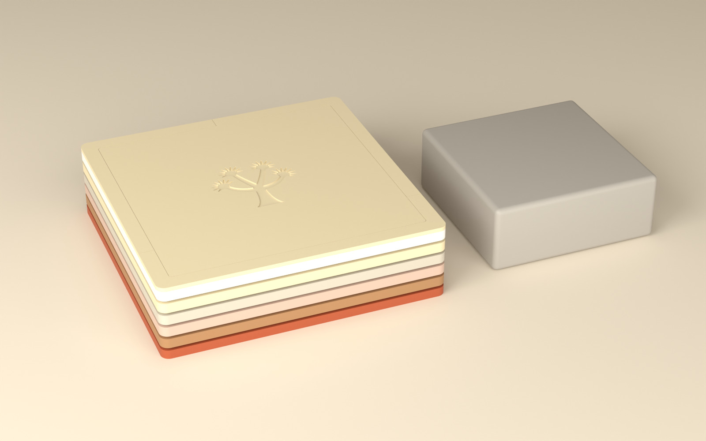
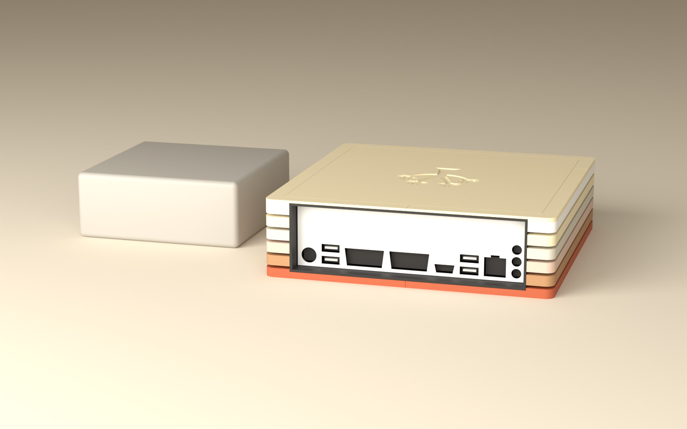
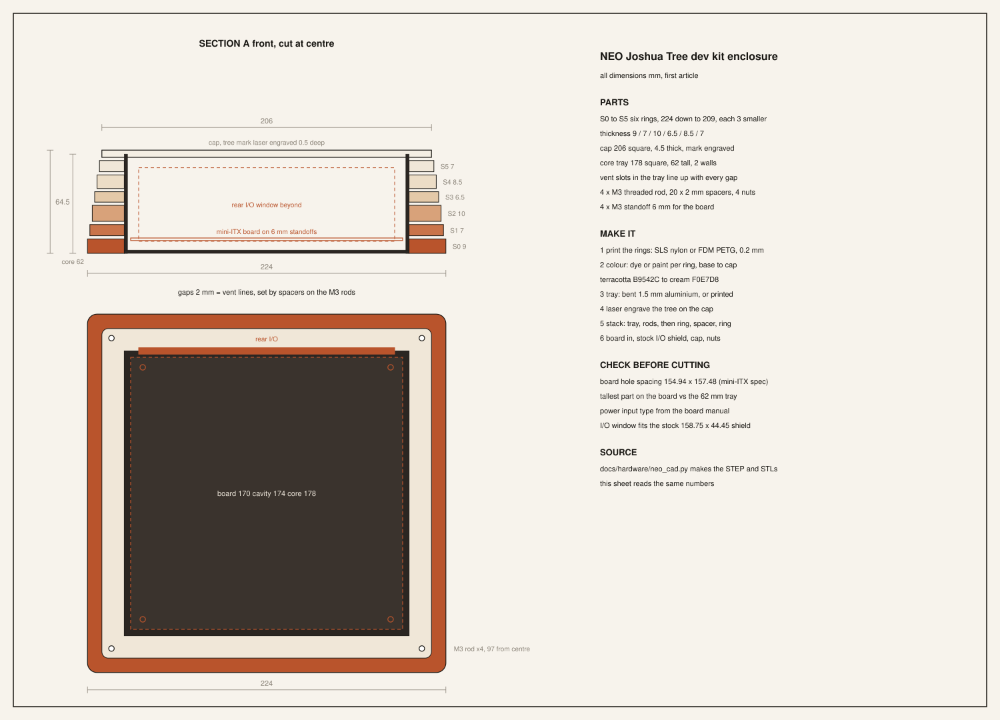
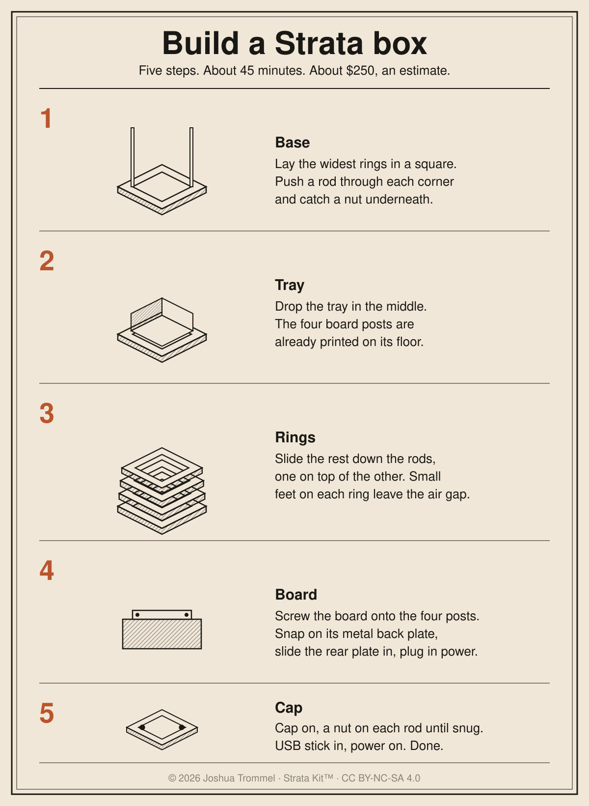

# Joshua Tree guide

How to use it, put it on a Raspberry Pi, and build the hardware.

## Contents

- [User guide](#user-guide)
- [Terminal](#terminal)
- [Samantha's agent loop on the Pi](#samanthas-agent-loop-on-the-pi)
- [The Claude app](#the-claude-app)
- [Encrypted Pi relay](#encrypted-pi-relay)
- [Raspberry Pi](#raspberry-pi)
- [Board test](#board-test)
- [Local model on the Pi](#local-model-on-the-pi)
- [Hardware plan](#hardware-plan)
- [Build a Neo box](#build-a-neo-box)
- [Printable Pi case](#printable-pi-case)
- [Samantha box](#samantha-box)
- [Breadboard prototype](#breadboard-prototype)

## User guide

Joshua Tree is a small operating system. On a Raspberry Pi 4,
it draws its own desktop, reads a USB keyboard, joins Wi-Fi and lets you ask
Samantha questions in Terminal. This guide explains one part at a time.
The first chapters cover boot, the desktop, Clock, Terminal and Wi-Fi.
Later chapters will explain memory, the screen and more apps.

### Boot: from the card to the desktop

The Pi starts with its own firmware, a small program supplied by Raspberry
Pi. It reads `config.txt` on the card and loads Joshua Tree's `kernel8.img`
into memory. Raspberry Pi OS is not involved.

Joshua Tree's first instructions choose one CPU core to run the kernel,
prepare its stack and clear the memory used by initially empty variables.
The other cores wait. The kernel then sets up memory, the screen, input
and networking, and draws the desktop. It talks to the hardware itself.

The Pi shows a terracotta splash while it boots: the tree mark in the middle and
a thin line under it that grows as the screen, the card, Wi-Fi, the clock and
Bluetooth finish. When Wi-Fi has joined or given up, the clock has synced or
given up and the radio is up (or has said it will not be), the desktop paints
once: wallpaper, menu bar, dock, no window. Any FAIL or oom line the boot prints
ends the splash at once and paints the desktop, so a failure is never hidden behind
it; a crash draws its red panel over the splash. The
boot log is kept all the same, and a click on a dock tile with no app of its
own (Mail, for one) opens the Console with it. Console shows what succeeded
and what failed. A failed Wi-Fi join does
not mean the entire OS failed: you can still use local apps. A desktop
picture proves the screen and boot path work; it does not prove every
app, key, network request or hardware driver works.

The card holds the boot image. Terminal conversations are kept in memory
and disappear when power is removed. Persistent SD saving and updates
without moving the card back to the Mac are still roadmap work.

| File | What it does |
|---|---|
| `tools/pi-config.txt` | Tells the Pi firmware how to load Joshua Tree. |
| `arch/arm64/start.S` | Runs first and prepares the CPU for the C code. |
| `arch/arm64/linker.ld` | Places the kernel's code, data and stack in memory. |
| `arch/arm64/main.c` | Starts the drivers and draws the desktop. |

### Desktop, Clock and Terminal

This chapter describes the 2.35.0 development build in PR #492. Its new
Clock and Calendar icon have QEMU checks; a real Pi check is still needed.
The card Joshua already booted is 2.34.0 and does not have these changes.

#### Open an app with the keyboard

Press F1 to open Spotlight, type an app name, then press Enter. Up and Down
choose another match; Escape closes the search. Cmd+Space opens Spotlight
too, like a Mac; Space on its own does nothing. A Mac keyboard may need its
Fn key for F1. With nothing typed, Spotlight lists every app, Calculator
included; type calc and press Enter to open it.
Some dock tiles are placeholders on the Pi. Calculator, Clock, Terminal
and Console are available; the web demo's larger app collection is separate.

#### Read the date and time

The Calendar tile shows a short month name and a large day number. Click
it, or find Calendar in Spotlight, to open the month in its own window.
Left and Right step a month, 1 to 4 pick Day, Week, Month or Year, and
Esc closes it. The Calendar chapter below says how events are saved.

To see the time clearly, open Spotlight and search for Clock. It shows the
time, date and Vancouver label. The display refreshes each minute. When
network time is unavailable, it shows `--:--` and `Waiting for network time`.
Escape or the red close button returns to the previous pane. There are no
alarms or timers yet. The timezone is fixed to Vancouver, including its
permanent UTC-7 offset from March 8, 2026.

#### Keep two conversations

Press F2 or Ctrl+T for Terminal. The Terminal and Samantha dock tiles also
open it. The prompt is `joshua@tree % `, like a zsh shell. Type a command and
press Enter; a word that is not a command prints `zsh: command not found`.
Ask Samantha with `sam QUESTION`.

Press F3 to switch between two Terminal sessions. Each remembers its typed
line, scrollback and assistant conversation until reboot. Finish or stop
a running request before switching. Browser history is shared between the
two sessions. `/clear` starts the current conversation over.

Console shows boot messages and network errors. It does not take questions.
Escape from an idle Terminal returns to Console. While the assistant is
working, Escape asks it to stop between action steps; it may have to wait
for the current network request to finish.

The Bluetooth mouse reconnects by itself after a reboot, from the pairing saved on the card; type `bt forget` to pair a different one.

#### The files behind the desktop

| File | What it does |
|---|---|
| `arch/arm64/main.c` | Draws the desktop, date icon and app search; handles app switching. |
| `arch/arm64/clock_ui.h` | Draws the Clock window and refreshes it each minute. |
| `arch/arm64/clock.c` | Obtains trusted network time. |
| `arch/arm64/ask.c` | Keeps the two assistant conversations and sends questions. |

### Wi-Fi: from switching on to asking a question

The Pi needs a network name and password before it can join your home Wi-Fi.
There is no Wi-Fi settings screen yet. You prepare the development card on
the Mac, then start the Pi with that card.

#### Prepare your development card

On the Mac, create `~/.config/joshuatree/wifi.conf` with two lines:

```text
ssid=YOUR_NETWORK_NAME
psk=YOUR_NETWORK_PASSWORD
```

Use your actual network name and password. The name can be up to 32 bytes;
the password must be 8 to 63 characters. Keep this file private with
`chmod 600 ~/.config/joshuatree/wifi.conf`. Do not put it in the repository.

From the repository folder, run `tools/flash-pi.sh` with the mounted card's
path, for example `tools/flash-pi.sh "/Volumes/PI"`. Check that this is your
development card first. The script replaces its boot files and keeps the
previous kernel and settings as `.bak` files. It does not format the card.
It ejects the card when finished. Move it to the Pi and switch on.

The flashing script includes the network name and a key derived from the
password. It also includes the relay token if one has been configured on
the Mac. The password itself is not in the image, but the derived key can
still let someone join your network. Keep the card and its image private.
A normal release build includes neither the Wi-Fi key nor the default
relay token. An explicitly supplied relay token file is a development
override, used by checks too.

#### What happens when the Pi starts

The Pi wakes its Wi-Fi chip and loads the chip's firmware, a small program
that runs inside the chip. It scans for networks, finds the configured name
and proves it knows the password through a WPA2 handshake. It then asks
your router for a local address, such as `192.168.1.20`.

The menu bar shows a Wi-Fi fan: flat ink once joined, dimmed grey until then. Open Console for the
`wifi` status lines if joining fails. A network clock is fetched after the
Pi gets an address. That clock comes from a verified HTTPS reply and cannot move behind the
build date or an already accepted time. The initial check still relies on
the build date; [the TLS setup](#encrypted-pi-relay) explains that limit.

Without a configured network, the Pi scans but does not join. Without a
successful join, Samantha cannot reach the relay. The desktop still works.

#### Ask Samantha or read a web page

Open Terminal from the dock, or press F2 (Ctrl+T also works). Type `help` for local commands.
Type `browse example.com` to read a web page as text. A bare host name uses
HTTPS. This is a text browser: pages that need JavaScript may not work.
Use `links`, `open 1`, `back`, `forward` and `find WORD` to move around.

For Samantha, the Mac must be on the same reachable network with its relay
running. Before flashing, set `CLAUDE_RELAY_HOST` to the Mac's local address
as a first guess; if the router moves the Mac, the Pi finds the relay on the
LAN by itself ([the Encrypted Pi relay section](#encrypted-pi-relay)). The relay port defaults to 8765. See [the relay setup](#the-claude-app) for the
shared token and the choice of Claude Code or an API-backed relay.

Type `sam QUESTION` in Terminal. `sam` hands the question over and gives the
prompt back at once, so you can keep typing commands while she thinks; her
answer prints as `sam: ...` above the prompt when it lands. One question
flies at a time (`sam: still thinking`), and `browse` waits for her answer.
`/status` shows the selected model, effort and
whether the relay answered last time. `/clear` starts a new conversation.
`/model haiku` selects the smaller model; `/model auto` restores routing.
`/effort low` requests a shorter, cheaper API answer. In Claude Code relay
mode the effort setting is ignored. `/help` lists these controls.

The Pi-to-relay connection requires HTTPS. Follow [the TLS setup](#encrypted-pi-relay)
to give the Mac a certificate and include its public CA on the card. An old
HTTP relay will fail until updated. Keep the relay on your trusted network;
do not expose its port to the public internet.

#### If something goes wrong

| What you see | What to check |
|---|---|
| Wi-Fi scans but never joins | Check the network name and password on the Mac, then reflash the development card. |
| `claude: no network` | Check Console's Wi-Fi lines and whether the router gave the Pi an address. |
| `claude: no token` | Configure the relay token on the Mac, then rebuild the development card. |
| `claude: error -401` | The Pi's token and the running relay's token do not match. |
| `claude: timeout` | Check that the Mac is awake, the relay is running and the configured address is reachable. |
| A web page fails with a TLS error | The certificate, host name or clock may be wrong. Do not disable certificate checks. |

#### The files behind it, in plain words

| File | What it does |
|---|---|
| `tools/flash-pi.sh` | Builds the development image and copies the boot files to your card. |
| `arch/arm64/wifi_cfg.sh` | Turns the private network settings into a key the Pi can use. |
| `tools/wifi-fw.sh` | Fetches the Wi-Fi chip's firmware for the build. |
| `arch/arm64/wifi.c` | Talks to the chip, scans and joins the network. |
| `drivers/net.c` | Handles addresses and moves packets between machines. |
| `arch/arm64/ip.c` | Connects the shared network code to the Pi. |
| `arch/arm64/clock.c` | Sets the clock from verified HTTPS and refuses time rollback. |
| `drivers/http.c` | Sends plain web requests and reads their replies. |
| `arch/arm64/tls.c` | Checks certificates and encrypts HTTPS web requests. |
| `arch/arm64/browser.c` | Turns a web page into readable text and numbered links. |
| `arch/arm64/claude_cfg.sh` | Includes the relay address and token in a development build. |
| `arch/arm64/ask.c` | Sends your question and shows Samantha's answer. |
| `tools/claude-relay/relay.py` | Receives the question on the Mac and asks Claude to answer it. |

For the technical map and checks, see [Architecture](ARCHITECTURE.md#architecture),
[Terminal](#terminal) and [the Pi security review](ARCHITECTURE.md#security-on-the-pi).

### Restart or shut down the Pi

The 2.36.0 development build adds keyboard power controls. Press
Type `reboot` or `shutdown` in Terminal, or press Ctrl+Alt+Delete to restart, or Ctrl+Alt+End to shut down. On a Mac keyboard,
Alt is Option and End may require Fn+Right. Terminal asks for confirmation:
Enter proceeds, Escape cancels. Ordinary letters do not confirm. Wait for
Samantha to finish an active request first.

Conversations are still held in memory and will be lost. Shutdown asks the
firmware to power down the SD interface and halt; it does not remove the
board's physical power supply. Restart boots the OS again. These paths
pass in QEMU; confirm them on the board before relying on them. The current
card has not been updated.

### Drag a window

Press on a window's title bar between the dots and move the mouse: the Console, Terminal, Browser, Clock and Brick windows follow the pointer and stop at the menu bar, the screen edges and the dock. The Calculator and app windows stay where they open. Released in 3.6.0.

### Play Brick

The 2.37.0 development build adds an original brick-breaker game. Open
Spotlight with F1, type Brick and press Enter. Move the paddle with Left
and Right, A and D, or the mouse inside the playfield. Space or a click
launches the ball. Clear all 32 bricks before losing your three lives.

Space or click pauses and resumes. R starts a new game. After a win or
game over, Space starts again. Escape or the red button closes the game;
opening another app closes it too. Spotlight temporarily suspends the
animation while you search. Scores are not saved and the game is silent.
QEMU checks pass; play on the real board is still pending.

#### Short messages in the Pi menu bar

A Wi-Fi join and a Brick result appear beside the clock for four seconds. A new message replaces the old one. Messages do not take the keyboard or mouse away from your app. Released in 2.40.0; a board check remains.

### Screen sleep on the Pi

In 2.41.0, five minutes without keyboard or mouse activity blanks the HDMI picture. Press a key or move the mouse to wake it; that input still reaches the app. Brick and an active Samantha request keep the screen awake. Apps, USB and networking keep running; this does not suspend the computer or save your files.

QEMU checks the idle timer, refused requests and both input paths through the firmware mailbox. QEMU acknowledges blanking without hiding its pixels, so HDMI sleep and wake still need a physical Pi test after flashing. The browser demo keeps its existing behavior.

### The apps and tools, one at a time

This part describes what is on main now (3.6.0). Every app and command below passes its checks in QEMU. Only some of it has been seen on the real board: the Pi row of [the architecture picture](../architecture.svg) shows which. Open any app with F1 and its name, as described above. Your files live in the card's `JT/` folder.

#### Terminal and the shell

Press F2 or Ctrl+T. The prompt is `joshua@tree % `. Type a command and press Enter. A word that is not a command prints `zsh: command not found: WORD`. Page Up, Page Down, Home and End scroll what has printed.

The commands that work today:

| Command | What it does |
|---|---|
| `help` | Lists the commands. |
| `sam QUESTION` | Asks Samantha. See the Samantha chapter. |
| `ls`, `ls DIR`, `cat NAME` | List the card's files and print the first 4096 bytes of one. |
| `write NAME.EXT TEXT`, `rm NAME`, `mkdir NAME` | Make a text file, remove a file, make a folder. All three work inside `JT/` only. The name needs a dot and keeps to the old 8.3 shape. |
| `browse`, `open`, `back`, `forward`, `reload`, `links`, `more`, `up`, `down`, `top`, `bottom`, `find` | The text browser. See the Browser chapter. |
| `bt` | Bluetooth. See the Bluetooth chapter. |
| `beep`, `vol` | `beep` plays a short tone. `vol 40`, `vol up` and `vol down` set the volume from 0 to 100. |
| `userrun NAME` | Starts a user program by name, for testing. |
| `llm PROMPT` | Asks the tiny model built into the kernel. A normal release has no model inside, so it stays quiet. |
| `reboot`, `shutdown` | Restart or switch off. Typing the word is the confirmation. |

`reboot` and `shutdown` ask the firmware to restart or halt. Shutdown stops the board but does not cut its power. Both are refused while Samantha is answering.

While Samantha is answering, the network commands (`browse`, `open`, `back`, `forward`, `reload`, `llm`, `bt` and `userrun`) wait. You get `zsh: sam is using the network, try again when she answers`. Other commands keep working.

#### Browser

Open it from Spotlight. It starts with the address bar ready. Type an address and press Enter. A bare name such as `example.com` uses HTTPS. Page text appears in Tree Sans, and links are drawn in terracotta.

- **Tab, then Enter:** Tab picks the next link and scrolls it into view. Tab again wraps back to the first. Enter follows the picked link. A click on a link works too.
- **Scrolling:** Up and Down move a line. Page Up and Page Down move a page. Home and End jump to the top and bottom. The mouse wheel scrolls three lines at a time.
- **Moving around:** Alt+Left is back, Alt+Right is forward, F5 or Ctrl+R reloads. Ctrl+L, or just typing a letter, starts a new address. The Back, Forward and Reload buttons work with the mouse.
- **Esc:** it leaves the address bar first. Esc again closes the window.

The HTTPS part knows 37 root certificates. A site signed by anyone else fails with a TLS error, and that is on purpose.

What does not work yet: JavaScript, images and styled layout. A page that needs them shows as plain text or not at all. It keeps up to 8 KB of text, 32 links and 8 pages of history. The status line says in plain words when a page did not load.

#### Books

Books reads plain text. It lists every `.TXT` file in `JT/BOOKS/`. Up and Down pick a book. Enter opens it. Esc closes the app.

In a book, Right or Space turns a page and Left goes back. Esc returns to the list. The page number is saved next to the book, as `NAME.POS`, so the book opens where you stopped. A book over 3 MB is refused with a message. Drop your own `.TXT` files into `BOOKS/` from the Mac.

#### Music

Music plays `.WAV` and `.MP3` files from `JT/` and `JT/MUSIC/`. It shows the title and artist from an MP3's tag, the length, and the cover picture when there is one.

Space plays and pauses. Left and Right seek 5 seconds. Up and Down change the volume. N and P go to the next and previous song. S turns shuffle on, and R cycles repeat through off, all and one. You can also click a song or a button, click or drag the seek bar and the volume bar, and scroll the list with the wheel. Esc closes it.

A song over 3 MB is refused. The sound comes out of the headphone jack, which a real board has not yet confirmed.

#### Notes

Notes keeps plain text files in `JT/NOTES/`. The left column holds folders and the right column holds notes. Each note shows its first line.

Up and Down pick. Enter opens a folder or a note. Tab swaps columns. N makes a note. F makes a folder. D then D again deletes the selected note, and any other key cancels. Esc closes the app.

In a note, type as usual. Shift with the arrows selects, Ctrl+A selects all, and copy, cut and paste work. A note saves one or two seconds after you stop typing. Esc saves and goes back to the list. Ctrl+S saves and stays.

#### Calendar

The Calendar has four views: press 1 for Day, 2 for Week, 3 for Month and 4 for Year. Left and Right step by the view's own unit. Up and Down step too. T jumps to today. The square bracket keys move the selected day by one.

Enter edits the one event for the selected day. Type and press Enter to keep it. Events are saved as lines in `JT/EVENTS.TXT`, one event per day. Esc closes the app.

#### Clock

Open Clock from Spotlight. It shows the time, the date and the Vancouver label, and refreshes each minute. It gets the time from the network, so before Wi-Fi joins it shows `--:--` and `Waiting for network time`. There are no alarms or timers. Esc closes it.

#### Samantha

Samantha is the assistant. On the Pi you reach her from Terminal with `sam QUESTION`. The Samantha dock tile opens that same Terminal.

She does not run on the Pi. The Pi sends your question to a small program called the relay, running on your Mac. The relay asks the model and sends the answer back. The link is HTTPS with a pinned certificate and a shared token. If the Mac is off, or Wi-Fi is down, she cannot answer. [The Wi-Fi chapter](#wi-fi-from-switching-on-to-asking-a-question) covers the setup.

`sam` hands the question over and gives the prompt back, so you can keep typing. Her answer prints as `sam: ...` when it lands, followed by one line like `sam: 27.4s (find 0.0, tls 0.8, wait 26.6)` that says where the time went: finding the relay, the secure connection, and waiting for the answer. Plain sums such as `sam 10+10` or `sam "2*(3+4)^2"` are worked out on the Pi at once and never leave it. She asks for one or two sentences unless you ask for detail. The Pi remembers the relay that last answered, in memory and in `JT/RELAY.TXT` on the card (an address, no token), so only the first question after the relay moves has to search the network. If nothing comes back in 30 seconds you get `sam: no answer in 30s (relay at 10.0.0.116)` and the prompt is free again. She can also act: a reply can add a note or blink the green light. A model that runs on the Pi itself is planned. Until then, there is only the kernel's tiny `llm` model, and a release build does not carry one.

#### Bluetooth

The Pi has a Bluetooth radio and can pair one Bluetooth mouse. Put the mouse in pairing mode, then:

1. Type `bt scan`. It listens for 5 seconds and lists what it hears, numbered, mice first.
2. Type `bt pair 1`, using the number of your mouse. `bt pair` alone picks the strongest mouse. `bt pair NAME` picks by name.
3. Move the mouse. The arrow follows it and clicks work.

When the pairing finishes, the Pi writes it to `JT/BTPAIR.BIN` on the card. On the next boot it reconnects to that mouse by itself, with no scan. Wake the mouse if it sleeps: the Pi keeps trying (12 seconds at a time, with growing pauses, up to 30 tries) and tries again whenever the mouse drops off, so a sleeping mouse comes back with a click. After the 30 tries, `bt reconnect` starts a new run.

`bt status` (or `bt` alone) shows the radio's state, whether it is searching, connected or idle, the saved mouse with only the last byte of its address, how many tries it made and the last error, and whether a pairing is saved. `bt forget` deletes the saved pairing. Then run `bt scan` and `bt pair` to pair a different mouse. Without an SD card the pairing works until the next reboot. The mouse has only been tested against a fake radio so far.

### Other ways to run it

- **PC USB stick:** download the latest ISO and `SHA256SUMS` from the [release page](https://github.com/nulljosh/joshuatree/releases/latest), which has the copy steps. BIOS boot is checked in QEMU. UEFI and real PC hardware are not verified.
- **Talk to Samantha on a Mac:** run `make talk`, then hold F2. It needs a mic (see `user/samantha.c`). Voice on the real Pi is not verified: no speaker has been tested there.
- **Samantha on the Pi:** she answers at the console through a relay on your Mac that uses the Claude API. You need your own API key. It stays on the Mac and never goes on the Pi. See [the Pi guide](#raspberry-pi).
- **Ask Claude Code:** run the relay on your Mac and open Claude from the Launchpad. See [the Claude app](#the-claude-app).
- **Other make targets:** `make samantha`, `make talk`, `make iso`.
- **Real Pi 4 numbers:** memcpy 1109 MB/s, alloc 30 ns/op, Wi-Fi joined in 6.4 s. The full table is in [`ARCHITECTURE.md` (Benchmarks)](ARCHITECTURE.md#benchmarks).
- **Version 3.0** is the Pi release. It cuts the day the board boots the desktop and you can type and click on it ([the plan](ROADMAP.md#loop-handoff)).

## Terminal

The ARM desktop has a Console and two Terminal sessions in the same spot. One is in front at a time.

**Console: logs only.** Boot messages, Wi-Fi and errors. It has no input row, and typing with it in front does nothing (the key echoes go to the UART only). It opens at boot, because on a Pi with no serial cable it is the only debug view. Page Up, Page Down, Home and End scroll it.

**Terminal: the command line.** Its bottom row is a zsh style prompt, `joshua@tree % `. Type, Backspace, Enter. Every command runs here and prints here, above the prompt, in 53-column lines. Page Up, Page Down, Home and End scroll it too. F3 switches between Terminal 1 and 2. Each keeps its own typed line, scrollback, relay conversation, model and effort. A running request must finish or be stopped before switching. These are two views in one window; side-by-side panes remain future work.

| Command | What it does |
|---|---|
| `browse URL` | Fetches a page and prints it as text with numbered links |
| `open N` | Follows link N of the last page |
| `beep [FREQ MS]` | Plays a tone out of the Pi's 3.5 mm jack |
| `vol [0-100\|up\|down]` | Shows or sets the master volume (default 70); up and down step by 10 |
| `llm PROMPT` | Runs the local model, if the image has one |
| `bt`, `bt scan`, `bt pair` | Bluetooth: where the radio is and its version; a 5 second scan listing what it hears; pairing the mouse from that scan so it drives the pointer ([the Raspberry Pi section](#raspberry-pi)) |
| `ls [DIR]` | Lists the SD card's boot partition (its root, or `ls JT`; 8.3 names and sizes) |
| `cat NAME` | Prints the first 4 KB of a file there as text (`cat JT/NOTE.TXT` one folder down) |
| `write NAME.EXT TEXT` | Makes or replaces `JT/NAME.EXT` holding TEXT; boot files are refused |
| `rm NAME`, `mkdir NAME` | Deletes the file `JT/NAME`, or makes the folder `JT/NAME` |
| `sam QUESTION` | Asks Samantha through the relay on the Mac and returns at once; her answer prints as `sam: ...` when it lands. Only one at a time (`sam: still thinking`); `sam` alone prints the usage. While she thinks, other commands run, except `browse`, `open`, `back`, `forward`, `reload`, `llm`, `bt` and `userrun`, which wait for her |
| `reboot` (or `restart`), `shutdown` (or `poweroff`) | Restarts or powers off the Pi at once. Typing the word is the confirmation; while Samantha is answering it says to wait. The chords Ctrl+Alt+Delete and Ctrl+Alt+End still ask first. |
| anything else | Prints `zsh: command not found: WORD` |

The Samantha dock tile and Spotlight's Samantha entry open this same Terminal on the ARM build; type `sam` there. The chat view on the i386 build is unchanged.

### Getting there

- Click the Terminal or Samantha tile in the dock, or press F2 (or Ctrl+T). Esc, with no question running, goes back to the Console.
- Calculator opens its own window; Clock opens through Spotlight. Other placeholder dock apps bring the Console back. The red dot closes the window in front.
- With no screen at all, F2 still moves the keyboard to the Terminal, and the UART shows everything.

The UART gets every line from both windows, unchanged. The QEMU checks read it there.

### Keys

No mouse is needed. The desktop's keys, in `arch/arm64/main.c` (`ui_key`); `tools/checks/arm64-keys-check.py` presses each one:

| Key | Does |
|---|---|
| F1, Cmd+Space | Toggle Spotlight: press again to close. Type to filter app names, including Clock (prefix or any part), Up and Down choose, Enter opens, Esc closes |
| A letter or digit | With no pane holding the keys, Spotlight with that character already typed |
| Enter, Space, Tab | With no pane holding the keys and no dock label, Spotlight, empty |
| F2, Ctrl+T | The Terminal, at once, closing Spotlight if open; it has the keyboard |
| F11, F12 | Volume down and up by 10 (0 to 100), before any pane. The menu bar says "Volume N" and the speaker clicks. The Mac media keys Volume Down, Volume Up and Mute do the same (Mute toggles 0 and the last level) |
| F3 | Switch Terminal session when no request is running |
| Left, Right | With no pane holding the keys, move the dock's label along the tiles |
| Enter | Open the labelled tile |
| Esc | Clear the label; with the Terminal in front, back to the Console. While a question runs it stops the agent instead. With nothing open it does nothing |
| Caps Lock | Letters come out capital until you press it again, and Shift flips them back; digits and punctuation ignore it. It works in the Terminal, the Calculator and Spotlight. No keyboard light yet |
| A key held down | A letter, digit, Space or Backspace types again after 400 ms, then every 80 ms, in whatever got the first press, until you let go or press another key. F-keys, Enter, Esc, arrows and Ctrl, Cmd or Alt chords never repeat. A USB keyboard sends a held key once, so `main.c` does the repeating |
| Page Up, Page Down, Home, End | Scroll the window in front |

Mac-style USB keyboards: Cmd is the GUI modifier (0x08 left, 0x80 right in the boot report). A top row in Mac mode sends F1 and F2 as brightness down and up on a second HID interface; `xhci.c` listens there and turns those into F1 and F2. A keyboard that sends a report ID in front of its report (9 bytes) is read past the ID. `tools/checks/arm64-keydbg-check.py` covers all of it over USB.

A dev card (`JT_WIFI_DEV=1`) shows the last raw HID report in hex and the key's name in the menu bar for 3 seconds after each key, for real-board tests. Release builds leave it out.

A release build has no relay token. Claude then answers `samantha: no token`, and the other commands still work. Only the dev card that `tools/flash-pi.sh` writes carries a token. The token comes from a file outside the repo and is never printed.

### Code and checks

- `arch/arm64/main.c`: the two windows, F1 and the dock tile.
- `arch/arm64/ask.c`: the prompt and the commands.
- `tools/checks/arm64-claude-console-check.py`: typing at the Console asks nothing, the Terminal answers, and the answer is not in the Console.
- `tools/checks/arm64-mouse-check.py`: the Terminal tile opens the Terminal with its prompt.

Next: several Terminals side by side. Browser navigation state is still shared; AI conversation state is separate. Sessions live in memory and reset on reboot.

## Samantha's agent loop on the Pi

Samantha answers at the Terminal prompt on the Pi through the relay (`tools/claude-relay/relay.py`). Since the agent loop she can also act on the Pi and see what happened. This page says what she can do and where it stops.

### The loop

1. You type a question. The Pi posts it to the relay with its live status (address, clock, Wi-Fi bars).
2. The answer is printed. If it ends with action lines, the Pi runs them, in order, and prints each outcome.
3. What the actions printed goes back to the relay as the next turn, in the same session ("The Pi ran your actions. Results: ..."). Samantha reads it and answers again, with or without more actions.
4. This repeats until an answer has no actions, or the step limit is reached.

Every step prints `agent: step N` in the Terminal, so a photo of the screen or the UART log shows how far it went.

### Actions

Each action is alone on its own line at the end of an answer, inside `[[ ]]`, at most 80 characters.

| Action | What the Pi does |
|---|---|
| `[[note TEXT]]` | Prints TEXT as `pi: TEXT`. |
| `[[say TEXT]]` | Prints TEXT as `say: TEXT`. A caption: the ARM build has no voice yet. |
| `[[led blink]]` | Blinks the green light (on QEMU: `pi: no green light on QEMU`). |
| `[[open APP]]` | Opens an app by name. Only the Calculator opens on ARM so far; other names print `pi: no app named ...`. |
| `[[browse URL]]` | Fetches an `http://` or `https://` page through the Terminal browser and prints it as text. Any other scheme is unknown. |
| `[[calc EXPR]]` | Works out EXPR with the Calculator's evaluator and prints `calc: EXPR = RESULT`. |
| `[[status]]` | Prints the Pi's address, clock and Wi-Fi bars. |
| `[[save NAME]]` | Saves the answer's first ``` code block to `JT/NAME` on the SD card, so `cat JT/NAME` shows it. Only a name the person typed in the question, only an 8.3 name, never a boot file. |
| `[[list]]` | Lists the files in `JT/` on the SD card, one line each with its size, and sends the list back to her. Read only. |
| `[[read NAME]]` | Prints the first 4 KB of `JT/NAME` (an 8.3 name, no path) and sends it back to her, so she can read, explain or edit what she saved. Read only. |

Only `[[save]]` changes a file, and only one the person named in their own question, inside `JT/` (the boot files are refused). Nothing changes a file on the Mac. For anything else the relay's prompt tells Samantha to ask first and explain what would change.

### Limits

- 4 actions per answer. A fifth stays in the text and does not run.
- 5 steps per question. The fifth ends with `agent: step limit`.
- 80 characters per action; longer ones stay in the text.
- The results sent back are cut at 1200 characters.
- An action the Pi does not know prints `agent: ignored [[...]]` and does nothing.
- Esc, or typing `stop` and Enter, while a question runs ends the loop at the next step with `agent: stopped`. At rest, `stop` says `agent: nothing running`.

### The relay side

In `--turing` and `--api-key-file` mode the relay keeps the last 24 messages of each session, so a result turn lands in the conversation it belongs to. In `claude -p` mode the session resumes as before. The `SAMANTHA` prompt lists the actions, says when each helps (browse for a live page, calc for sums, status when asked about the Pi), and states the ask-before-changing-files rule.

### Model and effort

Typed at the Terminal prompt, these run on the Pi and are never sent to Samantha.

| Command | What it does |
|---|---|
| `/model` | Lists `auto haiku sonnet opus` with the current one in brackets. |
| `/model NAME` | Picks one. `auto` keeps the relay's own pick (`pick_model`: short and easy goes to Haiku, hard words or a long question to Sonnet, design and security to Opus). |
| `/effort` | Lists `low medium high`, current in brackets. |
| `/effort LEVEL` | Picks one. `medium` is the default. |
| `/status` | Model, effort, the prompt text, whether the relay answered last time (or no token, or no network), steps used since `/clear`. |
| `/clear` | Empties the Terminal window and starts a new conversation (a new relay session). The model and effort stay. |
| `/help` | Lists these. |

A value that is not on the list prints one line (`model: not one of auto, haiku, sonnet, opus`) and nothing is sent. An unknown slash command prints `unknown command, try /help`.

The settings belong to the Terminal, the one place a question is typed on the Pi. The ARM build has no panes yet; when it does, each pane gets its own copy of these two settings and starts from `auto` and `medium`. (The i386 Panes app has no relay.)

The prompt shows the model that answered last, from the relay, and the effort only when it is not the default: `Claude Opus 5.5 high $`. Before the first answer it shows the choice (`Claude opus $`, `Claude auto $`). A reply's first line is `S <uuid> <model name>`.

On the wire the request gets `"model"` and `"effort"` only when they are not `auto` and `medium`. The relay accepts exactly those words and answers 400 `Unknown model or effort.` to anything else, even a real model id; the id used comes from its own flags (`--api-model` for haiku, `--api-model-hard` for sonnet, `--api-model-top` for opus). Absent fields keep the old behaviour.

What effort means in `--api-key-file` mode:

| Effort | Thinking budget | Max tokens |
|---|---|---|
| low | none | 300 |
| medium | none | 600 |
| high | 2048 | 4096 |

In `claude -p` mode the model word becomes `--model haiku|sonnet|opus`, and effort has no effect (that mode has no such knob). `high` costs more and takes longer.

### Keys and release builds

A Pi image carries the relay token only when built with `JT_WIFI_DEV=1`, the same flag that carries the Wi-Fi key (`tools/flash-pi.sh` sets it for the dev card). A release image has no relay config and the Console says `claude: no token`. QEMU builds are unchanged.

### Checks

- `tools/checks/pi-actions-check.py`: the parser, compiled on the host.
- `tools/checks/arm64-agent-check.py`: the loop under QEMU against a fake relay: browse then answer, the two caps, Esc, unknown actions.
- `tools/checks/arm64-model-check.py`: `/model`, `/effort`, `/status`, `/clear` under QEMU against a fake relay, including a refused value that is never sent.
- `tools/checks/claude-relay-check.py`: also the relay's model and effort whitelist and the thinking budget it sends.
- `tools/checks/pi-release-notoken-check.sh`: the release rule.
- `tools/checks/arm64-claude-console-check.py`: the `sam QUESTION` path still works.

## The Claude app

Claude is an app in the Launchpad. You type a question, Claude Code answers in the window. Ask it about the code in this repo and it reads the files to answer.

### How it works

The i386 app has no native TLS or Node. Claude Code needs both. So Claude Code does not run on Joshua Tree. It runs on your Mac, and Joshua Tree talks to it.

The piece in the middle is the relay, `tools/claude-relay/relay.py`. It is one Python file, standard library only. Joshua Tree sends it a plain HTTP POST. The relay runs `claude -p` (headless Claude Code, on your own logged-in plan) and sends the answer back as plain text.

```
Claude app (ring 3) -> kernel, SYS_HTTP_POST -> relay on your Mac -> claude -p -> answer
```

The relay keeps a session id for each conversation, so a follow-up question knows what came before. Type `/new` in the app to start over.

The relay has three backends. Pick one when you start it.

- No flag: `claude -p`, on your logged-in Claude plan.
- `--turing`: Samantha, Joshua's own model from the turing repo. Start `./.venv/bin/python app/serve.py` there first; the relay talks to it at `http://127.0.0.1:8127` (or the URL after the flag). No account and no credit. `/status` on the Pi says Samantha. If Turing is not running, the relay answers 502: "Samantha is not running on the relay machine."
- `--api-key-file FILE`: the Messages API, paid from a Claude Platform credit. It refuses to start unless `--allow-api-spend` is also given, so an old script cannot spend a topped-up credit. With both `--turing` and `--api-key-file`, Turing answers.

### Run it

Make a token once and keep it private:

```sh
openssl rand -hex 24 > ~/.claude-relay-token && chmod 600 ~/.claude-relay-token
```

Start the relay from the repo root:

```sh
python3 tools/claude-relay/relay.py --token-file ~/.claude-relay-token
```

It listens on `127.0.0.1:8765`. QEMU's network reaches your Mac's loopback at `10.0.2.2`, so boot with a network card:

```sh
make kernel.elf
qemu-system-i386 -kernel kernel.elf -vga std -net nic,model=rtl8139 -net user
```

In Joshua Tree open Settings, then Assistant. Set **Claude relay** to `10.0.2.2` and port `8765`. Set **Claude token** to the text in `~/.claude-relay-token`. Open Claude from the Launchpad and ask.

To try it without typing into Settings, the boot line can carry the three values for one boot: `-append "open=claude claudehost=10.0.2.2 claudeport=8765 claudetoken=$(cat ~/.claude-relay-token)"`. That puts the token in your shell history and process list, so use it for testing only.

### Security

The relay is a command-capable agent behind an HTTP port. Anyone with the token can make Claude read your files and spend your plan. Treat the token like a password.

What keeps that small:

- **Loopback only.** The relay binds `127.0.0.1` unless you pass `--lan`. QEMU does not need the LAN.
- **A token, checked in constant time.** No token, no start: it must be 16 to 63 characters. It comes from a file or an environment variable, never the command line. A wrong or missing token gets 401 and Claude never starts.
- **The app never holds the token.** Settings keeps it and the kernel adds the `Authorization` header itself, only for `/api/claude` on the relay host. The relay host is its own setting, never the Samantha host, so the token cannot leak to the internet by default.
- **Read-only tools.** Claude gets Read, Grep and Glob, scoped to the repo. Everything else is denied, not asked. None of your MCP servers, hooks or plugins load.
- **Limits.** One question at a time. A 4 KB request cap. A hard timeout, default 150 seconds, after which the whole Claude process tree is killed.
- **Quiet logs.** One line per request: method, path, status, sizes, seconds. Never the token, never a prompt.

What it does not protect against:

- **Your repo is readable.** Claude can read every file under the relay's `--cwd`. Keep secrets out of it, or point `--cwd` somewhere smaller.
- **LAN requires TLS.** `--lan` is refused without `--tls-cert` and `--tls-key`. The Pi uses HTTPS with no HTTP fallback. See [encrypted Pi relay](#encrypted-pi-relay) to update the relay and card together. Default loopback HTTP remains for i386 and QEMU. The i386 app cannot use a TLS LAN relay yet.
- **The token sits in `SETTINGS.TXT`.** Like the Mail token, it is plain text on the Joshua Tree disk. See `docs/ARCHITECTURE.md` (Threat model).
- **`--tools` can widen it.** Passing write tools turns it into an agent that changes files. The relay warns you, loudly.

### What it cannot do yet

This is phase 1. Claude Code runs on the host, through the relay. Joshua Tree is the front end. That is all.

- **No tools on Joshua Tree itself.** Claude cannot read or change Joshua Tree's own files. That is phase 2. It needs real TLS on the OS, or a trusted relay protocol where the relay calls back into the machine, with the same care as this one.
- **Not on the Raspberry Pi yet.** It works in QEMU and on any i386 machine with a supported network card. The ARM64 build has no apps yet, but its Terminal can ask the same relay (below). On a real Pi that waits on Wi-Fi.
- **Not in the browser demo.** The demo on the landing page cannot reach a relay on your network. The app says so in one red line, at once, and never waits.
- **One answer at a time, no streaming.** The answer arrives whole. While it waits, Weather and Stocks refreshes wait too. The desktop keeps running.
- **Up to 8 KB of answer.** Longer answers are cut. Curly quotes and dashes become plain ASCII, because the OS fonts are ASCII.
- **Sessions live in the relay.** Restart the relay and the next question starts a fresh conversation.

### Samantha's voice (text to speech)

The relay can turn text into speech for the Pi. The Pi side that plays it comes later. The relay half works now.

`POST /api/tts` takes the same `Authorization: Bearer` token and the same TLS rules as `/api/claude`. Send `{"text": "..."}` (or plain text). A good answer is raw audio: signed 16-bit little-endian, mono, 22050 Hz, no header. This is ElevenLabs' `pcm_22050`. The reply carries `X-Sample-Rate: 22050`.

- **The key stays on the Mac.** Put it in `~/.config/joshuatree/elevenlabs.key` and run `chmod 600` on it. The relay refuses a key file that others can read. Use `--tts-key-file` for another path. The key is never in a request, a reply or a log. If ElevenLabs fails, the Pi only sees a status code.
- **Caps.** 400 characters per request and 5000 per day by default (`--tts-max-chars`, `--tts-daily-chars`). Over the per-request cap is 413. Past the daily cap is 429. Neither calls ElevenLabs. The day is the Mac's local date. The count lives in `~/.config/joshuatree/tts-usage.json` (`--tts-usage-file`), so a restart does not reset it. A failed ElevenLabs call gives its characters back.
- **Voice.** Samantha's voice id, `EXAVITQu4vr4xnSDxMaL`, is the default. Change it with `--tts-voice`. The model is `eleven_flash_v2_5` (`--tts-model`).
- **Other statuses.** 400 for empty text, 503 when the key file is missing or not private, 502 when ElevenLabs fails, 429 while another voice request runs.
- `--tts-base` points the relay at a stub for tests. It must be https, or http on loopback.

### On ARM64: Claude in Terminal

The Pi uses HTTPS for its relay requests. Certificate setup and the clock bootstrap limits are in [the Encrypted Pi relay section](#encrypted-pi-relay). QEMU defaults to loopback HTTP; `CLAUDE_RELAY_TLS=1` exercises the HTTPS path.

The ARM build has no apps yet, so it asks from its Terminal window instead (the dock tile or F1, see [the Terminal section](#terminal)). Type `sam QUESTION` at the prompt on the bottom row (`joshua@tree % `) and press Enter; the prompt comes back at once and the answer prints in the Terminal as `sam: ...` when it lands. `/status` names the model that last answered. It talks to the same relay with the same token, read at build time from the same token file (or the file named by `CLAUDE_RELAY_TOKEN_FILE`), with the host and port from `CLAUDE_RELAY_HOST` and `CLAUDE_RELAY_PORT`. The token is compiled into the image and kept out of git, so treat a built Pi image like the token itself. It works on QEMU's virt machine today. A real Pi says `claude: no network` until Wi-Fi joins. Details: the Claude section of [`ARCHITECTURE.md` (ARM64 and the Raspberry Pi)](ARCHITECTURE.md#arm64-and-the-raspberry-pi).

### Checks

- `tools/checks/claude-relay-check.py` runs the relay against a stub `claude`: token refused and accepted, session resume, the exact read-only command line, the prompt on stdin, the timeout kill, the size cap, one at a time, and clean logs, and the second reply line, `M <model>`, that the Pi's prompt shows. It also runs a copy with the token check removed and proves a tokenless request then gets through.
- `tools/checks/arm64-claude-console-check.py` boots the ARM build with the real relay and the stub: `sam QUESTION` typed at the Terminal's prompt gets the answer printed as `sam: ...` in 53-column lines, a follow-up resumes the session, `/status` names the model the relay said answered, and a wrong token, no network and no token each print their own line.
- `tools/checks/ring3claude-check.py` boots QEMU with the real relay and the stub: the answer is drawn, the session resumes, a wrong token, a stopped relay and no relay at all each show the red line.
- `tools/checks/relay-tts-check.py` runs the voice endpoint against a stub ElevenLabs server: PCM returned, both caps refused without a call, the count kept across a restart, the key never in a response, header or log, and a tokenless request refused.

## Encrypted Pi relay

The Pi's Terminal sends its relay token over HTTPS. It refuses a plain HTTP
relay and never retries with an unencrypted request. The i386 app and default
QEMU Terminal still use HTTP on the Mac's loopback address. The i386 app
cannot connect to a TLS LAN relay; its remote LAN use needs a separate
transport upgrade.

Do not restart your existing relay or reflash a card until the change is
approved and its checks pass. The old development card uses HTTP and will
need updating together with the relay.

### Prepare certificates on the Mac

Use a private certificate authority (CA), then give the Pi only its public
certificate. Keep the CA key and server key on the Mac. The commands below
use OpenSSL and create files under `~/.config/joshuatree/relay-tls`.

The server certificate names `jt-relay`, not an address. The Pi checks that
name and our CA, whatever IP the relay answers from, so the Mac's address no
longer has to match anything. Since 2.46.0 the relay is trusted only through
this CA (`TLS_TA`): a certificate from a public root is refused even if it
names `jt-relay`.

```sh
mkdir -p ~/.config/joshuatree/relay-tls
chmod 700 ~/.config/joshuatree/relay-tls
cd ~/.config/joshuatree/relay-tls
umask 077
openssl req -x509 -newkey rsa:2048 -nodes -days 365 -subj '/CN=Joshua Tree relay CA' -addext 'basicConstraints=critical,CA:TRUE' -addext 'keyUsage=critical,keyCertSign,cRLSign' -keyout ca.key -out ca.pem
openssl req -new -newkey rsa:2048 -nodes -subj '/CN=jt-relay' -keyout server.key -out server.csr
```

Create `server.ext` in that folder:

```text
basicConstraints=critical,CA:FALSE
keyUsage=critical,digitalSignature,keyEncipherment
extendedKeyUsage=serverAuth
subjectAltName=DNS:jt-relay
```

Then sign the server certificate:

```sh
openssl x509 -req -in server.csr -CA ca.pem -CAkey ca.key -CAcreateserial -days 30 -sha256 -extfile server.ext -out server.pem
```

A certificate made for an IP before 2.46.0 is refused now, even from the
right CA: mint this one before reflashing. Do not copy either private key
onto the card or into git. `tools/checks/arm64-relay-discovery-check.py`
makes its throwaway certificates with these same commands.

### Update the relay and card together

From the repository root, start the reviewed relay with TLS:

```sh
python3 tools/claude-relay/relay.py --lan --turing --token-file ~/.claude-relay-token --tls-cert ~/.config/joshuatree/relay-tls/server.pem --tls-key ~/.config/joshuatree/relay-tls/server.key
```

`--turing` answers as Samantha from Turing's `app/serve.py`, so start that
first. Leave it off to use `claude -p`. `--api-key-file` uses the Messages
API and spends its credit, so it also needs `--allow-api-spend`. `--lan` without both certificate flags is refused. Default loopback
HTTP still works for existing i386 and QEMU checks.

Flash your development card with the public CA. `CLAUDE_RELAY_HOST` is now
only a first guess; the Mac's current address saves one probe:

```sh
CLAUDE_RELAY_HOST=192.168.1.10 TLS_TA="$HOME/.config/joshuatree/relay-tls/ca.pem" tools/flash-pi.sh "/Volumes/PI"
```

Use your actual development-card path. The script replaces its boot files.
A Pi build always uses TLS for relay requests. For a QEMU TLS build, set
`CLAUDE_RELAY_TLS=1` as well; its default remains loopback HTTP.

### When the Mac's address changes

Nothing to do. Before a relay request the Pi tries the relay that answered
last, else `CLAUDE_RELAY_HOST`. If that will not connect or will not prove
itself, it broadcasts one small UDP probe to the relay's port on the LAN.
A relay running with TLS answers on the same port number with that port and
nothing else. The Pi then tries the address the answer came from, and the
Terminal says `claude: relay found at <address>`. If no relay answers it
says `claude: no relay answered on the LAN`.

The answer is not trusted. Anyone on the LAN can send one; all it does is
say where to try. The token goes out only after a handshake that proves
`jt-relay` and our CA, and a failed request is never resent, so Claude never
runs twice. A LAN host that answers faster than the relay can stop the Pi
from reaching it, but it cannot read the token.

Renew the server certificate before it expires. Never work around a TLS
error by disabling certificate checks.

### Where the clock comes from

The Pi checks the time server's certificate at the image's build time,
then takes the Date header from a verified HTTPS reply from
`www.google.com`. It refuses malformed dates, duplicate Date headers,
dates before the build and dates before a time already accepted this boot.
An unsuccessful sync leaves the clock unset or preserves its previous time.
There is no HTTP time fallback.

This is a bootstrap improvement, not a battery clock. Before the first sync,
a certificate valid at build time can still be accepted even if it has
expired since then. A stale image can also reject a newer time-server
certificate and need rebuilding. A persistent trusted clock or signed fresh
time is still needed to remove that bootstrap window.

Pi TLS seeds come from the BCM2711 RNG200 hardware FIFO. A health fault or
one-second timeout wipes the seed and refuses the connection. There is no
timer fallback on the Pi. QEMU virt keeps a timer provider for tests only;
it is not a secure deployment target. `tools/checks/arm64-rng-check.py`
checks the driver with fake registers. Register definitions follow the
[upstream RNG200 register map](https://github.com/torvalds/linux/blob/master/drivers/char/hw_random/iproc-rng200.c); the implementation is independent. Hardware output still needs a board test.

### Checks

`tools/checks/arm64-clock-check.py` exercises the clock with sanitizers and
stubbed HTTPS responses. `tools/checks/claude-relay-check.py` checks TLS
startup, authenticated HTTPS and refusal of plaintext requests.
`tools/checks/arm64-claude-console-check.py --tls` uses the real relay and a
stub Claude through QEMU, including a raw port that must see a TLS handshake
and no bearer. `tools/checks/arm64-tls-check.py` rejects an untrusted chain,
a wrong name, an expired certificate and a certificate not yet valid.
`tools/checks/arm64-relay-discovery-check.py` builds with a dead
`CLAUDE_RELAY_HOST`, finds the relay by its probe, and refuses a certificate
from the right CA that names the old IP instead of `jt-relay`.

The real Pi, Wi-Fi timing, the probe crossing a real router and certificate
renewal need a board test before calling the deployment verified.

## Raspberry Pi

Joshua Tree booted on a real Pi 4 on 2026-10-06. This page says what works today, what to buy, how to flash the card, and what happened on the real board.

The plan and the milestones live in [`ARCHITECTURE.md` (ARM64 and the Raspberry Pi)](ARCHITECTURE.md#arm64-and-the-raspberry-pi). The case is in [the Printable Pi case section](#printable-pi-case). A desk unit with a 7 inch screen, a speaker and the Pi inside is in [the Samantha box section](#samantha-box).

### Apps currently implemented on ARM

The Pi does not have the i386 demo's full app collection. Its native windows are the Calculator, Calendar, Notes, Music, Terminal, Console, Clock and Brick (development branch). Calendar, Notes and Music run in user mode: the dock tile starts `user/calendar.c` or `user/notes.c`, and Spotlight (type music) starts `user/music.c`, the same programs the PC runs, each in its own window, one at a time. Music has no dock tile, a decision; see [Music on the Pi](#music-on-the-pi). Their files are on the card in `JT/` (see [Files on the card](#files-on-the-card)). In Calendar, arrows step the month. In Notes, n makes a note, Enter opens one, Esc saves it and goes back, and Esc again closes Notes. Its red dot closes it too, without saving an open note. The Apps tile opens Calculator, beside the Terminal or Console; a click on either one gives it the keys. F2 opens Terminal. Vancouver stays UTC-7 after March 8, 2026, following [B.C. permanent Pacific time](https://news.gov.bc.ca/releases/2026AG0013-000209). Search Brick in Spotlight for the brick-breaker game. Search Clock in Spotlight to open its time/date window; Escape closes it. The Samantha dock tile opens the assistant Terminal. Claude/Samantha and the text browser run as Terminal commands. The optional local model also runs there when weights are included in the image.

Burrow, Mail, Reminders, Weather, Stocks and Trash dock tiles do not open their own ARM apps. They return to the Console and print `not on ARM yet`. The live Calendar icon shows the month and day number, and a click opens Calendar. Samantha's `note` action prints text; it does not save a Notes document yet.

This is the dispatch in `arch/arm64/main.c` (`dock_activate` and `app_open_name`), not a claim that every feature has passed a physical-board test. The x86 user programs use a different syscall and window layer and still need ARM ports. The Calendar Year-view improvement is for the i386 app.

### What works today

| | Status |
|---|---|
| Boots under QEMU's generic ARM machine and prints over the UART | Works. `make -C arch/arm64 run` |
| Boots as a Pi image on QEMU's Pi 4B model, enters at EL2, drops to EL1, prints | Works. `make -C arch/arm64 run-pi` |
| Boots on a real Pi 4 | **Works, 2026-10-06.** First power-on drew the desktop over HDMI. See the log at the bottom. |
| A picture on a monitor | **Works on the real board**, same desktop as QEMU's Pi 4B model: the kernel asks the GPU for a screen through the mailbox, draws a simple desktop and prints the same boot lines in its window that go out over serial, in the same smooth DejaVu type as the main desktop (`tools/checks/arm64-m1c-check.py`). |
| Full screen at the monitor's own size | **Works on the real board, 2026-10-06.** The kernel asks the firmware how big the monitor is and draws at that size; a 4K monitor gets exactly half each way, so it stays sharp. Proven on QEMU's Pi model with a faked 1080p and 4K monitor. |
| Console text on the real board | **Fixed and seen on the real board, 2026-10-06.** The first boot showed one thin mark per line because later drawing never left the CPU cache. Every glyph is now cleaned out to memory as it is drawn. |
| Console scrollback from the keyboard | **In 2.19.0, not yet seen on the board.** The Console keeps the whole boot log. Page Up and Page Down on a USB keyboard move half a page, Home jumps to the first line, End returns to the newest. The title bar says which lines are shown, and a pinned row under the text always shows the latest `wifi` and `usb` line, so the Wi-Fi lines survive a photo. |

| USB keyboard and mouse on the Pi | **Keyboard works on the real board, 2026-10-06** (see the Log). Mouse untested, no wired one yet. Since 2.24.0 a USB mouse moves an arrow over the desktop, the dock's label follows it, the Console's red button closes it and a dock click opens it again, all proven in QEMU (`tools/checks/arm64-mouse-check.py`); see the mouse test list below. Since 2.13.2 each hub port prints one status line and every port is rescanned once a second, so a keyboard plugged in after boot is found too. Proven end to end in QEMU (`tools/checks/arm64-usb-check.py`). Each step prints a short `usb ...` line on screen: `usb pcie link up`, `usb vl805 ok`, `usb xhci run`, `usb port N connected`, `usb kbd addr N`, then `usb key 0x04 a` for every key. The last line on the photo is where it stopped. |
| Wi-Fi on the Pi (CYW43455) | Built in 2.16.0, waiting on a photo from the real board. Stage 1 lists nearby networks on screen as `wifi ap ...` lines; joining one is stage 2. QEMU has no SDIO card, so it only proves the failure path (`wifi FAIL cmd5`, boot carries on): `tools/checks/arm64-wifi-check.py`. |
| Bluetooth (the same CYW43455) | **In 2.54.0, not yet seen on the board.** The radio loads its patch at boot, `bt scan` lists the devices it hears, and `bt pair` connects the mouse (Just Works, the key kept in RAM only) so it moves the arrow and clicks. See [Bluetooth](#bluetooth). |
| Sound out of the 3.5 mm jack | **In 2.43.0, not yet heard on the board.** Run `beep` (or `beep 880 500`) in the Terminal with headphones in the jack. PWM1 on GPIO 40 and 41, fed by the CPU (no DMA yet). QEMU has no PWM, so `tools/checks/arm64-audio-check.py` proves only the tone, the buffer and the bounded waits. If it prints `audio:` and a reason, tell me the line. HDMI audio is not done. **Volume, in 2.48.0, not yet heard on the board:** `vol` shows it (0 to 100, default 70), `vol 40` sets it, `vol up` and `vol down` step by 10; F11 and F12 and a Mac keyboard's volume keys do the same, show "Volume N" in the menu bar and click once. The default level and the click are `AUDIO_DEFAULT_VOLUME` in `audio.h` and `TICK_HZ`, `TICK_MS` in `cmd.c`: tune them on the real speaker. **Music, in 2.59.0, not yet heard on the board:** an app's sound goes out through DMA, so the desktop never waits on it. See [Music on the Pi](#music-on-the-pi). |
| Files on the SD card | **Reads in 2.53.0, writes in 2.57.0, apps in 2.58.0, not yet seen on the board.** The kernel reads the card it booted from, `ls` and `cat` in the Terminal show its boot partition, and `write`, `rm` and `mkdir` change the OS's own `JT/` folder. Since 2.58.0 Notes keeps its notes in `JT/` too, and Calendar its events. The boot files are never written. See [Files on the card](#files-on-the-card). Proven on QEMU's Pi 4B model with a FAT32 card, across a reboot (`tools/checks/arm64-sd-check.py`, `tools/checks/arm64-notes-check.py`). |
| Wired Ethernet on the Pi | Not yet. M4. |

So on day one, watch two things: the text in a serial terminal, and with a monitor plugged in, a simple desktop of plain boxes with the same boot lines written in its white window. If the serial cable is wrong, the monitor still tells you how far the kernel got. If both are blank, it is the SD card or `config.txt`.

### What to buy

- **Raspberry Pi 4 Model B, 4 GB.** The port targets the 4B first. The Pi 5 comes after.
- **A USB-C power supply, 5 V 3 A.** The official one is the safe pick.
- **A microSD card, 16 GB or more.**
- **A USB to serial cable, 3.3 V.** CP2102, FTDI or CH340 all work. This is how you see the output. Make sure it says 3.3 V, not 5 V. The Mac mini only has USB-C, so search "USB-C to TTL serial 3.3V" (or a USB-A one plus an adapter). One end is USB, the other is three loose wires for the header pins. About $10.
- **Three female to female jumper wires.**
- A micro-HDMI to HDMI cable and a monitor, to see the first picture. Plug into the HDMI port next to the USB-C power port (HDMI 0). A USB keyboard and mouse come later (M4).

A local store may have the Pi in stock. Check before you drive. Canada Computers and Memory Express are the usual ones in Vancouver, and PiShop.ca ships from Canada.

### Wire the serial cable

Turn the Pi off. Match the three wires. Never connect the adapter's 5 V or VCC pin to the Pi.

| Pi pin | What it is | Adapter |
|---|---|---|
| 6 | Ground | GND |
| 8 | GPIO14, the Pi's TX | RX |
| 10 | GPIO15, the Pi's RX | TX |

Transmit goes to receive. If you see nothing later, swapping the two data wires is the first fix.

### Build and boot

You need `clang`, `ld.lld` and `qemu-system-aarch64`. The Mac already has them.

```
make -C arch/arm64 pi          # makes arch/arm64/kernel8.img
make -C arch/arm64 run-pi      # try it on QEMU's Pi 4B first
```

### Flash the card

You do not need Raspberry Pi OS. The Pi's firmware boots any `kernel8.img` it finds on a FAT32 card next to five files from the official [raspberrypi/firmware](https://github.com/raspberrypi/firmware/tree/stable/boot) repo. One script does the whole job:

```
tools/flash-pi.sh                    # finds the one mounted FAT32 card
tools/flash-pi.sh "/Volumes/NO NAME" # or name it
```

It builds `kernel8.img`, downloads `bootcode.bin`, `start4.elf`, `fixup4.dat` and `bcm2711-rpi-4-b.dtb` (cached in `build/pifw`), copies `tools/pi-config.txt` over as `config.txt` (an existing `kernel8.img` or `config.txt` is kept as `.bak` first), strips the macOS `._` files and ejects. With no argument it only picks a FAT volume on an external disk, and stops if it finds more than one. A card fresh out of the box is already FAT32. A used one: `diskutil eraseDisk FAT32 PI MBRFormat diskN` first (check `diskutil list` twice; the LaCie is also external).

The `config.txt` it writes, from `tools/pi-config.txt`, the one copy:

```
arm_64bit=1
kernel=kernel8.img
kernel_address=0x80000
disable_overscan=1
enable_uart=1
uart_2ndstage=1
```

`kernel_address` puts the kernel where it is built to run; newer firmware would otherwise load it at 0x200000. `disable_overscan` stops the firmware shrinking the picture inside a black border. There is no `dtoverlay=disable-bt` any more (since 2.51.0): the good UART, the PL011, belongs to the Bluetooth radio, and the console prints on the mini UART, on the same header pins at 115200. `enable_uart=1` holds the core clock the mini UART counts from steady, so the console's speed never drifts. `uart_2ndstage` makes the firmware print before our kernel does, so a blank serial line means wiring and a firmware-only line means the kernel.

If you would rather start from Raspberry Pi OS Lite (64-bit), flash it with Imager, replace `kernel8.img` on the boot partition with ours, and append the lines of `tools/pi-config.txt` to its `config.txt`. Same result, bigger card image.

Then put the card in the Pi. The monitor goes on the micro-HDMI port next to the USB-C power (HDMI 0). The serial cable is optional on day one; the screen shows the same boot lines.

### Boot

With a serial cable, open the terminal. On a Mac the adapter shows up as `/dev/cu.usbserial-something`:

```
ls /dev/cu.usb*
screen /dev/cu.usbserial-0001 115200
```

Power the Pi. You should see:

```
Joshua Tree on ARM64
booted at EL2
EL1
M0 ok
M1 vectors set
M1b mmu on
M1b heap ok
M1 svc ok
tick 1
tick 2
tick 3
M1a ok
M1c fb ok
```

The lines after `M0 ok` are the exception table, the memory map with the caches on, a small heap, and the timer. They run on QEMU's Pi model; on a real board the interrupt controller setup is the part most likely to need a fix. If the output stops after `M1 vectors set`, the memory map is the likely cause on real hardware; if it stops after `M1 svc ok`, it is the interrupt controller. Send me the last line you see.

After the userland lines, the last line is a measurement, for example `@0x80000 fb 1920x1080>1920x1080 p7680 M13x18 a14 ok`. In order: where the firmware really loaded the kernel, the monitor size it reported and the screen we got, the bytes per row, and the console font's self-test (the letter M's width and height, its advance, and the verdict). If the verdict says `FAIL`, the console switches to the old 8x16 VGA font, drawn at a whole-number scale. Photograph that line.

`M1c fb ok` means the GPU gave us a screen and the desktop is drawn: the monitor should show it, with these same lines in the white window (lines printed before the screen came up are replayed there). If the text says `M1c fb ok` and the monitor stays black, the picture is in memory but the GPU is not showing it (photograph both). If it says `M1c mailbox framebuffer refused`, the firmware said no.

That is milestones M0, M1a and the first picture on real hardware. To leave `screen`, press Ctrl-A then K.

The kernel guards against two things a real board may do differently from QEMU: if the firmware leaves the timer speed unset it assumes 54 MHz, and every wait on the GPU's mailbox gives up after a moment and prints `M1c mailbox framebuffer refused` instead of hanging.

The Pi has no battery clock, so it does not know the date until something gives it the time (Wi-Fi, once it is up). Until then the menu bar clock reads `--:--` and the Calendar tile in the dock shows its normal page with a red dash where the month goes and a dark dash where the day goes. That is on purpose: it never shows a made-up date. `tools/checks/arm64-m1c-check.py` fails if the tile turns blank.

### If nothing prints

1. Swap the two data wires.
2. Check the speed is 115200.
3. Check the adapter is 3.3 V and the ground wire is on pin 6.
4. Check `config.txt` matches `tools/pi-config.txt` and the card is fully ejected.
5. `uart_2ndstage=1` is already in `config.txt`, so the Pi's own firmware prints before ours. If you see that and not ours, the kernel is not starting. If you see neither, it is the wiring.
6. Look at the Pi's LEDs. A steady red light is power. A flickering green light is the card being read. A repeating pattern of green blinks is the firmware counting out an error: four means it could not find `start4.elf`, seven means no `kernel8.img`. Either way, re-run `tools/flash-pi.sh`.

If it still fails, send the exact lines you see, even if they look like garbage. Garbage means the speed or the clock is off. Nothing at all means wiring or boot files.

### What is next

| Milestone | What you will see |
|---|---|
| M0 | Text over the serial cable. Built, waiting for a real board. |
| M1 | A picture on a monitor over HDMI. A simple desktop works on QEMU's Pi model; the real Joshua Tree look comes next. |
| M2 | Keyboard, mouse, network and disk, working in QEMU first. Keyboard, mouse, the network card and a disk work. |
| M3 | Every app running on ARM. |
| M4 | The same on the real Pi: SD card, USB, Ethernet. Sound last. |
| M5 | The Pi 5. |

### Files on the card

Since 2.53.0 the kernel reads the SD card it booted from. Since 2.57.0 it writes too, so a file you make is still there after a reboot.

The card slot is wired to EMMC2, the Pi 4's own SD controller, so this never touches the Wi-Fi chip's controller. At boot the Console shows two lines. `sd card sdhc <size> MB, base clock <rate> MHz` gives the card's type and size, and the clock the firmware gave the controller. `sd fat32 partition at block <start>, <size> MB, writes go in JT/` says where the boot partition starts and how big it is. With no card it says `sd no card`. Any other failure is one `sd FAIL <step>` line. Either way the boot carries on.

In the Terminal (F2):

- `ls` lists the boot partition's top folder: each file's short name and its size in bytes, folders with a slash. `ls JT` lists the OS's own folder.
- `cat NAME` prints the first 4 KB of a file as text, for example `cat config.txt` or `cat JT/NOTE.TXT`.
- `write NAME.EXT TEXT` makes `JT/NAME.EXT` holding that line, or replaces it. The name needs a dot, so `write me a poem` still goes to Claude.
- `rm NAME` deletes `JT/NAME`. `mkdir NAME` makes the folder `JT/NAME`.

Names are the short 8.3 ones `ls` shows, so `bcm2711-rpi-4-b.dtb` is `BCM271~1.DTB`. One folder down at most.

Apps see `JT/` as their whole disk (2.58.0). Notes asks for `NOTES/NOTES/N0000001.TXT` and gets `JT/NOTES/NOTES/N0000001.TXT`; Calendar's `EVENTS.TXT` is `JT/EVENTS.TXT`. An app's path has no leading slash and no `..`, so nothing outside `JT/` is reachable from an app, the boot files least of all. The first time Notes opens, the kernel makes `JT/NOTES/NOTES`, its default folder, and the first time Music opens, `JT/MUSIC`. A file an app opens is 8 KB at most (a whole-file read, as Music's, takes up to 6 MB), and one app runs at a time.

The OS writes only inside `JT/`, made on the first write. It never writes a file the firmware boots from: `bootcode.bin`, `start*.elf`, `fixup*.dat`, any `.dtb`, `config.txt`, `cmdline.txt`, `kernel*.img`, `armstub*` and the `overlays` folder are refused by name, with an `sd refused NAME, the firmware boots from it` line. A name that is not 8.3, like `../config.txt`, is refused too. Under that, the driver refuses any write past the boot partition or onto its boot sectors. A full `JT/` folder or root says no rather than grow: folders do not grow past their first cluster yet.

The ten minute pass for 3.0 is [the Board test section](#board-test). The longer board test, after flashing with `tools/flash-pi.sh`:

1. The Console shows `sd card sdhc` with about the card's size, then `sd fat32 partition ... writes go in JT/`. Photograph both lines.
2. `ls` lists what `tools/flash-pi.sh` copied: `BOOTCODE.BIN`, `START4.ELF`, `FIXUP4.DAT`, `BCM271~1.DTB`, `CONFIG.TXT`, `KERNEL8.IMG` and `OVERLAYS/`. The backups it kept show as `KERNEL~1.BAK` and `CONFIG~1.BAK`, and folders macOS left may show too. The sizes match what the Mac shows.
3. `cat config.txt` prints the lines of `tools/pi-config.txt`. `cat nothere.txt` says `cat: no file nothere.txt`.
4. `write NOTE.TXT hello from the pi` says `wrote JT/NOTE.TXT, 18 bytes`, and `cat JT/NOTE.TXT` prints it. `write config.txt x` says `sd refused config.txt, the firmware boots from it`. Photograph all three.
5. Pull the power, boot again, and `cat JT/NOTE.TXT` still prints `hello from the pi`. That is the photo that matters.
6. `rm NOTE.TXT` says `removed JT/NOTE.TXT`. Then put the card in the Mac: it mounts, `JT` is there with `NOTE.TXT` gone, `config.txt` reads the same, and the Pi still boots from it.
7. Notes (2.58.0): click the Notes tile, or press Right until its label shows and then Enter. Press n, type `hello from the pi`, then Esc. The list shows the line. Esc again closes Notes. Pull the power, boot, open Notes: the line is still listed, and Enter opens it. On the Mac the card has `JT/NOTES/NOTES/N0000001.TXT` with that line. Photograph the list after the reboot.

### Music on the Pi

Since 2.59.0 the Pi plays songs from its card out of the 3.5 mm jack. Music is the PC's own `user/music.c`, unchanged, in user mode. It has no dock tile: press F1 (or just start typing), type music, Enter.

Put songs on the card from the Mac:

1. Put the card in the Mac and open it in Finder.
2. Make the folder `JT/MUSIC` if it is not there. Music makes it the first time it opens.
3. Copy WAV or MP3 files into it. Short names read best, like `SONG.MP3`: the Pi lists 8.3 names, so a long one shows as `MYLONG~1`.
4. In Terminal, `dot_clean /Volumes/<card>/JT/MUSIC` removes the `._` files Finder leaves. Otherwise each one shows in the list as a song that will not play. `cp -X` copies without them.
5. Eject the card and boot the Pi.

What it plays: WAV (8 or 16 bit, mono or stereo) and MP3, from 4000 to 44100 Hz. A 48 kHz file is refused. A song is read whole into memory, so 3 MB is the most; a three minute MP3 at 128 kbps fits. The sound is mono, out of both sides.

Keys: Space plays and pauses, Left and Right seek 5 seconds, Up and Down are Music's own volume, n and p change song, s shuffles, r repeats, Esc closes. F11 and F12 are the Pi's master volume, on top of Music's.

The board test, with headphones in the jack:

1. `beep` in the Terminal first. If you hear it, the PWM, its clock and the pins work.
2. Open Music. The list shows your songs. Space plays the first: the time under the bar counts up a second a second, and you hear the song.
3. F11 makes it quieter and F12 louder; the menu bar says `Volume N`.
4. n goes to the next song. Esc stops and closes Music, and the Console says `audio: app stream N frames at R Hz, ... played P`. Photograph that line.

If `beep` is heard but Music is silent while its clock runs, the DMA side is the suspect: channel 5, PWM1's DREQ (1) and the buffer's bus address (RAM at 0xC0000000). Tell me the `audio:` lines. `tools/checks/arm64-music-check.py` proves Music on QEMU, which has no PWM, and the Pi build's DMA setup against fake registers on the Mac; the jack itself is unverified.

### Mouse test on the real board (2.24.0)

QEMU proves the arrow, the label and the clicks, but not real mice or the real cache. Joshua's mouse is Bluetooth: since 2.54.0 pair it first (see [Bluetooth](#bluetooth)) and the steps below are the same, except step 4, where unplugging is switching it off and pairing again. A wired USB mouse (or a wireless one with its own USB receiver) works too.

1. Plug a wired USB mouse into the Pi before power-on. The Console should show `usb mouse addr N port ...`. Move it: an arrow appears and follows, with no trail left behind at 1080p.
2. Hover the dock: the tile's name shows above it and goes away when the pointer leaves. No arrow-shaped mark stays in the dock.
3. Click the Console's red button: the window goes and the wallpaper is back. Click Mail: the Console is back with `dock Mail: not on ARM yet` as its newest line. Click Calendar: its window opens over the Console with this month; Right steps a month, and the red dot closes it.
4. Unplug the mouse and plug it in again: `usb port ... disconnected`, then a new `usb mouse` line, and it moves the arrow again.
5. Keyboard and mouse together, on the hub and on the Pi's own ports: typing at the Claude prompt still works while the arrow sits over the Console.
6. A wireless keyboard and mouse receiver (one USB plug, two devices inside): both should show as `usb kbd` and `usb mouse` on one address.
7. If the arrow moves too slowly or too fast at 1080p, say so: there is no acceleration yet, one mouse count is one pixel.

### Why the serial cable matters

Without it, every test is: build, swap the card, photograph the monitor, guess. With it:

- **The exact error.** The Pi prints every step to the Mac, even when the screen is blank, so a failure names its own line.
- **No more card swaps.** A tiny loader goes on the card once; after that each new build is sent down the cable and booted. This is the "auto update" path. Pulling updates from GitHub by itself needs networking and TLS in the kernel, which is much further out.
- **Typing before USB works.** Serial is two-way, so the Mac's terminal can be Joshua Tree's keyboard while the USB driver is still being built.

### Wireless

A Logitech receiver is a USB device: it works as a plain USB mouse and keyboard with no extra code. The Pi's own Wi-Fi and Bluetooth chip (CYW43455) needs closed firmware files: Wi-Fi joins a network (see the table above), and Bluetooth pairs a mouse, below.

### Bluetooth

Joshua's mouse is the Incase version of the Microsoft Bluetooth Ergonomic Mouse. It is Bluetooth Low Energy, so the click half of the 3.0 gate waits on Bluetooth, and Bluetooth is the other half of the Wi-Fi chip. It talks HCI over a serial line, the PL011.

**What works now (2.54.0): scanning and pairing the mouse.** At boot the kernel powers the radio (BT_ON, through the firmware mailbox), loads its patch (`BCM4345C0.hcd`, about 6 seconds at 115200), switches the link to 921600 and prints:

```
bt: loading the radio's patch
bt: patch loaded, 323 records
bt: version hci 9 lmp 9 sub 0x.... rev 0x....
bt: ready, type bt scan to look for devices
```

At the Terminal, `bt` says where it is and the version. `bt scan` listens for 5 seconds and prints one line per device, then a count:

```
bt: Microsoft Bluetooth Mouse  rssi -60  addr c4:8e:8f:65:43:21
bt: scan done, 3 devices
```

If the radio stops answering, one line says so, `bt: no answer from the radio`, and the rest of the Pi carries on.

**How to pair the mouse.**

1. Switch the mouse on with the switch underneath. Hold the pairing button underneath for 5 seconds, until the light flashes.
2. F2 for the Terminal. Type `bt scan`, Enter. The mouse shows up by name.
3. Type `bt pair`, Enter. It takes the first name with "mouse" in it, or the strongest signal if none has one; `bt pair NAME` picks by name. One line per stage:

```
bt: connecting to Microsoft Bluetooth Mouse
bt: connected
bt: paired
bt: mouse ready
```

4. Move it. The arrow follows, and a click on a dock tile opens it.

Any failure is one plain line, and the Terminal keeps answering. `bt: the mouse did not answer, hold its button 5 seconds and type bt pair again` means it was not in pairing mode. `bt: pairing failed, ...` says which step. `bt: no boot mouse report on this device` means the mouse only speaks report mode, which is the next slice. `bt: the mouse disconnected, reason 0x..` means it hung up or switched off.

**The key lives in RAM only.** Pairing is Just Works: no code to type, which is all a mouse can do. The mouse hands over its long-term key, and it stays in memory, never printed. Nothing is written to the SD card yet, so after a reboot, or after the mouse switches off, pair again: hold its button 5 seconds, `bt scan`, `bt pair`. A mouse that still remembers the old pairing may refuse a new one until its button is held again. Reconnecting by itself waits on SD writes.

**Why the console moved.** The radio receives in bursts while the kernel is busy drawing or fetching a page. On the PL011 it gets a 32-byte buffer and hardware flow control (GPIO 30 to 33, as Linux wires it), so a burst waits in the radio instead of getting lost. The console only ever sends, so it lost nothing by moving to the mini UART, on the same pins 8 and 10 at 115200: a serial cable is wired the same way. We weighed `dtoverlay=miniuart-bt`, which keeps the console on the PL011 and gives the radio the mini UART: its 8-byte buffer and core-clock baud rate are the wrong fit for the side that receives.

**The board test.**

1. Flash a 2.54.0 card and boot. Within about 10 seconds the Console shows the four `bt:` lines above.
2. Put the mouse in pairing mode: switch it on with the switch underneath, then hold the pairing button underneath for about 5 seconds until the channel light flashes.
3. F2 for the Terminal, type `bt scan`, Enter. A line with the mouse's name (an advert holds at most 29 letters, so a long name is cut) and an RSSI near -50 to -70 should print. Photograph it.
4. Type `bt pair`, Enter. Photograph the `bt:` lines. All three stages should come within a few seconds.
5. Move the mouse and click the Mail tile: the Console opens with `dock Mail: not on ARM yet`. Photograph the arrow on the dock.
6. If it stops early, photograph the last `bt:` line. `bt: no answer from the radio` straight after boot means the chip never answered at 115200: power or the pins.

The patch is `BCM4345C0.hcd` from RPi-Distro/bluez-firmware at the commit pinned in `tools/bt-fw.sh`, fetched into `build/bt-fw/` with `LICENSE.cypress` beside it and never committed, like the Wi-Fi firmware. QEMU has no Bluetooth chip, so `tools/checks/arm64-bt-check.py` runs the whole exchange against a fake controller and a fake mouse on a second serial port. The fake does the pairing math itself with its own AES, so a wrong byte order in the kernel's fails the check.

**The Books step (2.66).** Books reads the `.TXT` files in `JT/BOOKS/` on the card. The card ships with one public domain sample, The Yellow Wallpaper. Make Something Wonderful is not public domain, so it is not bundled: drop your own copy on the card as `JT/BOOKS/JOBS.TXT`.

1. Boot the card. Books is not on the dock. Press F1, type `books`, Enter.
2. The library lists The Yellow Wallpaper. Enter opens it, Right or Space turns the page, Left goes back, Esc returns to the library.
3. Turn to page 3 or so, Esc, Esc to close Books, then power off and boot again. Open the book: it should open on the same page.

### Time estimates (2026-10-06)

Guesses, not measurements. Updated as each one lands.

| Milestone | Estimate |
|---|---|
| Full-screen, sharp picture at the monitor's own size; console text fixed; Steve Jobs tribute line | Same day |
| Serial loader (no card swaps) and typing from the Mac | The day the cable arrives |
| USB keyboard and mouse on the real Pi | Days. Driver built and tested in QEMU first; the Pi's own PCIe and USB chip setup can only be tried on the board |
| The real desktop and dock (`drivers/window.c`) on the Pi | About a week |
| Apps running on the Pi | One to three weeks |
| Files saved to the SD card, internet over Ethernet | One to two weeks, alongside the apps |
| Fully usable Joshua Tree on the Pi, the 3.0 gate | Roughly three to six weeks |

### The fan and the case

The little fan runs off the header: red to pin 4 (5 V), black to pin 6 (ground). Pin 6 is also the serial cable's ground, so if both are wired, share it or use pin 9, which is another ground. Heat sinks go on the big SoC chip and the smaller chips next to it. For the printed case, see [the Printable Pi case section](#printable-pi-case), or [the Samantha box section](#samantha-box) for the desk unit with a screen.

Wi-Fi firmware: the three CYW43455 files (`brcmfmac43455-sdio.bin`, `.txt`, `.clm_blob`) come from RPi-Distro/firmware-nonfree at the commit pinned in `tools/wifi-fw.sh`. They are redistributable under the terms in that repo's `debian/copyright` (saved next to them as `build/wifi-fw/copyright`), they are not ours, and they are never committed. `tools/flash-pi.sh` and `make -C arch/arm64 pi` fetch them into `build/wifi-fw/` and the build embeds them. The on-board chip needs no `dtoverlay=sdio`. Network credentials will live in `~/.config/joshuatree/wifi.conf` and never in the repo. See `docs/ARCHITECTURE.md` (ARM64 and the Raspberry Pi), M4 Wi-Fi.

### Log

Newest first. Each entry says what was tried on the real board and the last line seen.

- **2026-10-07: the real desktop on a Pi 4 (2.23.0).** Main is at 2.23.0 (PR 445, ARM desktop slice 3). The Pi boots to a 1920x1080 desktop with the satellite wallpaper, dock with eleven icons, a window frame and the menu bar all rendered live from `drivers/window.c` shared with i386. The Steve Jobs tribute line sits above the dock. A USB keyboard types and hot-plugs after boot. The Console window shows the boot log with readable DejaVu text (the cache clean fix still holds). Page Up scrollback is in 2.19.0 but not yet seen on the real board because the Wi-Fi lines scroll off screen during boot. The Wi-Fi chip advanced from silent to nine of twelve steps (power, bus, clock, reset, chip RAM size, core addresses, block-mode transfers); the optional regulatory-data and country-code steps were made optional and skipped, so the newest card goes straight to the network scan (not yet confirmed on board). Reading the failure lines off photos found key bugs in the ARM code: the ARM core held in reset froze its own memory, the chip's RAM was 32 KB short of expectation, core addresses were guessed instead of read from the chip, and frames over 512 bytes need block mode. The Burrow dock icon is a Finder-style split face in terracotta. Eight typefaces are now available in a registry (PR 451), with pickers and boot-time load still to implement. Joshua's next steps are to buy a wired USB mouse and a 3.3V serial cable. The HN post and a 30-second video are drafted in `docs/ROADMAP.md` (Our story and launch drafts) and wait for the mouse working on the Pi.

- **2026-10-06, night: full screen, readable console and USB first light (2.13.0).** Flashed with `tools/flash-pi.sh` and booted. The picture now fills the Samsung monitor at 1920x1080, sharp, and the Console shows real text: the cache write-back fix for the marks worked, so that explanation was right. The Steve Jobs line sits above the dock. The first diagnostic line read `@0x80000 fb 1920x1080>1920x1080 p7680 M13x18 a14 ok`: loaded at 0x80000, the firmware gave the size we asked for, and the font test passed. The USB bring-up ran on the real chips: PCIe link up at gen 2 x1, the VL805 firmware loaded through the mailbox, the xHCI controller started with 5 ports, and one port held a hub (`2109:3431`, a VIA 4-port hub, the VL805's own) which the driver enumerated. The first try ended with `usb ready: 0 kbd, 0 mouse`: the keyboard's cable was a charge-only one with no data wires. On a real data cable the NuPhy keyboard enumerated behind the hub (`usb kbd addr 2 port 1.1 full 1915:3266`, `usb ready: 1 kbd, 0 mouse`) and every key pressed printed on screen (`usb key 0x0c i`). **A USB keyboard works on the real Pi.** The Pi also shut off once mid-session: the USB-C power plug had worked loose.


- **2026-10-06, evening: the console marks explained (2.12.5).** The photo shows 12 marks, one for each line printed before the screen came up, and each is the left edge of that line's first letter. The screen lives in cached memory, and the GPU only sees what the kernel cleans out of the cache. The kernel cleaned once, after drawing the first page. The later lines filled the window, the console wiped it and carried on, and none of that was cleaned. The wipe went straight to memory because it overwrote whole cache lines, but the two pixel columns just left of a line boundary kept the old text. That is the column of marks. The font was fine all along. 2.12.5 cleans every glyph and every wipe, draws at the monitor's own size, pins the load address, and ends the log with a diagnostic line. Also on screen now: "Steve Jobs, 1955 to 2011. Thank you.", fifteen years on.

- **2026-10-06, first boot.** Pi 4 Model B 4 GB, 32 GB card, heat sinks, case, fan, the official 27 W supply. Flashed from the Mac without Raspberry Pi OS: the five firmware files straight from `raspberrypi/firmware` plus a 151 KB `kernel8.img` built that afternoon (now `tools/flash-pi.sh`). First power-on: red light only, black screen, because the card had gone in after power. Unplug, reseat, replug: the desktop came up over HDMI 0 on a Samsung monitor. Menu bar reads `Joshua Tree` and `ARM64` in DejaVu, the Console window and the dock box are drawn. The boot lines inside the Console render as a thin column of marks at the left edge instead of text; the title text is fine, so the font works. A close-up shows exactly 13 marks for the 13 boot lines, so every line arrives and every character in it draws as a one-pixel mark with no advance: the bytes reaching the console are not the ones the font table knows. No serial cable yet, so the serial log is unread.


Joshua Tree 3.0 ships when it boots the desktop on a real Pi.

Want to try parts (an LED, a button, a speaker) before soldering anything? See [the breadboard prototype](#breadboard-prototype).

### Shopping list

Everything the Pi work needs, cheapest and most useful first. Prices are rough Canadian estimates, not quotes.

#### Get this week

- [ ] **USB-C to TTL serial cable, 3.3 V** (about $10 to $15). The Mac sees everything the Pi prints, even with a black screen. Search "USB-C to TTL serial 3.3V" (CP2102, FTDI or CH340).
- [ ] **A smart plug** (about $15 to $20). The Mac power-cycles the Pi, so no plugging and unplugging for each test. Joshua 2026-10-07.
- [ ] **A second microSD card, 32 GB** (about $10). One card keeps the last good build, the other is for experiments.
- [ ] **A wired USB mouse** (about $10 to $15), unless the old one turns up. Bluetooth mice wait for the Bluetooth driver.
- [ ] **A USB-C to USB-A data cable** (about $10). A real data cable, not a charging one: the vape cable was the reason the keyboard went missing.
- [ ] **An Ethernet cable** (about $5 to $10), if the old ones stay lost. The wired backup to Wi-Fi, and what lets the Pi 4 load its kernel over the network so the SD card never has to leave the Pi.

#### Soon

- [ ] **Breadboard starter kit** (about $10 to $15): breadboard, jumper wires, LEDs, resistors, buttons. The first GPIO driver.
- [ ] **A 3.5 mm audio cable** (about $5) from the Pi's headphone jack to the Edifier speakers, for the sound driver.
- [ ] **Raspberry Pi camera module** (about $25 to $35). A real driver with live data, and the camera settings page.

#### Later

- [ ] **A 7 inch touchscreen** (about $60 to $90). Joshua Tree as a handheld.
- [ ] **Raspberry Pi Pico** (about $5 to $8). Bare metal with no OS at all, for sensors and the breadboard.
- [ ] **A USB gamepad** (about $20 to $30), for Doom.
- [ ] **A small USB speaker or a USB sound card** (about $15), for the Samantha box. The Yeti mic is already here.

#### Books

- [x] **Make Something Wonderful**, Steve Jobs in his own words (the Steve Jobs Archive, free online). Its title is now on the Pi's tribute line.
- [ ] **Operating Systems: Three Easy Pieces**, Remzi and Andrea Arpaci-Dusseau. Free online. The clearest book on how an OS works: processes, memory, files. The 4.0 road in book form.
- [ ] **The Elements of Computing Systems** (Nand2Tetris), Nisan and Schocken. Build a computer from one logic gate up to an OS. Makes the bottom layers of Joshua Tree feel obvious.
- [ ] **Code**, Charles Petzold. How computers work, from light bulbs and switches to software. A good first read before the two above.
- [ ] **The Soul of a New Machine**, Tracy Kidder. A small team racing to build a computer. The closest story to what this project feels like.
- [ ] **Just for Fun**, Linus Torvalds. How one person's hobby kernel became Linux.
- [ ] **Steve Jobs**, Walter Isaacson. The full biography, after Make Something Wonderful.

## Board test

This is the v3 board pass. Ten minutes, one card, one mouse. Every step says what you should see and what to send back if you don't.

You need: the flashed card (`tools/flash-pi.sh`), a Pi 4 with HDMI and a USB keyboard, your Bluetooth mouse (charged, and unpaired from any other device), and the Mac on the same Wi-Fi with the relay running (`python3 tools/claude-relay/relay.py --lan --turing ...`; see [the Encrypted Pi relay section](#encrypted-pi-relay)).

Power the Pi from a clean state and work down the list. Stop at the first failure and send me that step's line.

### 1. Boot

The tree and a progress bar, then the desktop at 1080p with the menu bar and dock. The console stays quiet.

If it stays black or on the splash: send a photo of the screen and the time it took.

### 2. Keyboard

Open Spotlight with Cmd+Space (or F1). Type `term` and press Enter: the Terminal opens. Hold a letter: it repeats after about half a second. Press Caps Lock: capitals.

If keys do nothing: unplug and replug the keyboard, then tell me what it is.

### 3. Sound

In the Terminal: `beep`. A short tone from the 3.5 mm jack (headphones in). Then `vol` (shows 70), `vol 20` (quieter), `vol up`, `vol down`. F11 and F12 step the volume too.

If silence: send the line starting with `audio:` if one printed.

### 4. Bluetooth mouse

In the Terminal: `bt`. It prints where the radio is and its version. Put the mouse in pairing mode (hold its pairing button until it blinks), then `bt scan`: a 5 second scan that lists what it hears, your mouse by name.

Then `bt pair` and the mouse's number from the list. The arrow should move with the mouse, and a click should focus a window.

If the scan lists nothing: send the lines `bt` and `bt scan` print. If it lists the mouse but pairing fails: send the one plain line that `bt pair` ends with. This is the step that has only run against a fake radio so far, so a failure here is the most likely thing to find.

If Bluetooth can't be saved today, plug in a USB mouse: that path already works.

### 5. Apps in user mode

Click the dock's Calendar: it opens in its own window and shows the right month. Click a window to focus it, type, and the keys go only to that window. Close it from the Terminal or the window and the desktop carries on.

If an app crashes the desktop, send what the screen says: the whole point of user mode is that it shouldn't.

### 6. The card keeps your files

Open Notes, type a few words, wait three seconds (Notes saves itself two seconds after the last key). In the Terminal: `ls` lists the card's files and `cat NAME` prints one. Now pull the power, boot again, and open Notes: your words are still there.

If the note is gone: send me `ls` before and after.

### 7. Music

Put an MP3 you own in the card's `JT/MUSIC/` folder (Music makes the folder the first time it opens, so open it once, power off, copy the file, boot again). Open Music from Spotlight (type `music`): the song shows its real title and artist, its cover if the file has one (or a `COVER.JPG` or `FOLDER.JPG` beside it), and its length. Play it: it comes out of the jack. Drag the volume knob and the seek knob. Apple Music downloads won't play (their files are locked).

If it hangs on a file: tell me which file. If the title reads like `NEVERG~1` or the cover is missing, tell me the file name and what tool tagged it.

### 8. Samantha

Open her and ask something simple ("what is ten plus ten", "what time is it"). She answers in one line. The Pi finds the Mac's relay by itself, so there's nothing to type.

If she says she can't reach the host: check the relay is running on the Mac, then send the line she prints.

### What to send back

Each failed step's line, and a photo for anything on screen. Say which numbers worked. When it all passes, that is version 3.

## Local model on the Pi

This is a plan for running a small language model on the Raspberry Pi 4 inside Joshua Tree's own kernel, with no Linux and no relay. Today Samantha answers through the relay (`tools/claude-relay/relay.py`). The roadmap item is "Integrated LLM that runs on the box" in `docs/ROADMAP.md` (Roadmap).

There are two kinds of facts in this doc.

- **Repo facts** come from reading the tree on 2026-10-08. They are not labelled.
- **Model and hardware facts** are marked *(from memory, not checked online)*. I had no web access while writing. Check each one before you build on it.

No speeds are given. Where a speed matters, the answer is: measure on the board.

### Where the ARM build stands today

These are the limits a model has to fit inside.

- **No model code yet.** There is no llm.c in `arch/arm64/`. It would be a new file.
- **The heap is small and never frees.** `kmalloc` in `arch/arm64/main.c` is a 16 MiB bump allocator (`HEAP_SIZE`). `kfree` does nothing. `heap_mark` and `heap_release` roll it back. Only the tiniest checkpoint fits in it. Weights need their own region of RAM, set aside the way the EL0 arena is at 64 MiB.
- **Only about 3 GiB is mapped.** `mmu_init` maps the first 4 GiB as 1 GiB blocks. On a Pi the fourth GiB is device memory, so about 3 GiB of RAM is usable. On an 8 GB board, RAM above 4 GiB cannot be reached until more `l1` entries map it.
- **No SD card driver.** `arch/arm64/wifi.c` drives the Arasan SDHCI (EMMC1), but only to talk to the Wi-Fi chip. Nothing reads files from the SD card yet. *(From memory, not checked online: on a Pi 4 the SD card slot sits on a separate controller, EMMC2.)*
- **One core.** `start.S` parks every core except core 0. The Pi 4 has four Cortex-A72 cores *(from memory, not checked online)*, so three sit idle.
- **Floating point is opt-in per file.** The Makefile builds everything with `-mgeneral-regs-only`. Only `text.c`, `libc.c` and `calc.c` get the FPU. `vectors.S` saves q0 to q31 across interrupts, and `tools/checks/arm64-fp-check.py` proves it. A model file would join that short list.
- **No libm.** A forward pass needs `expf` (softmax, SiLU) and `sqrtf` (RMSNorm). `calc.c` already computes its maths as short series on the FPU, with no libm. Reuse that approach.
- **No GPU compute.** We do not drive the VideoCore for maths. All work runs on the CPU, with NEON SIMD *(from memory, not checked online: the A72 has NEON, and int8 dot products help a lot there)*.

### Which models could run

All sizes below are *(from memory, not checked online)*.

| Class | Example | Rough size | Fit on the Pi |
|---|---|---|---|
| TinyStories toy | Karpathy's llama2.c checkpoints, the smallest (well under 1M params) and the 15M one | Under a megabyte up to about 60 MB as float32 | Easy. The smallest fits in the current heap. It writes short children's stories and nothing else. |
| Larger TinyStories | llama2.c 42M and 110M | Roughly 170 MB and 440 MB as float32 | Fits in RAM. It still writes only stories. Good for timing a real load. |
| Small chat models | Models from about 0.1B to 0.5B params, such as the smallest Qwen or SmolLM sizes | Hundreds of MB at int8, less at 4-bit | Fits. It can follow simple instructions. Expect weak facts and short memory. |
| About 1B chat | TinyLlama 1.1B, Llama 3.2 1B | About 1 GB at int8, about half that at 4-bit | Fits in the mapped 3 GiB. This is about the smallest size that feels like a useful assistant. |
| 3B and up | Llama 3.2 3B, Phi-class | Several GB even at 4-bit | A 4 GB board is too tight. An 8 GB board needs the RAM above 4 GiB mapped first. Likely too slow to be pleasant. Measure before you plan on it. |

llama2.c is the natural start. Its forward pass is one short C file with no dependencies. It reads one flat file of weights in a fixed order, which is easy to carry into a freestanding kernel. It also has an int8 version (runq.c) *(from memory, not checked online)*.

Licences differ per model. Check each one before a release ships weights.

### What quantization costs

All of this is *(from memory, not checked online)*. Judge quality on our own prompts.

- **float32** is the reference. It uses 4 bytes per weight. It is the easiest to get exactly right, and the slowest because it reads the most memory.
- **int8** stores each weight in 1 byte, plus one scale for each small group. Output is usually very close to float32. It cuts memory four times over, and on a memory-bound CPU that cuts time too.
- **4-bit** stores half a byte per weight, plus scales. It loses more than int8. The loss shows most on small models: a 1B model at 4-bit drifts more than a 7B one does. It is often the only way a bigger model fits.
- **Below 4 bits** is for very large models. Skip it here.

A useful habit: keep a float32 build of the same model on the host. Compare token by token before you trust a quantized build.

### Memory needed against the board

This is plain arithmetic. Weights take parameter count times bytes per weight: 4 for float32, 1 for int8, about 0.5 for 4-bit. On top of that:

- **The KV cache** grows with context length. It takes layers × context length × KV width × 2 (keys and values) × bytes per value. Short contexts keep it small.
- **Activations** are a few buffers the width of the model. They are small next to the weights.
- **The rest of the OS** needs its share: the 16 MiB heap, the framebuffer, the kernel image.

How that meets the board:

- **4 GB board.** After the GPU's share and the device GiB, the room left is under 3 GiB *(GPU split from memory, not checked online)*. A 1B model at int8 fits. A 3B model at 4-bit is tight to impossible.
- **8 GB board.** The same 3 GiB until the page tables map more RAM. After that, roughly 7 GB.

### Speed, in words

Generating each token reads every weight once. On a CPU like the A72, reading memory is usually the limit, not the maths *(from memory, not checked online)*. So the rough rules are:

- Fewer bytes per weight means faster tokens. int8 beats float32, and 4-bit beats int8, if unpacking stays cheap.
- Smaller models are faster, roughly in line with their size.
- Reading the prompt can batch many tokens at once. Generating cannot.
- Using all four cores helps the maths. It does not raise the memory ceiling.

The TinyStories toys should feel instant. A 1B model will be slow, and how slow is the question. Measure on the board.

### Loading weights

Simplest first:

1. **Embed them in the kernel image.** `arch/arm64/wifi_fw_gen.sh` already writes an assembly file that pulls the Wi-Fi firmware into `kernel8.img` at build time. A tiny checkpoint can ride along the same way. Nothing new is needed to read it. This only suits small models. *(From memory, not checked online: the Pi firmware may not like a very large `kernel8.img`.)*
2. **Have the firmware load a file.** *(From memory, not checked online: `config.txt` accepts an `initramfs FILE ADDRESS` line. The Pi firmware then copies that file from the SD card's boot partition into RAM before the kernel starts.)* The kernel would find the weights at a fixed address, outside the heap. Add the line to `tools/pi-config.txt`. Verify on the board that it works with `kernel_address=0x80000`, and check how large a file it accepts.
3. **Write a real SD and FAT driver.** Drive EMMC2, read the FAT32 boot partition and stream the file into the weights region. This is the most work. It also opens the card to everything else, such as notes and saved files. On QEMU virt, the virtio disk already reads sector 0, so the reading half can be tested there first.

Whichever path is used, keep a magic number and a length at the front of the weights. Check them before running anything. A cut-short file must give a clear one-line error, not garbage tokens.

### What to measure first

1. **Memory bandwidth and one int8 dot product on the real board.** Time a sum over a large buffer, and one int8 dot product the size of a real layer. Print each as a UART line. These two numbers bound the speed of every model above. Time with the generic timer counter (`cntpct_el0`) or the 100 Hz clock in `arch/arm64/ip.c`. Never wait on `ticks` in `arch/arm64/main.c`. It stops counting early and hangs the boot loop.
2. **The smallest llama2.c checkpoint, embedded, on QEMU.** Run it with greedy sampling, which is deterministic. The output must match the host's output exactly.
3. **The same build on the board.** Time the tokens.

**The check that proves it.** A future arm64-llm-check.py, in the same pattern as `tools/checks/arm64-calc-check.py`. It compiles the same forward pass on the host and runs the smallest checkpoint with a fixed prompt and greedy sampling. Then it boots an `llmtest` build headless on QEMU virt. It asserts that the UART prints exactly the same tokens. Reverting any part of the maths changes the tokens, so the check fails. It goes in `.github/workflows/check.yml`, like the other ARM checks. A model too big to embed can still use this check through the toy model, because the maths is shared.

### A staged plan

1. **Toy, embedded.** Port llama2.c's forward pass as a new arch/arm64/llm.c, with FP on and the `calc.c` series in place of libm. Embed the smallest TinyStories checkpoint. Add a `story` command at the `ask>` row. Prove it with the exact-token check.
2. **Measured.** Run the bandwidth probe and the toy on the board, and write the numbers in `docs/ARCHITECTURE.md` (Benchmarks). Every later choice of size comes from those numbers.
3. **Room to grow.** Set aside a weights region outside the bump heap. Map RAM above 4 GiB on 8 GB boards. Load a bigger TinyStories model through the firmware path, or a new SD driver.
4. **int8.** Port the int8 path, with NEON dot products. Check it against the float32 host build on a fixed prompt. Expect close output, not identical.
5. **Four cores.** Wake the parked cores and split each matrix multiply across them. Prove it gives the same tokens as one core.
6. **A small chat model.** Choose a chat model of about 0.5B to 1B at int8 or 4-bit, with a tokenizer we can run. Add a chat template. Route an `ask>` question to it when there is no network, or when the user picks local.

### When to still call the relay

The relay stays the default for anything that needs to be right or long.

- Facts, current events and anything a small model would make up.
- Samantha's two read-only file tools for `~/pi-files`, which run on the relay's side.
- The `[[note TEXT]]` and `[[led blink]]` actions that `arch/arm64/ask.c` runs. A small local model will not follow that format reliably. Keep actions on the relay until a check proves otherwise.
- Long answers, code and anything that needs Sonnet or Opus.

The local model is for offline use, privacy, instant toy output and a fallback when the relay cannot be reached. `ask.c` already prints `claude: no network`. That is the natural place to offer the local model.

### Next three, ranked

1. **The exact-token check with an embedded toy.** llm.c, the smallest TinyStories checkpoint in the image, an `llmtest` build, and arm64-llm-check.py comparing host and QEMU tokens.
2. **The bandwidth and timer probe on the real board.** Two UART lines, written into `docs/ARCHITECTURE.md` (Benchmarks), before any model size is chosen.
3. **A weights region outside the heap, and RAM above 4 GiB.** A fixed region for weights, more `l1` entries for 8 GB boards, and a test of the firmware's `initramfs` load on the card.

## Hardware plan

> **Update, 2026-10-03:** the first real board is now a Raspberry Pi 4B, not the x86 mini PC below. The Mac mini cannot be the board (Apple Silicon, and this kernel is i386), and a Pi boots a plain `kernel8.img` with a documented UART, framebuffer and interrupt controller. That needs an ARM64 port, planned and tracked in [`ARCHITECTURE.md` (ARM64 and the Raspberry Pi)](ARCHITECTURE.md#arm64-and-the-raspberry-pi); milestone M0 already boots under QEMU. The x86 board analysis below stays as the i386 path, and the Neo Kit math (3.1) is unchanged until a Pi build exists.

3.0 is "it boots a real computer." One reference mini PC: UEFI, USB
keyboard, mouse and stick, a real disk, a real network card, real sound.
This page picks that board, lists the driver work between here and
there, and says what a dev kit costs.

Everything the kernel talks to today is a QEMU-emulated device: rtl8139
or ne2k NIC, Sound Blaster 16, ATA PIO disk, PS/2 keyboard and mouse, a
multiboot/VBE linear framebuffer. None of those chips ship on a board
you can buy in 2026. This page is the bridge.

### The pick

**ASRock J4125B-ITX** (Gemini Lake Refresh, Intel Celeron J4125, mini-ITX,
current on ASRock's site: <https://www.asrock.com/mb/Intel/J4125B-ITX/index.asp>).

Why this one over a fixed-board SBC like an ODROID: it is a real
motherboard you buy new, drop into a case with a PSU and a SATA drive,
and it still ships with **separate PS/2 keyboard and mouse ports on the
rear I/O** (source: search results for the J4125-ITX manual, same rear
I/O layout carried into the B revision -
<https://www.manualslib.com/manual/3159314/Asrock-J4125-Itx.html> -
unverified against the B-revision manual directly, flagged below). PS/2
means the kernel's existing PS/2 driver can bring up input on day one,
before xHCI/HID exists at all. Hobbyist SBCs like the ODROID-H2/H3/H4
series are USB-only for input and, per Hardkernel's own forum, do not
support CSM/legacy boot (source:
<https://forum.odroid.com/viewtopic.php?t=39298>) - worse for this
kernel, not better, despite being the more obvious "small dev board"
answer.

| Chip | Model | Source | Confidence |
|---|---|---|---|
| CPU/SoC | Intel Celeron J4125 (Gemini Lake Refresh) | ASRock spec page | sourced |
| NIC | Realtek RTL8111H (Gigabit, PCIe) | ASRock spec page (J4125-ITX, carried to B) | sourced |
| Audio codec | Realtek ALC892, 7.1-channel HD Audio | ASRock spec page | sourced |
| SATA | 2x native SATA3 (SoC) + 2x SATA3 via ASMedia ASM1061 | ASRock spec page | sourced |
| USB | USB 3.2 Gen1 rear ports + USB 2.0 headers | ASRock spec page | sourced |
| Input (rear I/O) | Separate PS/2 keyboard port + PS/2 mouse port | J4125-ITX manual (ManualsLib mirror) | unverified for the B-revision board specifically |
| Legacy BIOS/CSM | AMI UEFI BIOS, CSM availability not confirmed for Gemini Lake Refresh boards | ASRock forum reports CSM missing on the related J4105/J5005 boards (<https://forum.asrock.com/forum_posts.asp?TID=8080>, <https://forum.asrock.com/forum_posts.asp?TID=8472>) | unverified for J4125B-ITX, must test in Phase 0 |
| Price | ~$113-$130 USD, board only | Beach Audio / Walmart listings, stock fluctuates | sourced, price only, availability unverified today |

**If CSM is missing** (real risk, see table): GRUB2 in UEFI mode can
still hand a multiboot kernel control the same way it does in QEMU today
- the kernel does not call BIOS interrupts after boot, it uses the
framebuffer GRUB already set up. The dependency on "legacy beats UEFI"
is really a dependency on GRUB working at all on the board, not on CSM
itself. Phase 0 below is exactly the test that settles this.

**Fallback: ODROID-H2+** (Gemini Lake, Intel Pentium/Celeron, SBC form
factor, official page: <https://www.hardkernel.com/shop/odroid-h2/> -
marked DISCONTINUED by Hardkernel; secondhand/eBay only as of this
writing). Dual 2.5GbE via Realtek RTL8125B, ALC662 audio, on-board
mSATA/SATA. Falls back to this only if the ASRock board's GRUB boot
fails outright in Phase 0 - it is USB-only for keyboard/mouse, so it
needs xHCI+HID working before any input at all, a strictly harder first
step.

### Driver gap table

| Chip on the pick | Kernel has today | Roadmap item | Effort |
|---|---|---|---|
| Realtek RTL8111H (Gigabit NIC) | rtl8139 (10/100, different register set) and ne2k | "Wired internet on real PCs: an Intel e1000 driver next to rtl8139 and ne2k" (`docs/ROADMAP.md` (Roadmap), Our own computer) - RTL8111 needs its own r8169-family driver, a sibling to that item, not the same chip | Medium. Same DMA-ring shape as rtl8139, different chip IDs, descriptor format and PHY init. A few days for someone who already wrote the rtl8139 driver. |
| ASM1061 / on-SoC SATA (AHCI) | ATA PIO (no AHCI, no DMA rings) | "AHCI for real SATA disks, on top of the e1000 work above" (roadmap) | Large. AHCI is a different command model (NCQ, command lists in memory) from PIO byte-banging. This is the biggest single item before "a real disk" is true. |
| ALC892 (Intel HDA bus) | SB16 (ISA, QEMU-only) | "Sound on real PCs: an AC97 or Intel HD Audio driver next to the Sound Blaster one" (roadmap) | Medium-large. HDA is PCI, ring-buffer based, codec-negotiated - closer in shape to the NIC work than to SB16's port I/O. |
| PS/2 keyboard/mouse (rear I/O, if present) | PS/2 driver exists and works in QEMU | none needed if the pick's PS/2 ports are real | None, if verified in Phase 0. This is the reason for the pick. |
| USB 3.2 xHCI (rear ports, for a boot stick and later HID/storage) | None | "xHCI USB host controller. Everything below hangs off it." (roadmap, first item under Our own computer) | Large. xHCI is the most complex controller here: ring-based TRBs, device enumeration, class drivers on top (HID, mass storage). Unavoidable long-term even with PS/2 covering input, because the boot stick itself is USB. |
| Intel UHD Graphics 600 (framebuffer) | Multiboot/VBE linear framebuffer, chipset-agnostic | none - GRUB sets the mode, kernel just writes pixels | None expected. This is the one piece that should just work, because GRUB (not the kernel) talks to the GPU. Phase 1 gate below proves it. |

### Bring-up order

Each phase ends in something you can point a camera or a log file at.
Do them in this order; do not start a phase until the previous one's
gate is met.

**Phase 0 - it boots at all.**
Flash the ISO to a USB stick, boot the board, and get *any* output: a
GRUB menu on screen, or a boot log over a serial cable if the screen
stays black. This is also where the CSM question above gets answered
for real.
Gate: a photo of the GRUB menu on the board's monitor, or a captured
serial log showing `kmain` starting.

**Phase 1 - the framebuffer.**
Same multiboot/VBE path QEMU already uses; the difference is whether
this specific Intel UHD 600 + GRUB combination hands back a usable
linear framebuffer address and mode.
Gate: the desktop wallpaper or shell prompt visible on the board's own
monitor, photographed.

**Phase 2 - input.**
PS/2 keyboard and mouse, if the port table above holds up. Type in the
shell, move a window.
Gate: a photo or short video of a command typed and executed on the
board.

**Phase 3 - storage.**
ATA PIO first against a real SATA disk in IDE-compat/legacy mode if the
board's BIOS offers it (many boards still do, even without full CSM) -
this proves "a real disk" without waiting on AHCI. AHCI work lands after,
as its own item.
Gate: `check.sh`-equivalent file write/read round-trip on the board,
logged.

**Phase 4 - network.**
RTL8111H driver up, DHCP or a fixed IP, a ping out.
Gate: a captured `ping` or an HTTP fetch from Samantha's chat, screen
recorded.

**Phase 5 - sound.**
HDA driver, the existing 1.6.9 audio path re-pointed at it instead of
SB16.
Gate: audio recording of the board playing back Samantha's voice or the
boot chime.

Each gate should be a file checked into the repo (photo, log, or a
`tools/checks/*.py` script's output), same discipline as every other
roadmap item here.

### Test rig

Iterating on real hardware without reflashing a USB stick every time is
the actual blocker, not any single driver. Plan:

- **Serial log is the priority over video.** A USB-to-TTL serial adapter
  (~$8-10, any FTDI-chip one) into the board's header if it has one, or a
  PCIe/USB serial card if not, gives a boot log without a monitor. This
  is how Phase 0 gets debugged without guessing from a black screen.
- **USB boot loop.** Keep two USB sticks: one known-good (last verified
  ISO) to fall back to, one for the build under test. `make iso` already
  produces the image; the loop is copy-to-stick, boot, note the result,
  repeat.
- **A board-side check script.** Once Phase 3 (storage) lands, a small
  `tools/checks/hwcheck.sh`-style script that runs from the board itself
  and writes its pass/fail to disk, so results survive a reboot instead
  of living only in someone's head. Not built yet - first real item once
  the board is in hand.
- **Network log, once Phase 4 lands.** After the NIC driver works, the
  kernel can push its own boot log to a listener on the LAN, which beats
  serial for convenience (no cable to the desk) but can't replace it for
  debugging Phase 0-3, when there's no network yet.

### Dev kit v0 BOM

Board-only prices, USD, gathered 2026-09-28. Stock and price move; treat
this as a snapshot, not a quote.

| Part | Pick | Price | Source |
|---|---|---|---|
| Motherboard + CPU | ASRock J4125B-ITX | ~$120 | Walmart/Beach Audio listings (estimate range $113-$130, stock fluctuates) |
| RAM | 8GB DDR4 SO-DIMM | ~$25 | generic current market price, estimate |
| Storage | 128GB SATA SSD | ~$20 | generic current market price, estimate |
| Case (mini-ITX) | generic mini-ITX case with a slot for the board's rear I/O | ~$40 | estimate |
| PSU | picoPSU or mini-ITX-compatible internal PSU | ~$30 | estimate |
| USB stick (ships pre-flashed with the ISO) | 16GB | ~$8 | estimate |
| Cables/misc (SATA cable, screws) | - | ~$7 | estimate |
| **Total (parts)** | | **~$250** | mostly estimate, board price is the only line with a real listing behind it |

This is a build-it-yourself BOM, not the $199 dev kit price - it is
already above $199 before labor, assembly, packaging and shipping are
added. `ROADMAP.md` (Money) resolves it with two boxes: a $199 Neo Kit (case and OS
stick, you bring the board) and a $349 Neo Complete.

### Risks and unknowns

- **CSM/legacy BIOS on the J4125B-ITX is unverified.** Related Gemini
  Lake boards (J4105-ITX, J5005-ITX) have user reports of no working
  CSM/legacy boot mode. If GRUB still boots the kernel in pure UEFI mode
  (likely, per the note above), this may not matter - but it is
  Phase 0's whole job to find out on the real board, not on paper.
- **Board availability.** J4125B-ITX shows out-of-stock at multiple
  retailers as of this writing. The dev kit BOM assumes it is buyable;
  if it goes fully EOL before Joshua orders one, the fallback (ODROID-H2+,
  also discontinued, secondhand-only) is worse, not better. A third
  option may be needed and isn't picked yet.
- **BOM total exceeds the $199 price** before any margin, as shown
  above. Needs either a cheaper board, volume discounts, or a price
  change - not resolved on this page.
- **Needs Joshua:** buy one J4125B-ITX board (or confirm a better
  current option), a case, RAM, an SSD, a USB-serial adapter, and a
  monitor/keyboard/mouse to test with. Nothing in Phase 0-2 can start
  without the physical board in hand.
- **PS/2 port claim is carried over from the plain J4125-ITX manual**,
  not confirmed against the B-revision's own manual PDF. Worth a five
  minute check against ASRock's official J4125B-ITX manual before
  ordering, since it's the whole reason for this pick.

### Enclosure: Neo



Neo is a stack of six rings, terracotta at the base fading to cream at
the top, like the layered rock around Joshua Tree. The 2 mm gaps between
rings are the vents. The tree mark is laser engraved half a millimetre
into the cap, tone on tone, so you see it up close and not across the
room. It's the concept for the custom shell; v0 still ships in a stock
mini-ITX case. Neo was called Strata until 2026-10-04.



#### The drawing



200 x 200 x 55 mm outside (a Mac mini is 127 x 127 x 50; the 170 mm board and its 158.75 mm I/O shield set the floor). Inside is a 178 mm core tray with 2 mm
walls and chamfered corners, which leaves a 174 mm cavity for the 170 mm board. The rear notch
cuts through every ring down to the tray so the stock 158.75 x 44.45 mm
I/O shield fits.

#### Parts

Everything is split to fit a 180 x 180 x 180 mm bed (Bambu A1 mini). All numbers come from `hardware/neo_cad.py`, which fails if any part doesn't fit.

<!-- parts:start -->
| Part | Size | Print |
|---|---|---|
| Rings S0 to S5 | 200 mm square, 6.5 / 7.1 / 7.1 / 7.1 / 7.1 / 7.1 mm thick (base ring first, then equal strata), 2.0 mm vent gap between each, 3 pieces per ring: one 200 mm front with side returns of 50 and 40 mm alternating, and two rear L pieces, so every seam lands on a side face; rings 1 to 5 carry 5 pads under the front and 3 under each rear L (rod corner, arm end, mid), 16.0 x 2.4 mm and 8.4 mm or more behind the face, nut pocket under ring 0 and on top of ring 5 | FDM PLA or PETG at 0.2 mm, one tone each |
| Cap | 200 mm square frame in 3 pieces (one front U plus two rear L, side cut at 45 mm, 5 mm from the ring 5 seam) and a 178 mm panel in one piece carrying the whole tree, 3 mm thick, panel and frame hole corners R2, tree from `landing/logo.svg` engraved 0.8 mm | Same print, printed right side up |
| Core tray | 178 mm square, 52.0 mm tall, 2 mm walls, corners chamfered 4.2 mm, vent slots on every gap line, 4 board standoffs printed on the floor, no rear wall | Printed, floor down, no supports |
| Rear plate | 173.6 x 51.1 mm and 13 mm deep including the facade, one piece, with the 160 x 45 I/O window and a 1.6 mm frame on all four sides, flush with the ring faces | Printed lying flat |
| Feet | 7.6 mm round, 1.6 mm thick, recessed under ring 0, cover the nut and the rod end | TPU or PLA |
<!-- parts:end -->

Hardware: 4 M3x50 rods, 8 M3 nuts, 4 M3x8 self-tapping screws (16 fasteners, was 20), all off the shelf.

35 printed pieces in 32 STL files (24 ring pieces, 5 cap pieces, tray, rear plate, 4 feet), down from 58 loose pieces. The 24 loose spacers and the metal standoffs are gone; the spacers and standoffs are printed into parts you already make, and four recessed feet hide the bottom nuts. Picture version: the Build a Neo box section.

Full STL list with counts: `hardware/stl/manifest.json`. Print settings and steps: the Build a Neo box section.

#### Build it

Follow the Build a Neo box section. The short version: rods and nuts in ring 0, tray in, rings, board on the printed standoffs, rear plate, nuts in ring 5, cap on top.

#### Check before cutting

- Board mounting holes against the mini-ITX spacing (154.94 x 157.48 mm)
  on the real J4125B-ITX. The CAD file uses the spec numbers.
- Tallest part on the board, heatsink included, against the 62 mm tray.
- Power input type, from the board manual, and where its jack lands on
  the rear I/O.
- Passive cooling is fine on paper for this SoC; measure it in the stack
  under load before calling it done.
- No real print quote yet. The prototype cost below is an estimate; replace it with the JLC3DP cart total once the STLs are uploaded.

#### Regenerate

Every file here comes from one set of numbers in `hardware/neo_cad.py`.

```sh
uv run --with build123d python docs/hardware/neo_cad.py docs/hardware   # STEP, STLs, step diagrams
python3 docs/hardware/blueprint_sheet.py docs/hardware/neo-blueprint.svg
blender -b -P docs/hardware/concepts.py -- docs/hardware neo  # renders
```

`neo_cad.py` asserts, in code, that:

- every printed part fits the 180 mm bed (the tray is the biggest at 178 mm)
- no flat roof is wider than 10 mm, so nothing needs supports (the tall rear window is its own plate, printed flat)
- every wall is 1.6 mm or thicker, every mating face has 0.2 mm of clearance
- the I/O window clears the 158.75 x 44.45 mm shield, the mounting holes match the 154.94 x 157.48 mm mini-ITX pattern, and the tray clears a 30 mm heatsink
- the rods clear the core and keep 1.6 mm of wall in the smallest ring

These caught real mistakes. The first draft's rods didn't fit the top rings. Its tray window was 158 mm, narrower than the 158.75 mm shield. The rear window was a 160 mm unsupported bridge. Rods had nothing to anchor to at the bottom, so v2 anchors them with nut pockets under ring 0, and the feet now close those pockets from below. Spacers are now pads on the rings, set 8.4 mm behind the face so the gaps read as vents.

### Prototype cost

Print it once before anyone is charged. All of this is an **estimate**, no quote yet. The STLs total about 900 cm3 solid, so with walls and 15 to 20% infill it's roughly 450 g of plastic.

| Route | Parts | Shipping | Total | Source |
|---|---|---|---|---|
| JLC3DP, PLA or resin, ugly gray | ~$25-45 | ~$15-30 | **~$40-75** | estimate, replace with the cart total |
| Bambu A1 mini at home | ~$9 plastic (450 g at ~$20/kg) | none | **~$9 after the $299 printer** | estimate |
| Hardware bag (rods, nuts, standoffs, screws) | ~$7 | included | **~$7** | same estimate as the existing BOM "cables/misc" line |

The existing dev kit BOM above is unchanged: its numbers still come from the listings and estimates stated there.

### Ordering from JLC3DP

1. Go to jlc3dp.com, pick 3D Printing, upload the STLs from `hardware/stl/`. Upload each file once and set the quantity from `manifest.json` (every ring quarter is 1, the cap frame pieces are 1 each, the feet are 4).
2. Material: PLA or PETG-like FDM if offered, otherwise the cheapest resin (Standard Resin, gray). Layer 0.1 to 0.2 mm. Color: one per ring, hex values in the Build a Neo box section and `hardware/stl/manifest.json` (terracotta B9542C at the base to cream F0E7D8 at the cap, black for tray, rear plate and feet). A single grey order has the right shape and no fade.
3. Quantity per file: from the manifest.
4. Open the DFM preview. Check: every part lies flat as uploaded, no wall flagged under 1.6 mm, the quarters aren't merged into one body, the rear plate window and the nut pockets show as holes. If it flags the rear ring quarters, which are cut away for the I/O plate, ask for PETG or accept the risk, the thinnest strip is 4.7 mm tall and stiff once stacked.
5. Look at the cart total. Write the real number into this page and into `ROADMAP.md` (Money) in place of the estimate. That one number decides the kit margin.
6. Nothing is ordered until Joshua says so.

## Build a Neo box



Five steps. About 45 minutes once you have the parts. About $250 with the board, RAM and drive, and every price here is an estimate until a real quote lands. The long version with every part ID is [Detailed assembly](#detailed-assembly) below.

### The five steps

1. **Base.** Lay the three ring 0 pieces (the front and two rear L pieces) in a square, drop a nut into each corner pocket from below, push a rod up through it, then press a foot into the round recess under each corner. The feet hide the nut and the rod end.
2. **Tray.** Drop the tray in the middle. The board posts are already on its floor. Its walls run flush with the top of ring 5.
3. **Rings.** Slide the rest of the rings down the rods, one on top of the other. Each ring is three pieces: one 200 mm front with a short return on each side, and two rear L pieces. The little 2 mm pads under every piece (five under the front, three under each L) leave the air gap for you and hold it flat at the rods. The front is never cut, and the side seams alternate between rings so none lines up.
4. **Board.** Screw the board onto the four posts, snap its metal back plate on, lower the rear plate into the notch at the back (it ends flush with the rings), plug in power.
5. **Cap.** Drop a nut into each pocket on top of ring 5 and run it down snug. Glue the three frame pieces on ring 5, then lay the centre panel with the tree in the middle on the tray walls. The tree is one piece and no seam crosses it. Plug in the USB stick and boot.

### What you need

| Item | Qty | Where to buy | Estimate |
|---|---|---|---|
| Printed parts (28 pieces, 25 files in `stl/`, 4 of the pieces are feet) | 1 set | JLC3DP or your own printer | $40 to 75 printed, about $9 at home |
| ASRock J4125B-ITX board | 1 | Walmart or Beach Audio listing | about $120 |
| 8GB DDR4 laptop RAM | 1 | any computer shop | about $25 |
| 128GB SATA drive and a SATA cable | 1 | any computer shop | about $20 |
| Small power supply for mini-ITX (picoPSU) | 1 | any computer shop | about $30 |
| M3 threaded rod 50 mm (4), M3 nuts (8), M3x8 screws (4) | 1 bag | hardware store or Amazon | about $7 |
| 16GB USB stick with Joshua Tree on it | 1 | ships in the kit | about $8 |

Total about $250, mostly estimate. Only the board price comes from a real listing.

### Colours, one filament per row

The fade is the product, so print each ring in its own colour. All seven come from one maker's line, **Bambu Lab PLA Matte**, the matte PLA made for the A1 mini. The hex is the one on Bambu's published filament listing, so check the swatch when you buy. `stl/manifest.json` carries the same hex for every file, and the renders use them.

| Parts | Bambu Lab PLA Matte | Hex |
|---|---|---|
| ring 0 (3 pieces) | Terracotta | `#B15533` |
| ring 1 (3) | Caramel | `#AE835B` |
| ring 2 (3) | Latte Brown | `#D3B7A7` |
| ring 3 (3) | Bone White | `#CBC6B8` |
| ring 4 (3) | Desert Tan | `#E8DBB7` |
| ring 5 (3) | Ivory White | `#FFFFFF` |
| cap panel and cap frame (4) | Desert Tan | `#E8DBB7` |
| tray, rear plate, 4 feet | any black PLA | `#1E1C1A` |

### Pick your path

#### I want it done for me

1. Upload every file in `stl/` to jlc3dp.com (3D Printing). Set each quantity from `stl/manifest.json`.
2. JLC3DP does not match a hex colour, so the fade is a home-print feature. An order there gets you the right shape in the one colour you pick for the whole set, and you can paint or swap rings later.
3. Order the board from the listing above, with the rest of the table.
4. When the box arrives, follow the five steps. You need a small Phillips screwdriver and nothing else. Nuts go in by hand.

#### I want to print it myself

1. Printer: Bambu A1 mini, 0.4 mm nozzle, PLA or PETG, no supports.
2. Every file prints flat, exactly as it is. Rings and cap: 0.2 mm layers, 3 walls, 15% infill. Tray: 20% infill. Rear plate: 100% infill. Feet: TPU if you have it, PLA works.
3. Print each file in the colour from the table, the number of times `manifest.json` says. About 450 g of plastic and around 30 hours, both estimates.
4. Sand any blob off the edges. Do not scale a part.

### Something went wrong

| It does this | Do this |
|---|---|
| A ring will not slide down | Sand the rod hole edge. Do not scale the file. |
| The stack rocks | One nut is loose. Lift the cap, tighten the four top nuts a little at a time, glue it back. |
| The back plate will not go in | Sand its edges. It is a 0.2 mm fit. |
| The board screws will not bite | Start each screw with a firm push and two turns. The posts are plastic. |
| Black screen on first boot | Check the USB stick is in a rear port, tap F11, pick the stick with UEFI in its name. |


### Detailed assembly

The parts come from `neo_cad.py`. Every STL is in `stl/`, and `stl/manifest.json` lists how many of each to print. The whole machine is one stack: four rods hold a ring sandwich together, a tray sits in the middle, the board sits in the tray.

#### Tools

- A small Phillips driver for the four board screws
- Small pliers or a 5.5 mm nut driver
- A hobby knife and a bit of sandpaper for print blobs
- Superglue, one drop at a time (rear plate only)
- A hacksaw or side cutters if your M3 rods are longer than 50 mm

#### Bill of materials

Same lines as the table in the Hardware plan section. The ID is what each step points at.

| ID | Part | Qty | Where |
|---|---|---|---|
| P1 | Printed ring pieces (`ring0_*` to `ring5_*`, three per ring: `_front` is the whole 200 mm front with side returns, `_rl` and `_rr` are the rear L pieces), spacer pads already on rings 1 to 5 | 18 pieces | `stl/` |
| P2 | Printed cap: `cap_panel` (the whole tree, engraved) and three `cap_frame_*` pieces (front U, two rear L) | 4 | `stl/` |
| P3 | Printed tray, board standoffs already on the floor | 1 | `stl/` |
| P4 | Printed rear plate, with its outer face flush to the rings | 1 | `stl/` |
| P5 | Foot, TPU or PLA, recessed under ring 0 | 4 | `stl/` |
| B1 | ASRock J4125B-ITX board | 1 | listing, ~$120 |
| B2 | 8GB DDR4 SO-DIMM | 1 | in the board |
| B3 | 128GB SATA SSD | 1 | in the tray |
| B4 | PSU, picoPSU or mini-ITX compatible | 1 | rear, plugs into the board |
| B5 | 16GB USB stick, OS pre-flashed | 1 | in the kit |
| B6 | M3 threaded rod, 50 mm | 4 | hardware bag |
| B7 | M3 nut | 8 | hardware bag |
| B8 | M3x8 self-tapping screw (board to the printed standoffs) | 4 | hardware bag |
| B9 | Stock I/O shield | 1 | in the board box |
| B10 | SATA cable | 1 | hardware bag |

#### Print settings

All parts print flat on the bed, in the orientation the STL is already in. No part needs more than 10 mm of bridge, so there are no supports anywhere. Bed: 180 x 180 mm (Bambu A1 mini). Nozzle 0.4 mm.

| Part | Layer | Walls | Infill | Supports |
|---|---|---|---|---|
| P1 rings, P2 cap (print pad side up, the STLs are already flipped; each `_front` file is already turned 45 degrees so the 200 mm front lies diagonally on the 180 mm bed) | 0.2 mm | 3 | 15% gyroid | none |
| P3 tray | 0.2 mm | 3 | 20% gyroid | none |
| P4 rear plate | 0.2 mm | 3 | 100% | none |

PLA is fine to start. PETG is better if the box will sit near a warm room. Print each ring in its own colour. The hex per part is in the colour table above and in `stl/manifest.json`.

#### Steps


**1. Ring 0 and rods.** Lay the three ring 0 pieces (P1, the front and two rear L pieces, 200 mm like every ring) in a square on the table. Drop a nut (B7) into the hex pocket at each corner from below, then push a rod (B6) up through the hole into it. Press a foot (P5) into the round recess under each corner so it closes the pocket and covers the rod end. Nothing metal shows from underneath.


**2. Tray.** Lower the tray (P3) into the middle of ring 0, between the four rods. The four standoffs are already printed on its floor. Its walls run up flush with the top of ring 5.


**3. Rings.** Slide ring 1 over the rods. Every piece carries its own 2 mm pads (five under the front, three under each rear L: one at the rod corner along the inner chamfer, one near each arm end, one mid-side), so no piece can drop onto the ring below. Then ring 2, 3, 4, 5. No loose spacers. The front of every ring is one unbroken piece; the cuts land on the side faces at 50 and 40 mm from the front, alternating, so the seams stagger. The pads hug the core, 8.4 mm behind the face, so the 2 mm gap shows only shadow and the corners and the rear stay open for air. The rear pieces with the notch between them are for the I/O. Ring 0 is notched 1.6 mm deep as well, so the plate sits in a recess and shows an even black frame on all four sides.

**4. Board.** Seat the board (B1, with B2 in it) on the printed standoffs and screw it down with the four M3x8 screws (B8). Clip the I/O shield (B9) onto the back of the board. Plug in the SATA cable (B10) and the SSD (B3).


**5. Rear plate.** Lower the plate (P4) from above into the notch at the back of the rings, behind the board, so the shield sits in the window. Its outer face ends flush with the rings, and its top sits level with the cap panel underside, rising to the cap frame rebate behind it. It's a 0.2 mm slip fit. One drop of superglue on each side keeps it there. Plug the power supply (B4) into the board.


**6. Top nuts and cap.** Before the cap, drop a nut (B7) into each of the four hex pockets in the top of ring 5 and run it down until the stack is snug. Snug, not crushed. If a ring is rocking, one nut is loose. Then set the three frame pieces (P2) flat on ring 5 with one drop of superglue under each. Lay the cap panel (the tree) in the middle, resting on the tray walls. The frame hides every nut, and no seam crosses the tree.

**7. First boot.** Plug a keyboard into the PS/2 port, a monitor into the board, and the USB stick (B5) into a rear USB port. Power on and tap F11 (or F2, then boot menu) for the board's boot menu. Pick the USB stick, the UEFI entry. You'll see the GRUB menu, then Joshua Tree. If the screen stays black, plug a USB serial adapter into the board's header and read the log. the Hardware plan section Phase 0 has the whole drill.

#### If something doesn't fit

Cutting down: 35 prints and 58 loose pieces became 28 printed pieces in 25 files, and 20 fasteners became 16. Parts have 0.2 mm of clearance on every mating face. If your printer runs tight, sand the edge, don't scale the part. If a ring hole won't clear the tray, you printed too hot. Fix the part in `neo_cad.py`, run it again, reprint. That loop is the whole point.

## Printable Pi case

The same stacked-ring look as the [Neo enclosure](#hardware-plan), sized for the Pi. Four rings that get smaller as they climb, a cap, and a tray in the middle that holds the board. Every part fits a 180 mm printer bed (a Bambu A1 mini is enough).


Overall size is about 131 x 102 x 27.5 mm.

### Print the fit test first

The port positions come from the Raspberry Pi 4B mechanical drawing, and they have not been checked against your board yet. So print one small part before the rest. It takes about ten minutes.

1. Build the files (below).
2. Print `fit_test.stl`. It is a flat plate with a thin lip the size of the board and four holes.
3. Drop the Pi in. The board should sit inside the lip and the four mounting holes should line up with the plate's holes.
4. If it is off by half a millimetre or more, change `BOARD_L`, `BOARD_S` or `HOLES` in `pi4b.py` and rebuild. The [Samantha box](#samantha-box) reads the same file, so it gets the fix too.

The port windows are cut bigger than the connectors on purpose, so small errors still fit. The mounting holes are the part that has to be right.

### Build the files

```
uv run --with build123d python docs/hardware/neo_pi_cad.py docs/hardware/pi
```

That writes one STL per part, the whole thing as a STEP file, and two drawings. The script stops with an error if the rods would miss the rings, the cap would not cover the tray, or the tallest port would hit the lid.

| File | What it is | Qty |
|---|---|---|
| `core_tray.stl` | Floor, walls, four standoffs, port windows, vent slots | 1 |
| `stratum0.stl` to `stratum3.stl` | The four rings, biggest at the bottom | 1 each |
| `cap.stl` | The lid | 1 |
| `fit_test.stl` | The board outline test plate | 1, first |

### What you need besides the prints

- Four M3 bolts, about 40 mm long, four M3 nuts (or threaded rod cut to length). They run through the corners of every ring and the cap.
- Four M2.5 screws, 6 mm. They hold the Pi to the standoffs. The standoffs are printed and the screws cut their own thread.

### Print settings

- PLA is fine. PETG if the case will sit somewhere warm.
- 0.2 mm layers, 3 wall loops, 20% infill.
- No supports. Lay every part flat on its biggest face. The tray prints floor down.
- Colour: the Neo look runs a dark orange at the bottom to cream at the top. The colours are in [the Hardware plan section](#hardware-plan).

### Assemble

1. Screw the Pi onto the four standoffs in the tray. The USB-C and HDMI ports face the front window, and the USB and Ethernet ports face the right window.
2. Slide the tray into the biggest ring.
3. Stack the other three rings and the cap. Run the four bolts down through the corners and tighten the nuts under the base ring.
4. The gaps between rings are the vents. Leave them open.

### What the windows are for

| Side | What shows through |
|---|---|
| Front | USB-C power, both micro-HDMI ports, the 3.5 mm jack |
| Right | Ethernet and all four USB ports |
| Back | The 40-pin header, so a serial cable or a HAT still fits with the case closed |
| Left | The microSD card |

The back window is the one you need on day one. The serial cable plugs into the header while the lid is on.

### Not done yet

- No print has been made. The numbers come from the drawing, so treat the first print as a test.
- No Pi 5 version. The Pi 5 board is the same size but the ports are laid out differently.
- No fan. The Pi 4 runs warm under load. The vent gaps are enough for the idle work Joshua Tree does today. A fan mount comes if M3 runs hot.

## Samantha box

A 7 inch screen, a Raspberry Pi 4B, a round speaker and a mic hole in one printable box. Samantha lives in it.


About 171 x 124 x 34 mm. Two parts make the box. Two small cradles lean it back on the desk.

| File | What it is |
|---|---|
| `back_shell.stl` | Floor, four walls, four screw bosses, Pi standoffs, a ring for the speaker, a grille in the back, port windows, the mic hole |
| `front_bezel.stl` | A frame with a pocket for the screen, a window for the lit area, and four M3 holes with the heads sunk below the face |
| `stand.stl` | Two cradles, one under each end, with a slot cut 15 degrees off upright. The box drops in with half a millimetre each side |
| `fit_test.stl` | A thin tray with the screen's pocket in it. Print it first |
| `samantha-box.step` | The shell and the bezel only, for any CAD program. The stand and the fit test are STL only |

Four M3 x 10 socket head screws hold the bezel to the shell.

### Nothing here is measured yet

Every part number at the top of `samantha_cad.py` (the screen, the speaker, the power plug) is a stand-in. Nothing has been printed.

Print `fit_test.stl` first. It is a frame on a ledge, open in the middle so the screen's own connectors hang through. Drop the real screen in. It should sit flush with the top and move a hair side to side. Tight or loose: fix `SCREEN_W` and `SCREEN_H`. Proud or sunk: fix `SCREEN_T`. The notch on the top edge is for a finger to lift it out. Then measure the speaker's diameter and height. The Pi numbers live in `pi4b.py`, shared with the [Neo Pi case](#printable-pi-case).

```
uv run --with build123d python3 docs/hardware/samantha_cad.py /tmp/box
```

The script checks every fit before it writes a file, and stops with the reason when a change breaks one:

- a screw boss runs into the Pi, a port window, the card hole, the speaker or the screen
- a bezel screw lands on the screen
- a grille bar gets too thin to print, or a piece of the shell comes loose
- the screen stops dropping into the bezel or the fit test
- the box stops dropping into the stand, the stand hides part of the screen, or the power plug has no room under the box

`tools/checks/samantha-box-check.py` runs it in the suite wherever uv and build123d are installed.

### How it is laid out

The Pi sits against the right and bottom walls, so its USB, Ethernet, power and HDMI ports meet the walls through windows. Above and below the screen there is a 9 mm band for the four M3 screws, so none lands on the panel. Three bosses sit in the corners. The Pi fills the fourth corner, so that boss sits on the bottom band to its left.

The speaker sits on the left and fires out of the back through a grille. A gap is left beside the microSD slot, with a hole in the back under it, so the card can be changed without opening the box. The mic hole is in the top wall.


The power, HDMI and audio ports face down. The cradles only hold the ends of the box, so the power lead reaches the Pi from below, between them. It needs a right-angle USB-C plug that stands no more than 12 mm off the box (`PLUG_H`).

### Not done yet

- Nothing holds the screen from behind. It rests in the bezel's pocket, so a firm press on a touch panel could push it in. Ledges on the shell, or the panel's own mounting holes, come once the real panel is measured.
- The screen's own HDMI and touch connectors stick out of its back. Their height and place are unknown, so the clearance to the Pi is unchecked.
- No cable route from the Pi's micro-HDMI to the screen.
- No mic part is chosen. Joshua's Yeti is too big for this box.
- No fan. See [the Printable Pi case section](#printable-pi-case).

The renders come from `python3 docs/hardware/render_samantha.py`. It builds the CAD into a temp folder, renders both views in Blender with no window, and writes the two JPGs here.

## Breadboard prototype


A Raspberry Pi 4 and a breadboard, so the parts Joshua Tree needs next can be tried without soldering. The picture is drawn by `tools/gen/breadboard.py` in Blender. When the wiring changes, change both.

### What you need

- A Raspberry Pi 4 with the Joshua Tree card (`tools/flash-pi.sh`).
- A full-size breadboard and a 40-pin breakout with its ribbon cable (a "T-cobbler").
- A USB to serial cable, 3.3 V only.
- One LED and a 330 ohm resistor, one push button, a small speaker with a PAM8302 amp board, jumper wires.

### Wire it

Power the Pi off first. Pin numbers are the Pi's physical pins, 1 to 40.

| Part | Pi pin | Goes to |
|---|---|---|
| Ribbon cable | all 40 | the breakout, red stripe at pin 1 |
| Serial cable | 6 GND, 8 TX, 10 RX | cable GND, RX, TX (crossed) |
| LED | 11 (GPIO17) | resistor, LED, then the ground rail |
| Button | 13 (GPIO27) | button, then the ground rail |
| Speaker | 12 (GPIO18) | amp input; amp to the speaker, amp power from pin 2 (5 V) and ground |
| Ground rail | 9 | the blue rail on both sides |

### What works today

Only the serial cable. Joshua Tree prints every boot line on it (the Raspberry Pi section). The LED, the button and the speaker are wired for the drivers that come next: a GPIO driver for the LED and button, then PWM sound on GPIO18. Until then they sit there quietly.

---
Neo Kit and Joshua Tree are trademarks of Joshua Trommel. Designs licensed CC BY-NC-SA 4.0. Build one for yourself; please do not sell copies.
