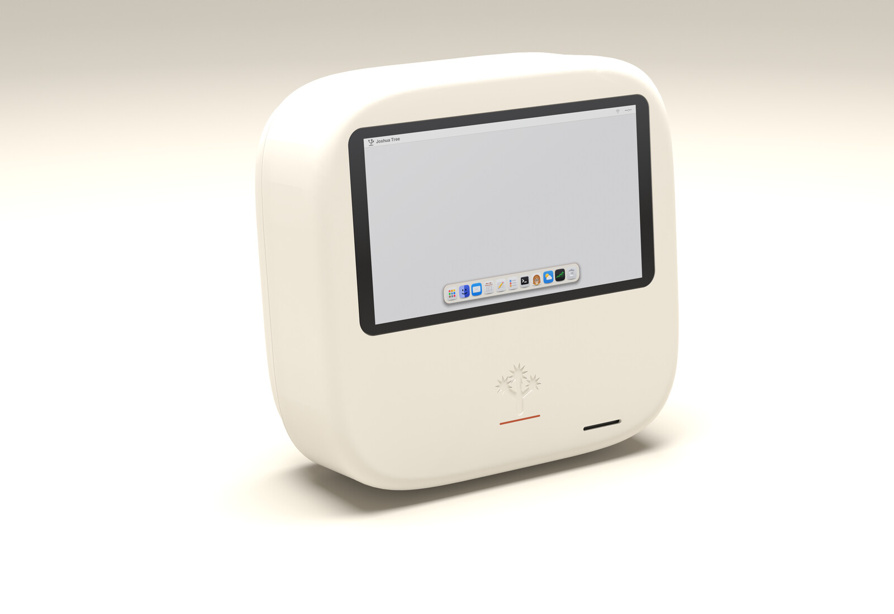
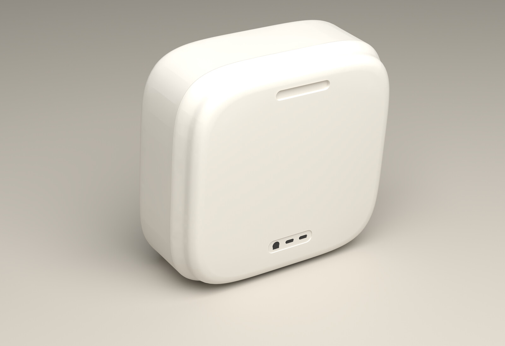
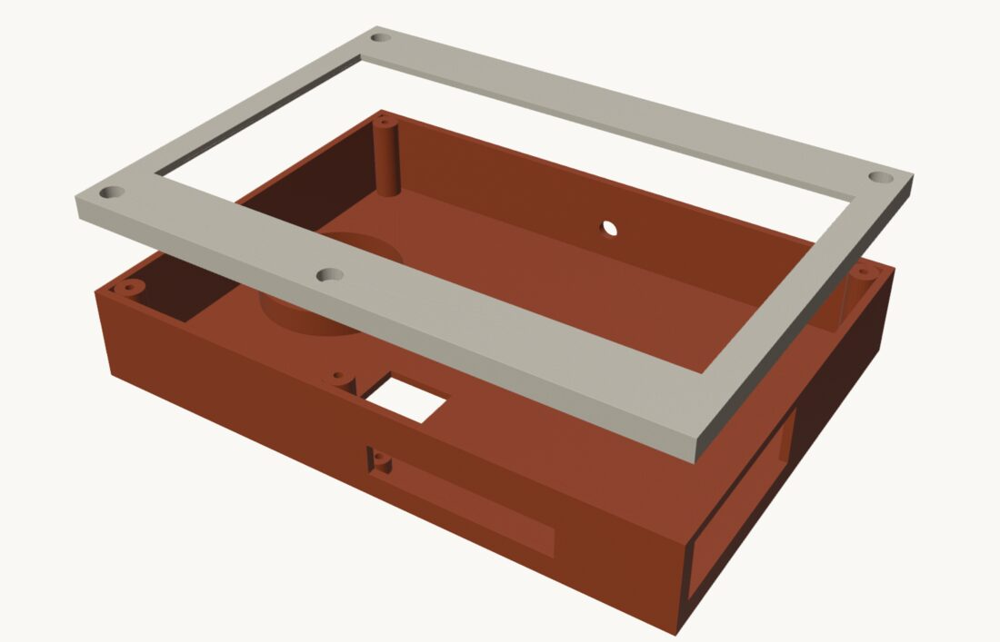
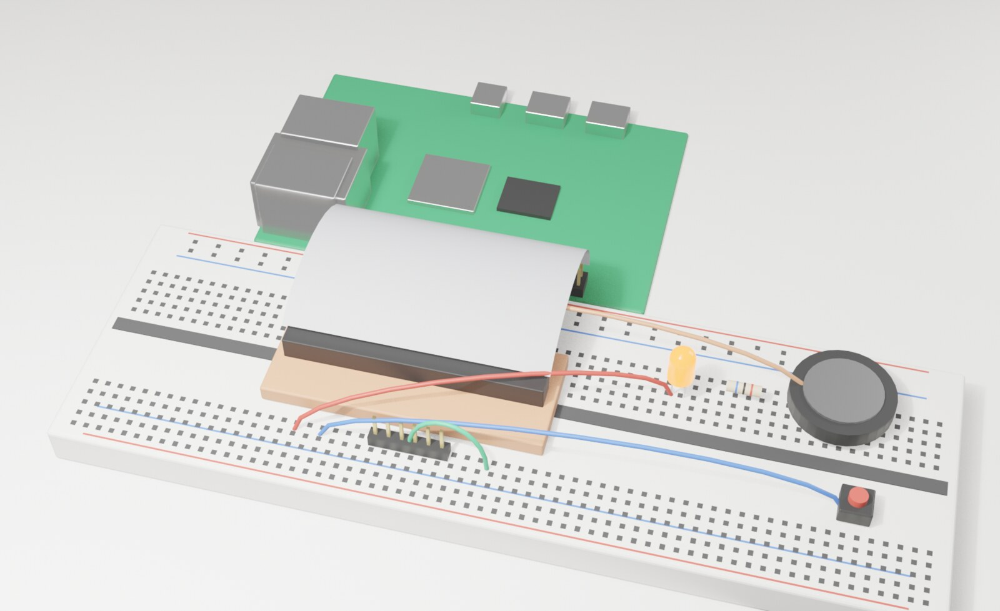

# Joshua Tree guide

How to use it, put it on a Raspberry Pi 4, and build the hardware.

## Use it

### Keys

| Key | What it does |
|---|---|
| F1, Cmd+Space | Spotlight: type an app name, Enter opens it. Up and Down pick, Esc closes |
| F2, Ctrl+T | The Terminal |
| F3 | Switch between Terminal 1 and 2 (not while a question runs) |
| F11, F12 | Volume down and up by 10 |
| Cmd+W, Cmd+Q | Close the front window, quit the front app |
| Cmd+N, Cmd+A, Cmd+C, Cmd+X, Cmd+V | New note, select all, copy, cut, paste (one clipboard, plain text, 4 KB) |
| Cmd+Tab | Bring the window behind to the front |
| Cmd+F5 | Screen reader on or off (`reader on`, `reader off` in the Terminal) |
| Ctrl+Alt+arrows, Ctrl+Alt+U, I, J, K | PC build: snap the front window to a half or a corner |
| Ctrl+Alt+Delete, Ctrl+Alt+End | Restart, shut down (Terminal asks first) |
| Esc | Closes Spotlight, a window or a chat. Stops Samantha between steps |
| Caps Lock | Capitals until you press it again |
| Page Up, Page Down, Home, End | Scroll the window in front |

Mac keyboards: Alt is Option, and End may need Fn+Right.

Other make targets: `make run` boots the PC build, `make samantha` boots straight to Samantha, `make talk` adds a Sound Blaster wired to the Mac's microphone and speakers, and `make iso` builds the PC ISO.

### Desktop

- **Dock.** A dot under a tile means that app has a window open. The green dot on a window fills the space between the menu bar and the dock. Press it again to put the window back.
- **Windows.** Drag by the title bar. Drag an edge to resize. Each window has a minimum size.
- **Menu bar.** Shows the clock, the Wi-Fi fan and short messages. The tree menu at the left has Restart, Shut Down, Sleep and Log Out.
- **Screen sleep.** Five minutes with no key or mouse blanks the picture. A key wakes it. This is not suspend.
- **Power.** `reboot` and `shutdown` in the Terminal. Both write open files to the card first.
- **Focus.** `focus on` keeps app notices out of the menu bar. `focus off` turns it back on.
- **Calendar.** Views 1 Day, 2 Week, 3 Month, 4 Year. T jumps to today. Enter edits the selected day. Events are in `JT/EVENTS.TXT`.

### Terminal

The Terminal has a zsh style prompt, `joshua@tree % `. Each of the two sessions keeps its own line and scrollback. The Console beside it shows boot messages and takes no input.

| Command | What it does |
|---|---|
| `help` | Lists the commands |
| `sam QUESTION`, `sam` | Ask Samantha, or open the chat view with `sam` alone |
| `ls`, `ls DIR`, `cat NAME` | List the card's files, print one (first 4 KB) |
| `write NAME.EXT TEXT`, `rm NAME`, `mkdir NAME` | Make, remove or create files inside `JT/` (8.3 names) |
| `browse ADDRESS`, `open`, `back`, `forward`, `reload`, `links`, `more`, `find` | The text browser |
| `fetch URL` | Save any address to your Downloads folder |
| `history`, `history WORDS`, `history top`, `history clear` | Recent pages |
| `cookies`, `cookies clear` | Cookies a site asked to keep |
| `bt scan`, `bt find`, `bt pair N`, `bt connect N`, `bt status`, `bt forget` | Bluetooth (see Mouse and Bluetooth) |
| `beep`, `vol`, `vol 40`, `vol up`, `vol down` | Sound, volume 0 to 100 |
| `mic`, `mic 5` | Listen through a USB microphone for 1 to 5 seconds. Nothing is saved |
| `wifi`, `wifi join NAME` | List networks, join one and save it (asks for the password with stars) |
| `calendar subscribe URL`, `calendar unsubscribe` | Read-only calendar feeds (`webcal://` works too) |
| `calendar caldav https://.../ YOU`, `calendar use N`, `calendar sync` | Two-way calendar sync (iCloud: `https://caldav.icloud.com/`, with an app password) |
| `mail login imap.mail.me.com you@icloud.com`, `mail logout` | Sign in to mail with an app password, kept in your keychain |
| `mail`, `mail N` | The ten newest messages, or open one |
| `mail send ADDRESS Subject \| TEXT`, `mail reply N TEXT`, `mail smtp HOST[:PORT]` | Send or answer mail |
| `print NAME.TXT ADDRESS`, `printers`, `scan`, `scan ADDRESS` | Print a card file to a network printer, list printers, scan into Photos |
| `snapshot`, `snapshots`, `restore N yes` | Copy your home folder, list copies, go back to one |
| `backup`, `restore mac yes` | Send your home folder to the Mac relay, or bring the newest back |
| `install NAME` | Fetch a signed app from the store |
| `update`, `update install` | Check for a new release, install it (admin) |
| `userrun NAME` | Start an app from `JT/APPS/` |
| `debug NAME [STEPS]` | Run an app one instruction at a time |
| `userrun plankc build NAME.PK` | Build a Plank program on the Pi |
| `userrun code NAME.PK` | Open the editor |
| `llm PROMPT` | The tiny model in the kernel (only in builds that have one) |
| `focus on`, `focus off`, `reader on`, `reader off` | Menu bar focus and the screen reader |
| `reboot`, `shutdown` | Restart or switch off |

With accounts, these need `sudo` for another person's files or for admin work.

| Account command | What it does |
|---|---|
| `users`, `admins` | List accounts and admins |
| `adduser NAME PASSWORD`, `deluser NAME PASSWORD` | Add or remove an account (admin) |
| `passwd`, `sudo passwd NAME` | Change your password, or reset someone's (admin) |
| `sudo makeadmin NAME`, `sudo unadmin NAME` | Change who is an admin (the last one stays) |
| `sudo COMMAND` | Run one command as admin. Remembered for five minutes. `sudo -k` forgets it |
| `logout` | Back to the login screen |

Your files live in `JT/`. With accounts, each person gets `JT/HOME/NAME`, and `~` in the Terminal means that folder:

```sh
write ~/NOTE.TXT hello
cat ~/NOTE.TXT
ls ~
mkdir ~/DOCS
rm ~/NOTE.TXT
sudo cat jt/home/bob/NOTE.TXT    # another person's folder, as admin
```

### Apps

- **Calendar, Clock, Stocks, Weather, Notes, Reminders, Music, Books, Calculator, Brick.** Each opens from Spotlight or the Launchpad.
- **Notes.** Plain text in `JT/NOTES/`. Saves a second or two after you stop typing.
- **Books.** Reads `.TXT` files in `JT/BOOKS/`. Right or Space turns a page. Books over 3 MB are refused.
- **Music.** Plays `.WAV` and `.MP3` from `JT/` and `JT/MUSIC/`. Space plays and pauses. Left and Right seek. N and P skip. S shuffles, R repeats. Songs over 3 MB are refused.
- **Blackcomb (the browser).** Tab picks the next link, Enter follows it. Ctrl+L or a letter starts a new address. Cmd+T opens a tab. The star saves a page as a bookmark. Type `mail:` in the address bar for your inbox. Pages have no JavaScript and no images in the text browser. HTTPS checks against Mozilla's root list. A site signed by anyone else fails on purpose.
- **Photos.** Shows `.JPG` files in a `PHOTOS` folder. Enter opens one, then r, b and + edit it. Edits are kept. 0 undoes them.
- **Games.** Chess (you play White), Solitaire, Paddle, Bricks, Depths (a first-person maze, find the pale door), Snake, Mines, Toroid, Hamurapi and Keyrate. Esc closes each one.
- **Settings.** Wallpaper, sound, dock size and magnify, Wi-Fi, Bluetooth, Language (twelve languages), Users, and a screen saver.
- **Blackcomb tabs and Top Sites.** A second tab shows a tab strip. Type two letters of a page you visited to get it offered.

### Samantha

Samantha does not run on the Pi. The Pi sends your question to the relay on your Mac, which asks the model and sends the answer back over HTTPS. If the Mac is off or Wi-Fi is down, she cannot answer.

- `sam QUESTION` returns the prompt at once. Her answer prints above it, with the time it took.
- `sam` alone opens a chat view. Enter sends. Esc or `/quit` goes back to the shell.
- Hold Space (tap Space, then hold it the second time) to talk. Let go to send. This needs a USB microphone and the words service on the Mac.
- `/status` shows the model, effort and whether the relay answered. `/clear` starts over. `/model auto`, `/model haiku`, `/model sonnet`, `/model opus` choose a model. `/effort low`, `/effort medium`, `/effort high` set effort.

Samantha can act on the Pi. She does it with action lines at the end of an answer, inside `[[ ]]`, at most 80 characters:

| Action | What the Pi does |
|---|---|
| `[[note TEXT]]` | Prints TEXT |
| `[[say TEXT]]` | Says it out loud through the jack |
| `[[led blink]]` | Blinks the green light (not on QEMU) |
| `[[open APP]]` | Opens an app by name |
| `[[browse URL]]` | Reads a page as text |
| `[[calc EXPR]]` | Works out a sum |
| `[[status]]` | Prints the Pi's address, clock and Wi-Fi |
| `[[save NAME]]` | Saves the answer's first code block to `JT/NAME`. Only a name you typed |
| `[[list]]`, `[[read NAME]]` | List `JT/`, or read a file back to her |
| `[[app NAME]]` | Builds the first code block as a Plank app in `JT/APPS/`, only when you asked for an app |

She can change files only where you named them, inside `JT/`. Boot files are refused. The loop runs up to 5 steps per question, with 4 actions per answer. Esc stops it.

## Wi-Fi

The Pi joins a network you pick on the Pi: Settings, Wi-Fi, or `wifi join NAME` in the Terminal. Press R in Settings to look again. The key is saved on the card as `JT/WIFI.TXT`, never the password.

A development card can carry a network built in. Prepare it on the Mac:

1. Create `~/.config/joshuatree/wifi.conf` with two lines: `ssid=YOUR_NETWORK_NAME` and `psk=YOUR_NETWORK_PASSWORD`.
2. Run `chmod 600 ~/.config/joshuatree/wifi.conf`. Never put it in the repository.
3. Run `tools/flash-pi.sh "/Volumes/PI"` with your development card mounted.

The image holds a key derived from the password. Keep the card private. A release build has no Wi-Fi key and no relay token.

If something fails:

| What you see | What to check |
|---|---|
| Wi-Fi scans but never joins | The network name and password, then reflash the development card |
| `claude: no network` | Console's Wi-Fi lines, and whether the router gave the Pi an address |
| `claude: no token` | Set the relay token on the Mac, then rebuild the development card |
| `claude: error -401` | The Pi's token and the relay's token do not match |
| `claude: timeout` | The Mac is awake, the relay runs, and the address is reachable |
| A web page fails with a TLS error | The certificate, the name or the clock. Never turn certificate checks off |

## The Claude app and the Mac relay

Joshua Tree has no native TLS or Node, so Claude Code runs on your Mac and the Pi talks to it through the relay, `tools/claude-relay/relay.py`. The relay is one Python file with only the standard library.

Make a token once and keep it private:

```sh
openssl rand -hex 24 > ~/.claude-relay-token && chmod 600 ~/.claude-relay-token
```

Start the relay from the repo root:

```sh
python3 tools/claude-relay/relay.py --token-file ~/.claude-relay-token
```

Two helpers run beside it with the same token. Install `yt-dlp` first with `brew install yt-dlp`:

```sh
python3 tools/claude-relay/stt.py --token-file ~/.claude-relay-token   # speech to words, port 8766, whisper.cpp on the Mac
python3 tools/claude-relay/yt.py --token-file ~/.claude-relay-token    # YouTube in Blackcomb, port 8767, needs yt-dlp (and ffmpeg for Movies)
```

Pick a backend when you start the relay:

- No flag: `claude -p`, on your logged-in Claude plan.
- `--turing`: Samantha, Joshua's own model. Start `./.venv/bin/python app/serve.py` in the turing repo first. The relay needs it running.
- `--api-key-file FILE --allow-api-spend`: the Messages API, paid from your credit. It refuses to start without `--allow-api-spend`.

To try it in QEMU, the relay listens on `127.0.0.1:8765`. QEMU reaches the Mac's loopback at `10.0.2.2`:

```sh
make kernel.elf
qemu-system-i386 -kernel kernel.elf -vga std -net nic,model=rtl8139 -net user
```

In Joshua Tree, open Settings, then Assistant. Set **Claude relay** to `10.0.2.2`, the port to `8765`, and **Claude token** to the text in `~/.claude-relay-token`. Then open Claude from the Launchpad.

**Security.** Anyone with the token can make Claude read the relay's `--cwd` and spend your plan. Treat the token like a password.

- The relay binds loopback only, unless you pass `--lan`, which needs both TLS flags.
- Claude gets read-only tools (Read, Grep, Glob) and no MCP servers or hooks.
- One question at a time. A 4 KB request cap, and a 150 second timeout.
- The token sits in `SETTINGS.TXT` on the Joshua Tree disk, in plain text.
- `--tools` with write tools turns the relay into an agent that changes files. It warns you.

**Voice.** `POST /api/tts` turns text into 22050 Hz PCM for the Pi. The ElevenLabs key stays on the Mac in `~/.config/joshuatree/elevenlabs.key`, which needs `chmod 600`. Requests are capped at 400 characters and 5000 a day.

## Encrypted Pi relay

The Pi sends its relay token over HTTPS. It refuses a plain HTTP relay and never retries without encryption. The i386 build and the default QEMU Terminal still use HTTP on loopback.

Make a private certificate authority (CA) on the Mac. Give the Pi only the public CA. Keep both private keys on the Mac.

```sh
mkdir -p ~/.config/joshuatree/relay-tls
chmod 700 ~/.config/joshuatree/relay-tls
cd ~/.config/joshuatree/relay-tls
umask 077
openssl req -x509 -newkey rsa:2048 -nodes -days 365 -subj '/CN=Joshua Tree relay CA' -addext 'basicConstraints=critical,CA:TRUE' -addext 'keyUsage=critical,keyCertSign,cRLSign' -keyout ca.key -out ca.pem
openssl req -new -newkey rsa:2048 -nodes -subj '/CN=jt-relay' -keyout server.key -out server.csr
```

Create `server.ext` in that folder:

```text
basicConstraints=critical,CA:FALSE
keyUsage=critical,digitalSignature,keyEncipherment
extendedKeyUsage=serverAuth
subjectAltName=DNS:jt-relay
```

Sign the server certificate:

```sh
openssl x509 -req -in server.csr -CA ca.pem -CAkey ca.key -CAcreateserial -days 30 -sha256 -extfile server.ext -out server.pem
```

The Pi trusts only this CA and checks the name `jt-relay`, so the Mac's address can change. A certificate made for an IP address is refused. Renew the server certificate before it expires.

Start the relay with TLS, from the repo root:

```sh
python3 tools/claude-relay/relay.py --lan --turing --token-file ~/.claude-relay-token --tls-cert ~/.config/joshuatree/relay-tls/server.pem --tls-key ~/.config/joshuatree/relay-tls/server.key
python3 tools/claude-relay/stt.py --lan --token-file ~/.claude-relay-token --tls-cert ~/.config/joshuatree/relay-tls/server.pem --tls-key ~/.config/joshuatree/relay-tls/server.key
python3 tools/claude-relay/yt.py --lan --token-file ~/.claude-relay-token --tls-cert ~/.config/joshuatree/relay-tls/server.pem --tls-key ~/.config/joshuatree/relay-tls/server.key
```

Flash the development card with the public CA:

```sh
CLAUDE_RELAY_HOST=192.168.1.10 TLS_TA="$HOME/.config/joshuatree/relay-tls/ca.pem" tools/flash-pi.sh "/Volumes/PI"
```

`CLAUDE_RELAY_HOST` is only a first guess. If the Mac moves, the Pi broadcasts one small probe on the LAN and finds the relay. The answer is not trusted. The token goes out only after the Pi proves the `jt-relay` name and our CA.

**Clock.** The Pi sets its clock from the Date header of a verified HTTPS reply from `www.google.com`. It refuses dates before the build and dates before a time it already accepted. There is no HTTP fallback. Before the first sync, the build date is still trusted, so this is a bootstrap, not a battery clock.

**Software Update.** Type `update` in the Terminal. Update and Restart download the new kernel and its signature, and the Pi writes nothing unless the signature is Joshua's. The new kernel runs beside the old one as `KERNEL8.NEW`. If it runs for 20 seconds it becomes `KERNEL8.IMG`. If it does not, turn the Pi off and on to fall back. A card flashed by `tools/flash-pi.sh` keeps your relay key in its kernel, so `update` refuses to replace it. Flash it again instead. Signatures come from `tools/update-sign.sh` on the Mac, since CI never holds the key.

A real board still needs testing for Wi-Fi timing, the probe over a real router, and certificate renewal.

## Raspberry Pi

Joshua Tree booted on a real Pi 4 on 2026-10-06. The board list to try is [TESTING.md](TESTING.md).

### What works

| Part | Status |
|---|---|
| Desktop on the board, at the monitor's own size (4K is drawn at half size, sharp) | Works |
| Console text and scrollback | Works |
| USB keyboard and mouse | Works. Keys repeat in the kernel, since USB sends a held key once |
| Wi-Fi (CYW43455) | Joins and holds on the board |
| Bluetooth LE mouse | Pairs and moves the pointer on the board. Classic headphones and keyboards are still being tested (see Mouse and Bluetooth) |
| SD card files | Read, write and apps across a reboot (SD card in the EMMC2 slot) |
| Sound out of the 3.5 mm jack | Works in QEMU. Not yet heard on the board in every case |
| Wired Ethernet | Not yet |

Each app runs in user mode, in its own window. It cannot touch the kernel or another app.

### What to buy

- A Raspberry Pi 4 Model B, 4 GB.
- A USB-C power supply, 5 V 3 A.
- A microSD card, 16 GB or more.
- A USB to serial cable, 3.3 V (CP2102, FTDI or CH340), and three female to female jumper wires. Check it says 3.3 V.
- A micro-HDMI to HDMI cable and a monitor, in the HDMI port next to the power port.

Canada Computers and Memory Express in Vancouver stock the Pi. PiShop.ca ships from Canada.

### Wire the serial cable

Turn the Pi off. Never connect the adapter's 5 V pin.

- Pi pin 6 (ground) to adapter GND.
- Pin 8 (the Pi's TX) to adapter RX.
- Pin 10 (the Pi's RX) to adapter TX.

If you see nothing, swap the two data wires first.

### Build, flash and boot

You need `clang`, `ld.lld` and `qemu-system-aarch64`. To try the Pi build in QEMU first:

```sh
make -C arch/arm64 pi          # builds arch/arm64/kernel8.img
make -C arch/arm64 run         # boots the ARM build in QEMU
make -C arch/arm64 run-pi      # runs it on QEMU's Pi 4B model
```

Then flash the card. You do not need Raspberry Pi OS.

```sh
tools/flash-pi.sh "/Volumes/NO NAME"
```

The script builds the kernel, downloads five firmware files from the official [raspberrypi/firmware](https://github.com/raspberrypi/firmware/tree/stable/boot) repo, copies `tools/pi-config.txt` over as `config.txt`, keeps any old `kernel8.img` or `config.txt` as `.bak`, and ejects the card. It never formats the card. For a used card, format it first with `diskutil eraseDisk FAT32 PI MBRFormat diskN`.

The `config.txt` it writes:

```
arm_64bit=1
kernel=kernel8.img
kernel_address=0x80000
disable_overscan=1
enable_uart=1
uart_2ndstage=1
```

With a serial cable, find the adapter with `ls /dev/cu.usb*`, then open it:

```sh
screen /dev/cu.usbserial-0001 115200
```

Leave `screen` with Ctrl-A then K. A good boot prints `Joshua Tree on ARM64`, `booted at EL2`, `EL1`, a run of `M0` to `M1c` lines and then `tick` lines. The last line of the framebuffer check is a measurement, for example `fb 1920x1080>1920x1080`. `M1c fb ok` means the desktop is drawn.

The Pi has no battery clock. The menu bar clock reads `--:--` until Wi-Fi gives it the time.

**If nothing prints:**
1. Swap the two data wires.
2. Check the speed is 115200, and the adapter is 3.3 V with ground on pin 6.
3. Check `config.txt` matches `tools/pi-config.txt` and the card is ejected.
4. With `uart_2ndstage=1`, you see the firmware's lines first. If you see those and not ours, the kernel did not start.
5. Watch the LEDs. Steady red is power. A repeating green pattern is the firmware counting out an error.

Send the exact lines you see, even if they look like garbage. Garbage means the speed is off. Nothing means wiring or boot files.

### Files on the card

Files you write are still there after a reboot. The OS writes only inside `JT/`, and it refuses any file the firmware boots from (`bootcode.bin`, `start*.elf`, `fixup*.dat`, `.dtb`, `config.txt`, `cmdline.txt`, `kernel*.img`, `armstub*`, and the `overlays` folder).

```sh
ls                      # the boot partition's top folder
ls JT                   # the OS's folder
write NOTE.TXT hello    # makes JT/NOTE.TXT
cat JT/NOTE.TXT
```

Apps see `JT/` as their whole disk. Names are the short 8.3 ones that `ls` shows. An app image in `JT/APPS/` is named `NAME.APP` and runs with `userrun NAME`. Spotlight lists the apps there too.

### Write an app

The walk-through from a blank card to a running app is the SDK page, `landing/sdk.html`. Its example is the one the suite builds and runs.

You can write an app on a Mac without touching the kernel. It is one C file that includes `jtsys.h` and starts at `_start`:

```sh
tools/mkapp.sh sun.c           # builds SUN.APP
tools/signapp.sh SUN.APP       # signs it as SUN.SIG
```

Copy both to `JT/APPS/` on the card. `userrun sun` runs it. An unsigned app runs only for an admin (`sudo userrun NAME`). A signed one runs for anyone. The kernel trusts one key, Joshua's. `tools/signapp.sh --new-key` makes a new one, and its private half stays in `~/.config/joshuatree/app-signing.pem`.

The store: `install NAME` (or `sudo install NAME` with accounts) fetches a signed app from joshuatree.jaybulb.com/apps, checks the signature, and saves it in `JT/APPS/`. To add one to the store, run `tools/store-add.sh store/NAME.c` (or `.pk`) and it goes live when main deploys.

**Plank apps.** Plank is Joshua's compiled language (github.com/nulljosh/plank):

```sh
tools/plankapp.sh hello.pk     # builds HELLO.APP on the Mac
```

A card flashed with `tools/flash-pi.sh` carries plankc, so the Pi builds Plank apps itself. Write `JT/HELLO.PK`, then in the Terminal `userrun plankc build HELLO.PK` and `userrun hello`. A mistake prints the line and the reason, and goes in `JT/APPS/HELLO.ERR`.

A Plank app gets a window through `jtw`: `jtw_open()`, `jtw_fill(x, y, w, h, colour)`, `jtw_text(x, y, text, colour, bold)`, `jtw_present()` and `jtw_wait()`. `store/slide.pk` is a whole example.

**The editor.** Copy `store/code.pk` to the card as `JT/CODE.PK`, build it once with `userrun plankc build CODE.PK`, then `userrun code HELLO.PK` opens a file. Cmd+S saves, Esc saves and closes.

**The debugger.** `debug NAME [STEPS]` runs an app one instruction at a time for its first STEPS (12 by default, 64 at most), then lets it run.

### Accounts and backups

With no accounts the Pi boots straight to the desktop. The first `adduser` makes an admin. Passwords are at least 4 characters and are stored as salted hashes.

```sh
users
adduser NAME PASSWORD
sudo adduser bob hunter22
sudo makeadmin bob
sudo deluser bob
```

Each signed-in person has a home folder, `JT/HOME/NAME`. `snapshot` copies it to `~/SNAP/N`, the newest three are kept, and `restore N yes` brings snapshot N back. `backup` sends the folder to the Mac relay when it runs with `--backup-dir FOLDER`. `restore mac yes` brings the newest backup back. It takes a snapshot first.

### Music on the Pi

Put songs in `JT/MUSIC` from the Mac. Use short names (`SONG.MP3`), or copy with `cp -X`. Then remove the `._` files Finder leaves:

```sh
dot_clean /Volumes/CARD/JT/MUSIC
```

The Pi plays WAV (8 or 16 bit) and MP3 from 4000 to 44100 Hz. A 48 kHz file is refused. Test with `beep` (or `beep 880 500`) first. `vol 20` sets the volume, and F11 and F12 change it too.

### Mouse and Bluetooth

The Pi pairs one Bluetooth mouse. Put it in pairing mode, then:

```sh
bt scan          # 5 seconds, numbered, mice first
bt pair 1        # or `bt pair` for the strongest mouse, or `bt pair NAME`
```

The pairing is saved in `JT/BTPAIR.BIN`. The Pi reconnects on each boot, and when the mouse wakes. `bt status` shows the radio state. `bt forget` deletes the pairing.

Classic Bluetooth (headphones, speakers and keyboards) works from the same Terminal:

```sh
bt find          # lists headphones, speakers and keyboards by name
bt connect 1     # pairs with Secure Simple Pairing and saves the link key
```

A Bluetooth keyboard may show six digits. Type them on the keyboard, then Enter. Keep the wired mouse plugged in while you pair a keyboard. Apple's Magic Keyboard uses Classic Bluetooth, which the Pi does not pair with yet.

A Logitech receiver is a plain USB mouse and keyboard. It needs no extra setup.

### Fan and case

The fan runs off the header: red to pin 4 (5 V), black to pin 6 (ground). Pin 6 is also the serial cable's ground, so share it or use pin 9.

### Software release history

The release notes and `git log` hold the history. Each major version has one line in [ROADMAP.md](ROADMAP.md#shipped).

### 7.0 board day

Check Wi-Fi, mail and calendar on the real Pi. Stop at the first failure and send that step's lines.

1. **Sign in.** Time from Enter at the login screen to the desktop.
2. **Wi-Fi.** `wifi` lists networks. In Settings, Wi-Fi, press R, pick a second network and type its password. It says `Joined.` within about 15 seconds.
3. **Web.** `browse en.wikipedia.org/wiki/Raspberry_Pi`, then the same page in Blackcomb. Note any page that comes back blank or with a TLS error.
4. **Mail.** `mail login imap.mail.me.com YOUR-APPLE-ID`, then `mail`, then `mail 1`. Reply to yourself and check it arrives.
5. **Calendar.** Use a scratch calendar. `calendar caldav https://caldav.icloud.com/ YOUR-APPLE-ID`, `calendar use N`, add a day, then `calendar sync`.
6. **History.** Open a second tab with Cmd+T. Type two letters of a page you visited. It should offer it.
7. **Bluetooth keyboard.** `bt scan`, `bt pair NAME`, then type the six digits.

## Nimbus

Nimbus is the small square computer: a Pi 4 and the official 7 inch touch display in a printed shell. It is a concept with a full print pack.





The print pack in `docs/hardware/nimbus/pack/` has the parts checked against a 256 mm bed, a 1:1 blueprint, a bill of materials and six assembly drawings. Everything is generated:

```
uv run --with build123d --with shapely python docs/hardware/nimbus_cad.py docs/hardware        # STL and STEP per part
python3 docs/hardware/nimbus_desktop.py --compose                                               # the desktop picture
blender -b -t 4 -P docs/hardware/render_nimbus.py -- docs/hardware                             # hero, rear and side renders
blender -b -P docs/hardware/nimbus_box.py -- docs/hardware                                     # the retail box render
uv run --with build123d --with shapely python docs/hardware/nimbus_blueprint.py docs/hardware  # the print blueprint
uv run --with build123d --with shapely --with trimesh python docs/hardware/nimbus_pack.py docs/hardware   # the print pack
NIMBUS_WALL=wall-desktop NIMBUS_W=5120 NIMBUS_H=2880 CAM="-1210,-1880,1020" AIM="-10,0,110" SS=1 python3 docs/hardware/render_nimbus.py OUT   # a 5K desktop wallpaper
```

### Build a Nimbus, step by step

Plan an afternoon for the build and a day for the print. Stop at the first step that goes wrong and ask (trommatic@icloud.com).

1. **Buy the parts.** Everything is in `docs/hardware/nimbus/pack/bom.csv`, with stores in the Shopping list. The main ones: a Raspberry Pi 4 Model B, a 16:9 HDMI panel, a right-angle micro-HDMI cable, a 5 V 3 A USB-C supply and a 16 GB microSD card.
2. **Measure the panel.** With digital calipers, measure its outline, its lit area and its thickness. If they differ from the stand-ins at the top of `docs/hardware/nimbus_cad.py`, change them there and make the pack again. The script refuses a part that no longer fits.
3. **Print.** The parts are `docs/hardware/nimbus/pack/front_shell.stl`, `back_cover.stl` and `ground_inlay.stl`. Settings are in `docs/hardware/nimbus/pack/print-sheet.csv`. Print the front shell first and drop the panel in. It should sit flush. A print shop can take `docs/hardware/nimbus/pack/print-shop.pdf`.
4. **Put it together.** Follow the six drawings in `docs/hardware/nimbus/pack/assembly/`. Glue the glass to the ledge, seat the display, screw the Pi down (four M2.5 x 6), fit the back ports, close the case (two M3 x 12 from underneath), and press the terracotta mark into its groove. No heat-set inserts are needed. No fan either: a vent slot in the foot and the open shell behind the Pi cool it.
5. **Make the card.** On a Mac with clang, ld.lld and qemu (`brew install llvm lld qemu`), run `tools/flash-pi.sh /Volumes/NAME`. Put the card in the slot in Nimbus's chin.
6. **First boot.** Plug in the supply. In under ten seconds the tree appears, then the desktop at the panel's own size (800x480, 1024x600, 1280x800 or 1080p all fill the screen). A USB keyboard and mouse work at once. Wi-Fi and Bluetooth are in Settings.
7. **If the screen stays black.** Check the micro-HDMI is in the port next to the power (HDMI 0). If it is still black, the serial cable (see Wire the serial cable) shows where the boot stopped. Send that text.

`tools/checks/guide-nimbus-check.py` keeps this chapter true to the repo.

### Shopping list

Rough Canadian estimates, not quotes.

For Nimbus, in buying order:

| # | Item | About | Where |
|---|---|---|---|
| 1 | The screen: a 16:9 HDMI panel, 8 inch class, touch if you want it (about 194 x 110 mm outline) | $60 to $100 | PiShop.ca, Amazon.ca |
| 2 | Digital calipers, to measure the screen before printing | $15 to $25 | Canadian Tire, Princess Auto |
| 3 | A right-angle micro-HDMI to HDMI cable, 20 to 30 cm | $10 to $15 | Canada Computers, Amazon.ca |
| 4 | Double-sided foam tape, 2 mm | about $5 | Canadian Tire, Home Depot |
| 5 | Screws: four M2.5 x 6, two M3 x 12 | $5 to $10 | Lee's Electronics, Amazon.ca |
| 6 | Two USB-C panel-mount extension cables | $10 to $15 | Amazon.ca |
| 7 | A short microSD to SD extension cable, for the front slot | $8 to $12 | Amazon.ca |
| 8 | A 3.5 mm panel-mount jack (optional, for sound) | about $5 | Lee's Electronics |
| 9 | The print: three parts in cream PLA or PETG. Print the front shell alone first as a fit test | $40 to $80 | Canada Computers |

All in, about $160 to $270.

Also worth having: a 3.3 V USB to serial cable, a second 32 GB microSD card (one for the last good build, one for experiments), a wired USB mouse, a real USB-C data cable, and an Ethernet cable.

Books: *Operating Systems: Three Easy Pieces* (free online), *The Elements of Computing Systems* (Nand2Tetris), *Code* by Charles Petzold.

## Samantha box

A 7 inch screen, a Raspberry Pi 4B, a round speaker and a mic hole in one printable box, about 171 x 124 x 34 mm. Samantha lives in it.



| File | What it is |
|---|---|
| `back_shell.stl` | The floor, walls, screw bosses, Pi standoffs, speaker ring, grille and port windows |
| `front_bezel.stl` | The frame, the screen's pocket and the lit-area window |
| `stand.stl` | Two cradles that lean the box back 15 degrees |
| `fit_test.stl` | A thin tray with the screen's pocket. Print it first |
| `samantha-box.step` | The shell and bezel for CAD |

Four M3 x 10 socket head screws hold the bezel to the shell.

Every part number in `samantha_cad.py` is a stand-in until you measure the real screen, speaker and plug. Print `fit_test.stl`, drop the screen in and adjust `SCREEN_W`, `SCREEN_H` and `SCREEN_T` until it sits flush. Then build the box:

```sh
uv run --with build123d python3 docs/hardware/samantha_cad.py /tmp/box
python3 docs/hardware/render_samantha.py    # both views, rendered in Blender with no window
```

The script checks each fit before it writes a file. `tools/checks/samantha-box-check.py` runs it in the suite.

Not done yet: nothing holds the screen from behind, the screen's connectors are unchecked, there is no cable route from the Pi's micro-HDMI, no mic is chosen, and there is no fan.

## Breadboard prototype



A Pi 4 and a breadboard, to try the next parts without soldering. `tools/gen/breadboard.py` draws the picture.

| Part | Pi pin | Goes to |
|---|---|---|
| Serial cable | 6 GND, 8 TX, 10 RX | cable GND, RX, TX (crossed) |
| LED with a 330 ohm resistor | 11 (GPIO17) | the LED, then the ground rail |
| Button | 13 (GPIO27) | the button, then the ground rail |
| Speaker with a PAM8302 amp | 12 (GPIO18) | the amp input. Amp power from pin 2 (5 V) and ground |
| Ground rail | 9 | the blue rail on both sides |

Power the Pi off before you wire it. Only the serial cable works today. The LED, button and speaker wait for their drivers.

## The x86 box (later)

The i386 kernel runs on QEMU's emulated devices today. A PC board is the later target. The plan is an ASRock J4125B-ITX with a Realtek NIC, Intel HDA audio and an AHCI disk. Each driver is a separate step in the roadmap, and the first gate is whether the board's BIOS can boot a multiboot kernel from GRUB.

---
Nimbus and Joshua Tree are trademarks of Joshua Trommel. Designs licensed CC BY-NC-SA 4.0. Build one for yourself; please do not sell copies.
