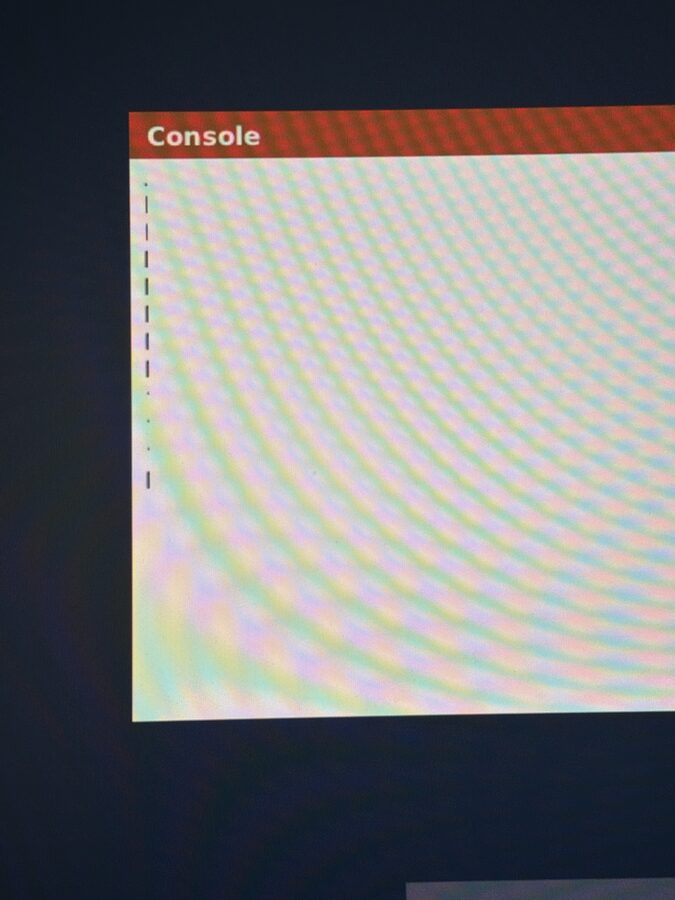

# Raspberry Pi

Joshua Tree booted on a real Pi 4 on 2026-10-06. This page says what works today, what to buy, how to flash the card, and what happened on the real board.

The plan and the milestones live in [ARM64.md](ARM64.md). The case is in [hardware/PI-CASE.md](hardware/PI-CASE.md). A desk unit with a 7 inch screen, a speaker and the Pi inside is in [hardware/SAMANTHA-BOX.md](hardware/SAMANTHA-BOX.md).

## Apps currently implemented on ARM

The Pi does not have the i386 demo's full app collection. Its native windows are the Calculator, Calendar, Notes, Music, Terminal, Console, Clock and Brick (development branch). Calendar, Notes and Music run in user mode: the dock tile starts `user/calendar.c` or `user/notes.c`, and Spotlight (type music) starts `user/music.c`, the same programs the PC runs, each in its own window, one at a time. Music has no dock tile, a decision; see [Music on the Pi](#music-on-the-pi). Their files are on the card in `JT/` (see [Files on the card](#files-on-the-card)). In Calendar, arrows step the month. In Notes, n makes a note, Enter opens one, Esc saves it and goes back, and Esc again closes Notes. Its red dot closes it too, without saving an open note. The Apps tile opens Calculator, beside the Terminal or Console; a click on either one gives it the keys. F2 opens Terminal. Vancouver stays UTC-7 after March 8, 2026, following [B.C. permanent Pacific time](https://news.gov.bc.ca/releases/2026AG0013-000209). Search Brick in Spotlight for the brick-breaker game. Search Clock in Spotlight to open its time/date window; Escape closes it. The Samantha dock tile opens the assistant Terminal. Claude/Samantha and the text browser run as Terminal commands. The optional local model also runs there when weights are included in the image.

Burrow, Reminders, Weather, Stocks and Trash dock tiles do not open their own ARM apps. They return to the Console and print `not on ARM yet`. The live Calendar icon shows the month and day number, and a click opens Calendar. Samantha's `note` action prints text; it does not save a Notes document yet.

This is the dispatch in `arch/arm64/main.c` (`dock_activate` and `app_open_name`), not a claim that every feature has passed a physical-board test. The x86 user programs use a different syscall and window layer and still need ARM ports. The Calendar Year-view improvement is for the i386 app.

## What works today

| | Status |
|---|---|
| Boots under QEMU's generic ARM machine and prints over the UART | Works. `make -C arch/arm64 run` |
| Boots as a Pi image on QEMU's Pi 4B model, enters at EL2, drops to EL1, prints | Works. `make -C arch/arm64 run-pi` |
| Boots on a real Pi 4 | **Works, 2026-10-06.** First power-on drew the desktop over HDMI. See the log at the bottom. |
| A picture on a monitor | **Works on the real board**, same desktop as QEMU's Pi 4B model: the kernel asks the GPU for a screen through the mailbox, draws a simple desktop and prints the same boot lines in its window that go out over serial, in the same smooth DejaVu type as the main desktop (`tools/checks/arm64-m1c-check.py`). |
| Full screen at the monitor's own size | **Works on the real board, 2026-10-06.** The kernel asks the firmware how big the monitor is and draws at that size; a 4K monitor gets exactly half each way, so it stays sharp. Proven on QEMU's Pi model with a faked 1080p and 4K monitor. |
| Console text on the real board | **Fixed and seen on the real board, 2026-10-06.** The first boot showed one thin mark per line because later drawing never left the CPU cache. Every glyph is now cleaned out to memory as it is drawn. |
| Console scrollback from the keyboard | **In 2.19.0, not yet seen on the board.** The Console keeps the whole boot log. Page Up and Page Down on a USB keyboard move half a page, Home jumps to the first line, End returns to the newest. The title bar says which lines are shown, and a pinned row under the text always shows the latest `wifi` and `usb` line, so the Wi-Fi lines survive a photo. |

| USB keyboard and mouse on the Pi | **Keyboard works on the real board, 2026-10-06** (see the Log). Mouse untested, no wired one yet. Since 2.24.0 a USB mouse moves an arrow over the desktop, the dock's label follows it, the Console's red button closes it and a dock click opens it again, all proven in QEMU (`tools/checks/arm64-mouse-check.py`); see the mouse test list below. Since 2.13.2 each hub port prints one status line and every port is rescanned once a second, so a keyboard plugged in after boot is found too. Proven end to end in QEMU (`tools/checks/arm64-usb-check.py`). Each step prints a short `usb ...` line on screen: `usb pcie link up`, `usb vl805 ok`, `usb xhci run`, `usb port N connected`, `usb kbd addr N`, then `usb key 0x04 a` for every key. The last line on the photo is where it stopped. |
| Wi-Fi on the Pi (CYW43455) | Built in 2.16.0, waiting on a photo from the real board. Stage 1 lists nearby networks on screen as `wifi ap ...` lines; joining one is stage 2. QEMU has no SDIO card, so it only proves the failure path (`wifi FAIL cmd5`, boot carries on): `tools/checks/arm64-wifi-check.py`. |
| Bluetooth (the same CYW43455) | **In 2.54.0, not yet seen on the board.** The radio loads its patch at boot, `bt scan` lists the devices it hears, and `bt pair` connects the mouse (Just Works, the key kept in RAM only) so it moves the arrow and clicks. See [Bluetooth](#bluetooth). |
| Sound out of the 3.5 mm jack | **In 2.43.0, not yet heard on the board.** Run `beep` (or `beep 880 500`) in the Terminal with headphones in the jack. PWM1 on GPIO 40 and 41, fed by the CPU (no DMA yet). QEMU has no PWM, so `tools/checks/arm64-audio-check.py` proves only the tone, the buffer and the bounded waits. If it prints `audio:` and a reason, tell me the line. HDMI audio is not done. **Volume, in 2.48.0, not yet heard on the board:** `vol` shows it (0 to 100, default 70), `vol 40` sets it, `vol up` and `vol down` step by 10; F11 and F12 and a Mac keyboard's volume keys do the same, show "Volume N" in the menu bar and click once. The default level and the click are `AUDIO_DEFAULT_VOLUME` in `audio.h` and `TICK_HZ`, `TICK_MS` in `cmd.c`: tune them on the real speaker. **Music, in 2.59.0, not yet heard on the board:** an app's sound goes out through DMA, so the desktop never waits on it. See [Music on the Pi](#music-on-the-pi). |
| Files on the SD card | **Reads in 2.53.0, writes in 2.57.0, apps in 2.58.0, not yet seen on the board.** The kernel reads the card it booted from, `ls` and `cat` in the Terminal show its boot partition, and `write`, `rm` and `mkdir` change the OS's own `JT/` folder. Since 2.58.0 Notes keeps its notes in `JT/` too, and Calendar its events. The boot files are never written. See [Files on the card](#files-on-the-card). Proven on QEMU's Pi 4B model with a FAT32 card, across a reboot (`tools/checks/arm64-sd-check.py`, `tools/checks/arm64-notes-check.py`). |
| Wired Ethernet on the Pi | Not yet. M4. |

So on day one, watch two things: the text in a serial terminal, and with a monitor plugged in, a simple desktop of plain boxes with the same boot lines written in its white window. If the serial cable is wrong, the monitor still tells you how far the kernel got. If both are blank, it is the SD card or `config.txt`.

## What to buy

- **Raspberry Pi 4 Model B, 4 GB.** The port targets the 4B first. The Pi 5 comes after.
- **A USB-C power supply, 5 V 3 A.** The official one is the safe pick.
- **A microSD card, 16 GB or more.**
- **A USB to serial cable, 3.3 V.** CP2102, FTDI or CH340 all work. This is how you see the output. Make sure it says 3.3 V, not 5 V. The Mac mini only has USB-C, so search "USB-C to TTL serial 3.3V" (or a USB-A one plus an adapter). One end is USB, the other is three loose wires for the header pins. About $10.
- **Three female to female jumper wires.**
- A micro-HDMI to HDMI cable and a monitor, to see the first picture. Plug into the HDMI port next to the USB-C power port (HDMI 0). A USB keyboard and mouse come later (M4).

A local store may have the Pi in stock. Check before you drive. Canada Computers and Memory Express are the usual ones in Vancouver, and PiShop.ca ships from Canada.

## Wire the serial cable

Turn the Pi off. Match the three wires. Never connect the adapter's 5 V or VCC pin to the Pi.

| Pi pin | What it is | Adapter |
|---|---|---|
| 6 | Ground | GND |
| 8 | GPIO14, the Pi's TX | RX |
| 10 | GPIO15, the Pi's RX | TX |

Transmit goes to receive. If you see nothing later, swapping the two data wires is the first fix.

## Build and boot

You need `clang`, `ld.lld` and `qemu-system-aarch64`. The Mac already has them.

```
make -C arch/arm64 pi          # makes arch/arm64/kernel8.img
make -C arch/arm64 run-pi      # try it on QEMU's Pi 4B first
```

## Flash the card

You do not need Raspberry Pi OS. The Pi's firmware boots any `kernel8.img` it finds on a FAT32 card next to five files from the official [raspberrypi/firmware](https://github.com/raspberrypi/firmware/tree/stable/boot) repo. One script does the whole job:

```
tools/flash-pi.sh                    # finds the one mounted FAT32 card
tools/flash-pi.sh "/Volumes/NO NAME" # or name it
```

It builds `kernel8.img`, downloads `bootcode.bin`, `start4.elf`, `fixup4.dat` and `bcm2711-rpi-4-b.dtb` (cached in `build/pifw`), copies `tools/pi-config.txt` over as `config.txt` (an existing `kernel8.img` or `config.txt` is kept as `.bak` first), strips the macOS `._` files and ejects. With no argument it only picks a FAT volume on an external disk, and stops if it finds more than one. A card fresh out of the box is already FAT32. A used one: `diskutil eraseDisk FAT32 PI MBRFormat diskN` first (check `diskutil list` twice; the LaCie is also external).

The `config.txt` it writes, from `tools/pi-config.txt`, the one copy:

```
arm_64bit=1
kernel=kernel8.img
kernel_address=0x80000
disable_overscan=1
enable_uart=1
uart_2ndstage=1
```

`kernel_address` puts the kernel where it is built to run; newer firmware would otherwise load it at 0x200000. `disable_overscan` stops the firmware shrinking the picture inside a black border. There is no `dtoverlay=disable-bt` any more (since 2.51.0): the good UART, the PL011, belongs to the Bluetooth radio, and the console prints on the mini UART, on the same header pins at 115200. `enable_uart=1` holds the core clock the mini UART counts from steady, so the console's speed never drifts. `uart_2ndstage` makes the firmware print before our kernel does, so a blank serial line means wiring and a firmware-only line means the kernel.

If you would rather start from Raspberry Pi OS Lite (64-bit), flash it with Imager, replace `kernel8.img` on the boot partition with ours, and append the lines of `tools/pi-config.txt` to its `config.txt`. Same result, bigger card image.

Then put the card in the Pi. The monitor goes on the micro-HDMI port next to the USB-C power (HDMI 0). The serial cable is optional on day one; the screen shows the same boot lines.

## Boot

With a serial cable, open the terminal. On a Mac the adapter shows up as `/dev/cu.usbserial-something`:

```
ls /dev/cu.usb*
screen /dev/cu.usbserial-0001 115200
```

Power the Pi. You should see:

```
Joshua Tree on ARM64
booted at EL2
EL1
M0 ok
M1 vectors set
M1b mmu on
M1b heap ok
M1 svc ok
tick 1
tick 2
tick 3
M1a ok
M1c fb ok
```

The lines after `M0 ok` are the exception table, the memory map with the caches on, a small heap, and the timer. They run on QEMU's Pi model; on a real board the interrupt controller setup is the part most likely to need a fix. If the output stops after `M1 vectors set`, the memory map is the likely cause on real hardware; if it stops after `M1 svc ok`, it is the interrupt controller. Send me the last line you see.

After the userland lines, the last line is a measurement, for example `@0x80000 fb 1920x1080>1920x1080 p7680 M13x18 a14 ok`. In order: where the firmware really loaded the kernel, the monitor size it reported and the screen we got, the bytes per row, and the console font's self-test (the letter M's width and height, its advance, and the verdict). If the verdict says `FAIL`, the console switches to the old 8x16 VGA font, drawn at a whole-number scale. Photograph that line.

`M1c fb ok` means the GPU gave us a screen and the desktop is drawn: the monitor should show it, with these same lines in the white window (lines printed before the screen came up are replayed there). If the text says `M1c fb ok` and the monitor stays black, the picture is in memory but the GPU is not showing it (photograph both). If it says `M1c mailbox framebuffer refused`, the firmware said no.

That is milestones M0, M1a and the first picture on real hardware. To leave `screen`, press Ctrl-A then K.

The kernel guards against two things a real board may do differently from QEMU: if the firmware leaves the timer speed unset it assumes 54 MHz, and every wait on the GPU's mailbox gives up after a moment and prints `M1c mailbox framebuffer refused` instead of hanging.

The Pi has no battery clock, so it does not know the date until something gives it the time (Wi-Fi, once it is up). Until then the menu bar clock reads `--:--` and the Calendar tile in the dock shows its normal page with a red dash where the month goes and a dark dash where the day goes. That is on purpose: it never shows a made-up date. `tools/checks/arm64-m1c-check.py` fails if the tile turns blank.

## If nothing prints

1. Swap the two data wires.
2. Check the speed is 115200.
3. Check the adapter is 3.3 V and the ground wire is on pin 6.
4. Check `config.txt` matches `tools/pi-config.txt` and the card is fully ejected.
5. `uart_2ndstage=1` is already in `config.txt`, so the Pi's own firmware prints before ours. If you see that and not ours, the kernel is not starting. If you see neither, it is the wiring.
6. Look at the Pi's LEDs. A steady red light is power. A flickering green light is the card being read. A repeating pattern of green blinks is the firmware counting out an error: four means it could not find `start4.elf`, seven means no `kernel8.img`. Either way, re-run `tools/flash-pi.sh`.

If it still fails, send the exact lines you see, even if they look like garbage. Garbage means the speed or the clock is off. Nothing at all means wiring or boot files.

## What is next

| Milestone | What you will see |
|---|---|
| M0 | Text over the serial cable. Built, waiting for a real board. |
| M1 | A picture on a monitor over HDMI. A simple desktop works on QEMU's Pi model; the real Joshua Tree look comes next. |
| M2 | Keyboard, mouse, network and disk, working in QEMU first. Keyboard, mouse, the network card and a disk work. |
| M3 | Every app running on ARM. |
| M4 | The same on the real Pi: SD card, USB, Ethernet. Sound last. |
| M5 | The Pi 5. |

## Files on the card

Since 2.53.0 the kernel reads the SD card it booted from. Since 2.57.0 it writes too, so a file you make is still there after a reboot.

The card slot is wired to EMMC2, the Pi 4's own SD controller, so this never touches the Wi-Fi chip's controller. At boot the Console shows two lines. `sd card sdhc <size> MB, base clock <rate> MHz` gives the card's type and size, and the clock the firmware gave the controller. `sd fat32 partition at block <start>, <size> MB, writes go in JT/` says where the boot partition starts and how big it is. With no card it says `sd no card`. Any other failure is one `sd FAIL <step>` line. Either way the boot carries on.

In the Terminal (F2):

- `ls` lists the boot partition's top folder: each file's short name and its size in bytes, folders with a slash. `ls JT` lists the OS's own folder.
- `cat NAME` prints the first 4 KB of a file as text, for example `cat config.txt` or `cat JT/NOTE.TXT`.
- `write NAME.EXT TEXT` makes `JT/NAME.EXT` holding that line, or replaces it. The name needs a dot, so `write me a poem` still goes to Claude.
- `rm NAME` deletes `JT/NAME`. `mkdir NAME` makes the folder `JT/NAME`.

Names are the short 8.3 ones `ls` shows, so `bcm2711-rpi-4-b.dtb` is `BCM271~1.DTB`. One folder down at most.

Apps see `JT/` as their whole disk (2.58.0). Notes asks for `NOTES/NOTES/N0000001.TXT` and gets `JT/NOTES/NOTES/N0000001.TXT`; Calendar's `EVENTS.TXT` is `JT/EVENTS.TXT`. An app's path has no leading slash and no `..`, so nothing outside `JT/` is reachable from an app, the boot files least of all. The first time Notes opens, the kernel makes `JT/NOTES/NOTES`, its default folder, and the first time Music opens, `JT/MUSIC`. A file an app opens is 8 KB at most (a whole-file read, as Music's, takes up to 6 MB), and one app runs at a time.

The OS writes only inside `JT/`, made on the first write. It never writes a file the firmware boots from: `bootcode.bin`, `start*.elf`, `fixup*.dat`, any `.dtb`, `config.txt`, `cmdline.txt`, `kernel*.img`, `armstub*` and the `overlays` folder are refused by name, with an `sd refused NAME, the firmware boots from it` line. A name that is not 8.3, like `../config.txt`, is refused too. Under that, the driver refuses any write past the boot partition or onto its boot sectors. A full `JT/` folder or root says no rather than grow: folders do not grow past their first cluster yet.

The ten minute pass for 3.0 is [BOARD-TEST.md](BOARD-TEST.md). The longer board test, after flashing with `tools/flash-pi.sh`:

1. The Console shows `sd card sdhc` with about the card's size, then `sd fat32 partition ... writes go in JT/`. Photograph both lines.
2. `ls` lists what `tools/flash-pi.sh` copied: `BOOTCODE.BIN`, `START4.ELF`, `FIXUP4.DAT`, `BCM271~1.DTB`, `CONFIG.TXT`, `KERNEL8.IMG` and `OVERLAYS/`. The backups it kept show as `KERNEL~1.BAK` and `CONFIG~1.BAK`, and folders macOS left may show too. The sizes match what the Mac shows.
3. `cat config.txt` prints the lines of `tools/pi-config.txt`. `cat nothere.txt` says `cat: no file nothere.txt`.
4. `write NOTE.TXT hello from the pi` says `wrote JT/NOTE.TXT, 18 bytes`, and `cat JT/NOTE.TXT` prints it. `write config.txt x` says `sd refused config.txt, the firmware boots from it`. Photograph all three.
5. Pull the power, boot again, and `cat JT/NOTE.TXT` still prints `hello from the pi`. That is the photo that matters.
6. `rm NOTE.TXT` says `removed JT/NOTE.TXT`. Then put the card in the Mac: it mounts, `JT` is there with `NOTE.TXT` gone, `config.txt` reads the same, and the Pi still boots from it.
7. Notes (2.58.0): click the Notes tile, or press Right until its label shows and then Enter. Press n, type `hello from the pi`, then Esc. The list shows the line. Esc again closes Notes. Pull the power, boot, open Notes: the line is still listed, and Enter opens it. On the Mac the card has `JT/NOTES/NOTES/N0000001.TXT` with that line. Photograph the list after the reboot.

## Music on the Pi

Since 2.59.0 the Pi plays songs from its card out of the 3.5 mm jack. Music is the PC's own `user/music.c`, unchanged, in user mode. It has no dock tile: press F1 (or just start typing), type music, Enter.

Put songs on the card from the Mac:

1. Put the card in the Mac and open it in Finder.
2. Make the folder `JT/MUSIC` if it is not there. Music makes it the first time it opens.
3. Copy WAV or MP3 files into it. Short names read best, like `SONG.MP3`: the Pi lists 8.3 names, so a long one shows as `MYLONG~1`.
4. In Terminal, `dot_clean /Volumes/<card>/JT/MUSIC` removes the `._` files Finder leaves. Otherwise each one shows in the list as a song that will not play. `cp -X` copies without them.
5. Eject the card and boot the Pi.

What it plays: WAV (8 or 16 bit, mono or stereo) and MP3, from 4000 to 44100 Hz. A 48 kHz file is refused. A song is read whole into memory, so 3 MB is the most; a three minute MP3 at 128 kbps fits. The sound is mono, out of both sides.

Keys: Space plays and pauses, Left and Right seek 5 seconds, Up and Down are Music's own volume, n and p change song, s shuffles, r repeats, Esc closes. F11 and F12 are the Pi's master volume, on top of Music's.

The board test, with headphones in the jack:

1. `beep` in the Terminal first. If you hear it, the PWM, its clock and the pins work.
2. Open Music. The list shows your songs. Space plays the first: the time under the bar counts up a second a second, and you hear the song.
3. F11 makes it quieter and F12 louder; the menu bar says `Volume N`.
4. n goes to the next song. Esc stops and closes Music, and the Console says `audio: app stream N frames at R Hz, ... played P`. Photograph that line.

If `beep` is heard but Music is silent while its clock runs, the DMA side is the suspect: channel 5, PWM1's DREQ (1) and the buffer's bus address (RAM at 0xC0000000). Tell me the `audio:` lines. `tools/checks/arm64-music-check.py` proves Music on QEMU, which has no PWM, and the Pi build's DMA setup against fake registers on the Mac; the jack itself is unverified.

## Mouse test on the real board (2.24.0)

QEMU proves the arrow, the label and the clicks, but not real mice or the real cache. Joshua's mouse is Bluetooth: since 2.54.0 pair it first (see [Bluetooth](#bluetooth)) and the steps below are the same, except step 4, where unplugging is switching it off and pairing again. A wired USB mouse (or a wireless one with its own USB receiver) works too.

1. Plug a wired USB mouse into the Pi before power-on. The Console should show `usb mouse addr N port ...`. Move it: an arrow appears and follows, with no trail left behind at 1080p.
2. Hover the dock: the tile's name shows above it and goes away when the pointer leaves. No arrow-shaped mark stays in the dock.
3. Click the Console's red button: the window goes and the wallpaper is back. Click Stocks: the Console is back with `dock Stocks: not on ARM yet` as its newest line. Click Mail: a three-pane window opens on sample messages (or your `MAIL.TXT`); Down moves, Enter reads. Click Calendar: its window opens over the Console with this month; Right steps a month, and the red dot closes it.
4. Unplug the mouse and plug it in again: `usb port ... disconnected`, then a new `usb mouse` line, and it moves the arrow again.
5. Keyboard and mouse together, on the hub and on the Pi's own ports: typing at the Claude prompt still works while the arrow sits over the Console.
6. A wireless keyboard and mouse receiver (one USB plug, two devices inside): both should show as `usb kbd` and `usb mouse` on one address.
7. If the arrow moves too slowly or too fast at 1080p, say so: there is no acceleration yet, one mouse count is one pixel.

## Why the serial cable matters

Without it, every test is: build, swap the card, photograph the monitor, guess. With it:

- **The exact error.** The Pi prints every step to the Mac, even when the screen is blank, so a failure names its own line.
- **No more card swaps.** A tiny loader goes on the card once; after that each new build is sent down the cable and booted. This is the "auto update" path. Pulling updates from GitHub by itself needs networking and TLS in the kernel, which is much further out.
- **Typing before USB works.** Serial is two-way, so the Mac's terminal can be Joshua Tree's keyboard while the USB driver is still being built.

## Wireless

A Logitech receiver is a USB device: it works as a plain USB mouse and keyboard with no extra code. The Pi's own Wi-Fi and Bluetooth chip (CYW43455) needs closed firmware files: Wi-Fi joins a network (see the table above), and Bluetooth pairs a mouse, below.

## Bluetooth

Joshua's mouse is the Incase version of the Microsoft Bluetooth Ergonomic Mouse. It is Bluetooth Low Energy, so the click half of the 3.0 gate waits on Bluetooth, and Bluetooth is the other half of the Wi-Fi chip. It talks HCI over a serial line, the PL011.

**What works now (2.54.0): scanning and pairing the mouse.** At boot the kernel powers the radio (BT_ON, through the firmware mailbox), loads its patch (`BCM4345C0.hcd`, about 6 seconds at 115200), switches the link to 921600 and prints:

```
bt: loading the radio's patch
bt: patch loaded, 323 records
bt: version hci 9 lmp 9 sub 0x.... rev 0x....
bt: ready, type bt scan to look for devices
```

At the Terminal, `bt` says where it is and the version. `bt scan` listens for 5 seconds and prints one line per device, then a count:

```
bt: Microsoft Bluetooth Mouse  rssi -60  addr c4:8e:8f:65:43:21
bt: scan done, 3 devices
```

If the radio stops answering, one line says so, `bt: no answer from the radio`, and the rest of the Pi carries on.

**How to pair the mouse.**

1. Switch the mouse on with the switch underneath. Hold the pairing button underneath for 5 seconds, until the light flashes.
2. F2 for the Terminal. Type `bt scan`, Enter. The mouse shows up by name.
3. Type `bt pair`, Enter. It takes the first name with "mouse" in it, or the strongest signal if none has one; `bt pair NAME` picks by name. One line per stage:

```
bt: connecting to Microsoft Bluetooth Mouse
bt: connected
bt: paired
bt: mouse ready
```

4. Move it. The arrow follows, and a click on a dock tile opens it.

Any failure is one plain line, and the Terminal keeps answering. `bt: the mouse did not answer, hold its button 5 seconds and type bt pair again` means it was not in pairing mode. `bt: pairing failed, ...` says which step. `bt: no boot mouse report on this device` means the mouse only speaks report mode, which is the next slice. `bt: the mouse disconnected, reason 0x..` means it hung up or switched off.

**The key lives in RAM only.** Pairing is Just Works: no code to type, which is all a mouse can do. The mouse hands over its long-term key, and it stays in memory, never printed. Nothing is written to the SD card yet, so after a reboot, or after the mouse switches off, pair again: hold its button 5 seconds, `bt scan`, `bt pair`. A mouse that still remembers the old pairing may refuse a new one until its button is held again. Reconnecting by itself waits on SD writes.

**Why the console moved.** The radio receives in bursts while the kernel is busy drawing or fetching a page. On the PL011 it gets a 32-byte buffer and hardware flow control (GPIO 30 to 33, as Linux wires it), so a burst waits in the radio instead of getting lost. The console only ever sends, so it lost nothing by moving to the mini UART, on the same pins 8 and 10 at 115200: a serial cable is wired the same way. We weighed `dtoverlay=miniuart-bt`, which keeps the console on the PL011 and gives the radio the mini UART: its 8-byte buffer and core-clock baud rate are the wrong fit for the side that receives.

**The board test.**

1. Flash a 2.54.0 card and boot. Within about 10 seconds the Console shows the four `bt:` lines above.
2. Put the mouse in pairing mode: switch it on with the switch underneath, then hold the pairing button underneath for about 5 seconds until the channel light flashes.
3. F2 for the Terminal, type `bt scan`, Enter. A line with the mouse's name (an advert holds at most 29 letters, so a long name is cut) and an RSSI near -50 to -70 should print. Photograph it.
4. Type `bt pair`, Enter. Photograph the `bt:` lines. All three stages should come within a few seconds.
5. Move the mouse and click the Stocks tile: the Console opens with `dock Stocks: not on ARM yet`. Photograph the arrow on the dock.
6. If it stops early, photograph the last `bt:` line. `bt: no answer from the radio` straight after boot means the chip never answered at 115200: power or the pins.

The patch is `BCM4345C0.hcd` from RPi-Distro/bluez-firmware at the commit pinned in `tools/bt-fw.sh`, fetched into `build/bt-fw/` with `LICENSE.cypress` beside it and never committed, like the Wi-Fi firmware. QEMU has no Bluetooth chip, so `tools/checks/arm64-bt-check.py` runs the whole exchange against a fake controller and a fake mouse on a second serial port. The fake does the pairing math itself with its own AES, so a wrong byte order in the kernel's fails the check.

**The Books step (2.66).** Books reads the `.TXT` files in `JT/BOOKS/` on the card. The card ships with one public domain sample, The Yellow Wallpaper. Make Something Wonderful is not public domain, so it is not bundled: drop your own copy on the card as `JT/BOOKS/JOBS.TXT`.

1. Boot the card. Books is not on the dock. Press F1, type `books`, Enter.
2. The library lists The Yellow Wallpaper. Enter opens it, Right or Space turns the page, Left goes back, Esc returns to the library.
3. Turn to page 3 or so, Esc, Esc to close Books, then power off and boot again. Open the book: it should open on the same page.

## Time estimates (2026-10-06)

Guesses, not measurements. Updated as each one lands.

| Milestone | Estimate |
|---|---|
| Full-screen, sharp picture at the monitor's own size; console text fixed; Steve Jobs tribute line | Same day |
| Serial loader (no card swaps) and typing from the Mac | The day the cable arrives |
| USB keyboard and mouse on the real Pi | Days. Driver built and tested in QEMU first; the Pi's own PCIe and USB chip setup can only be tried on the board |
| The real desktop and dock (`drivers/window.c`) on the Pi | About a week |
| Apps running on the Pi | One to three weeks |
| Files saved to the SD card, internet over Ethernet | One to two weeks, alongside the apps |
| Fully usable Joshua Tree on the Pi, the 3.0 gate | Roughly three to six weeks |

## The fan and the case

The little fan runs off the header: red to pin 4 (5 V), black to pin 6 (ground). Pin 6 is also the serial cable's ground, so if both are wired, share it or use pin 9, which is another ground. Heat sinks go on the big SoC chip and the smaller chips next to it. For the printed case, see [hardware/PI-CASE.md](hardware/PI-CASE.md), or [hardware/SAMANTHA-BOX.md](hardware/SAMANTHA-BOX.md) for the desk unit with a screen.

Wi-Fi firmware: the three CYW43455 files (`brcmfmac43455-sdio.bin`, `.txt`, `.clm_blob`) come from RPi-Distro/firmware-nonfree at the commit pinned in `tools/wifi-fw.sh`. They are redistributable under the terms in that repo's `debian/copyright` (saved next to them as `build/wifi-fw/copyright`), they are not ours, and they are never committed. `tools/flash-pi.sh` and `make -C arch/arm64 pi` fetch them into `build/wifi-fw/` and the build embeds them. The on-board chip needs no `dtoverlay=sdio`. Network credentials will live in `~/.config/joshuatree/wifi.conf` and never in the repo. See docs/ARM64.md, M4 Wi-Fi.

## Log

Newest first. Each entry says what was tried on the real board and the last line seen.

- **2026-10-07: the real desktop on a Pi 4 (2.23.0).** Main is at 2.23.0 (PR 445, ARM desktop slice 3). The Pi boots to a 1920x1080 desktop with the satellite wallpaper, dock with eleven icons, a window frame and the menu bar all rendered live from `drivers/window.c` shared with i386. The Steve Jobs tribute line sits above the dock. A USB keyboard types and hot-plugs after boot. The Console window shows the boot log with readable DejaVu text (the cache clean fix still holds). Page Up scrollback is in 2.19.0 but not yet seen on the real board because the Wi-Fi lines scroll off screen during boot. The Wi-Fi chip advanced from silent to nine of twelve steps (power, bus, clock, reset, chip RAM size, core addresses, block-mode transfers); the optional regulatory-data and country-code steps were made optional and skipped, so the newest card goes straight to the network scan (not yet confirmed on board). Reading the failure lines off photos found key bugs in the ARM code: the ARM core held in reset froze its own memory, the chip's RAM was 32 KB short of expectation, core addresses were guessed instead of read from the chip, and frames over 512 bytes need block mode. The Burrow dock icon is a Finder-style split face in terracotta. Eight typefaces are now available in a registry (PR 451), with pickers and boot-time load still to implement. Joshua's next steps are to buy a wired USB mouse and a 3.3V serial cable. The HN post and a 30-second video are drafted in docs/LAUNCH.md and wait for the mouse working on the Pi.

- **2026-10-06, night: full screen, readable console and USB first light (2.13.0).** Flashed with `tools/flash-pi.sh` and booted. The picture now fills the Samsung monitor at 1920x1080, sharp, and the Console shows real text: the cache write-back fix for the marks worked, so that explanation was right. The Steve Jobs line sits above the dock. The first diagnostic line read `@0x80000 fb 1920x1080>1920x1080 p7680 M13x18 a14 ok`: loaded at 0x80000, the firmware gave the size we asked for, and the font test passed. The USB bring-up ran on the real chips: PCIe link up at gen 2 x1, the VL805 firmware loaded through the mailbox, the xHCI controller started with 5 ports, and one port held a hub (`2109:3431`, a VIA 4-port hub, the VL805's own) which the driver enumerated. The first try ended with `usb ready: 0 kbd, 0 mouse`: the keyboard's cable was a charge-only one with no data wires. On a real data cable the NuPhy keyboard enumerated behind the hub (`usb kbd addr 2 port 1.1 full 1915:3266`, `usb ready: 1 kbd, 0 mouse`) and every key pressed printed on screen (`usb key 0x0c i`). **A USB keyboard works on the real Pi.** The Pi also shut off once mid-session: the USB-C power plug had worked loose.


- **2026-10-06, evening: the console marks explained (2.12.5).** The photo shows 12 marks, one for each line printed before the screen came up, and each is the left edge of that line's first letter. The screen lives in cached memory, and the GPU only sees what the kernel cleans out of the cache. The kernel cleaned once, after drawing the first page. The later lines filled the window, the console wiped it and carried on, and none of that was cleaned. The wipe went straight to memory because it overwrote whole cache lines, but the two pixel columns just left of a line boundary kept the old text. That is the column of marks. The font was fine all along. 2.12.5 cleans every glyph and every wipe, draws at the monitor's own size, pins the load address, and ends the log with a diagnostic line. Also on screen now: "Steve Jobs, 1955 to 2011. Thank you.", fifteen years on.

- **2026-10-06, first boot.** Pi 4 Model B 4 GB, 32 GB card, heat sinks, case, fan, the official 27 W supply. Flashed from the Mac without Raspberry Pi OS: the five firmware files straight from `raspberrypi/firmware` plus a 151 KB `kernel8.img` built that afternoon (now `tools/flash-pi.sh`). First power-on: red light only, black screen, because the card had gone in after power. Unplug, reseat, replug: the desktop came up over HDMI 0 on a Samsung monitor. Menu bar reads `Joshua Tree` and `ARM64` in DejaVu, the Console window and the dock box are drawn. The boot lines inside the Console render as a thin column of marks at the left edge instead of text; the title text is fine, so the font works. A close-up shows exactly 13 marks for the 13 boot lines, so every line arrives and every character in it draws as a one-pixel mark with no advance: the bytes reaching the console are not the ones the font table knows. No serial cable yet, so the serial log is unread.




Joshua Tree 3.0 ships when it boots the desktop on a real Pi.

Want to try parts (an LED, a button, a speaker) before soldering anything? See [the breadboard prototype](hardware/BREADBOARD.md).
