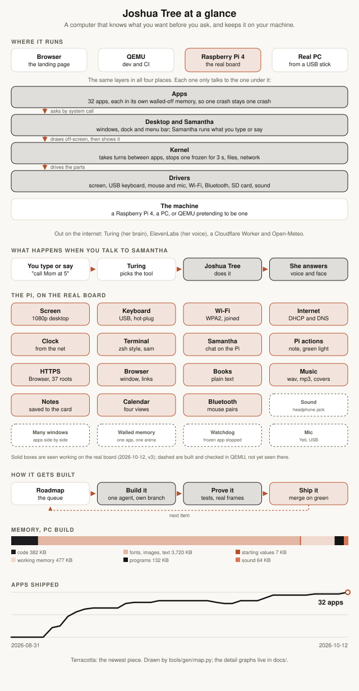
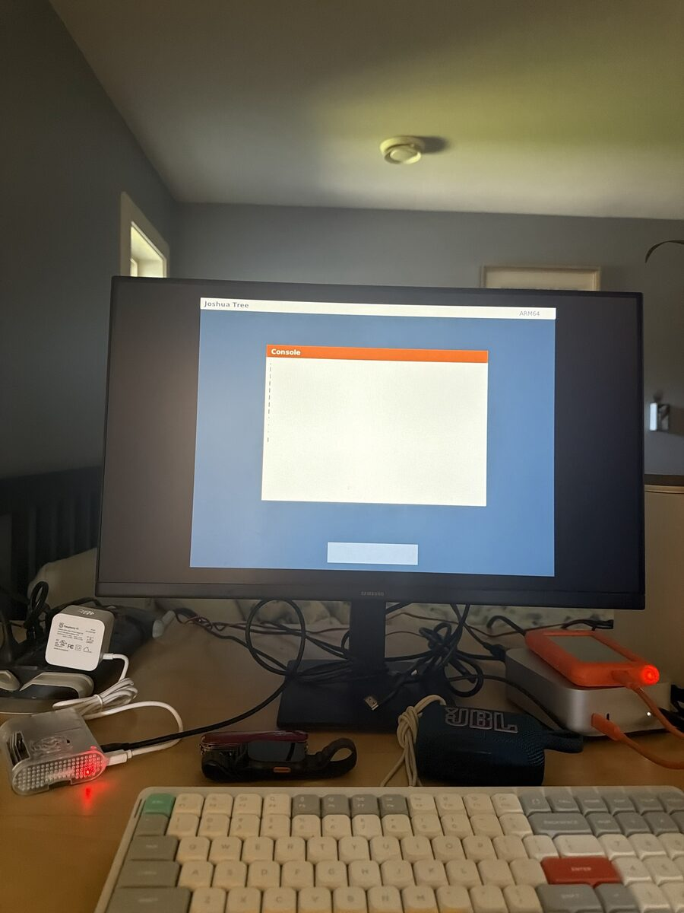
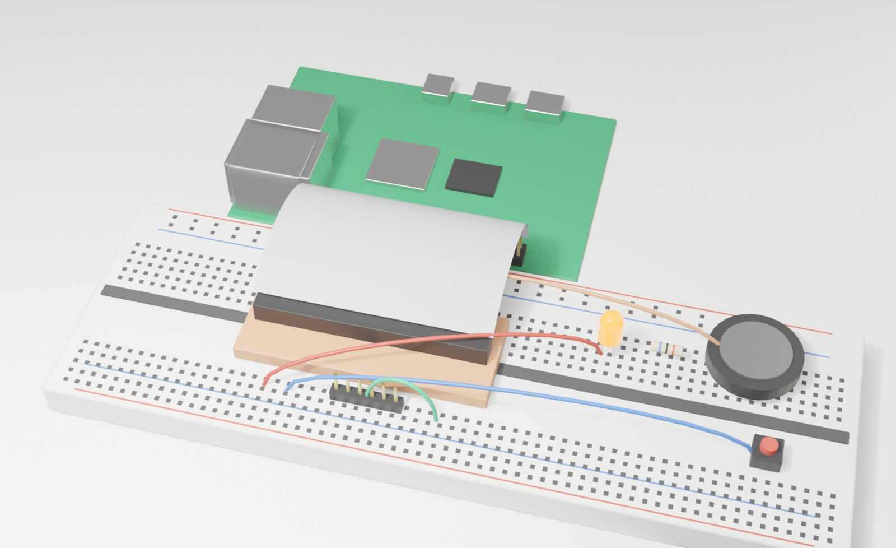

# Joshua Tree roadmap and history

Where it is going, what shipped, and the story so far.

## Contents

- [Roadmap](#roadmap)
- [Next priorities (reviewed 2026-10-18)](#next-priorities-reviewed-2026-10-18)
- [From the gap study (2026-10-11)](#from-the-gap-study-2026-10-11)
- [Daily driver gaps (Joshua, 2026-10-12: "keep identifying gaps and check them off as we go")](#daily-driver-gaps-joshua-2026-10-12-keep-identifying-gaps-and-check-them-off-as-we-go)
- [Next few weeks](#next-few-weeks)
- [The long road: version 3 to 10, and 100 (proposal, 2026-10-05)](#the-long-road-version-3-to-10-and-100-proposal-2026-10-05)
- [Pickup (written 2026-10-03, night)](#pickup-written-2026-10-03-night)
- [Architecture to A+ (refreshed 2026-10-11)](#architecture-to-a-refreshed-2026-10-11)
- [Apps after 2.2 (cheapest first, one agent and one PR each)](#apps-after-22-cheapest-first-one-agent-and-one-pr-each)
- [Our own computer](#our-own-computer)
- [Bloomberg terminal](#bloomberg-terminal)
- [Samantha](#samantha)
- [Desktop and apps](#desktop-and-apps)
- [Tests and the loop](#tests-and-the-loop)
- [Later](#later)
- [Session task queue](#session-task-queue)
- [Landing roadmap summary](#landing-roadmap-summary)
- [Vision](#vision)
- [Blueprint: where the OS goes after 1.0](#blueprint-where-the-os-goes-after-10)
- [Autonomy](#autonomy)
- [Version plan](#version-plan)
- [Shipped log](#shipped-log)
- [Money](#money)
- [Research](#research)
- [Whitepaper](#whitepaper)
- [System design ideas](#system-design-ideas)
- [The book](#the-book)
- [Our story and launch drafts](#our-story-and-launch-drafts)
- [Portfolio mode](#portfolio-mode)
- [Loop handoff](#loop-handoff)
- [Samantha reset postmortem](#samantha-reset-postmortem)

## Roadmap

Freestanding i386 kernel, no libc. This is the forward plan. What already
shipped lives in `git log`, `git tag -l`, and the [GitHub
releases](https://github.com/nulljosh/joshuatree/releases), not here.

See the Blueprint: where the OS goes after 1.0 section for the structural plan of where this OS goes after 1.0.

**Latest**: 4.0: Many windows. Run Calendar, Notes, Music and Books at once, each in its own space. If one crashes, the others never notice.

<!-- NOTE: The **Latest** field is public-facing copy synced to the landing page's h1/eyebrow. Must read as a feature announcement ("Introducing X."), never a changelog line. Update alongside version bumps. tools/gen/inject-landing-headline.sh reads this line automatically. -->

**Model tag on each item**: `[Haiku]` mechanical, known-correct shape, cheap. `[Sonnet]` general feature work with a clear pattern to follow. `[Fable]` anything where a subtly wrong answer still boots fine: privilege isolation, exact register/stack layouts, wire-protocol bytes, memory-model changes. `[Joshua]` a design or scope call, not code. Re-tag if an item turns out easier or harder once opened.

## Next priorities (reviewed 2026-10-18)

The near-term queue. The topic sections below keep the longer plan, and shipped work is in [the Shipped log section](#shipped-log).

**Now: 5.0, Talk to it (Joshua, 2026-10-18: "aim for v5, focus on the mic").** The gate was a ten-minute spoken conversation on the real Pi that opens and changes things. 5.0.0 was cut on Joshua's word on 2026-10-26 ("I'll test tomorrow ... I trust it works"), before that board pass, so items 1 and 3 below stay open and the first 5.0.x patches are whatever the board shows.

Built and passing on QEMU: USB audio and `mic` (4.6.0), speech to text on the Mac (`tools/claude-relay/stt.py`), voice mode (double-tap and hold Space, a mic mark and a level bar), her voice through `[[say]]` with a mouth in the chat view, and the agent loop. Since 4.17.0 `[[open]]` reaches every app Spotlight opens. Left:

1. The board proof (Joshua): the Yeti in a Pi port, `mic` shows the room, hold Space and talk, she answers out loud.
2. A full-screen face whose mouth follows her voice. Done in 4.20.0: the Samantha tile opens her chat across the screen.
3. Whatever the board shows is broken.

**First, the 6.x refinements** (Joshua, 2026-10-26, from the Snow Leopard and Mac OS X 2000 introductions): Movies on the Pi (6.1.0), then long movies streamed from the card with QuickTime-style controls and trim, a magnifying Dock and the genie effect into it, Dock Exposé (click and hold a tile for its windows), Stacks for Downloads and Documents, window buttons that react on hover and dim in back windows, Finder icon sizes with picture thumbnails, Top Sites and full-text history in the browser.

**Also from posts.design** (Joshua, 2026-10-26: the work is the page, almost no chrome):
- [ ] The Launchpad card fades in on `lib/ease.h`'s curve (it needs a card-sized buffer to blend from).
- [ ] Minimize for the kernel-drawn windows (Settings, Browser, Clock, Brick, the Console) and Cmd+M; 6.5.0 covers the EL0 apps.

**Now: 7.0, Online (Joshua, 2026-10-26: "let's focus on internet next").** 6.0, Yours, shipped (2026-10-26): accounts, login, sudo and home folders (4.8 to 4.11), snapshots (4.12), the crash-safe card (4.14), the Users pane (4.15), backups to the Mac and back (5.2.0, 5.3.0), and each person's own wallpaper. The gate for 7.0 is a normal day of web, mail and calendar on the board.

What is there today: Wi-Fi joins from the card's config, DNS and the clock come from the network, and a text browser (`arch/arm64/browser.c`) fetches HTTPS through BearSSL (`tls.c`). Its limits: TLS 1.2 only, 126 baked-in root certificates (Mozilla's list since 6.11.0), a 64 KB reply cap, text only (no images, no clicks on links, no forms, no cookies). Mail and Calendar read files on the card and sync nothing. There is no Ethernet driver for the Pi.

The steps, one minor version each, cheapest unblock first:
- [ ] [Sonnet] Keep-alive, once there is something to reuse a connection for (tabs, inline images): `net.c` holds one connection, so 6.12.0 sends `Connection: close`. 6.45.0's TLS session resumption already skips the costly part of each new connection.
- [ ] [Sonnet] More of CSS for reading: display:none for selectors of three parts or with > + ~ (6.33.0 takes two-part descendants); no JavaScript for 7.0 (a decision to revisit at 8.0). More than eight images a page. Check: a fixture page's pixels.
- [ ] [Sonnet] Wi-Fi passwords typed in Settings in the keychain too (Joshua's call: the Pi joins at boot, before anyone signs in).
- [ ] [Sonnet] CalDAV: a sync in the background instead of on opening Calendar. Board pass: iCloud's real CalDAV, `calendar caldav https://caldav.icloud.com/ APPLE-ID`.
- [ ] [Sonnet] Wi-Fi joins without a restart, and a fresh scan from Settings (6.23.0 lists the start-up scan). Board pass: a card with only `JT/WIFI.TXT` (no built-in network), picked in Settings, joins a home network. Check: the board.
- [ ] [Fable] Later, not a 7.0 blocker: TLS 1.3 (BearSSL stops at 1.2, and most sites still offer 1.2), and Ethernet through the Pi 4's GENET.


**Still open from the 2026-10-11 review:**
- Codex through the relay on the Mac, read-only, never a bare-metal OAuth client on the Pi (research decision 2026-10-10).
- Pi security on the board: verify the TLS relay and HTTPS clock, then drop the build-time clock bootstrap.
- Self-update with a fallback kernel. Check: a fake release that boots once and falls back.
- The local model with real weights read from the card (`tools/checks/arm64-llm-check.py` loading from a FAT image).
- A trademark search before any rename.

**Stand out (Joshua 2026-10-07).** Almost nobody builds their own OS, and fewer get it onto a real board. Lean into that:
- **Our own case.** 3D print the Nimbus case for the Pi 4 (CAD and print pack in `docs/hardware/nimbus/`). Film the first ugly print and every fix. Then sell board, card and case as one kit at about 5x the print cost. The waitlist is already live.
- **Nothing underneath.** No Linux, no Raspberry Pi OS: it boots straight into our desktop. Say it on the box and in the first second of the video.
- **It knows what you want.** The anticipation slice from the Vision section, all on the device. No other hobby OS has an assistant that runs it.
- **A maker pack.** The breadboard prototype (`docs/GUIDE.md` (Breadboard prototype)) with real drivers for the LED, button and speaker, so people can wire their own things to it.
- **Show it in person.** A live Pi on a table at Vancouver maker meetups and the UBC and SFU computing clubs. A Show HN with the 30-second boot video (the Our story and launch drafts section).
- **Later, our own board.** A carrier board for the Raspberry Pi compute module with the mark on it, so the kit is ours down to the copper.

**A guide for everyone (Joshua 2026-10-07).** Documentation a person can read without knowing code. It is a plain-words user guide where every part of the OS, and every file behind it, is explained. A curious reader should understand what each piece does and why it is there.

The plan:
- The guide ([`docs/GUIDE.md` (User guide)](GUIDE.md#user-guide), boot, Wi-Fi and Pi desktop/Clock/Terminal chapters written).
- One chapter per area: boot, memory, screen, apps, network, Wi-Fi, Samantha.
- Each file in `docs/ARCHITECTURE.md` (Architecture) gets a one-line "in plain words" summary.
- A check keeps the two in step.

It is written a chapter at a time, Wi-Fi first because it is freshest.

## From the gap study (2026-10-11)

Five comparisons, one agent each. Every claim was checked against this tree, then a skeptic checked each top item.

The five: SerenityOS, Haiku, Circle (bare-metal Pi), Omarchy and Apple's public iOS guidelines.

The method and the full result are in the Research section. Two gaps survived the skeptic. The rest are worth doing but not yet re-checked.

Refuted, and why, so nobody re-finds them:
- A first-boot welcome card. It hides the boot log that 30 checks read, and Spotlight already opens on any key.
- A key sheet, cmdline.txt boot options and on-device Wi-Fi setup. All are after 5.0 or already queued.
- One search box for actions. It comes after user mode.
- A crash card for apps. There is nothing to build on until M3c.

The research rounds of 2026-10-06 and 2026-10-08 further down still hold. Where they overlap (the crash reporter, W^X, bad-argument syscall tests), the slices here are the ones to build, because they were checked against the tree with a path and line.

Confirmed, 3.0, usable, hours each:
  - `arch/arm64/ask.c` drops every code of 58 or more, so Caps Lock does nothing.
  - `hid_kbd` emits one press per report, so holding Backspace deletes one character (the keyboard is set to idle 0).
  - Track Caps Lock in ask.c (letters only, Shift inverts it).
  - Repeat the last typed key from the main loop after 400 ms, then every 80 ms. Cancel it by release or another key. Typed keys and Backspace only, so Brick is untouched.
  - Check: `tools/checks/arm64-keys-check.py` with a held key over QMP input-send-event (8 to 14 repeats, none after release) and a Caps Lock case through the self-test path.

Worth doing, not yet re-checked, in the order the study ranked them:
- 3.0 stability, hours:
  - an app crash shows a menu bar notice and the desktop carries on
  - the flash script verifies every file on the card before it ejects
  - skipped checks are counted, not passed
  - a crash report with LR, SP and a six-frame stack walk
  - the SoC temperature read every 4 s, with a warning before throttling
  - no page both writable and executable in the M3 loader (W^X, two new EL0 fault cases)
- 3.0 stability, days:
  - a hang watchdog that reboots a frozen board (fed from the main loop and the network wait)
  - a kernel crash that resets after 30 s, once
  - `wifi restart` and an automatic rejoin on deauth
  - a `selftest` command that ends in one PASS or FAIL line, so one photo closes a board pass
  - a real page allocator that frees an app's pages on exit
  - a syscall fuzzer that runs in EL0
  - FAT writes that never lose the old file, and a delete that frees its clusters
- 4.0 usable:
  - USB mass storage read, then MBR and FAT32, so a stick keeps files on the Pi
  - undo and redo in Notes
  - open a file with the app that suits it
  - a Trash that survives a reboot
  - recent items in Spotlight
  - Wi-Fi join by name and password from the Terminal (PBKDF2 on the box)
- 4.0 stability:
  - a fallback kernel through the Pi firmware's tryboot
  - chain-boot a downloaded kernel from RAM
  - a `sendlog` command that posts the boot log to the Mac over TLS
  - network fuzzing on the host under the sanitizers
  - a crash restart with a strike limit
- 4.0 polish and mobile:
  - one theme header for every app's colours and controls
  - sound by DMA so the desktop never stalls
  - a day and night palette on the Pi
  - touch from a USB touchscreen
  - an on-screen keyboard on the Pi

## Daily driver gaps (Joshua, 2026-10-12: "keep identifying gaps and check them off as we go")

Gap study, 2026-10-26 (Joshua ran `/mobbin`). Our apps beside the App Store screens of Fantastical, Bear, Drafts, Things 3, Mercury Weather, CARROT Weather, Delta, Documents by Readdle and Termius. Skipped: anything needing their cloud, accounts, ads or paywalls. Ordered by what gets touched every day, polish before novelty, on the device before the cloud. Each row is one minor version, built on both desktops where the app runs on both, with light and dark screenshots beside the rival's sheet before it ships.

| # | Gap | Who has it | Size | Status |
|---|---|---|---|---|
| 1 | Notes: Cmd+F finds text in the open note, and a search field over all notes | Bear, Drafts | M | open |
| 2 | Calendar: the day's events listed under the month grid, not only dots | Fantastical | M | open |
| 3 | Weather: one line for the next hour ("rain starting in 11 min") from Open-Meteo's 15-minute data | CARROT, Fantastical | S | open |
| 4 | Weather: the next 24 hours as a temperature curve, not only a row of icons | Mercury | M | open |
| 5 | Reminders: Today and Upcoming views, with a date on a reminder | Things 3 | M | open |
| 6 | Burrow: a search field over the folder, and a Recents list | Documents | S | open |
| 7 | Notes: word and character count in the editor | Bear | S | open |
| 8 | Terminal: Ctrl+R searches the command history | Termius | S | open |
| 9 | Weather: saved cities, swipe or arrow between them | Mercury, CARROT | M | open |
| 10 | Calendar: type an event in plain words ("lunch with Sam Tuesday 1pm") and it lands on the day | Fantastical | M | open |
| 11 | Stocks: holdings, a total and the day's gain over the watchlist | Delta | M | open |
| 12 | Desktop widgets: weather, today's events and reminders on the wallpaper | Mercury, CARROT, Things 3 | L | open |
| 13 | A real dark mode across the apps, not only the Terminal | Things 3, Fantastical | L | open |


## Next few weeks

- [ ] [Fable] The browser grows up, after the text browser ships (Joshua, 2026-10-12: "then we'll get JS working etcetera"). In order:
  1. Images (the Pi already has a PNG decoder, JPEG next).
  2. CSS layout (block and inline flow, colours, fonts, a box model, no floats at first).
  3. Forms and cookies.
  4. A small JavaScript engine (an embeddable one such as QuickJS, ported freestanding, with a DOM just big enough for the pages Joshua actually reads).

  Each step is its own PR with its own check against a local test page.

- [ ] [Sonnet] The dock grows to the default macOS set that exists on Joshua Tree.
  - Music, Books, Clock, Calculator and the Browser join the 11 tiles (Apps, Finder, Mail, Calendar, Notes, Reminders, Terminal, Samantha, Weather, Stocks, Trash).
  - One flat house-style icon each from the icon composer, in the Mac's order. The dock narrows its tiles to fit.
  - `GUI_ICON_COUNT`, the dock geometry numbers in the checks (`iconlight-check.py`, `dockhover-check.py`, `iconart-check.py`) and `docs/ARCHITECTURE.md` (Design rules) all move together.
  - An app that has no ARM build yet keeps its tile and says "not on ARM yet".
  - Check: the dock checks pass at the new count.

- [ ] [Fable] Samantha on the device, no relay.
  - A small chat model (Qwen 0.5B class, int8, under 1 GB) baked into the card image and run by the kernel's own inference code.
  - `arch/arm64/llm.c` is a float32 llama2 forward pass today. It needs int8 weights, a tokenizer for that model and a KV cache that fits the Pi's 4 GB.
  - The relay stays the default when the Mac answers. The local model answers when it does not.
  - Check: `tools/checks/arm64-llm-check.py` extended to the real model's tokenizer and a fixed prompt.

- [ ] [Sonnet] Dock magnification settings: a Settings row for off, small and large (6.3.0 ships one size, 160 percent), and the i386 desktop's dock to match through a shared `kernel/dock_draw.c`.
  - Check: extend `tools/checks/arm64-dockmag-check.py` to each size.

- [ ] [Sonnet] `sam "what is 5+5"` takes about a minute on the board while the relay answers in seconds.
  - Read 2026-10-12, not fixed. Relay discovery is already cached (`relay_ip` in `arch/arm64/ask.c`) and `ask_poll` adds no sleep, so the time is somewhere else.
  - Suspects, in order:
    1. A fresh TLS handshake per question without session resume on the Pi (software crypto).
    2. A dead baked `CLAUDE_HOST` costing a 3 s connect plus two 1.5 s probes on each question.
    3. The relay running several agent steps (each one a full POST) on the small local model.
  - Time each step with `ticks()` stamps on the UART on the board first.
  - Check: a stub-relay check that fails when a question costs more than one handshake.
  - At 11:20 PM on 11 October the Clock and the dock tile said the 11th and the month grid circled the 12th. The app read `SYS_TIME` as raw UTC; on the Pi `SYS_TIME` now returns Vancouver wall time through `clock_offset` in `arch/arm64/main.c`, the one time-zone path the Clock already used.
  - Check: `tools/checks/arm64-calicon-check.py` boots 06:20 UTC on 12 October, finds the circled day in the Calendar window (the 11th), and a mutation with the grid back on UTC (`--mutate`) circles the 12th and fails.
- [ ] [Sonnet] Keyboard shortcuts in every app.
  - The Command key (the GUI or Windows key on a PC keyboard) with A select all, C copy, X cut, V paste, Z undo, S save, W close the window, Q quit, N new, F find, Tab to switch windows.
  - Plus Ctrl for the same on a keyboard with no GUI key.
  - One table in the shell. Apps handle the actions.
  - Done on the Pi: C X V A S W Q N, Space and Tab (`arm64-cmdtab-check.py`); N is a new note in Notes on both kernels. Left: Z undo and F find, which each app has to handle.
  - Check: an arm64 key check that sends each chord through QMP and sees its serial line.
- [ ] [Sonnet] The first few seconds after the Pi desktop appears take no keys. Find why and fix it. Since 4.28.1 `boottime` in the Terminal says `first key N ms after the desktop` and `slow step NAME N ms`; read those on the board, then fix the step it names. (The splash, its bar and the login screen shipped: `arm64-splash-check.py`, `arm64-splashbar-check.py`, `arm64-login-check.py`.)


- [ ] [Sonnet] A small voxel building game as a native Joshua Tree app, software-rendered: walk, place and break blocks.
  - Pick a name that is not Minecraft.
  - Check: a host test of the block grid and ray pick, plus a `tools/checks/` boot check that opens the app and sees a frame.
- [ ] [Joshua] Java, step one: a research doc (a docs/JAVA.md research note) on what is possible.
  - A small JVM-style bytecode interpreter for simple programs is in reach.
  - Real Minecraft Java is out of reach.
  - Minecraft streamed from the Mac needs the video path below.
  - Then decide whether to build the interpreter.
  - Check: `check-refs.sh` passes and the doc names what is in and out.
- [ ] [Sonnet] Baseline JPEG decoder on the Pi build, then an MJPEG video path from the Mac relay.
  - Silent first, sound after audio output.
  - The i386 kernel already has `drivers/jpeg.c`. Reuse it.
  - Check: `tools/checks/jpeg-host-check.sh` plus an arm64 check that shows relayed frames.
- [ ] [Joshua] Higgsfield video through the Mac relay, under Joshua's spending rule.
  - Never automatic. Always an explicit yes from Joshua with the cost shown first. One clip at a time. Nothing from Samantha on her own.
  - Check: a relay test that a request without a fresh yes is refused and that Samantha's actions cannot start one.

## The long road: version 3 to 10, and 100 (proposal, 2026-10-05)

A guess at the shape, in Joshua's words as far as they are known. Each version has one idea, so "what is 6.0" has a one-line answer. Nothing here is promised; pick, reorder or cut. Every version ships as small 2.x-style steps first, and the big number is cut only when its one gate is true.

| Version | The idea | The gate that cuts it |
|---|---|---|
| **3.0 Hold it** | Joshua Tree runs on a real Raspberry Pi 4. | The desktop boots on a real board, you can type and click, and one shared `user/` app runs there in user mode. |
| **4.0 Many windows** | Real multitasking. A window server (compositor), real processes, pipes, and a Terminal with tabs, splits and background sessions (the cmux idea). | Three apps run at once, one crashes, the other two do not notice. |
| **5.0 Talk to it** | Samantha is the interface. Full-screen face with a coded mouth, speech in and out streamed, a small model that runs on the box, and "computer, build me a game" for real. | You hold a ten-minute spoken conversation and it opens and changes things on the machine. |
| **6.0 Yours** | One machine, many people, and it keeps your stuff safe. Accounts, a locked disk, Time Machine snapshots, backups. | Delete a file, go back in time, get it back. Pull the plug mid-write, lose nothing. |
| **7.0 Online** | The real internet. TLS 1.3, Wi-Fi, a real browser (Blackcomb on this OS), mail and calendar that sync. | You do a normal day of web, mail and calendar on it. |
| **8.0 Build things** | The machine builds its own apps. The Plank compiler on the box, an SDK, apps as signed bundles, a store for them. | Someone who is not Joshua writes and installs an app without touching the kernel source. |
| **9.0 The kit** | The hardware is a product. Nimbus Kit revisions, two displays, GPU, USB audio, storage and camera. | A stranger builds a Nimbus from the guide and it boots first try. |
| **10.0 Daily driver** | Boring and trusted. A security audit against the threat model, accessibility, languages, long-term support. | Joshua uses it as his only computer for a month. |

**Version 100** is not a plan, it is the point of the whole thing: a computer small enough to read end to end, that you can build yourself from open parts, and that talks to you like a person. Its test is a child with the guide, a Nimbus Kit and an afternoon, who ends the day with their own computer and understands every layer of it. Everything above is steps toward that.

**What stands between here and 10 (2026-10-26).** 7.0 is the list under Next priorities. After it:
- 8.0 Build things: the Plank compiler and a linker on the box, SDK headers, an editor fit for code, a debugger that steps a ring-3 app, signed app bundles and an `install` command fed by a page on the landing.
- 9.0 The kit: the Nimbus revisions, the 8 inch HDMI screen and the DSI touch screen both driven, the GPU (V3D) for compositing, USB storage, a camera, and a guide a stranger finishes on the first try.
- 10.0 Daily driver: a security audit against the threat model, a screen reader, languages, self-update with a fallback kernel, and a month as Joshua's only computer.

**Version 1000** (a guess, 2026-10-26): a computer that outlives its maker. It rebuilds itself from its own source in one sitting, the whole source still reads like a book, it runs on any open board, and people who never met Joshua keep it going.

Order of work from 3.0 on (Joshua, 2026-10-11): usable first, then stable, then polished.
- Usable means a person can do a real thing on the board without the Mac: open an app, type, save, come back tomorrow.
- Stable means it does not crash. When an app does, the desktop stays.
- Polish is the last pass, never the first.

4.0 and 5.0 may go mobile first. That is a phone-shaped Joshua Tree that copies iOS the way the desktop copies macOS: one app full screen, a home grid, gestures, and the on-screen keyboard from `user/libjt/osk.c`. It would run on the 7 inch touch screen or a phone-sized one.

How to use this: the Pickup list below stays the near-term queue. When a Pickup item belongs to one of these versions, tag it (for example `[4.0]`), so the road and the queue stay one list.

### [5.0] Talk to it: Claude Code in Joshua Tree
- [ ] [5.0] [Fable] Claude phase 2: tools on Joshua Tree itself, so Claude can read and change the OS's own files. Needs real TLS on the box or a trusted relay protocol that calls back into the machine.

## Pickup (written 2026-10-03, night)
Open work by topic. The 3.0 gate above also needs a working mouse on the real board; a desktop boot alone does not close it.

### Landing and demo, to A+

The redesigned footer is live in 2.40.0: a spacious directory, original desert art, dark mode and 44px links. Live Chromium and WebKit phone/desktop checks passed.

- [ ] [Sonnet] Phone shows two input bars: the OS draws its own chat bar, and the page draws a real composer for the phone keyboard.
  - Keep one visible.
  - The OS bar can hide while the composer is up. Or the composer can be the only bar and feed the OS.
  - Check: `tools/checks/phone-boot-check.py` plus a screenshot of the phone tour.
- [ ] [Sonnet] The tour is silent after the intro video.
  - Joshua speaks each stop in his cloned voice (`/api/speak` with `voice: "joshua"`, see the personas doc in the Turing repo).
  - The caption is on screen and the speaker button is respected.
  - Check: extend `tools/checks/portfolio-mute-check.mjs` so muted means no audio request.
- [ ] [Sonnet] Real-Chrome QA of the whole tour after any tour change, desktop and phone.
  - Headless Chromium has no H.264, so it skips the intro video. Run the checks with the system Chrome (`CHROMIUM_PATH`).
  - The last full desktop pass was clean (intro, then Epiphany, Scrounge, Bookrank, Lexly, Hikko).
  - The phone tour was last checked before the 2.6.13 fixes.
- [ ] [Sonnet] All icons share one design system.
  - Rule decided 2.12.2 in `docs/ARCHITECTURE.md` (Design rules): a fleet icon keeps its own tile colour and picture (Tonchi stays #2E86DE). It shares the squircle, edge, lip and glyph margin. Its tile stays flat.
  - Still open:
    - Windgate's faint ring runs past the margin (the check exempts fleet icons).
    - Tonchi's picture is a speech bubble.
    - The `APPS` fallback colours for Quotes, Fieldbook and Tonchi are purple or green.
    - App windows keep their own accents (Epiphany and Windgate are blue).
  - Next: make `iconinset-check.py` measure fleet margins, then fix what it finds.
  - Details in PR 425.
- [ ] [Joshua] Judge the live landing against the Plank landing, the bar for the whole site. List what still falls short, in his words.

### From the notebook (Joshua, 2026-10-04)
Two notebook pages checked against the tree. Already shipped and not listed: menu bar with weather, dock, Activity, Trash, clipboard, Burrow (the Finder), Epiphany tabs, Launchpad-style Apps folder, Music, Movies, landing page, docs at 100 percent, CI, Samantha chat with tools. Wi-Fi was ruled out for 1.0 and is under Our own computer.
- [ ] [Joshua] Competitor research as a doc: Apple Mac mini against our box on RAM (8 to 16 GB), integrated CPU, multi-display over HDMI, internal or external design, USB-C ports. A good-computer checklist for `docs/GUIDE.md` (Hardware plan).
- [ ] [Fable] Time Machine: a browse-the-past view. Home-folder snapshots exist since 4.12.0 (`snapshot`, `restore N yes` in the Terminal); a window to look through them does not.
- [ ] [Sonnet] Fullscreen avatar, custom: Samantha (or Joshua's face) full screen as a mode, with the face picked in Settings. The page also lists video, audio and GUI mode as three ways to talk to her.
- [ ] [Fable] An integrated LLM that runs on the box. The small forward-pass runtime landed; real weights from the SD card remain in Next priorities. A full Turing model still needs a memory and runtime decision.
- [ ] [Sonnet] Improved chat app: more tools and persistent memory across boots (a file the app reads at start).
- [ ] [Sonnet] Spotlight: one key opens a search box over apps, files, contacts, events. The Search app does files only; the existing Spotlight-style item under Desktop and apps is the same item.
- [ ] [Sonnet] GarageBand-lite: record and layer a few tracks from the Sound Blaster, then play them back. Movie trim (iMovie) is already listed.
- [ ] [Sonnet] Sharp image everywhere, no visible pixels: audit the icons and small type at retina scale, same bar as the JT retina polish rule.
- [ ] [Fable] The big promise, in his words: say "computer, run the simulation", "build me a game", "publish and monetize my apps", "add X feature", "patch Y bug", and the OS does it. Samantha plus a coding agent plus the publish flow. Scope it as a doc before any code.

### Fleet apps on their real backends (Joshua, 2026-10-04)
Scrounge, Epiphany and Stocks already pull live data through `SYS_HTTP_GET`. The other fleet apps still show samples. The real apps are native Swift and cannot run here, so the OS versions stay C rewrites that talk to the same backends. One PR each, with the offline samples kept as the fallback when the network is down.

#### Every fleet app in the Launchpad (Joshua, 2026-10-04)
The goal: every app in the Portfolio catalog that fits this OS opens from the Launchpad with live data. One app, one PR, same pattern as Bookrank: a read-only Worker route, `SYS_HTTP_GET`, samples offline, a stub check. Let `ci-balance.py` place the new check, never pick a shard by hand. In the Launchpad today: Bookrank, Scrounge, Epiphany, Fieldbook, Hikko, Keyrate, Quotestreak, Stocks, Tonchi, Conway (Toroid), Weather.
- [ ] [Sonnet] Brick: live rental listings.
- [ ] [Sonnet] Hagaki: inbox triage (smart folders over the Mail app's messages).
- [ ] [Sonnet] Nimble: instant answers from its real API. The Terminal command and Samantha's plugin shipped in 5.1.0; the window and its tile are left.
- [ ] [Sonnet] Sidewise: news with the bias rating per source.
- [ ] [Sonnet] Wordroot: look up a word's origin.
- [ ] [Sonnet] Intake (Healstack): today's supplement stack and log.
- [ ] [Sonnet] Windgate: guided breathing, runs offline, a timer and a circle.
- [ ] [Sonnet] Curvely: plot an equation. Numen: a calculator canvas. Both run offline.
- [ ] [Sonnet] Inkpress: RSS reader over a Worker feed route.
- [ ] [Sonnet] Homeward (lost pets) and HomeQi (room check): list views over their APIs.
- [ ] [Sonnet] Dream and Costanza: read-only feeds of entries and poems.
- [ ] [Sonnet] Cadence and Tripwire: commit streak and API drift status.
- [ ] [Sonnet] Plain and Block Frame: fold into Notes as modes instead of new apps, or skip.
- [ ] [Sonnet] Plank: run one-file programs. Needs the compiler ported, the biggest of these.
- [ ] [Sonnet] Blackcomb: the 7.0 browser steps under Next priorities.
- Not planned: Talli (private case data), Swing (video chat), Notate (speech model), Seamark (vision model), NYC, Conveyer, Vancouver Vice. They need hardware or models this OS does not have. Turing is Samantha, already here.

### Voice chat, lag and sharing (Joshua, 2026-10-04)
Checked 2026-10-04: neither side listens yet. Both are typed text in, her voice out, so "voice chat" still needs speech-to-text. Each message in the OS is three round trips in a row: `/api/pick` (which tool), `/api/chat` (the full reply, no streaming), then `/api/speak` per sentence piece. Order: measure, cut round trips, stream, then listen.
- [ ] [Sonnet] Read `voicetime` off the live demo for ten messages and post the numbers here. The web portfolio gets the same line (`console.info`) next.
- [ ] [Sonnet] Skip `/api/pick` when the message plainly is not a tool request, or have `/api/chat` pick the tool in the same call. One round trip less on every message.
- [ ] [Fable] Speech-to-text: mic in, words out. Web first (browser mic plus a hosted STT), then the OS once it has audio input (an SB16 capture path or the Pi's USB mic).
- [ ] [Sonnet] Stream every stage: STT, LLM tokens, ElevenLabs over its WebSocket TTS, audio chunks played as they land. Add barge-in: talking over her stops her.
- [ ] [Sonnet] One shared voice module, the portfolio's code, used by both. The OS stays thin: it opens the voice page or calls a small server, no audio pipeline or TLS of its own.
- [ ] [Sonnet] Hardening: keys server-side only, a per-session cost cap, reconnect on a dropped socket, Claude as the fallback when Turing is down.
- [ ] [Joshua] Live face: Simli or HeyGen LiveAvatar (credit based, about $30 to $500 a month). Veo and Higgsfield stay for pre-rendered ads and intros only.
- [ ] [Joshua] ElevenLabs Agents could run the whole loop with any LLM endpoint as the brain (about $0.08 to $0.10 a minute). Decide: their loop, or ours.

### CI and speed

- [ ] [Sonnet] Convert the remaining fixed scratch paths in `tools/checks/tmp-paths-baseline.txt` to private directories and sockets. The one-suite lock already prevents collisions; keep it until the baseline is empty. Check: `tools/checks/tmp-paths-check.py`.
- [ ] [Sonnet] Six of the last ten red runs were slow-runner timing flakes (Chat tool scenes, the phone mute button, Keyrate, the Apps folder layout): each suite shard already has its own runner and runs its checks serially. Measure CPU load and guest startup before changing concurrency, and watch the next ten runs.
CI now installs ARM QEMU, so ARM regressions run instead of skipping for a missing emulator.
- The 217 checks use the slower of the last green GitHub and local timings.
- ARM build checks sit together on shard 6, so local cleans cannot collide.
- Eight shards and the two-job local cap remain.
- Re-run `tools/gen/ci-balance.py` on the next green GitHub run to measure the new ARM coverage.
- [ ] [Haiku] About a third of recent runs were cancelled by force-pushes to an open PR. Push once per PR, or fold PRs together before CI starts.
- [ ] [Sonnet] Reduce local CI time without raising the two-job concurrency cap. Four concurrent jobs previously exhausted the Mac's memory; measure slow checks and rebalance first.

### Raspberry Pi and ARM64
**Goal (Joshua, 2026-10-06 night, /goal): we can build a mini Joshua Tree with Claude Code inside Joshua Tree on the Pi.**

The Pi runs the OS. The Claude app (phase 1, via a relay on the Mac) is the way in. A session on the Pi edits and rebuilds a small Joshua Tree.

The road there is the queue below:
1. Wi-Fi (the relay needs the network).
2. The desktop and dock.
3. SD writes.
4. `get`.
5. Phase 2 of the Claude app (the model reading and writing the OS's own files through a tool loop).
6. A build toolchain on the box (the Plank compiler, 8.0).

Say honestly what is not here yet in every release note.

Pi queue (Joshua, 2026-10-06 night: "bang out all of those in order of relevance"). Software first. Items that need a part wait for the part.
- [ ] [Fable] Admin and sudo (Joshua, 2026-10-06: "fix it soon"). Done on the Pi in 4.8.0 to 4.10.0: accounts, the login screen, an admin flag, `sudo`, `makeadmin` and `unadmin` (`tools/checks/arm64-sudo-check.py`). Left: the same tier on i386.
  - An admin flag per account, a password prompt before anything that installs, deletes a user or changes system settings, and a normal-user role that cannot. On i386 it touches `kernel/auth.h`, Settings and the syscall gate.
  - Per-user home folders shipped in 4.11.0; file permissions follow (6.0).
- [ ] [Fable] Sound over DMA.
  - Move the PWM FIFO feed to a DMA channel so long sounds do not hold the CPU, then HDMI audio. Then Movies plays a clip with sound on the Pi.
  - An app's sound goes through DMA since 2.59.0 (Music, M3e, `tools/checks/arm64-music-check.py`), waiting on the board.
  - `beep` is still polled. HDMI audio and Movies remain.
- [ ] [Fable] SD card reads and writes through EMMC2, so files survive a reboot and the Wi-Fi firmware can load from the card.
  - Reads (2.53.0) and writes (2.57.0) pass under QEMU and wait on the board.
  - Loading the firmware from the card remains.
- [ ] [Sonnet] `get`, the Joshua Tree installer: a public recipes repo in the Homebrew shape (name, URL, checksum), a C command that downloads an app over Wi-Fi and drops it on the card. Needs Wi-Fi stage 2 and SD writes.
- [ ] [Sonnet] mruby as a ring-3 app: Ruby scripts compiled to bytecode on the Mac, run on Joshua Tree through `user/libjt`. Full Ruby and Homebrew stay out of reach (they need git, curl, a shell and a compiler).
- [ ] [Sonnet] Jellyfin app: list and stream Joshua's movies from the Jellyfin server on the Mac (installed 2026-10-06) through the Movies player. Needs Wi-Fi stage 2 and sound.
- [ ] [Fable] USB audio: the Yeti mic in, a USB speaker out. Then the Samantha box: talk to Joshua Tree on the Pi.
- [ ] [Joshua] The real-board proof of 4.6: the Yeti in a Pi port, `mic` shows the room, hold Space and talk, Samantha answers out loud. Everything else of voice mode and the USB audio driver shipped in 4.6.0 against QEMU.
- [ ] [Fable] Pi camera (needs the part, about $25): a CSI driver, the picture on screen.
- [ ] [Fable] Touchscreen (needs the part, about $60): the i386 touch driver's shape on the Pi's DSI or USB touch.
- [ ] [Fable] Ethernet through the Genet MAC, as the wired backup.
- [ ] [Fable] Serial loader the day the cable arrives: new kernels over the wire, no card swaps.
- [ ] [Fable] The self-update loop (Joshua, 2026-10-06: "make tweaks to the OS from inside the OS, push changes and hot swap").
  1. Ask Claude in the Claude app.
  2. The relay's Claude Code edits the repo on the Mac and opens a draft PR.
  3. CI goes green.
  4. The Pi pulls the new `kernel8.img` over Wi-Fi from a release, writes it to the card and reboots into it.
  - Needs Wi-Fi stage 2, SD writes and plain-HTTP downloads from a mirror.
- [ ] [Fable] A/B boot, so a bad self-update can never brick the Pi: keep the last good kernel on the card as `kernel8.old`, boot the new one once, and fall back to the old one if the new build never reaches the desktop (the Pi bootloader's `tryboot` is the likely mechanism; check it on the board).
Also missing, added 2026-10-06 night, in order:
- [ ] [Fable] The other three cores: wake them from the spin table, give each a stack, run the desktop on one and the drivers on another.
- [ ] [Fable] Bluetooth for the mouse: same CYW43455 chip as Wi-Fi, HCI over the PL011 UART, HID over GATT (Joshua's mouse is Bluetooth Low Energy).
  - BT1 (2.51.0): the patch, the version and `bt scan`, checked against a fake controller.
  - BT2 (2.54.0): `bt pair`, Just Works, GATT HID, boot reports into the pointer, checked against a fake mouse.
  - BT3 (3.5.0): the pairing is saved to `JT/BTPAIR.BIN` and a reboot reconnects it, checked against a fake mouse on a QEMU card.
  - Left: the board test of the reconnect, and report mode for a mouse with no boot report.
- [ ] [Sonnet] Heat and the fan: read the SoC temperature through the mailbox, show it, drive the fan pin.
- [ ] [Fable] Update over Wi-Fi: the Pi fetches the newest kernel8.img from the GitHub release and writes it to the card, then reboots. Needs Wi-Fi stage 2, SD writes and plain-HTTP downloads from a mirror (no TLS yet).
- [ ] [Sonnet] A Wi-Fi settings screen on the Pi: name and password typed on the keyboard and saved on the card, so nothing is baked into the build.
- [ ] [Fable] The Pi 5 (M5): the RP1 chip over PCIe for every peripheral.
Gaps against Linux distributions (Kali, Ubuntu, Arch), 2026-10-06 night. Most are already on the version road (4.0 processes and a real shell, 6.0 users and backups, 7.0 TLS and a browser, 8.0 a compiler and `get`); these are the ones it did not name:
- [ ] [Fable] An SSH server: log in to the Pi from the Mac over Wi-Fi, with its own crypto (ed25519, ChaCha20-Poly1305). It makes the serial cable optional for everything but early boot.
- [ ] [Fable] ext4 read-only, so a Linux-formatted USB stick or card can be opened. FAT stays the default.
- [ ] [Sonnet] A packet capture and ping/traceroute/port-scan toolbox (raw sockets), the part of Kali that is a few tools, not the whole distro.
- [ ] [Fable] Wi-Fi monitor mode, only if the CYW43455 firmware allows it. Kali's wireless tools depend on it. Low priority, owner's own network only.
- [ ] [Sonnet] A sandbox for untrusted apps, the small version of containers: a ring-3 app with no network and a private folder, per `get` recipe.
The rest of the Linux gaps, tagged with the version that owns them (Joshua, 2026-10-06 night: "add those gaps to the roadmap too"). These are the road items in `## The long road`, written out as work you can pick up:
- [ ] [Fable] [4.0] Processes the Unix way: fork and exec, pipes, signals, a process table, exit codes. The base for everything below.
- [ ] [Fable] [4.0] A real shell and Terminal: a command line with pipes, redirects, job control, a PATH and scripts, so `ls | grep` works. Tabs and splits come after.
- [ ] [Fable] [6.0] Users and permissions: accounts, file owners and modes, a login screen, an admin role that can install. Joshua's "admin privileges" idea starts here.
- [ ] [Fable] [7.0] TLS 1.3 in the kernel or a ring-3 library: the gate for HTTPS, so websites, Plex and a real Claude API connection work without a relay.
- [ ] [Fable] [7.0] A web browser on the Pi (Blackcomb on this OS; NetSurf is the reference port). Needs TLS, fonts and a JavaScript engine decision.
- [ ] [Fable] [8.0] A compiler and linker on the box (the Plank compiler first), so the OS can build its own apps. The last piece of "build Joshua Tree inside Joshua Tree".
- [ ] [Sonnet] [8.0] App breadth: ports of Joshua's own apps to native Joshua Tree, in the order they are most used (Bookrank, Tonchi, Curvely), each a ring-3 C rewrite.
- [ ] [Sonnet] Driver breadth, by what Joshua owns: USB mass storage, USB audio, USB Ethernet, a USB serial adapter, a Bluetooth adapter. Each is a class driver on the xHCI code that already works.
- [ ] [Fable] Power management: suspend and resume, CPU frequency scaling, the board's low-power states. Linux does this for free; a hobby OS never does until someone sits down.
- [ ] [Sonnet] A security-update story: a signed release feed, a version check, and a changelog on screen, so "is my Pi current" has an answer.
From the field, 2026-10-06 night (what Onyx and Circle, the two best bare-metal Pi 4 projects, have and we do not), in order:
- [ ] [Fable] VNC server: the Pi's screen on the Mac over Wi-Fi, so debugging stops needing photos and demos need no monitor. After Wi-Fi stage 2.
- [ ] [Fable] A USB stick as the first disk: mass storage over the xHCI driver we have, likely faster to "files survive a reboot" than EMMC2.
- [ ] [Fable] Doom: the classic proof a platform is real, and Joshua's chosen benchmark (2026-10-06: "if we can get doom working that's sort of a benchmark"). Full speed with sound on the Pi is the flag right after 3.0. Keyboard first, gamepad next. Depths (4.23.0) is our own raycaster in its spirit; the real port still needs a small C library, the GPL doomgeneric source kept apart from the Apache tree, and Freedoom data loaded from the disk, not baked into the kernel.
- [ ] [Sonnet] USB gamepad: a HID report parser beside the keyboard and mouse. Doom and Hamurapi on the couch.
- [ ] [Fable] An Atari-style console: our own 6502 core and a tiny TIA-like video chip. Only homebrew games whose authors allow redistribution, never original cartridges (the ROMs are copyrighted). Avoid Tetris-like and Space-Invaders-like designs.
- [ ] [Sonnet] Drop files from the Mac over Wi-Fi: a tiny upload server on the Pi (plain HTTP PUT), no card swap.
- [ ] [Sonnet] `joshuatree.local`: mDNS so the Pi announces its name on the network.
- [ ] [Fable] GPU 3D: the V3D block for real 3D, the way Onyx did it. Samantha's face in 3D is the first use.
- [ ] [Sonnet] I2C and SPI drivers for breadboard sensors and small screens.
- [ ] [Sonnet] Console emulators (NES first), later.
Sources: Onyx on Circle (Adafruit blog, 2026-09-29), Circle's feature list (github.com/rsta2/circle), rpi4-osdev, AROS on the Pi (Hackaday, 2026-08-23).
Round 2, 2026-10-06 night (Raspberry Pi OS Trixie and RISC OS on the Pi 4). Small, all after Wi-Fi:
- [ ] [Fable] Both HDMI ports: the Pi 4 drives two monitors; a second framebuffer through the mailbox display id, the desktop spanning or mirroring.
- [ ] [Sonnet] A Screen settings page on the Pi: resolution, scale, which HDMI, saved on the card.
- [ ] [Fable] Bluetooth audio: speakers and headphones over the same CYW43455 radio. After Bluetooth for the mouse.
Note: RISC OS on the Pi 4 still lists USB 3 as unsupported (riscosopen.org port status); Joshua Tree got xHCI working on the board on 2026-10-06.
Round 3, 2026-10-06 night (macOS Tahoe 26 and Windows 11 2026). Joshua Tree already has the glass look (v48); these are what the two big desktops added that we lack:
- [ ] [Sonnet] Search that understands plain words, Spotlight style: one box that finds files, apps, contacts and actions ("open the clock", "new note") through Samantha. Starts with the Search app we already have.
- [ ] [Fable] A screen reader (Narrator, VoiceOver): speaks the focused control and window title through the sound driver. The accessibility basics the 10.0 gate needs.
- [ ] [Sonnet] A phone link: show a phone's live activities (a timer, a delivery, a call) in the menu bar. Needs Wi-Fi and a small relay; later.
- [ ] [Sonnet] Shortcuts: small chains of actions (open this, type that, play a song) built from blocks, run by a key or by Samantha. Pairs with the Plank language at 8.0.
- [ ] [Sonnet] A built-in network speed test in the Wi-Fi menu, and a signal bar in the menu bar. After Wi-Fi stage 2.
- [ ] [Sonnet] Game mode: a full-screen mode that quiets notifications and background work, for Doom and the handheld idea.
- [ ] [Sonnet] More wallpaper formats (WebP and AVIF through the decoder code we have, JPEG and PNG already work) and a slideshow.
- [ ] [Sonnet] A Start-style launcher you can customise: pin, reorder and hide apps in the Launchpad.
- [ ] [Sonnet] Camera controls in Settings, once the Pi camera driver exists.
Sources: Tom's Guide and TechRadar on macOS Tahoe 26, Pureinfotech and Digital Citizen on Windows 11 2026.
- [ ] [Fable] ARM framebuffer write-combining: map the framebuffer Normal non-cacheable in MAIR, so a live desktop needs no cache cleans. Split out of M1d: QEMU cannot see cache attributes, and a wrong mapping can blank the Pi's screen, so it needs a board test of its own.
- [ ] [Fable] M2: IP, DHCP and a TCP connection on top of the ARM network card (port the i386 stack above the NIC), and the net and disk drivers moved to interrupts too (input already is). Then M3 (EL0 userland and the syscall layer) and M4 (SD through EMMC2, USB through xHCI, Ethernet through the Genet MAC). 3.0.0 ships when M4 shows the desktop on a real Pi. `docs/ARCHITECTURE.md` (ARM64 and the Raspberry Pi) has the milestones.
- [ ] [Fable] ARM IP stack, stage 2: TCP that survives a lost segment (retransmit, reorder, a real window) before the Claude app runs on ARM over Wi-Fi; net and disk drivers on interrupts too (input already is).
- [ ] [Fable] Still ahead on ARM: M3 (EL0 userland and the syscall layer) and M4 (SD through EMMC2, USB through xHCI, Ethernet through the Genet MAC). 3.0.0 ships when M4 shows the desktop on a real Pi. `docs/ARCHITECTURE.md` (ARM64 and the Raspberry Pi) has the milestones.

### x86-64 (Joshua, 2026-10-06 night: "let's do x86-64 next")

Why: the Neo kit's x86 board and almost every PC made after about 2015 is 64-bit and boots through UEFI, and the i386 kernel boots from GRUB on legacy BIOS. Joshua Tree stays one OS with three ports (i386, ARM64, x86-64); the shared code moves into common files so a driver is written once. Slices, each a shippable draft PR, started after Wi-Fi stage 2 and the ARM desktop so the Pi keeps priority:

- [ ] [Fable] x86-64 slice 1, boots and prints: a 64-bit kernel that GRUB or UEFI loads into long mode under QEMU (`qemu-system-x86_64`), sets up 64-bit paging and a stack, and prints to the serial port and the framebuffer. A new headless boot check proves it, named after the ARM one.
- [ ] [Fable] x86-64 slice 2, a machine: the 64-bit IDT and exception frames, the APIC timer, the heap and the page allocator, a keyboard and a mouse.
- [ ] [Fable] x86-64 slice 3, the shared drivers: split the code that assumes 32-bit pointers (`u32` addresses in `kernel/syscall.c`, the PCI and network drivers) behind a pointer-size type, and share the PCIe and xHCI code the ARM port already proved on the Pi.
- [ ] [Fable] x86-64 slice 4, apps: the 64-bit syscall entry (`syscall`/`sysret`), a 64-bit `user/libjt`, and the ring-3 apps rebuilt for it. The 32-bit app ABI stays supported on i386.
- [ ] [Fable] x86-64 slice 5, a real PC: UEFI boot from a USB stick with a GOP framebuffer, USB keyboard and mouse, NVMe or AHCI disks. The first photo from a real x86-64 board closes the slice.
- [ ] [Sonnet] A single `make` per target and one CI line each, so a change to shared code is checked on all three.
- [ ] [Fable] RISC-V (later): the open chip family. Same shape as the ARM port; a cheap board and QEMU's `virt` machine make it the cheapest fourth port to try.

### From the YouTube playlists (checked 2026-10-06)

Both reference series are mapped in the Research section. What is still open from them:

- [ ] [Sonnet] MBR partition tables and FAT32: `drivers/fat.c` is FAT16 on one volume from sector 0, but a Pi SD card is an MBR partition table with a FAT32 boot partition. Needed before the SD driver can read the card it boots from.
- [ ] [Sonnet] ICMP: answer and send pings, so `ping` works on both builds.
- [ ] [Sonnet] An ELF loader beside the flat binaries, so apps built by normal toolchains can run.
- [ ] [Fable] POSIX compatibility for the common calls (open, read, write, fork, exec), part of 4.0.

### From SerenityOS and Haiku (research round 4, 2026-10-06 night)

The two from-scratch desktops closest to Joshua Tree. What they have that we do not, smallest first:

- [ ] [Sonnet] Drag and drop everywhere: a file from Files onto an app, an image into Notes, text between windows. Haiku's signature feel.
- [ ] [Sonnet] One decoder library for every format (Haiku's "translators"): each image, sound and video format decoded in one place, so every app that opens a picture opens all of them.
- [ ] [Sonnet] A crash reporter app: when a ring-3 app dies, a window says which one, why and where, with a "send log" button (SerenityOS CrashServer). The kernel already survives the crash.
- [ ] [Sonnet] A hex editor and a system profiler (which app is using the CPU, sampled), for debugging the OS from inside the OS.
- [ ] [Fable] File tags and live queries (Haiku BFS): attributes on any file (artist, author, status) and saved searches that update themselves. Builds on the Search app.
- [ ] [Fable] Hardening (SerenityOS): no memory both writable and executable (W^X), randomised kernel and app addresses (ASLR), and per-app promises of what it may touch (pledge and unveil). The sandbox item grows into this.
- [ ] [Fable] A graphical debugger: step a ring-3 app, see its registers and memory. Needed once apps are built on the box (8.0).
- [ ] [Sonnet] Fast boot and shutdown as a number on the landing page: power to desktop on the Pi, timed from the photo, beaten each release.
- [ ] [Sonnet] More protocols for the small web: Gemini (tiny pages) and IMAP for the Mail app, after TLS.

Sources: SerenityOS README and Wikipedia; Haiku project pages and Phoronix.

Round 5, 2026-10-06 night (Android and ChromeOS, the phone and the laptop that update themselves). Items not already above:

- [ ] [Fable] Verified boot: the Pi checks the kernel's signature before running it, so a tampered card refuses to boot. Pairs with the fallback kernel.
- [ ] [Sonnet] Reset to factory (ChromeOS powerwash): one Settings button that wipes users and files back to a clean first boot.
- [ ] [Sonnet] Guest mode: a session with no account that leaves nothing behind.
- [ ] [Sonnet] Ask-first permissions (Android): the first time an app wants the camera, the mic, the network or your files, a prompt asks you, and Settings can take it back.
- [ ] [Sonnet] Quick settings: one panel from the menu bar for Wi-Fi, sound, brightness, Bluetooth and do-not-disturb.
- [ ] [Sonnet] Split screen and picture-in-picture: two apps side by side, a movie floating over the desktop.
- [ ] [Sonnet] Clipboard history and an emoji picker, both from one key.
- [ ] [Sonnet] Screen recording to a file, from the screenshot key's menu.

The research loop ends here (Joshua's /loop, 2026-10-06): five rounds now cover Circle and Onyx on the Pi, Raspberry Pi OS and RISC OS, macOS and Windows, SerenityOS and Haiku, Android and ChromeOS. New rounds were starting to repeat what is already listed.

### From the hobby OS comparison (2026-10-08)

The top five gaps from the Research section (written from memory) that were not already on this list:

- [ ] [Fable] Bad-argument tests for every system call (xv6 `usertests`): bad pointers, huge lengths and closed handles. Check: a ring-3 program runs them all and the kernel returns an error for each and keeps running.
- [ ] [Haiku] Attach a debugger to QEMU: lldb on QEMU's gdb stub for both ports. Check: a script boots paused, stops at the kernel entry and reads a register.
- [ ] [Sonnet] A manual page for every shell command, read with `man NAME`. Check: fails if any command in the shell's table has no page.
- [ ] [Sonnet] A ports folder: build scripts for outside C programs against libjt, Lua first. Check: the ported Lua runs a script as a ring-3 app and prints the right answer.
- [ ] [Fable] One driver out of the kernel: the mouse as a ring-3 program. Check: kill it, the kernel keeps running, restarts it, and the pointer moves again.

### Nimbus, the hardware (Joshua, 2026-10-06 night)

Nimbus replaced the stacked-ring Neo case, which was removed in 4.11.6 (Strata was its earlier name). Nimbus is a compact, square box with the original Macintosh as inspiration.

- [ ] [Sonnet] Name check for Nimbus before it goes on a box: domain, trademark search in Canada and the US, and the App Store and GitHub namespaces (the asc-name-creator skill has the bulk domain check). Nimbus is a common word, so confirm it is free for computer hardware.

### Known limits to recheck
- [ ] [Sonnet] `SYS_READFILE` reads with interrupts off, so loading mid-song can glitch the audio.
- [ ] [Sonnet] Music and Movies live in the Apps folder only, not on the dock.
- [ ] [Sonnet] A persistent FAT disk keeps the first copy of every app's `.BIN`: `ring3app_seed` only writes a file that is missing, so after an upgrade the disk still runs the old app (the Music QA ran a pre-fix `MUSIC.BIN` off a reused disk). Compare the embedded checksum and replace a stale copy. Check: boot twice on one disk, the second kernel carrying a different Music, and see the new `music:` line.
- [ ] [Sonnet] Silent movie clips play about twice too fast on this QEMU build.

## Architecture to A+ (refreshed 2026-10-11)

- [ ] Window open takes about 640 ms for a ring-3 app (CI frametime check, 2.0.0): profile the seed, private page table and first draw; preseed binaries at boot and skip zeroing pages that get overwritten. [Sonnet]
- [ ] [Fable] What the ports will need from the ABI: a font syscall (Keyrate carries its own 8x16 bitmap), a tick clock finer than `SYS_TIME`'s seconds, more than one program window at a time, and the framebuffer pages flipped back to supervisor-only on release (today they are zeroed and re-mapped on the next open).
Measured against the closest from-scratch peers: SerenityOS (the one-person-scale benchmark), ToaruOS (own compositor, own libc), KolibriOS (tiny, runs on real PCs), Haiku, and against macOS/Linux. Ranked; the loop works top down. Each line points at the section that closes it.

1. **Real hardware.** Boots only in QEMU: no xHCI USB, no AHCI, no e1000; keyboard needs legacy BIOS mode, saving needs an old IDE disk. The hardware business depends on this. See Our own computer.
2. **A compositor.** Apps draw straight to the framebuffer in blocking loops: at most two windows, no resize or minimize, nothing runs in the background. See Desktop and apps.
3. **Native TLS.** HTTPS goes through the worker proxy, so a browser can't happen yet.
4. **Sound beyond the demo.** The Sound Blaster driver plays audio in QEMU (1.6.9), but every peer ships a music player, and real PCs need AC97 or HD Audio. See Desktop and apps, Our own computer.
5. **Desktop basics.** Undo, right-click menus, drag and drop, an app switcher, a screenshot key. SerenityOS, ToaruOS and KolibriOS all have these (the clipboard landed in 1.0.6, text selection in 1.2.0).
6. **Apps from outside the kernel.** All twenty-five apps are ring-3 programs (Keyrate, Toroid, Calculator, Quotes, Bookrank, Lexly, Plan, Fieldbook, Clock, Portfolio, Activity, Contacts, Sparkjar, Reminders, Scrounge, Calendar, Search, Epiphany, Weather, Burrow, Stocks, Mail, Notes, Terminal, Samantha). No installer, no update path.
7. **Everyday apps peers ship.** An image viewer, a music player, a few games. KolibriOS ships dozens in under 2MB. See Desktop and apps.

Kernel.c is ~9,800 lines with 84 files pasted in; an Opus agent is building the app interface (`feat/app-interface`) so apps move to ring 3. Grading is currently C+.

- [ ] [Fable] Crash reports with function names: build a symbol table into the kernel and print `panic in <function>+offset` over serial and on screen.
- [ ] [Fable] HTTPS without the proxy: native TLS 1.3 in the kernel, then the web browser on top of it.
- [ ] [Fable] The lag (issue #14) profiled, fixed and measured, with frame time numbers in the release notes.
- [ ] [Sonnet] Nothing crashes: bad input in every text field, long lines, empty files, missing disk, no network. Each case gets a check.
  - 1.0.10: empty, oversized, corrupt-FAT and full-disk cases; `tools/checks/filerobust-check.py`.
- [ ] [Sonnet] Icons with taste: depth, soft light, real materials, consistent corner and light direction across all of them. Judged from the gallery at dock, hover and Apps grid sizes.
  - 0.89.0: the 11 dock icons redrawn Big Sur style (one top light, no outlines, 148px art at an exact 2:1); `tools/checks/iconlight-check.py`. Still to do: the 15 Apps-folder fleet icons. Calendar is now a picture, a page with a binding bar and a grid of day squares, with no date on i386 or the Pi: the Pi has no clock, and its blank page with a dash looked half drawn. Check: `tools/checks/calicon-check.py`.
- [ ] [Sonnet] Text sharp everywhere: no bitmap fallback font where the antialiased one should draw, no uneven letter gaps, baselines level.
  - 0.89.0: coverage-to-ink curve (stem darkening) sharpens every AA text path; `tools/checks/textsharp-check.py`.
  - 1.0.9: a retina-bar typography pass judged from real headless crops across the menu bar, a title bar, Notes' paragraph, Terminal's prompt/output, a Settings row, the dock hover label and the Apps folder grid; fixed the Apps folder's glass panel being 19 logical px short of its own grid. `tools/checks/baseline-check.py` measures container padding, baseline flatness and letter-gap variance on real pixels.
- [ ] [Haiku] Accessibility floor: every app opens and closes by keyboard alone. In progress in #127 (Enter on the desktop opens the Apps folder; the check still has to prove all 25). Ships as 1.0.x, not a blocker for the tag.
- [ ] [Fable] Kernel goes 1-bit: ordered dither (4x4 Bayer) replaces every grey and alpha blend.
- [ ] [Sonnet] Window chrome: 1px ink border, hatched title bar, no shadows.
- [ ] [Sonnet] All 23 app icons redrawn as 1-bit line glyphs.
- [ ] [Haiku] Boot splash: the badge drawn scanline by scanline.
- [ ] [Haiku] `landing/icon.svg`, root `icon.svg`, and the app `.icns` redrawn as the simplified tree.
- [ ] [Haiku] Audit that every fleet app has a native port or a line in this roadmap.
- [ ] [Sonnet] File search, Spotlight-style. Needs an index-or-scan design, not a stub.
- [ ] [Fable] A second privilege tier (sudo/admin) on top of the accounts that already exist.
- [ ] [Fable] Text rendering: a dedicated pass on AA quality, separate from the font size/weight controls that already exist.
- [ ] [Fable] Multi-core (SMP).

Decided, not doing: a C++ rewrite (no gain for a freestanding kernel, only risk), and moving the landing page to a `gh-pages` branch.

## Apps after 2.2 (cheapest first, one agent and one PR each)

- [ ] [Haiku] Photos: browse and view JPEG and PNG from Files, next and previous by arrow key. The decoders already exist.
- [ ] [Sonnet] Voice Memos: record with `SYS_AUDIO_RECORD`, save a WAV to Files, play it back in Music.
- [ ] [Sonnet] Samantha media tools: "play something", "pause", "what's playing", one check each.
- [ ] [Sonnet] Movie trim: cut, split and join clips at frame boundaries and save a new AVI. The iMovie-lite step.
- [ ] [Sonnet] Preview: opens images and text files from any Files window. PDF is a later, bigger step.
- [ ] [Sonnet] Step sequencer: a drum and synth loop maker with 8-bit mono sound. The GarageBand-lite step.
- [ ] [Sonnet] Docs: Notes grows into a word processor: bold, italic, headings and lists, saved as plain Markdown so any machine can open it. No `.docx`.
- [ ] [Sonnet] Sheets: a grid with formulas (sum, average, min, max, plain arithmetic, cell references), saved as CSV. The app that makes it feel like a real computer.
- [ ] [Haiku] Slides: a Markdown file becomes full-screen slides, arrow keys to move, one title and a few lines per slide.
- [ ] [Fable] Stereo and 16-bit audio: a second `SYS_AUDIO` op so music stops sounding flat. Unblocks a real music studio (VERSIONS 54).
- [ ] [Fable] A real video codec on this CPU class, only after 3.0 hardware shows what it can decode.

## Our own computer
The OS stays free. Monetization is custom hardware built to run it. Everything this kernel drives today runs on QEMU's emulated devices; porting to physical hardware comes first, not a coding task yet. 1.0 ships a USB-bootable ISO with a PS/2 fallback; USB is the 1.1 headline, built in this order.

- [ ] [Fable] xHCI USB host controller. Everything below hangs off it.
- [ ] [Fable] USB keyboard and mouse (HID). Also covers "Bluetooth" keyboards that ship with a USB dongle.
- [ ] [Fable] USB storage, so an external SSD mounts.
- [ ] [Fable] USB audio in, so a microphone works. Needs the sound work below.
- [ ] [Fable] True Bluetooth: radio over USB, pairing, keyboard and mouse. Hardest, last.
- [ ] [Fable] Wired internet on real PCs: an Intel e1000 driver next to rtl8139 and ne2k, proven with QEMU `-device e1000`. Most PCs from the last 15 years have an Intel or Realtek chip. Stretch for 1.0; if it slips, the release notes say wired internet is QEMU-only.
- [ ] [Fable] Drivers for physical hardware, not just QEMU's emulated devices: AHCI for real SATA disks, on top of the e1000 work above.
- [ ] [Fable] FAT32, read and write: open a normal USB stick or SD card. Today the disk format is Joshua Tree's own, so nothing from another computer opens.
- [ ] [Fable] Load ELF programs from disk at runtime, so apps can ship outside the kernel. First step to installable apps.
- [ ] [Sonnet] Saving on real PCs stated plainly: today only old IDE disks work.
- [ ] [Fable] User profiles and sign-in done properly: login screen at boot, a home folder and settings per person, passwords stored hashed and never in the clear, lock screen, an admin level for risky actions (issue #28). Accounts exist today; this is the pass that makes them trustworthy.
- [ ] [Fable] Sound on real PCs: an AC97 or Intel HD Audio driver next to the Sound Blaster one (1.6.9), which only exists in emulators.
- [ ] [Sonnet] Laptop basics: battery level, trackpad, lid close.
- [ ] [Joshua] One real PC booted from the USB stick, keyboard and mouse working, photographed. The USB image and non-emulator graphics are only proven in QEMU so far.
- [ ] [Fable] Install to disk from the USB stick.
- [ ] [Fable] Wi-Fi.
- [ ] [Joshua] Trademark search and registration (CIPO or USPTO) for Joshua Tree and the mark before the first boxes ship; a quick search found Joshua Tree Technologies LLC and a JOSHUA TREE VOICE mark, and many STRATA marks in the software and computer classes, so clear the names first.

## Bloomberg terminal
Epiphany is the terminal. Stocks stays a basic ticker widget and never grows into this.

- [ ] [Sonnet] Epiphany command bar inside Joshua Tree: `AAPL GP`, `AAPL DES` style commands pulling live market data (PR #252), landing eventually as a native ring-3 port (see Native ports of fleet apps below).

## Samantha
1. **It can make sound.** The Sound Blaster driver plays audio in QEMU (1.6.9).
2. **She speaks.** Chat reads her answers aloud: her server turns the reply into audio the kernel plays as-is (1.6.9).
3. **It can't hear you yet.** A microphone needs USB support first, then a way to send your voice to Whisper.
4. **Her face is on screen.** Chat shows her face and moves her mouth while she talks, from still frames cut out of her video loops (1.6.9).

- [ ] [Sonnet] Samantha's mail tools ship: "read my email" and "email Mom that I'm late" work in Chat, with a scenario check.
- [ ] [Sonnet] Samantha tools for every app: open, read and write Notes, Files, Calendar, Reminders, Weather, Stocks. A few apps a night, one check each.
- [ ] [Sonnet] She says nothing when "Tap to boot" lifts the landing poster: the demo has no greeting line, only the opt-in `?tour` questions, so it needs one short spoken hello sent through her existing speak path, which depends on the voice relay and ElevenLabs key that live outside this repo.
- [ ] [Joshua] Google project for mail sign-in (OAuth client id), then [Sonnet] sign in with Google in Mail.
- [ ] [Sonnet] Lip-synced face: one Higgsfield lip-sync render of a sentence about Joshua Tree, cut into a viseme library, the server sends a mouth timeline with each reply. The face benchmark (PR #241) must grade it A+ (sync is the gap: best so far 55/100).
- [ ] [Sonnet] Chat listens: speak to Samantha instead of typing. She already answers out loud with her face moving (1.6.9); hearing you needs a microphone path first.
- [ ] [Fable] Samantha on-device: run the Turing project's model inside this kernel instead of over the network. Today she is far too big for a 32-bit kernel with integer-only math, so the first step is a much smaller model and an int8 matmul path. Proof: a headless check that answers one fixed question offline.
- [ ] [Fable] Customization system: users can talk to Samantha to modify OS behavior, colors, fonts, layouts; settings persist on disk in a user-bootstrapped config.
- [ ] [Sonnet] Third-party LLM support: let users choose their preferred model provider (OpenAI, Anthropic, local, etc.).

## Desktop and apps
Desktop apps run as protected ring-3 programs. The Pi app port is separate; its current limits are in `docs/GUIDE.md` (Samantha's agent loop on the Pi).

- [ ] [Fable] Per-window backing stores, not drawing straight into the shared framebuffer.
- [ ] [Fable] A compositor with damage tracking, plus the back buffer this kernel still lacks. Pi part done in 4.3.0: a RAM back buffer and one damage rectangle per window move or resize (`arch/arm64/main.c`, `fb_flush`, `desk_compose`). Still open: per-window stores and damage for app redraws, and all of it on i386.
- [ ] [Fable] Input routing by focus instead of the current global key/click pull.
- [ ] [Fable] Every app converted from a blocking loop to open/draw/on_key/on_click handlers, or its own task.
- [ ] [Sonnet] Window resize, minimize, and maximize. Needs the compositor above; once it lands, wire up the two unlit traffic-light dots.
- [ ] [Sonnet] Right-click context menus.
- [ ] [Sonnet] App switcher and global hotkeys.
- [ ] [Sonnet] Lock screen, sleep, and ACPI shutdown.
- [ ] [Sonnet] Maps app. The wallpaper already fetches map tiles.
- [ ] [Sonnet] Undo in editors.
- [ ] [Sonnet] Files app view options: list, grid, columns, with adjustable sorting and grouping.
- [ ] [Sonnet] Mail account configuration: setup for multiple accounts, IMAP/POP/SMTP settings.
- [ ] [Sonnet] Chat app redesign: expanded capabilities, better interface, rename to Sam.
- [ ] [Sonnet] Shell pipes, redirection, and environment variables.
- [ ] [Sonnet] File associations, opening a file in the right app.
- [ ] [Sonnet] Drag and drop.
- [ ] [Sonnet] Notifications posted by apps.
- [ ] [Sonnet] Software update path.
- [ ] [Haiku] Accessibility: text size and high contrast.
- [ ] [Joshua] Landing page polish: slow the demo tour for intimate feel, device-frame chrome, loading states.
- [ ] [Haiku] Window edges and corners: eliminate pixelated rendering, ensure smooth antialiased edges.
- [ ] [Haiku] Dock icon padding and alignment: consistent spacing, balanced visual weight.
- [ ] [Haiku] Window title bar buttons: fit and finish, proper proportions and spacing.
- [ ] [Sonnet] Word processor (Notes) text: improve letter spacing, line height, paragraph margins for better readability.
- [ ] [Sonnet] Lazy-load the boot loading image itself so it never shows visibly pixelated while scaling in. (Found by eye in the 2026-09-21 QA tour, `tools/qa-demo.sh`.)
- [ ] [Sonnet] Mobile Joshua Tree: the landing demo and the OS usable on a phone screen. Mobile first by 2026-10-04.
- [ ] [Sonnet] Photos app: grid of the images on disk, click for full view, arrow keys to move. Built on `drivers/png.c`, plus baseline JPEG if the wallpaper decoder can be reused.
- [ ] [Sonnet] Typeface support: proportional fonts beyond DejaVu, loaded from disk, picked in Settings. Reference look from Joshua: a tight grotesque sans for body and headlines, one display face for titles, hairline rules, flat colour blocks. Sans only in the UI chrome.
- [ ] [Sonnet] Keyboard shortcuts for the snap zones (halves, quarters, full), split out of the snapping item that shipped in #82.
- [ ] [Sonnet] Music app: WAV playback from disk, playlist, play, pause, skip, volume. Unblocked: the Sound Blaster driver shipped in 1.6.9.
- [ ] [Sonnet] Video playback: an MJPEG or raw-frame player synced to audio. Needs the sound driver and a JPEG decoder.
- [ ] [Sonnet] Music app enhancements: equalizer, better playback controls.
- [ ] [Sonnet] Video editor: basic timeline, trimming, and export.
- [ ] [Fable] Dual monitor support: a second framebuffer (QEMU `-device secondary-vga`), the desktop across both, windows dragged between them. Needs the compositor.
- [ ] [Sonnet] Installing and updating apps from inside the OS.
- [ ] [Sonnet] Native Bible app (public-domain KJV on the disk image, book and chapter picker, search).
- [ ] [Sonnet] Settings as a real native app in the dock: wallpaper, text size, system typeface, location, accounts, network status, about. One place, not scattered panels.
- [ ] [Sonnet] Languages: every UI string through one table, a Settings language picker, Latin-1 accents drawn (the DejaVu faces have the glyphs; the text paths drop bytes above 0x7F today).
- [ ] [Sonnet] Ring-3 programs a fresh shell ships with: `cat`, `wc`, `grep`, `calc`. A tiny C compiler is a stretch. First piece landed: `user/libjt/`, a small userland C library (string/ctype/stdlib/stdio) over `jtsys.h`, plus `user/wc.c` built against it (`docs/ARCHITECTURE.md` (System call ABI)'s "Writing a program with libjt"). Still open: porting `hello`/`note` onto it, the rest of `cat`/`grep`/`calc`. The shell installs `WC.BIN` into the active filesystem at boot, so `wc FILE` works without running a developer test first.
- [ ] [Sonnet] Native ports of fleet apps (Epiphany etc.) as ring-3 programs against the syscall ABI.
- [ ] [Sonnet] A split/multiplexed terminal, the buildable substitute for tmux (tmux itself needs pty/job control this kernel lacks).
- [ ] [Sonnet] Moveable dock position, menu bar customization, a network status panel in Settings.

### Mac gaps (Joshua, 2026-10-07)
The Mac apps and menu bar pieces this OS still lacks, listed so they can be picked up one at a time.

- [ ] [Sonnet] Browser (a real web browser app, not a stub).
- [ ] [Sonnet] Messages.
- [ ] [Sonnet] FaceTime.
- [ ] [Sonnet] Preview (open and view documents and images).
- [ ] [Sonnet] System Settings as its own app, not panels inside Settings.
- [ ] [Sonnet] App Store.
- [ ] [Sonnet] Podcasts.
- [ ] [Sonnet] Control Center in the menu bar.
- [ ] [Sonnet] Battery status in the menu bar.
- [ ] [Sonnet] Focus in the menu bar.

## Tests and the loop
Everything a stranger needs to use it for an hour in the browser or an emulator without getting stuck. See the Loop handoff section for what's merging right now.

- [ ] [Sonnet] Dock polish: no white rim on icons, smooth tray and icon corners, hover label with a backing, loading bar drawn at full resolution, Trash visibly empty or full, Terminal out of the default dock (Files, Mail, Calendar, Notes, Reminders, Chat, Weather, Stocks, Settings, Trash).
- [ ] [Sonnet] Boot splash shows the real engraved tree mark at full resolution, not the stick tree.
- [ ] [Fable] Typography QA across Notes, the document app and the Terminal: spacing between letters, baselines, sizes and weights, every printable character, long lines, wrapping, selection. This kernel is a word processor from scratch, so text gets its own checks.
- [ ] [Sonnet] Chat QA: open Chat, switch between models, sign-in gate for subscription models.
- [ ] [Sonnet] A headless test for every app (open, use, close) in `tools/checks/ci-suite.sh`.
- [ ] [Fable] Error handling audit: corrupt or oversized files, full disk, bad input in every text field, missing disk, network or mouse. Each case gets a check.
- [ ] [Haiku] Build and run documented and checked on Apple Silicon, Intel and AMD hosts.
- [ ] [Fable] Samantha fixes her own bugs: a failing check becomes a draft PR she opens herself (Claude for the hard part at first), gated on `tools/ci-local.sh`. First target: the three compiler warnings in the build.

## Later

The following 1.0 decisions are historical context, not the current Pi queue.

Joshua's call, 2026-09-22: **1.0 is a Snow Leopard release.** No new features. Stability, reliability and speed only. New apps and features wait for 1.1.
Joshua's call, 2026-09-21: 1.0.0 is a super thorough QA release. Every feature works, nothing crashes, all text and icons are sharp, and the icons have taste, not a Microsoft look. Real hardware is trusted for now and proven after.
Joshua's call, 2026-09-21: Decided for 1.0, stated in the release notes: no Wi-Fi, no Bluetooth (both need firmware blobs and a full 802.11 or BT stack, months of work each), English only (every UI string is compiled in; a language table is a 1.1 project), no screen reader. Keyboard-only use and large text in Notes are the accessibility floor.

- [ ] [Joshua] V1 product vision: full-color UI with crisp icons and fonts, music and video at 100+ fps, clean typography, mobile-first design discipline across every surface.
- [ ] [Joshua] Public APIs and webhooks: exposing kernel features over HTTP for external automation and integration.
- [ ] [Joshua] Performance targets: 100+ fps sustained in all apps, instant launch times, memory efficiency on low-spec hardware.
- [ ] [Joshua] Plugins system. Needs a design pass on what a plugin can touch first.
- [ ] [Joshua] AI agent accounts: settings, bootstrapping, auth. Too undefined to scope yet.
- [ ] [Joshua] Boot-to-disk install flow with install-speed numbers. Needs hardware boot support first.

Explicitly parked:
- SMP: one CPU is plenty until everything above works (tracked as Multi-core above, but not scheduled).
- A filesystem journal / crash consistency: FAT read support is enough for now.
- A GUI toolkit (retained widgets, layout, scene graph): one hand-drawn screen doesn't justify one yet.
- Voice control via `gato` (`~/Documents/Code/gato`, a separate macOS app): different project on purpose.
- Steam/gaming support: needs OpenGL/Vulkan and anti-cheat compatibility, off the table for a hobby kernel.

Needs a call from Joshua before scoping:
- "Golden gate, new features?" Unclear reference, needs an answer before triage.
- Proprietary filesystem / server mode / GPU framework: three different-sized ideas in one note, needs unpacking.
- Whether `pmm_total_frames()`'s ~15M default frame ceiling can be raised safely. Not attempted.
- A comparative pass against apple.com/macos's own page structure and animation, for landing-page ideas.
- Device-frame chrome for the browser demo: still undone, needs a redesign that doesn't fight the live 16:9 canvas.

## Session task queue
Feeds the landing page's "Where it's going" card automatically via `tools/gen/landing-roadmap.py`. Keep titles short, bold, and current. Each item also needs a `(plain: ...)` phrase right after the title, a few plain words a 20-year-old visitor would understand with zero dev background, that phrase is what actually shows on the landing page, never the dev title. Internal refactor work that a visitor has no way to try (nothing to click, nothing that looks different) uses `(plain: skip)`, which the generator drops from the card entirely instead of translating it into vague visitor-facing words.
1. **One input bar and a talking tour** (plain: a demo that talks you through it) [Sonnet]: the phone shows two bars and the tour is silent after the intro.
2. **Pi relay security** (plain: skip) [Fable]: relay TLS is merged. Next: the Pi finds the relay by itself and Turing answers (PRs open), then a board retest.
3. **Per-check QMP ports** (plain: skip) [Haiku]: parallel test runs stop colliding on fixed ports.
4. **Every icon in one style** (plain: icons that match) [Sonnet]: the fleet icons keep their own tile colors.
5. **Photos, Solitaire, Voice Memos** (plain: photos, games and voice notes) [Haiku]: the "Apps after 2.2" list.
6. **Rich document app, richer Weather icons, native code editor, package tool** (plain: a word processor, nicer weather art, a code editor, installable apps) [Sonnet]: after the Pi boots.

## Landing roadmap summary
`tools/gen/landing-roadmap.py` reads this file's Session task queue and takes up to three open, numbered, bold task titles for the landing page's "Where it's going" card, skipping completed entries and escaping for HTML. `tools/checks/landing-roadmap-check.py` and `tools/gen/landing-roadmap.py --check` are the regression checks. A roadmap change triggers the landing deploy workflow, which regenerates the card before upload.

### Pi follow-ups
- [ ] [Fable] Rendered browse: the Mac relay renders JS pages in headless Chromium for `browse -r`; then QuickJS on the Pi with a tiny page model for simple scripts.

## Vision



The picture above is the source of truth: where it runs, what it is made of, how it talks, how far the Pi has come, and how it gets built. `tools/gen/map.py` draws it from the build. When the picture and the code disagree, fix one of them.

### The north star

A computer that knows what you want before you ask. You open it at nine and your mail is already sorted. You finish a note and the reminder is already drafted. One tap takes it. Ignoring it costs nothing. It never nags, and none of it leaves your machine.

Not built yet. The first slice: Samantha learns your habits on the device (time of day, which app follows which, your calendar) and offers the next thing as a quiet suggestion.

### What Aspen, 1983 points at

At the 1983 Aspen design conference, Steve Jobs said where personal computers were going. Some of it maps onto this project. Some of it only rhymes.

**A motor in every appliance.** The electric motor went from one big machine, to belts across a factory, to small motors in every home. He said the personal computer was that last step. The Pi kit is one too. What we add is that you can read every line it runs.

**Past the "I Love Lucy stage".** New media copy old media first, the way early TV was radio with a camera. The new part is that the computer answers back. Samantha should be that part, not a menu read aloud.

**You can't ask Aristotle a question.** He hoped a machine might one day hold a thinker's way of seeing, so the next one could be asked. That is the closest anchor Samantha has. She is far smaller: an assistant on your desk, not a captured mind.

**A computer in a book, and "a software radio station".** He wanted a great computer in a book for under a thousand dollars, and a way to try software free, the way radio lets you hear a record first. Our echo: a board that costs less than a dinner, an OS that stays free, and a landing page that boots the real thing before you buy anything.

Steve Jobs, Aspen, 1983.

### How we work

Steve Jobs said great artists steal, after Picasso. So we take the best ideas openly, the Mac's menu bar, the Finder, the dock, and make them ours.

Every new thing gets seduced, then attacked, then ignored by the people it threatens. We expect all three. We seduce with the work itself (boot it live, talk to her). We name the enemy plainly: your life on someone else's computer. Then we ignore the incumbents and never compare ourselves to them.

A little anarchy: free, open source, no accounts, no tracking, runs on a small board anyone can buy. Held together by professionalism: every pixel finished, every claim true, every change tested before it ships.

Say no to almost everything. Make the few things that are left wonderful.

## Blueprint: where the OS goes after 1.0

> **Status:** the plan below was carried out. Apps run at ring 3 (user mode), not inside the kernel; this section is kept for the reasoning, shortened on 2026-10-12 (the comparison table and the per-phase write-ups are in git history). Current state: the Architecture section.

The 1.0 problem: every app ran inside the kernel, so one buggy app could take the whole machine down.

The plan was to give each app its own protected space, so a crash closes that app and nothing else. It would go in small safe steps, based on how SerenityOS, ToaruOS, Haiku, Redox and Essence did it.

Where things stood at the time:
- `kernel/kernel.c` was about 9,800 lines.
- Ring 3 existed with real user page tables, a TSS-backed stack switch and 9 syscalls.
- A fault from ring 3 was already reaped without stopping the kernel (`ring3test fault`).
- No GUI app used it, and there was no framebuffer handle, input stream or shared memory in the ABI.

### What the comparison taught

Every OS that ships isolation (SerenityOS, ToaruOS, Haiku, Redox, Essence) does the same thing, whatever its kernel philosophy:
- The kernel exposes a small stable surface for surfaces and input.
- One process runs the compositor.
- Every app is a separate address space talking to it by message passing, never shared memory it can corrupt.

KolibriOS and MenuetOS skip this and keep apps in ring 0 for simplicity.

Precedent notes were summaries of how those projects are laid out. They are direction, not verified history.

### The phases

Each phase was a run of small PRs that pass `make`, `./check.sh` and the headless suite.

1. **Finish extracting in-kernel apps out of `kernel.c`**, one app per PR, to shrink the god file (mechanical).
2. **Harden ring-3 fault isolation**: several concurrent ring-3 tasks, per-task cleanup on reap, and a check that one task can fault without disturbing another. Test the cleanup path, not just the crash path.
3. **The syscalls a GUI app needs**: a window-scoped surface handle, an input-event call, and a shared-memory mapping, as additive v3 syscalls with v1 frozen. Keep the kernel entry points narrow and put convenience in a userland shim.
4. **One pilot app at ring 3** (the Calculator): its job is to break the new ABI cheaply, so expect to revise Phase 3 after it.
5. **A window server or compositor process** that owns the framebuffer and mediates every surface, with per-window backing stores and damage tracking (carry the partial-repaint discipline forward).
6. **The rest of the apps**, one PR each: stateless apps first, then single-file apps, then network apps last. Do it incrementally and keep feature releases shipping in parallel rather than gating on it.

### What it deliberately did not do

No microkernel rewrite (drivers are trusted, in-tree and reviewed like the kernel, so there is no payoff for the IPC cost). No GUI toolkit: ring-3 apps keep drawing immediate-mode against the surface syscalls. No change to the v1 numbers or the `int 0x80` calling convention; every new syscall is additive.

## Autonomy

The honest distance between the Pi on the desk and a computer that fixes itself. Written 2026-10-08, trimmed 2026-10-12: items that have since shipped (software reboot, Bluetooth mouse, encrypted relay, Pi apps) are removed or marked, and the three full task briefs are in git history.

### The goal

You talk to the Raspberry Pi and tell the assistant what to fix in the OS. The change is written, built, tested and merged, the Pi fetches the new kernel, flashes it, reboots into it and says it worked. Over time the model doing the thinking runs on the board, so the whole loop happens on one small computer you own.

### The pipeline, nine steps

1. **The Pi takes the prompt.** Exists: the `sam` command in the Terminal (`arch/arm64/ask.c`), a USB keyboard, Wi-Fi, DHCP, the network clock, live status sent with each question. Missing: voice (no USB audio driver).
2. **The relay.** Exists: `tools/claude-relay/relay.py` on the Mac, with a shared token, one request at a time, a hard timeout and size cap, headless Claude Code or the Messages API with a cheap-or-strong model per question, and an encrypted transport (the Encrypted Pi relay section of GUIDE.md). Missing: the relay cannot start a build; it answers questions and runs two read-only file tools.
3. **Samantha acts.** Exists: `[[note TEXT]]`, `[[led blink]]`, benchmark and the other Pi actions. Missing: an action that means "change the OS" (a `[[fix TEXT]]` that hands a task to the repo agent) and a way for the Pi to learn the result (`[[status]]`).
4. **An agent builds a branch.** Exists: a repo agent on the API credit (`~/.config/joshuatree/agent.py`, outside the repo) with its own branch, a hard cost cap and no push. Missing: a trigger from the Pi, opening the draft PR by itself, and a result file the Pi can poll.
5. **CI.** Exists: `check.yml` on every pull request, `tools/ci-local.sh` on the Mac first, `tools/checks/arm64-*.py` under QEMU. Gap: CI never runs on a real board, so a change that passes QEMU can still fail on the Pi.
6. **A person merges.** Stays human on purpose: Claude opens drafts, a person merges, `--admin` is never used. The release should also attach `kernel8.img` and a checksum so step 7 has a fixed URL; today releases carry the i386 `kernel.elf` only.
7. **The Pi fetches and flashes.** Exists: HTTP GET and POST over Wi-Fi. Missing: SD card writes (MBR and FAT32; the card is a FAT32 volume with `kernel8.img` at the root), a download of several hundred KB into RAM and onto the card with a checksum, and HTTPS or a plain-HTTP mirror trusted by checksum alone.
8. **Reboot into the new kernel, and survive a bad one.** The software reboot now exists (3.6.2). Missing: A/B boot that keeps `kernel8.old`, boots the new image once and falls back if it never reaches the desktop. The firmware's `tryboot` flag is the likely mechanism and must be checked on the board.
9. **Report back.** Exists: the Pi can POST to a host at boot (`arch/arm64/ip.c`, built with `NETPORT=`). Missing: a boot message saying which version came up and whether the last update worked, shown in Samantha's next answer.

### The local model question

There is no model on the board. The relay on the Mac does all the thinking.

A model is mostly a table of numbers. At 4 bits per parameter:
- a 1 billion parameter model takes about half a gigabyte of RAM
- 3 billion takes about one and a half
- 7 billion takes about three and a half, which fits a Pi 4 with 8 GB

Speed is not known and must not be guessed. With four cores and no usable GPU, it is set by how fast the CPU can read the whole table from RAM per word. The first job is to measure it on the board (the bandwidth probe in the Local model section).

With no Linux, libc or llama.cpp, we would write:
- a model file reader (GGUF is documented and simple)
- integer matrix multiply with NEON for 4-bit and 8-bit weights
- the transformer forward pass, with a cache for past tokens
- a byte-pair tokenizer and sampler
- an SD card read (the model must not be baked into `kernel8.img`)
- support for the other three cores, which the kernel parks at boot

A 1 billion parameter model is the right first target. Quality is low at that size. So for a long while it is a fallback and a demo, and the relay stays the brain.

### The gaps, in order

Small is a day, medium a week, large more. Steps 1 to 3 are small and independent; 4, 5 and 7 are the hard middle, because until the Pi can write its card nothing it builds can reach it.

1. `[[fix TEXT]]` (the relay appends a JSON line to a tasks file, `--tasks-file`, off by default) and `[[status]]` (reads the last line of a results file). Small.
2. The repo agent opens a draft PR itself and writes a one-line result the Pi can poll. Small.
3. The release workflow attaches `kernel8.img` and its sha256. Small.
4. SD card writes: MBR walk and FAT32 file write, checked under QEMU. Large.
5. Fetch a release kernel over HTTP into RAM, verify a checksum, write it to the card. Medium, after 4.
6. A/B boot with `tryboot` and a fallback kernel, checked on the real board. Medium.
7. A boot report to the relay. Small.
8. HTTPS on the Pi: vendor the rest of BearSSL's TLS client, one secure fetch as the test. Large.
9. Start the other three cores. Medium.
10. Local inference, 1 billion parameters at 4 bits, measured on the board. Large.
11. Voice in: a USB audio class driver for the Yeti, then speech to text through the relay. Large.

## Version plan

Where this goes, one major version at a time. Up to 10 it's a plan: each version is one promise kept, and the roadmap holds the steps. Past 10 it's a direction, not a schedule. The loop works top down and moves this file as versions ship.

### 1.x: the base (shipped, 2026)

- 1.7: Samantha on your phone. The app interface. Mail, notes and reminders through Samantha. The Epiphany command bar.
- 1.8: A phone home screen: an app grid, one app full screen at a time, a back button.
- 1.9: Touch, an on-screen keyboard, and every app readable at phone size.

### The plan to 10

  - 1.7.7 took the first step: Keyrate runs as a real ring-3 process with its own window, and crashing it on purpose leaves the desktop standing.
- 3.0: Hold it. Joshua Tree runs on a real Raspberry Pi 4: the desktop boots on the board and you can type and click on it, mouse included. Sound from the 3.5 mm jack, Samantha over Wi-Fi through the Mac relay, a new mark. The reference mini PC (UEFI, a real disk, a real network card) moves to a later 3.x.
- 3.1: The Samantha box ships as a kit. The printed case from `docs/hardware/`, a Pi 4, a 7 inch screen, a speaker and the card, bring your own parts (MONEY.md has the math).
- 4.0: Many windows. Real multitasking: a window server, real processes, pipes, a Terminal with tabs and splits. Three apps run at once, one crashes, the other two do not notice. Doom is the proof. May go mobile first: one app full screen, a home grid, gestures.
- 5.0: Talk to it. Samantha is the interface: a full-screen face, speech in and out, a small model on the box. A ten-minute spoken conversation that opens and changes things on the machine. The phone shape, if 4.0 started it, is finished here.
- 6.0: Yours. Accounts, a locked disk, snapshots and backups. Delete a file, go back in time, get it back.
- 7.0: Online. TLS 1.3, Wi-Fi, a real browser, mail and calendar that sync. A normal day of web, mail and calendar on it.
- 8.0: Build things. The Plank compiler on the box, an SDK, apps as signed bundles, a store. Someone who is not Joshua ships an app without touching the kernel.
- 9.0: The kit. The hardware is a product: Neo revisions, two displays, GPU, USB audio, storage and camera. A stranger builds one from the guide and it boots first try.
- 10.0: Daily driver. A security audit against the threat model, accessibility, languages, long-term support. Joshua uses it as his only computer for a month.

The one-line ideas and gates are the roadmap's long-road table (the Roadmap section); this list stays in step with it. Order of work inside every version: usable, then stable, then polished.

### 11 to 100: a direction, not a schedule

- **11 to 20: a family of machines**
  - 11 A laptop: battery, suspend, trackpad
  - 12 Wi-Fi
  - 13 Bluetooth: headphones, keyboards
  - 14 Graphics acceleration on the reference board
  - 15 An ARM port, the second chip family
  - 16 A phone board: cellular modem, cameras
  - 17 External displays and HiDPI everywhere
  - 18 Printers and scanners
  - 19 Power management that beats the laptop's stock OS on battery life
  - 20 Three shipping devices: dev kit, laptop, phone
- **21 to 30: an ecosystem**
  - 21 An SDK anyone can build apps with
  - 22 A package manager and updates for every app
  - 23 An app store
  - 24 Accounts and more than one person per machine
  - 25 Backups and restore
  - 26 Sync between your Joshua Tree devices
  - 27 Plugins for the desktop and for Samantha
  - 28 The first hundred apps by other people
  - 29 Localization into the top 25 languages
  - 30 Accessibility complete: screen reader, voice control, high contrast
- **31 to 40: Samantha grows up**
  - 31 You speak, she hears. Voice in, not just voice out
  - 32 She sees the screen and understands it
  - 33 She runs every app for you, end to end
  - 34 She remembers you, on the device, private
  - 35 She plans multi-step tasks and checks her own work
  - 36 Her face is a real-time, fully lip-synced video, on the device
  - 37 Custom characters: pick her face and voice, or make your own
  - 38 She learns from your corrections without the cloud
  - 39 Samantha for developers: she writes and ships apps with you
  - 40 Most people use Joshua Tree by talking
- **41 to 50: trust**
  - 41 A security audit by outsiders
  - 42 The kernel core formally verified
  - 43 Every app sandboxed with explicit permissions
  - 44 Encrypted disk by default
  - 45 Reproducible builds: anyone can prove the image matches the source
  - 46 A bug bounty
  - 47 Messaging, end to end encrypted
  - 48 Federated services you can host yourself
  - 49 Ten years of updates promised per device
  - 50 Trusted enough for banks and hospitals
- **51 to 60: pro tools**
  - 51 The terminal trades, through real brokers
  - 52 Research: fundamentals, filings, screeners
  - 53 A photo editor
  - 54 A music studio
  - 55 A video editor
  - 56 A full IDE
  - 57 A spreadsheet that runs a business
  - 58 A word processor that runs a publisher
  - 59 Design and 3D tools
  - 60 Professionals switch for the tools, not the novelty
- **61 to 70: scale**
  - 61 10,000 devices shipped
  - 62 An education edition for schools
  - 63 Fleet management for companies
  - 64 100 languages
  - 65 100,000 devices
  - 66 Manufacturing partners build their own Joshua Tree machines
  - 67 Joshua Tree certified hardware program
  - 68 A foundation to steward the OS
  - 69 A million devices
  - 70 Profitable on hardware alone
- **71 to 80: new shapes**
  - 71 The kitchen display: Samantha on the counter
  - 72 The car
  - 73 The watch
  - 74 Glasses
  - 75 One OS across all your devices, handing tasks between them
  - 76 Tiny embedded Joshua Tree for appliances
  - 77 Joshua Tree in space (a satellite or a rover payload)
  - 78 A home server edition
  - 79 Accessibility devices built on it
  - 80 Ten form factors, one kernel
- **81 to 90: it improves itself**
  - 81 Samantha writes most new code, reviewed
  - 82 Updates proven safe before they ship
  - 83 The OS tunes itself to your hardware
  - 84 Drivers written by Samantha from a chip's datasheet
  - 85 Every bug report fixed by Samantha within a day
  - 86 A verified compiler
  - 87 New apps generated from a sentence
  - 88 The OS explains every decision it makes
  - 89 People customize the OS by asking
  - 90 It keeps getting better on its own
- **91 to 100: the computer after the phone**
  - 91 10 million devices
  - 92 Talking replaces tapping for most people who use it
  - 93 100 million people
  - 94 Joshua Tree in every classroom that wants it
  - 95 The default OS on a major hardware brand
  - 96 A billion people
  - 97 The trillion dollar plan in the Money section, reached
  - 98 Fully open, fully verified, fully yours
  - 99 The next person builds their own OS on it
  - 100 A computer you talk to, that anyone can trust, that anyone can read

## Shipped log

One line per version. The full release notes live in the GitHub releases and `git log`; the longer write-ups of each step are in the last commit before the docs merge (`git show 35aa01cb:docs/roadmap-done.md`).

- **6.48.1 (2026-10-27)**: Security fix. A new fuzzer for the calendar parsers (iCalendar feeds, CalDAV REPORT and PROPFIND replies, all from servers anyone can run) found three reads past the end of a buffer on a kernel with no memory protection: `dav_tag` read the byte after a tag name ending at the buffer's end, `dav_href` and the displayname read scanned for `>` with no bound, `dav_feed` matched entities and CDATA past the end, and the feed reader since 6.19.0 compared short last lines to DTSTART and SUMMARY. All bounded now. Check: `ics-fuzz-check.sh` (ASan and UBSan, every truncation and 9000 mutations).
- **6.48.0 (2026-10-27)**: A choice of calendar. When an account holds more than one event calendar, `calendar caldav` lists them by name and uses the first; `calendar use N` picks another. Also a safety fix: CALSYNC.TXT now names the calendar its days were synced with, and another calendar's list deletes nothing, so moving to a different calendar can no longer read your own days as deleted on the server and drop them. Check: `arm64-caldav-check.py` (Personal and Work listed, a switch to Work and a sync there delete nothing, and back).
- **6.47.1 (2026-10-27)**: CI only. The network job caches its packages like the demo job and gets 25 minutes: with the Azure mirror near 20 KB/s its uncached installs ran out the 15, and a cancelled job blocked PRs even though it only reports. A main run was dispatched by hand so pull requests read main's caches instead of each filling its own.
- **6.47.0 (2026-10-27)**: font-weight and text-align from two-part descendant rules (".note span", ".box div"), on the same ancestor tracking 6.33.0 built for hiding. Also a fix: a bold or alignment mark at the start of a line no longer adds a blank line before the next block, so centred and right-aligned pages lose their stray gaps. Check: `arm64-pagestyle-check.py` (both rules, only inside their parent, and no doubled break).
- **6.46.0 (2026-10-27)**: Progressive JPEG. Photos saved progressive (common on news and photo sites) used to fail in Blackcomb; the decoder now reads every scan into each block's coefficients and draws them with the same IDCT. The sanitizer fuzz run covers it. Check: `jpeg-host-check.sh` (four progressive images against PIL, odd sizes included), `decoder-fuzz-check.sh`, `arm64-images-check.py` (one on a page).
- **6.45.0 (2026-10-27)**: TLS session resumption. The Pi keeps the session from a full handshake (four hosts, an hour) and offers it on the next connection to the same name; a server that agrees skips the certificate and key exchange, the slow part on a Pi, so a page's images and the next page on a site arrive sooner. Check: `arm64-browser-check.py` (the server sees the second connection resumed).
- **6.44.0 (2026-10-27)**: Right-aligned text. text-align right (or end) from a rule or an inline style, and align=right, set their lines flush right in Blackcomb, the way 6.35.0 centres; justify still reads flush left, which is how a narrow text column reads best anyway. Check: `arm64-pagestyle-check.py` (a rule and an attribute, each further in than a centred line).
- **6.43.0 (2026-10-27)**: Calendar syncs itself. Once CalDAV is set, opening Calendar (tile, Spotlight, Launchpad or Samantha) runs the sync first when this boot has not synced in 15 minutes, so the app opens on fresh days; new credentials sync on the next open. Check: `arm64-caldav-check.py` (the open syncs and shows what came down; a second open does not).
- **6.42.0 (2026-10-27)**: CalDAV finds the calendar itself. `calendar caldav` takes the account's server (https://caldav.icloud.com/, say) as well as a calendar's own address: PROPFIND finds the principal, its calendar home, and the first calendar there that holds events. A step to another host is followed only under the same parent domain, so the password stays with that provider. Check: `arm64-caldav-check.py` (root, principal, home with an inbox, a tasks list and the event calendar).
- **6.41.0 (2026-10-27)**: Calendar deletes sync both ways. A day you take off the Pi is deleted on the server at the next `calendar sync`, and a day deleted on the server (say in iCloud) leaves the Pi instead of being sent back. CALSYNC.TXT remembers which days both sides had last time; a day the server refused is never on it, so a failed send cannot read as a delete. Check: `arm64-caldav-check.py` (one delete each way).
- **6.40.0 (2026-10-27)**: Text areas. A `<textarea>` is a form field that holds line breaks and up to 1 KB, so a reply or a new message can be more than one short line. In Blackcomb, Shift+Enter starts a new line; at the Terminal, `\n` in `fill` does. The page shows each break as " / ". Mail's Reply and New message boxes use it. Check: `arm64-mailpages-check.py` (a two-line reply from the window, and a long second line from the Terminal, sent whole).
- **6.39.0 (2026-10-27)**: A tab strip in Blackcomb. With two tabs or more a row of tabs sits between the toolbar and the page, each named by its page's title, the front one white; a click brings a tab to the front. It replaces "tab N of M" in the status line. Check: `arm64-tabs-check.py` (the strip's names, and a click on each tab).
- **6.38.0 (2026-10-27)**: Blackcomb's address bar searches your history as you type. From two letters, up to six pages holding every typed word (in the title, address or words) cover the well, newest first; Tab picks one and Enter opens it, and Enter with none picked loads or searches as before. Check: `arm64-history-check.py` (granite finds two, granite kelp one, Tab, Tab, Enter).
- **6.37.0 (2026-10-27)**: Top Sites on Blackcomb's start page, between Favorites and Recent: up to four pages you have visited twice or more, most visited first, read from the searchable history. Check: `arm64-bookmarks-check.py` (a page visited three times listed, one visited once not).
- **6.36.0 (2026-10-27)**: Eight images a page, up from four, still inside the same five-second budget; each is kept at 400 by 300 at most, so eight take 3.75 MiB. Check: `arm64-images-check.py` (a page with ten PNGs loads eight and never asks for the ninth).
- **6.35.0 (2026-10-27)**: Centred text stays centred. `<center>`, align=center, an inline text-align:center and a stylesheet rule that says it all centre their lines in Blackcomb; the Terminal still prints them flush left. Check: `arm64-pagestyle-check.py` (a second page with each kind and a plain line after).
- **6.34.0 (2026-10-27)**: A page's own CSS can make text bold. A rule with font-weight bold, or 600 and up, draws its element bold in Blackcomb, as `<b>` does, and ends where the element does. Check: `arm64-pagestyle-check.py` (a .lead paragraph and a span.hl bold, the words after and a weight-400 paragraph plain).
- **6.33.0 (2026-10-26)**: display:none rules with a descendant selector of two parts ("header .menu", ".nav li") hide too, so more of a page's menus and drawers stay out of the text. Each rule counts its first part's own nesting, the way a hidden element does. Check: `arm64-csshide-check.py` (two-part rules hide, nested lists inside count, a three-part rule is left alone).
- **6.32.0 (2026-10-26)**: Mail in the dock and Spotlight is your real inbox. Once mail is signed in, the Mail tile, Spotlight's Mail and Samantha's open mail all open Blackcomb on mail:; before that they open the Mail app on the card's MAIL.TXT, as before. Check: `arm64-mailpages-check.py` (Mail from Spotlight, signed in).
- **6.31.0 (2026-10-26)**: A form shows its changes at once. Tick a box and the page reads [x], pick a radio and the others clear, step a select and its label changes, type in a field and the text (or its stars) is there, all without a reload, at the Terminal and in Blackcomb. Check: `arm64-formctl-check.py` (`top` after the changes).
- **6.30.0 (2026-10-26)**: A cookie whose Expires date is behind us is deleted, the way sites sign you out ("Thu, 01 Jan 1970 00:00:00 GMT", or the dashed spelling). Max-Age beats Expires when both are there. Before the network sets the clock the build time stands in. Check: `arm64-cookiekeep-check.py` (/expire: both spellings deleted, Max-Age kept).
- **6.29.0 (2026-10-26)**: Mail as pages in Blackcomb. `mail:` is the inbox, the newest ten as links and a New message form; `mail:N` is a message with a Reply form and a link back; both forms send through SMTP, and a send comes back to the inbox. Type mail: in the address bar (it is an address, not a search) or `browse mail:` at the Terminal; before mail login the page says how to set it up. The Terminal's mail commands stay. Check: `arm64-mailpages-check.py` (fixture IMAP and STARTTLS SMTP: the inbox, a message, Reply and Send, the window).
- **6.28.0 (2026-10-26)**: Checkboxes, radio buttons and select menus. A checkbox reads `[x] [N]`, a radio `(o) [N]`, a select `name: Label [N]` with its options read and hidden from the page; `open N` ticks a box, picks a radio and unpicks the rest of its name, or steps a select, and `fill N TEXT` picks a select's option by value or label in any case. A form sends only ticked boxes, the picked radio and the chosen option's value, as a browser does. In Blackcomb, Tab and Enter change one in place and the status line says how. Check: `arm64-formctl-check.py` (the exact query string sent).
- **6.27.0 (2026-10-26)**: History you can search. Every page that loads goes to the top of `HISTWORD.TXT` in the person's home (JT/ with no accounts): its address, title and first 300 characters of words, and a visit count; 40 pages at most. `history` lists the newest, `history WORDS` the pages holding every word in any case, `history top` the most visited, `history clear` empties it. Mail messages are not recorded. Check: `arm64-history-check.py` (three pages, one visited twice).
- **6.26.0 (2026-10-26)**: Cookies kept per person. The jar is the signed-in person's: a cookie its site marks persistent (Max-Age or Expires) is sealed in their keychain and comes back after a restart, a session cookie never leaves memory, and another sign-in (or nobody) empties the jar and loads that person's. `cookies` lists hosts and names, never values; `cookies clear` empties the jar and the keychain's copy. The keychain holds 8 KiB now. Check: `arm64-cookiekeep-check.py` (four boots of one card: kept, restarted, bob, cleared). The games check now keeps pressing and looking for four seconds before it calls a move dead, since a loaded CI runner drew paddle's move late once.
- **6.25.0 (2026-10-26)**: What the page hides stays hidden. A pass over every `<style>` takes the simple selectors (tag, .class, #id, tag.class) whose rules say display:none, @media and complex selectors left out, and the browser skips an element with one of them, the hidden attribute or an inline display:none, nested elements and all: menus, drawers and cookie banners no longer fill the page, and their links take no numbers. Check: `arm64-csshide-check.py` (seven hidden pieces gone, the @media and descendant ones kept, the visible link numbered [1]).
- **6.24.0 (2026-10-26)**: Two-way calendar, step thirteen of 7.0 Online (the table's "calendar that syncs"). `calendar caldav https://.../ USER` takes an app password with stars (https only: Basic auth would otherwise be the password in the clear) and keeps it in the keychain; `calendar sync` PUTs each of the person's own days as `jt-YYYYMMDD.ics`, so a second sync replaces rather than doubles it, then REPORTs the calendar's events into SUBS.TXT, XML escapes and CDATA undone. Deletes are not synced yet. Check: `arm64-caldav-check.py` (a fixture CalDAV server over TLS: a wrong password refused, the PUT's UID and escaped comma, the REPORT read back).
- **6.23.1 (2026-10-26)**: Downloads go in a DOWNLOAD folder and never over a file. Root cause: 6.17.0 saved a download beside the system's own files under its link's name, so a page could link `/wifi.txt` as a download and replace JT/WIFI.TXT (the Pi would join the page's network at its next start), or USERS.TXT, SUDOERS.TXT or a keychain. Now a download lands in `~/DOWNLOAD` (or `JT/DOWNLOAD`), a taken name becomes NAME~1 to NAME~9, and the system's files are never in reach. Check: `arm64-downloads-check.py` (a card with its own WIFI.TXT downloads a hostile /wifi.txt; the card's file stays, the download sits in DOWNLOAD; fails on the old save path).
- **6.23.0 (2026-10-26)**: Wi-Fi in Settings, step twelve of 7.0 Online. A seventh section lists the networks the start-up scan heard, loudest first by name with Strong, Okay or Weak; Enter or a click picks one and opens a password field with stars, no key lines reach the UART while it is open, and Enter saves the name and the PMK the Pi works out for the next start. Its glyph is a dot under three arcs. Check: `arm64-wifi-pane-check.py` over three made-up networks (`make WIFI_FAKE=1`, never in a real build); the Settings check now counts seven sections.
- **6.22.0 (2026-10-26)**: Picking the Wi-Fi network on the Pi, step eleven of 7.0 Online. The network to join is chosen at run time: `JT/WIFI.TXT` (the name and the 32 byte PMK as hex), else the dev card's built-in one, else scan only. `wifi` lists what the scan heard; `wifi join NAME` takes the passphrase with stars, makes the PMK on the Pi (`wpa_pmk`, PBKDF2-HMAC-SHA1, checked against 802.11i's vector) and saves the file, which apps cannot open; the passphrase is never stored. The Pi joins at its next start; the real join is the board pass. Check: `arm64-wifi-join-check.py` (the file is exactly Python's PMK), `wpa-test.c`, and the raspi4b wifi check still boots.
- **6.21.0 (2026-10-26)**: The keychain. An account's secrets live sealed in its home folder as `KEYCHAIN.BIN`: AES-256-GCM under a key PBKDF2 makes from the login password at sign-in, held in memory only while that account is signed in. mail keeps its sign-in there, so a restart does not ask again; `passwd` re-seals it, another account cannot open it, and one changed byte opens nothing. Sign-in takes about twice as long (PBKDF2 for the check, then for the key). Check: `arm64-keychain-check.py` (five boots of one card: kept, restarted, passwd, bob, tampered); the login host test asserts the right password unlocks it once.
- **6.20.0 (2026-10-26)**: Sending mail, step ten of 7.0 Online. `mail send TO SUBJECT | BODY` and `mail reply N BODY` go over SMTP submission with the same app password: on 587 the server must offer STARTTLS and the connection upgrades (tls.c's new `tls_upgrade`) before AUTH PLAIN, so the password never travels in the clear; 465 is TLS from the start. One plain address only, the subject kept to one line, lines starting with a dot doubled. Check: `arm64-smtp-check.py` (a server without STARTTLS is refused and never sees AUTH; the fixture reads AUTH only after TLS).
- **6.19.0 (2026-10-26)**: Calendar subscriptions, step nine of 7.0 Online. `calendar subscribe URL` reads an iCalendar feed (https, http or webcal) into `SUBS.TXT`: each event's date and summary, folded lines joined, escapes undone, one day's events on one line, the 48 soonest from a month ago on. Calendar shows those days beside the person's own, never saves them back, and a day the person has an event on keeps theirs. Check: `arm64-ics-check.py` (the card's SUBS.TXT exactly, EVENTS.TXT untouched, Calendar's count).
- **6.18.0 (2026-10-26)**: Mail over IMAP and TLS, step eight of 7.0 Online. `mail login HOST[:PORT] USER` asks for an app password with sudo's stars and keeps it in memory only, wiped by `mail logout` or when another account (or nobody) is signed in; it goes over TLS alone, the certificate checked like any https page. `mail` lists the ten newest with sender and subject, `mail N` shows one through the browser's renderer: plain text, or a multipart message's HTML part, quoted-printable and base64 decoded, its remote images never fetched. Check: `arm64-mail-check.py` (a fixture IMAP server over TLS; a fake tagged ending inside a message, sent in two pieces, must not end the reply).
- **6.17.0 (2026-10-26)**: Downloads, step seven of 7.0 Online. A reply that is not text or html (a PDF, a zip, an image opened as a link) is saved where an app's files live, the home folder or JT/, under its address's last part as an 8.3 name, and the page on screen stays; `fetch URL` at the Terminal saves any reply, and a 404 is not saved. Blackcomb's status line says where it went. Check: `arm64-downloads-check.py` (the card image holds the server's exact bytes).
- **6.16.0 (2026-10-26)**: Tabs, step six of 7.0 Online. Up to four, each with its own page and history (`tab new`, `tab N`, `tab close`, `tabs` at the Terminal; Cmd+T, Ctrl+Tab, Cmd+1 to 4 and Cmd+W in Blackcomb, where Cmd+W closes the window only once one tab is left). A switch fetches that tab's page again, since one page is held in memory; the status line says "tab 2 of 3". Check: `arm64-tabs-check.py`.
- **6.15.0 (2026-10-26)**: Forms and cookies, step five of 7.0 Online. A text or password field and a submit button are numbered links; `fill N TEXT` (or, in Blackcomb, Tab to the field, Enter, type, Enter, the bar showing stars for a password) sets a field and opening the button sends the form, GET as a query or POST as a body with its hidden fields. A cookie jar keeps `Set-Cookie` from every reply, redirects too, and sends a cookie only back to its own host, a Secure one only over https. `fill` never prints a value. Check: `arm64-forms-check.py` (a login that posts, redirects and comes back signed in, a search form, the window flow).
- **6.14.0 (2026-10-26)**: Inline images, step four of 7.0 Online. Blackcomb fetches up to four PNG or baseline JPEG images after a page's text, scales each to fit 400 by 300 (never up), and draws it where its `` stood, one row slice at a time so scrolling and link clicks keep working. The Pi kernel now links `drivers/jpeg.c`; a missing image logs that it failed. Check: `arm64-images-check.py` (the colours on a screendump where each image was drawn). A page's images share a 5 s budget and the rest are skipped, since the window blocks while they load (CI's real DuckDuckGo page held it long enough to drop keystrokes). CI: the suite and demo jobs keep the `.deb` files they download in a cache, saved right after the installs, since the mirror ran near 30 KB/s that day and one WebKit install took 29 minutes.
- **6.13.0 (2026-10-26)**: Blackcomb draws the page, step three of 7.0 Online. h1 and h2 come out as 20 px bold headings, h3 to h6 bold, and `<b>`/`<strong>` runs bold mid-line, from four style marks `to_text` puts in the page text; the Terminal prints the same page with the marks taken out. Check: `arm64-pagestyle-check.py` (the UART names each styled run, and the big heading's ink stands 1.4 times the paragraph's).
- **6.12.0 (2026-10-26)**: Real pages, step two of 7.0 Online. The browser asks for HTTP/1.1 and gzip, joins a chunked reply and inflates gzip through the PNG decoder's inflate, and reads up to 4 MiB off the wire (was 64 KiB) and 8 MiB once inflated. A chunk cut short is refused, not shown half. Keep-alive waits for tabs: the stack holds one connection. Check: `arm64-realpages-check.py` (a 2 MiB chunked gzip page and a 300 KiB plain one read whole).
- **6.11.0 (2026-10-26)**: The whole web's certificates, step one of 7.0 Online. The Pi trusts Mozilla's root list (curl's extract, 118 roots) beside the 37 it had, 126 anchors once `tls-ta.py` folds the shared ones, so any public HTTPS site verifies, not just the big clouds. Mozilla's list leaves out ten of the old 37 (retired for age), and they stay because BearSSL takes the chain the server sends and cannot find another path. Check: `tls-roots-check.py`; `arm64-tls-check.py` still proves a fetch through an anchor and the refusal without one. CI: the demo job gets 45 minutes too, as the shards did in 6.6.0 (its WebKit install ran 16 minutes and was cut off).
- **6.10.0 (2026-10-26)**: A YouTube video plays from Blackcomb. The video page's Play link asks the Mac's video service for the clip made to fit the Pi's memory (yt-dlp, then ffmpeg to the motion JPEG Movies plays, cut short only when it would not fit), saves it as YT.AVI where your files live, and Movies opens and plays it on its own (PLAYNOW.TXT names the clip, read once). Live: "Me at the zoo" from youtu.be in QEMU. The Pi decoding YouTube itself (MP4, H.264, AAC) is the next step. Check: `arm64-youtube-check.py`.
- **6.9.0 (2026-10-26)**: YouTube in Blackcomb, step one of "play a YouTube video in the browser" (Joshua, 2026-10-26). A watch, youtu.be or shorts address opens a page about the video, its title, channel, length, views and description, from a small service on the Mac (`tools/claude-relay/yt.py`, yt-dlp behind the relay's token and TLS), because YouTube's own page is JavaScript. Next: its Play link. Check: `arm64-youtube-check.py`.
- **6.8.0 (2026-10-26)**: Blackcomb QA on real sites. Curly quotes, dashes and non-breaking spaces in UTF-8 read as ASCII instead of a `?` for every byte, and a page whose words are all script (YouTube, the BBC) says it is built by JavaScript instead of falling back to the start page, and stays out of Recent. Check: `arm64-browser-app-check.py`.
- **6.7.0 (2026-10-26)**: The Browser becomes Blackcomb, the Mac and iPhone browser, ported by its features since its code is SwiftUI over WebKit. An empty window is its start page, Favorites then Recent, and both lists are each person's own, in their home folder. An address with no scheme opens as https when it is a host and searches DuckDuckGo otherwise. Check: `arm64-bookmarks-check.py`.
- **6.6.0 (2026-10-26)**: Window buttons like a Mac's. The window in front shows plain red and yellow dots, with the close X and the minimize bar only while the pointer is over them, and every window behind it goes grey. Only the dots are redrawn when the front window or the hover changes, and a window stacked above keeps its own pixels. The PC keeps its look. Check: `arm64-traffic-check.py`. CI: suite shards get 45 minutes, not 30, since slow mirrors made the installs alone take 20 to 26 minutes that day.
- **6.5.3 (2026-10-26)**: The landing opens on one hard number, 38 apps on a Raspberry Pi, with the desktop shot under it. The app shots now sit in a masonry wall, three across on desktop, two on tablet and one on phone, with an 8 px gap and a small name badge on each shot and no borders or captions. Clips are left out: no per-app clips exist yet, so the wall plays none. Check: `landing-facts-check.py`, `landing-headline-check.sh` and `landing-shots-fresh-check.py`. CI: the Playwright installs run their apt step once and time only the browser download, since a killed `--with-deps` left apt holding the dpkg lock and the retry failed at once (the 6.5.1 retry did that on this PR's demo job).
- **6.5.1 (2026-10-26)**: CI stops losing shards to slow mirrors. `apt-get update` gets 4 minutes and three tries, the Playwright browser install 7 minutes and two, so a stuck mirror fails fast and retries instead of eating the 30 minute shard (6.5.0's first run lost three shards that way, its checks done in 5 minutes).
- **6.5.0 (2026-10-26)**: Minimize with the genie. The yellow dot on an app's window pours it into its dock tile over 0.4 s on `lib/ease.h`'s curve: the rows pinch toward the tile, the nearer the dock the narrower, then the top slides down after them. The app keeps running and its dot stays lit; its tile, Spotlight or the Launchpad bring it back the same way in reverse. Apps without a tile go to the slot before the Trash, as on a Mac. Check: `arm64-genie-check.py`.
- **6.4.0 (2026-10-26)**: One motion curve. `lib/ease.h` holds `ease_out`, an ease-out quint close to the web's `cubic-bezier(.23,1,.32,1)` (borrowed from posts.design), and the PC's boot mark and the Movies bar fade move on it now (the splash bar stays linear: progress should glide evenly, `arm64-splashbar-check.py`). The magnifying dock grows in over 150 ms on it instead of snapping. Check: `arm64-dockmag-check.py` (the first size on arrival is below the last), `bootmark-check.py`, `arm64-movies-check.py`.
- **6.3.0 (2026-10-26)**: The Pi's dock magnifies like the Mac's. The tile under the pointer grows to 160 percent into a strip of room above the tray, its neighbours grow less, and it follows the pointer along the dock; leaving puts the screen back exactly. It also fixes an older sliver: the hover label's soft edge left pixels on the line above the dock, because the saved band started at the tray's top. Check: `arm64-dockmag-check.py`.
- **6.2.0 (2026-10-26)**: QuickTime-style controls in Movies. In fullscreen (`f`) the bar floats over the picture, a dark strip with play, progress and time, and fades out over 0.3 s, 3 s after the last key or click; any input brings it back and a click on it seeks. Paused or ended, it stays up. Trim waits for a way to write big files. Check: `arm64-movies-check.py`, `movie-check.py`.
- **6.1.0 (2026-10-26)**: Movies on the Pi. The motion-JPEG player the PC has had since 2.2 (sound, pause, seek, fullscreen) runs unchanged at EL0, last in Spotlight and the Launchpad (29 entries, a fifth row). Clips of any length stream from the card: a new `SYS_READAT` and `fat_read_at` read each frame and stretch of sound as it plays, where the PC still loads up to 6 MB whole. Checks: `arm64-movies-check.py` (a clip with its second half past 6 MB), `movie-check.py`, `fat-crash-check.py`.
- **6.0.0 (2026-10-26)**: Yours. One machine, many people, and it keeps your stuff safe: accounts and sudo, home folders, snapshots, the crash-safe card, and backups to the Mac and back (5.2.0, 5.3.0). The UI step for this major: each person's own wallpaper, saved in `~/WALL.TXT` by anyone, applied at sign-in, with the card's on the login screen. The mark grows a sixth tuft, low on the short right arm (`tools/gen/logo.py`), on the boot splash, the README and the landing. The launch film's spec is `docs/hardware/ad/yours.json` (the `opus-ad` generator). Cut on the loop's goal before Joshua's board pass; the card carries it. Checks: the full suite on this PR, `arm64-settings-check.py`, `arm64-login-check.py`, `logo-check.sh`, `bootmark-check.py`.
- **5.3.0 (2026-10-26)**: Restore from the Mac, the other half. `restore mac yes` asks the relay's `/api/backup/latest` for the newest backup it keeps for you (`backup_latest` in `relay.py` packs it, leaving out anything the Pi would refuse), then `snap_unpack` in `snap.c` checks every name, depth and size, takes a snapshot so `restore N yes` undoes it, and writes each file over the one of the same name. Nothing is deleted, and a big file or folder in the way is left alone. Checks: `arm64-backup-check.py`, `arm64-snap-check.py`.
- **5.2.0 (2026-10-26)**: Backups to the Mac, the first half of what 6.0 still needed. `backup` in the Terminal packs the signed-in person's home folder (`snap_pack` in `arch/arm64/snap.c`, a snapshot's limits) and sends it to the relay in one request; the relay keeps it only when started with `--backup-dir`, checks every name before writing and renames the finished folder into place (`backup_unpack`, `backup_write` in `tools/claude-relay/relay.py`). Check: `arm64-backup-check.py`.
- **5.1.0 (2026-10-26)**: Nimble on the Pi, ported from the 3.8 draft #568. `nimble QUESTION` in the Terminal asks `nimble.jaybulb.com` and prints the answer and numbered sources (`arch/arm64/nimble.c`), and Samantha gets a plugin table in `ask.c` with Nimble as row one, so `[[nimble QUESTION]]` lets her look things up. The relay now reads 240 characters of the Pi's status field so the plugin line fits beside the brevity line. The Nimble window and dock tile are next. Check: `arm64-nimble-check.py`.
- **5.0.0 (2026-10-26)**: Talk to it. Hold Space and talk to Samantha, she answers out loud with a mouth that follows her voice, opens any app and acts on the machine (USB mic 4.6.0, voice mode, `[[say]]`, `[[open]]` 4.17.0, her full-screen chat 4.20.0). Cut on Joshua's word before his board pass, which is still to come. The mark grows a fifth tuft, low on the long left arm (`tools/gen/logo.py`), on the boot splash, the README and the landing; the README now loads it from `docs/brand/` instead of a 4.6.1 release asset. The UI step for this major is that mark plus what the 4.2x run brought: running-app dots in the dock, every typeface at boot, and the desktop-at-work hero. Checks: the full suite on this PR, `logo-check.sh`, `bootmark-check.py`, `bootlogo-check.py`, `arm64-splash-check.py`.
- **4.29.1 (2026-10-26)**: The README and the landing open on the desktop at work (the Terminal and live Weather open, dots in the dock), and the tiles are Samantha, Burrow, Notes, the Terminal, Weather and Stocks instead of a game. Taking that shot found two bugs: a second i386 window reached into the dock band, so a hover label left a grey bar across it (`gui_multiwin_geom` in `kernel/multiwin.c` now stops it above the band, as a drag already did), and Weather's hourly row climbed into its heading in a short window (`user/weather.c`). Checks: `multiwindow-check.py`, `ring3window-check.py`, `windowsnap-check.py`, `ring3resize-check.py`, `ring3weather-check.py`, `landing-shots-fresh-check.py`.
- **4.29.0 (2026-10-26)**: Cmd+N (or Ctrl+N) is a new document, on both kernels: one new key code, `JT_KEY_NEW` (316), from the chord tables in `kernel/ring3app.c`, `kernel/multiwin.c` and `arch/arm64/boot.c`. Notes takes it as a new note, from the list or from the editor (the open note is saved first). Checks: `clipboard-check.py` (i386), `arm64-clipboard-check.py` (Pi).
- **4.28.1 (2026-10-26)**: Stamps for the Pi's dead first seconds. The UART and the Terminal's new `boottime` say when the first key arrived after the desktop and names any main-loop step that held the keys up 100 ms or more in the first half minute (`TIMED` in `arch/arm64/boot.c`). QEMU takes keys at once, so the cause is on the board; the next board test reads it. Check: `arm64-firstkey-check.py`.
- **4.28.0 (2026-10-26)**: Cmd+Tab on the Pi, from the keyboard-shortcuts item. Cmd+Tab or Ctrl+Tab brings the app window furthest back to the front (`app_cycle` in `arch/arm64/appwin.c`), so taps walk every open window; i386 already had its switcher. Check: `arm64-cmdtab-check.py`.
- **4.27.0 (2026-10-26)**: Every typeface loads at boot (Joshua, 2026-10-07: "load the entire typeface on every boot"): i386 parses all 14 faces and draws one glyph from each before the desktop, keeps them (1,792 bytes of heap) and prints `fonts 14 of 14 ok`; a face that fails is named, stops being offered by name and draws as DejaVu Sans. The Pi prints the same line for its three. Check: `fonts-boot-check.py`.
- **4.26.0 (2026-10-26)**: Running-app dots in the dock on both desktops (Joshua, 2026-10-07: "a little light below the icon, like macOS"): a small neutral dark dot under every tile whose app has a window open, drawn by the shared `gui_draw_dock_dot`. On the Pi the Console's window counts as the Terminal's. Check: `dockdots-check.py`.
- **4.25.2 (2026-10-25)**: The EL0 boot self-tests leave the Pi's `main.c` for `arch/arm64/eltests.c` (1,073 lines to 965). The `app_len`, `app_code` and `app_img` macros live in `kmain.h` only: `main.c` also had dead globals of those names, which the new part would have read as 0. Check: `arm64-m3-check.py`, `arm64-m3c-check.py`, `godfile-check.sh`.
- **4.25.1 (2026-10-25)**: `kmain` leaves `kernel/kernel.c` for `kernel/kmain.c` (1,260 lines to 982), so with `arch/arm64/main.c` at 1,073 then (965 after 4.25.2), both under the 1,000 Joshua asked for. Check: `check.sh`, `panic-symbols-check.py`, `usertest-check.sh`, `iso-boot-check.sh`.
- **4.25.0 (2026-10-25)**: Chess, you as White against the computer, on both builds (Apps folder, the Pi's Spotlight and Launchpad). The rules and the opponent are `user/chess_core.h`, which the host compiles and counts against the standard perft numbers; the board takes the cursor, clicks or typed moves. Check: `chess-core-check.py`, `ring3-chess-check.py`, `arm64-games-check.py`.
- **4.24.0 (2026-10-25)**: The five 4.23 games run on the Pi: Spotlight and the Launchpad list Solitaire, Paddle, Bricks, Depths and Snake, the unchanged user/*.c at EL0. Solitaire moves its help under the cards in a narrow window and Paddle's scores sit at the bar's right end. The Launchpad is seven across and Spotlight shows its first 20 rows. Check: `arm64-games-check.py`, `arm64-launchpad-check.py`, `arm64-spotlight-check.py`.
- **4.23.9 (2026-10-25)**: `gui_run`, the i386 desktop's event loop, and its lock screen and Apple-menu actions leave `kernel/kernel.c` for `kernel/desktop.c` (1,940 lines to 1,260). Check: `check.sh`, `esc-desktop-check.py`, `lockscreen-check.py`, `design-doc-check.py`.
- **4.23.8 (2026-10-25)**: The menu bar and the app viewport leave `kernel/kernel.c` for `kernel/menubar.c` and `kernel/appview.c`, and the triangle painter joins `gui_shapes.c` (2,166 lines to 1,940). kernel.c is under the god-file limit and off its ratchet list. Check: `godfile-check.sh`, `menubar-persist-check.py`, `windowdrag-check.py`, `appclose-check.py`.
- **4.23.7 (2026-10-25)**: The antialiased UI text leaves `kernel/kernel.c` for `kernel/uitext.c` (2,346 lines to 2,166). Check: `textsharp-check.py`, `termmono-check.py`, `textspacing-check.sh`, `design-doc-check.py`.
- **4.23.6 (2026-10-25)**: The i386 wallpaper painters and the day/night tint leave `kernel/kernel.c` for `kernel/wallpaint.c` (2,827 lines to 2,346). Check: `check.sh`, `frametime-check.py`, `wallboot-check.sh`, `design-doc-check.py`.
- **4.23.5 (2026-10-25)**: The keyboard paths, window drag and resize, app windows, the pointer, the crash screen and the console leave the Pi's `main.c` for six files (2,646 lines to 1,073). Build-time macros two parts test live in `kmain.h`. Check: `godfile-check.sh`, `arm64-windows-check.py`, `arm64-crash-check.py`, `arm64-keys-check.py`.
- **4.23.4 (2026-10-25)**: The tree menu, the menu bar, the boot splash and the desktop's first paint leave the Pi's `main.c` for `desk.c` (3,426 lines to 2,646). Checks that read the core's source now read every part through `tools/checks/armcore.py`. Check: `godfile-check.sh`, `arm64-treemenu-check.py`, `arm64-quietboot-check.py`.
- **4.23.3 (2026-10-25)**: Input and the boot sequence leave the Pi's `main.c` for `boot.c`, with a shared header, `kmain.h`, for every part cut from it (3,896 lines to 3,426). CI installs WebKit only in the demo job, since its media libraries made the suite's browser install take 12 minutes on a slow mirror. Check: `godfile-check.sh`, the arm64 suite.
- **4.23.2 (2026-10-25)**: The Pi build's god file starts to split: the virtio drivers leave `arch/arm64/main.c` for `virtio.c`, and the god-file check now covers `arch/`. Check: `godfile-check.sh`.
- **4.23.1 (2026-10-25)**: Each game played to the end. That found Paddle rallying forever, Bricks stuck in one column, and Depths creatures chasing through walls; all three are fixed. Snake got a step mode so a script can play it. Checks: `games-sim-check.py`, `ring3-depths-check.py`, `ring3-snake-check.py`.
- **4.23.0 (2026-10-25)**: Five games in the Apps folder: Solitaire, Paddle (the Pong idea), Bricks (the Breakout idea), Depths (a first-person maze shooter, all our own code) and Snake. To fit them, the baked tree photo ships packed and unpacks on first use, about 1 MB back under the app window. Checks: `ring3-solitaire-check.py`, `ring3-paddle-check.py`, `ring3-bricks-check.py`, `ring3-depths-check.py`, `ring3-snake-check.py`, `png-check.sh`.
- **4.22.1 (2026-10-25)**: CI's Playwright install gets six minutes and one retry. GitHub's runners sometimes hang in it, and a hung install sat for the whole 30 minute job before anyone could rerun it (it hit #671 twice and #672 once). Check: the suite job itself.
- **4.22.0 (2026-10-25)**: The landing page opens on screenshots. The desktop shot leads, every app has a tile, and the page loads no emulator. The live demo is one click away at `?demo` (or any of its old links, like `?desktop`), where the page is what it was before (Joshua: "remove the demo from the landing page, just show screenshots"). Check: `tools/checks/landing-shots-hero-check.mjs`.
- **4.21.1 (2026-10-25)**: The README opens on the whole desktop, then six main apps (Samantha, Notes, Calendar, Terminal, Weather, Hamurapi), and says Samantha answers with no relay (Joshua: "first should be the desktop, second the main apps"). `tools/landing-shots.py desktop` takes it headless; the desktop is mapped to the kernel files that draw it. Check: `tools/checks/landing-shots-fresh-check.py`.
- **4.21.0 (2026-10-25)**: Samantha answers without the relay. When the Mac's relay is out of reach, or the card has no relay token at all, `sam` asks Turing's hosted Samantha at turing.jaybulb.com over HTTPS and prints her answer. Only the question goes out, never the token. Acting on the Pi (`[[open]]`, notes) still needs the relay (Joshua: "fix it so we don't need the relay"). Check: `tools/checks/arm64-sam-hosted-check.py`.
- **4.20.0 (2026-10-25)**: The Samantha tile opens her chat across the screen, menu bar to dock, so her face is the big one (14 rows) with the mouth following her voice. That is the 5.0 full-screen face. The big face now starts at 21 rows, since a full window at 800x600 has about 24. Check: `tools/checks/arm64-samtile-check.py`.
- **4.19.1 (2026-10-25)**: Samantha's face in the chat view is twice as big in a tall window (14 rows when the window has 28 or more, still 7 in a medium one, none in a short one), a step toward the full-screen face for 5.0. Check: `tools/checks/arm64-voice-check.py` still draws it and her mouth still follows the clip.
- **4.19.0 (2026-10-19)**: Talking to Samantha on the Pi is double-tap and hold Space, like Claude Code's voice mode, and nothing else: the typed `hear` command and its quiet detector are gone (Joshua: "replace hear with double click and hold space"). Holding Space now says plainly when there is no USB microphone or no relay token, the two errors `hear` used to give, and `arm64-voicemode-check.py` gained `hear`'s refusal case (a 401 from the words service is reported and nothing reaches the relay).
- **4.18.3 (2026-10-19)**: Second slice of breaking up `kernel/kernel.c` (now 7,282 lines): the map and satellite wallpapers (tile fetch, theme switch, the baked satellite fallback, `wall_apply`) move to `kernel/wallmap.c` (286 lines) behind `kernel/wallmap.h`, and the 17,000-line satellite header compiles with it instead of with kernel.c. The per-pixel readers stay inlined in kernel.c; the photo is reached through one pointer so its 1.5 MB is linked once. No behaviour change. Checks: `check.sh`, `walldefault-check.sh`, `walldemo-regression-check.py`, `wallcompose-check.py`, `bss-margin-check.py`.
- **4.18.4 (2026-10-19)**: Third slice of breaking up `kernel/kernel.c` (now 7,037 lines): `SETTINGS.TXT` load and save and the LLM, Mail and Claude relay settings move to `kernel/settings.c` (250 lines) behind `kernel/settings.h`. Same file format, same keys, same bounds checks; the god-file ceiling drops to match.
- **4.18.5 (2026-10-19)**: Fourth slice of breaking up `kernel/kernel.c` (now 6,724 lines): `pngtest`, `jpegtest`, `heaptest`, `nettest` and `mailtest` leave the shell's 1,729-line `run()` for `kernel/selftest.c`, and the PNG and JPEG test fixtures and `mail.h` compile with them instead of with kernel.c. Same commands, same output; png, jpeg and the shell regression checks pass unchanged.
- **4.18.6 (2026-10-19)**: Fifth slice of breaking up `kernel/kernel.c` (now 6,556 lines): the scheduler demos (`tasktest`, `fputest`, `preempttest`, `killtest`, `spawntest`, `isotest`, `reaptest`) and the tasks they start move to `kernel/taskdemo.c`. Same commands, same output; the shell regression and fpu checks pass unchanged.
- **4.18.7 (2026-10-19)**: Sixth slice of breaking up `kernel/kernel.c` (now 6,393 lines): the shell's file commands (`ls`, `cat`, `write`, `rm`, `trash`, `restore`, `cd`, `mkdir`, `browse`, `fsuse`, `diskuse`) move to `kernel/shellfs.c`. Same commands, same output; nine filesystem and shell checks pass unchanged.
- **4.20.21 (2026-10-25)**: The shell's dispatcher leaves `kernel/kernel.c` (3,033 lines to 2,827): `split_argv` and `run()` move to `kernel/shell.c` byte for byte, apart from comparing against `wall_photo` instead of including the 1.5 MB photo header a second time. `kernel/bench.h` becomes `kernel/bench.c`, so the shell and kmain share one copy. Checks: `tools/checks/shellregress-check.sh`, `tools/checks/shellname-check.sh`, `tools/checks/notetest-check.sh`, `tools/checks/usertest-check.sh`, `tools/checks/files-roundtrip-check.sh`, `tools/checks/picker-check.sh`.
- **4.20.20 (2026-10-25)**: `tools/checks/wallpaper-check.py` (real network, not in the suite) failed on main: it expected the map with only the hour's tint, but `walltheme=map` is the Warm theme, which also applies `gui_map_tint`. It now models that grade per pixel; the screen matches within 0.4 of 255. The map wallpaper itself was fine.
- **4.20.19 (2026-10-25)**: `testapps`, the last self-test in the shell's `run()`, joins `kernel/guitest.c` byte for byte now that `gui_launch` is shared through `kernel/desktop.h`. kernel.c is 3,033 lines. Check: `./check.sh`.
- **4.20.18 (2026-10-25)**: `kernel/phone_home.h`, phone mode's home screen, becomes `kernel/phone_home.c`, the last of the static headers kernel.c included whole. Its header names the four calls kernel.c makes; `portfolio_dock`, `gui_refuse_open` and `cmos_read_time_stable` are declared in `kernel/desktop.h`. kernel.c is 3,058 lines. Checks: `tools/checks/phone-boot-check.py`, `tools/checks/phone-samantha-back-check.py`.
- **4.20.17 (2026-10-25)**: `tools/checks/drunk-mode-check.py` flaked on a slow CI runner (PR 664, "frames identical" on both tries): it slept a fixed 3 s for boot and took its two frames 0.2 s apart. It now waits for `guidesktop` on serial and samples frames until the sway moves one, up to 8 s. Still fails without the `drunk` flag.
- **4.20.16 (2026-10-25)**: `kernel/settings_ui.h`, the whole Settings app kernel.c included, becomes `kernel/settings_ui.c`; its header names the three calls kernel.c makes, and the wallpaper name and order tables are shared through `kernel/wallmap.h`. That frees `settingsclicktest` to join `kernel/guitest.c`. kernel.c is 3,058 lines. Checks: `tools/checks/settingsclick-check.sh`, `tools/checks/auth-flow-check.py`, `tools/checks/lockscreen-check.py`, `tools/checks/walldemo-regression-check.py`, `tools/checks/mailsend-check.py`.
- **4.20.15 (2026-10-25)**: `kernel/auth.h`, the accounts and login code kernel.c included whole, becomes `kernel/auth.c`. A small `kernel/auth.h` names the six functions and two state variables kernel.c and Settings use; hashing, parsing and `USERS.TXT` stay private. `kernel/auth_env.h` holds the kernel calls auth.c makes, so the host harness still compiles the real file with its stand-ins. Next, `settings_ui.h` can follow. Checks: `tools/checks/auth-check.sh`, `tools/checks/auth-flow-check.py`, `tools/checks/lockscreen-check.py`, `tools/checks/input-bounds-check.sh`, `tools/checks/settingsclick-check.sh`.
- **4.20.14 (2026-10-25)**: `stockstest` (possible now that `kernel/stocks.h` is a real header) and `pickcheck` join `kernel/selftest.c`, moved byte for byte; `kernel/kernel.c` is 3,122 lines. Check: `tools/checks/picker-check.sh` (297 of 297 through the shell).
- **4.20.13 (2026-10-25)**: `kernel/stocks.h` becomes `kernel/stocks.c` with a header naming the five functions and two hints kernel.c uses; the quote table, chart points and parser stay private to it. Checks: `tools/checks/ring3stocks-list-check.py`, `tools/checks/stocks-aa-check.py`, `tools/checks/stocks-dock-check.py`.
- **4.20.12 (2026-10-25)**: `kernel/hint.h` becomes `kernel/hint.c` with a real header, so `kernel/appsfolder.c` no longer redefines kernel.c's phone flag to include it. Checks: `tools/checks/phone-boot-check.py` (the hint row is blank on a phone), `tools/checks/appsfolder-layout-check.py`.
- **4.20.11 (2026-10-25)**: `kernel/clockicon.h`, a header of static functions only kernel.c could include, becomes `kernel/clockicon.c` with a real header, so `kernel/icons.c` and `kernel/appsfolder.c` call the Clock face directly and the two wrappers 4.20.7 and 4.20.8 added are gone. The first of the static headers the Loop handoff names. Desktop pixel-identical. Checks: `tools/checks/clockicon-check.py`, `tools/checks/appsfolder-layout-check.py`.
- **4.20.10 (2026-10-25)**: The Apple menu's drawing and hit test and the weather dropdown leave `kernel/kernel.c` (3,264 lines to 3,145) for `kernel/menu.c`, moved byte for byte apart from linkage. Checks: `tools/checks/menubar-persist-check.py`, `tools/checks/lockscreen-check.py`, `tools/checks/menuclock-check.sh`, `tools/checks/walldemo-regression-check.py`.
- **4.20.9 (2026-10-25)**: The brand mark, the boot splash and About leave `kernel/kernel.c` (3,433 lines to 3,264) for `kernel/bootscreen.c`, moved byte for byte apart from linkage. Checks: `tools/checks/bootanim-check.py`, `tools/checks/bootlogo-check.py`, `tools/checks/bootmark-check.py`, `tools/checks/menubar-persist-check.py`, `tools/checks/phone-boot-check.py`.
- **4.20.8 (2026-10-25)**: The Apps folder leaves `kernel/kernel.c` (3,642 lines to 3,433) for `kernel/appsfolder.c`, moved byte for byte apart from linkage. Checks: the seven `appsfolder-*` and `launchpad-*` checks.
- **4.20.7 (2026-10-25)**: The app icon painters and their cache leave `kernel/kernel.c` (4,309 lines to 3,642) for `kernel/icons.c`, moved byte for byte, with the 23 painters made visible to the APPS table. The 1920x1080 desktop is pixel-identical before and after. Checks: `tools/checks/launchpad-centered-check.py`, `tools/checks/appsfolder-layout-check.py`, `tools/checks/clockicon-check.py`, `tools/checks/calicon-check.py`.
- **4.20.6 (2026-10-25)**: The kernel log and the notification panel leave `kernel/kernel.c` (4,464 lines to 4,309) for `kernel/klog.c`, moved byte for byte; the flyout radius moves to `kernel/desktop.h`. Checks: `tools/checks/vmmouse-check.sh`, `tools/checks/menubar-persist-check.py`.
- **4.20.5 (2026-10-25)**: Two shape painters leave `kernel/kernel.c` (4,629 lines to 4,464) for `kernel/gui_shapes.c`, moved byte for byte. The desktop at 1920x1080 is pixel-identical before and after (QEMU screendump). Check: `./check.sh`.
- **4.20.4 (2026-10-25)**: The panic screen leaves `kernel/kernel.c` (4,703 lines to 4,629) for `kernel/panic.c`, moved byte for byte. Checks: `tools/checks/panic-check.py`, `tools/checks/panic-symbols-check.py`.
- **4.20.3 (2026-10-25)**: Another slice out of `kernel/kernel.c` (4,810 lines to 4,703), moved byte for byte: `heapgrow`, `disktest`, `filetest` and `ring3test` join `kernel/selftest.c`; `gfxtest`, `fonttest` and `mousetest` join `kernel/guitest.c`. Checks: `tools/checks/files-roundtrip-check.sh`, `tools/checks/shellregress-check.sh`.
- **4.20.2 (2026-10-25)**: Another slice out of `kernel/kernel.c` (5,042 lines to 4,810): `cursortest`, `texttest`, `wraptest` and `dockstyletest` move to `kernel/guitest.c`, moved byte for byte. The UI face's glyph helpers are now shared through `kernel/desktop.h`. Check: `tools/checks/textspacing-check.sh`.
- **4.20.1 (2026-10-25)**: Another slice out of `kernel/kernel.c` (5,173 lines to 5,042): `usertest` and `notetest` move to `kernel/progtest.c`, with the hello and note binaries compiled there instead of into kernel.c. `notetest`'s argv array grows to five slots, so a third word can no longer write past it. Checks: `tools/checks/usertest-check.sh`, `tools/checks/notetest-check.sh`.
- **4.19.2 (2026-10-25)**: Three more slices out of `kernel/kernel.c` (6,393 lines to 5,173). The shell's network commands (`lspci`, `ifconfig`, `netscan`, `web`, `serve`, `serveapp`, `build`, `tcpmatchtest`, `rxclamptest`), the text web browser and the nine embedded app pages move to `kernel/shellnet.c`. The weather and wallpaper self-tests move to `kernel/wxtest.c`, with the per-pixel wallpaper grades in `kernel/walltint.h` (still always inlined) and the shared menu bar geometry in `kernel/desktop.h`. The window manager (the window table, open, close, focus, snapping, the switcher, screenshots) moves to `kernel/multiwin.c`. The stale `activity-check.py`, which failed on main and was not in the suite, is gone; `ring3activity-check.py` covers it. The Loop handoff section now says where things stand.
- **4.18.2 (2026-10-19)**: The CI split, reviewed and fixed. A check is ARM by what it runs (qemu-system-aarch64 or an arch/arm64 build), not by the shard it sat on: 30 checks move (Stocks onto the ARM runner, about 25 host-only checks off it), and every shard is now about 11 minutes, the slowest 14 before. `ci-balance.py` reads the ARM shards and the shard count from `check.yml`, the one place they are written, and refuses a count the workflow does not run; `ci-local.sh` starts the ARM group first. Check: `ci-tooling-check.py`, which now also proves check.yml, ci-local.sh and SHARDS agree.
- **4.18.1 (2026-10-19)**: Asking Samantha for the weather with no reading yet now fetches one: her tool asks the desktop (`jt_refresh`) and waits up to 15 s for `WEATHER.TXT` to move, keys left queued, instead of saying "open Weather first". `samweather-check.py` had been passing or failing on timing (the desktop's own first fetch now usually lands before the question); it now asserts a real reading and a fetch before her answer, and logs to a per-run temp folder instead of a fixed /tmp path.
- **4.18.0 (2026-10-18)**: A bare `hear` on the Pi records until you stop talking: 1.2 s of quiet after speech sends it, at most 10 s, in 100 ms blocks so a microphone that goes silent still ends. `hear 5` keeps the fixed length. The threshold (`HEAR_LOUD`) is the knob to tune on the Yeti. Check: `hear-quiet-check.py` runs ask.c's real `heard_end` on the host (silence, hiss, speech then quiet, a mid-sentence pause), and its mutant without the reset fails.
- **4.17.0 (2026-10-18)**: Samantha's `[[open APP]]` on the Pi reaches every app Spotlight opens (Notes, Music, Calendar, Books, the games), by the name Spotlight shows, through the same `dock_activate` its Enter uses. It opened eleven named apps before. The roadmap's 5.0 list now says what is built and what is left. Check: `arm64-agent-check.py` opens Notes and Music and refuses a made-up name; its `--mutate` build without the fallback fails.
- **4.16.2 (2026-10-18)**: The Calendar app on the Pi circles the local day, not the UTC one. At 11:20 PM on 11 October the Clock said the 11th and the grid circled the 12th, because `SYS_TIME` handed apps raw UTC. It now returns Vancouver wall time from `clock_offset` in `arch/arm64/main.c`, the same offset `clock_local` uses for the Clock. Samantha's "what time is it" and the Weather weekday were reading UTC too and now read local; the other callers only time gaps or seed. Checked with `tools/checks/arm64-calicon-check.py` (06:20 UTC on 12 October circles the 11th; the `--mutate` build with the grid on UTC circles the 12th and fails).
- **4.16.1 (2026-10-18)**: Two shipped features get the mutation their checks lacked, and their roadmap boxes are ticked. `notes-autosave-check.py` builds a private tree with the timer turned off and must fail on the missing save (`jtvm.py` takes a `JT_KERNEL` override for it); autosave shipped in 2.55.0. `arm64-keys-check.py` rebuilds with held-key repeat disabled and requires the held-j step to fail; Caps Lock and repeat shipped in 2.52.0. A bare `make` links the kernel again (its first rule had become memmap.ld). No kernel change.
- **4.16.0 (2026-10-18)**: Nimbus closes the landing page. The footer's desert engraving is replaced by the Nimbus render, cut out on the page's paper; a WebGL shader hatches its shadow in the accent and sends rounded waves out from it, the computer you talk to, talking. The plain cutout is the fallback without WebGL; `render_nimbus.py` makes it with `NIMBUS_CUTOUT=1`. Check: `landing-specs-footer-check.mjs`.
- **4.15.2 (2026-10-18)**: The stacked-ring Neo case is gone: its CAD, STLs, renders, blueprint, build sheet, assembly steps and three GUIDE sections. Nimbus is the only case. `render_nimbus.py` also renders wallpapers (`NIMBUS_WALL` with a size, camera and aim). The Neo film script (`docs/hardware/ad/anim.py`, which built on the deleted concepts.py) goes too.
- **4.15.1 (2026-10-18)**: The Terminal prompt shows who is signed in: `ann@tree % ` instead of always `joshua@tree % `. With no accounts it stays `joshua@tree % `. `ask_prompt()` rebuilds one static buffer from `current_user` (no heap); the echoed line on the UART carries the same prompt. Checked by `tools/checks/arm64-sudo-check.py` (bob signed in sees `bob@tree % `) and `arm64-zsh-check.py` (no accounts, unchanged).
- **4.15.0 (2026-10-19)**: A Users pane in the Pi's Settings, so accounts are managed without the Terminal. The sixth section lists the accounts and marks the admins; Add user (name, password twice), Change password (your own needs the old one, someone else's needs an admin), an Admin switch and Remove user with a confirm step. Every privileged change asks the signed-in admin's password through the same `sudo_check` and shares sudo's remembered five minutes; a normal user sees the list and changes only their own password. Passwords are stars on screen and no key line reaches the UART while one is typed. It runs the Terminal commands' own code (`cmd.c` `users_add`, `users_delete`, `users_passwd`). Keys and mouse both work. `arch/arm64/users_ui.h`; `tools/checks/arm64-users-check.py` drives it in QEMU, checks the card across a reboot and the UART for leaks, and catches a pane that skips the admin check.
- **4.14.0 (2026-10-18)**: Crash-safe card, slice 6 of 6.0. Pulling the power mid-write never corrupts the FAT or loses a replaced file's old contents: new data goes to fresh clusters, one directory-sector write flips the entry, then the old clusters are freed, and at mount a scan frees clusters no entry reaches, syncs the FAT copies and fixes FSInfo's free count. `USERS.TXT` takes the same path. `tools/checks/fat-crash-check.py` cuts the power after every sector write and wants `fsck.fat` clean and the file old or new, never a mix. The scan's bitmap and sectors come from the heap at first mount, so the i386 kernel keeps its 16 KB margin below the program window.
- **4.13.2 (2026-10-19)**: First slice of breaking up `kernel/kernel.c` (8,048 lines, now 7,572): the menu-bar weather moves to `kernel/weather.c` (490 lines) with `kernel/weather.h` as its whole interface. No behaviour change. Checks: `check.sh`, `ring3weather-check.py`, `samweather-check.py`, `wallfx-check.py` and the shell's own weather self-tests, which now call into weather.c.
- **4.13.1 (2026-10-18)**: Notes on the Pi saves itself with no network. The two second autosave timed on the clock the network sets, which stays 0 offline, so an offline Pi never saved a typed line unless Esc was pressed. It now times on the uptime ticks. Check: `arm64-notes-check.py` types a line, waits, closes by the red dot and finds it on the card; `--mutate` brings the old timing back and must fail.
- **4.13.0 (2026-10-19)**: Restart and Shut Down are safe to use at any moment on the Pi. Before either, `power_apply` writes every open file descriptor to the card (`ufile_sync`, so Notes mid-save keeps its text), and a shutdown paints a plain "It is safe to unplug the power now." screen (the Pi 4 cannot cut its own power; on the board it stays up, under QEMU the watchdog still halts the model). The `reboot` and `shutdown` Terminal commands and the tree menu rows already existed and need no sudo. Checked in `tools/checks/arm64-power-check.py`: `reboot` comes back to a fresh boot, a file left unsaved survives it, `shutdown` exits QEMU, and a build without the flush loses the file.
- **4.12.2 (2026-10-18)**: CI is about three times faster to merge. Every ARM check sat on shard 6, which took about 46 minutes while the other seven took 10 to 15; they are now packed by measured time across shards 6, 8, 9 and 10 (about 12 minutes each, all on the raspi4b runner). `ci-balance.py` keeps ARM on those four, `ci-local.sh` runs them in turn since locally they share `arch/arm64`, and the job ceiling drops from 60 to 30 minutes. Check: `ci-tooling-check.py`.
- **4.12.1 (2026-10-18)**: The i386 desktop boots to a plain grey wallpaper instead of the satellite photo. Grey, Terracotta, Clay and Ink are the same four colours the Pi offers; they fetch nothing and are never tinted. `wallpaper grey|terracotta|clay|ink` and Settings step through them first, and the photo and map themes stay selectable. Saved `wall=0` to `wall=4` still mean what they did. Check: `walldefault-check.sh` now expects Grey.
- **4.12.0 (2026-10-18)**: Snapshots of your home folder on the Pi. `snapshot` copies it, `snapshots` lists them (newest three kept) and `restore N yes` puts one back; `fat_rmdir` clears the old ones. New `arch/arm64/snap.c`. Check: `arm64-snap-check.py`, plus a snapshot and restore across a reboot in the accounts QA.
- **4.11.3 (2026-10-18)**: The roadmap's Next priorities section is current again: the 5.0 voice path in order, what is left of 6.0, and the items still open from the 10-11 review. The old road-to-3.0 queue is gone.
- **4.11.0 (2026-10-18)**: Per-user home folders on the Pi, slice 4 of 6.0. With accounts, Notes, Music and every other app save into `JT/HOME/<name>/` instead of the shared `JT/`; `~` in the Terminal is that folder (`write`, `cat`, `ls`, `mkdir`, `rm` with no sudo); Samantha's `[[save]]` writes there too. Another person's folder is refused to `cat`, `ls`, `write`, `rm` and apps unless the admin has `sudo` active. `adduser` makes the folder, `deluser` leaves it and says so. No accounts, no change. New `home.c`, `arm64-home-check.py`.
- **4.10.1 (2026-10-18)**: The landing page's Raspberry Pi section is a bento grid: mixed tile widths, a headline on every tile and a flat terracotta tint on the two lead tiles, CSS only. Checked with `tools/checks/landing-layout-check.mjs` and headless shots at 1280 and 390 wide, light and dark.
- **4.10.0 (2026-10-18)**: Admins, `sudo` and `passwd` on the Pi, slice 3 of 6.0. `JT/SUDOERS.TXT` lists the admins (the USERS.TXT record format is unchanged); the first account ever made is one. A normal user gets "you are not an admin; try sudo" for `adduser`, `deluser` of someone else, `passwd NAME`, `makeadmin`, `unadmin`, `write`, `rm`, `mkdir` and `cat` of the account files; an admin must still say `sudo`. `sudo COMMAND` asks for the signed-in user's password on the next line (stars on screen, nothing on the UART, not even a key code or a star count, buffer wiped), waits a second on a wrong one, says "NAME is not an admin" after a right one from a normal user, and remembers a success for five minutes (`sudo -k` and every sign-out forget it). `passwd` changes your own password (old, then new twice); `sudo passwd NAME` resets another's; `sudo deluser NAME` needs no password of theirs. `makeadmin NAME`, `unadmin NAME` (never the last admin) and `admins`. USERS.TXT and SUDOERS.TXT cannot be touched by hand, by Samantha or by an app; Settings and Samantha's `[[save]]` write only for an admin. Hardening: logout empties both Terminals' scrollback and the chat history and drops half-typed lines and prompts, the Terminal's key lines no longer spell a password on the UART, an unknown name costs the same PBKDF2 as a wrong password, and on the Pi's quiet boot the login card now goes up before the desktop is first drawn. `arch/arm64/sudo.c`; `tools/checks/arm64-sudo-check.py` runs it on the host under sanitizers, drives ann (admin) and bob in QEMU across three boots, checks the quiet-boot order, and catches a sudo that skips the password check.
- **4.9.0 (2026-10-18)**: The Pi's login screen, slice 2 of 6.0. With an account in `JT/USERS.TXT` the boot stops at a centred card (name field, masked password field) before the desktop; Return submits, a wrong password shows one plain line, clears the password and waits a second, a right one brings the desktop with the name in the menu bar (`current_user`). `logout` and the tree menu's Log Out close every window and return to it; with no account nothing changes. `arch/arm64/login.c` (the form) and `login_ui.h` (the screen); `tools/checks/arm64-login-check.py` runs the form on the host, the screen in QEMU with screendumps, and a mutant that accepts any password, which it must catch.
- **4.8.0 (2026-10-18)**: User accounts on the Pi, slice 1 of 6.0. `arch/arm64/accounts.c` keeps names and PBKDF2-HMAC-SHA256 password hashes (100000 rounds, random salt) in `JT/USERS.TXT`, the same record as the i386 kernel. The Terminal gains `users`, `adduser NAME PASSWORD` and `deluser NAME PASSWORD`, and the password is starred out of the typed line and the UART. `tools/checks/arm64-accounts-check.py` covers it on the host, in QEMU and across a reboot. No login screen yet.
- **4.7.0 (2026-10-18)**: Nimbus, the small square computer, lands in the repo: the build123d CAD for the two printed shells (front shell and back cover on a 0.5 mm reveal, 6 degree lean, a finger scoop on top, the debossed tree on the back), the headless Blender renders (hero, rear, side and a retail box, one light and one cream sweep for all of them, the desktop with Weather, Calendar and Notes on the screen), the print blueprint and the print pack (bed-checked STLs, 1:1 blueprint, bill of materials, print sheet, six assembly steps). All of it is generated from `docs/hardware/nimbus_*.py` and `render_nimbus.py`, see the Guide. Neo stays as the earlier concept.
- **4.6.1 (2026-10-18)**: The mark's fourth arm. The small tuft added in 4.0 hung down off the foot of the trunk and, small, read as something else; it now forks up off the long left arm like a real branch (`tools/gen/logo.py`, every copy regenerated: the SVGs, the PNGs, the boot splash). The X profile is drawn from the repo: `landing/brand/x-avatar.png`, a new `x-banner.png` (the footer desert) and `x-bio.txt` (bio and website), and the release workflow sends whichever changed through `tools/release-tweet.py`. Privacy says what the microphone does. Nimbus, the small square computer, is on the landing page, the README and the Guide with its round 12 renders (the desktop with Weather, Calendar and Notes open on its screen). Check: `logo-check.sh`.
- **4.6.0 (2026-10-18)**: The Pi can hear. A USB microphone or speaker works over isochronous transfers (`arch/arm64/xhci.c`): the driver picks a 16-bit 48 or 44.1 kHz setting and keeps 120 one-millisecond transfers queued; `mic` shows how loud the room is. `hear` records a few seconds, posts the samples to the Mac's words service (`tools/claude-relay/stt.py`, whisper.cpp, beside the relay with the same token) and hands the words to `sam` as `you: ...`. Checks: `arm64-usbaudio-check.py` streams a tone to QEMU's USB speaker and reads it back from a WAV, `stt-check.py` speaks a sentence with macOS `say` and wants it back, `arm64-hear-check.py` runs `hear` on virt with a tone and stub servers. Voice mode: double-tap Space and hold the second tap; the taps vanish, a terracotta mic mark sits in the menu bar and the prompt row shows `listening [####......] release to send` with a live level; the release sends what the microphone gathered (`arm64-voicemode-check.py` holds the key through QMP). The chat view (`sam`) has her face: her portrait above the rows, two frames mixed by the loudness of the clip the sound path is playing, so her mouth opens as she speaks (`face_blit` in `main.c`, `voice_level` in `ask.c`). She speaks on the Pi too: a `[[say TEXT]]` action posts the text to the relay's `/api/tts` and the 22050 Hz clip is queued into the app sound path a piece at a time, so the desktop never waits (`arm64-voice-check.py`, a stub relay, every sample reaches the ring). The microphone itself needs the real Pi. Also: the brand kit's tokens live in `docs/brand/tokens.css`, which `tools/gen/map.py` reads, so `architecture.svg` is drawn in the kit's own colours and now shows the layers and the new Pi pieces.
- **4.5.0 (2026-10-18)**: A frozen app on the Pi is stopped after 3 seconds and the desktop carries on. The EL1 physical timer (INTID 30) is re-armed on every syscall return and unmasked only while an app runs at EL0; when it fires, `wd_kill` ends the app and prints "M4 watchdog" (`arch/arm64/main.c`, `vectors.S`). `tools/checks/arm64-watchdog-check.py` runs a spinning app beside a live one on raspi4b and virt, and fails with IRQs masked at EL0.
- **4.4.0 (2026-10-18)**: Each app on the Pi reaches only its own memory. Before the kernel switches into an app, the other three arenas' level-2 entries get APTable=01, so EL0 cannot touch them while the kernel still can (`arena_only` in `arch/arm64/main.c`). A boot probe maps a page in slot 1 and loads from it in slot 0; `tools/checks/arm64-m3-check.py` wants the fault ("M4 arena isolation ok") and fails with the wall switched off.
- **4.3.3 (2026-10-18)**: The OS uses the apps' current names: Patois (was Tonchi), Thinkpond (was Hikko) and Airwell (was Windgate) in the dock, Launchpad, Spotlight, the landing captions and the docs.
- **4.3.2 (2026-10-18)**: The landing footer's desert is an engraving: one WebGL fragment shader draws the ridges, the dunes, a low sun and four Joshua trees as ink lines in the accent on the page's own paper (copper on black in dark mode). It animates only while on screen, holds still under reduced motion, and keeps the flat silhouette as the fallback.
- **4.3.1 (2026-10-18)**: The fleet icons are the apps' current ones: `import_fleet_icons.py` now reads Patois, Thinkpond and Airwell from their renamed folders (it still pointed at tonchi, hikko and breathe), and the nine imported tiles in `art/icons/` and `kernel/icon_art.h` are regenerated from each app's own `icon.svg`.
- **4.3.0 (2026-10-18)**: A back buffer on the Pi. Every painter draws into a RAM copy of the screen and `fb_flush` copies to the real framebuffer, so drags and resizes no longer flicker or smear. A moved or resized window repaints only the union of its old and new rectangles, put together off screen with the windows behind it, and reaches the screen in one copy with the arrow. Check: `arm64-dirtyrect-check.py`.
- **4.2.1 (2026-10-18)**: The Apps tile opens a Launchpad, not the Calculator: a cream card with all 22 apps Spotlight lists, icon over name, Trash greyed because it has no ARM app. Click a cell, or arrows and Enter; Esc or a click outside closes it and puts the desktop back pixel for pixel. The Calculator keeps Spotlight and the card, with no dock tile. `tools/checks/arm64-launchpad-check.py` is the gate.
- **4.2.0 (2026-10-18)**: `sam` with nothing after it opens a chat in the Terminal window: a header with the relay's name (or `local only`), a scrolling history of your lines and hers, and a `you: ` input row. It repaints only its own window, Up, Down, Page Up, Page Down, Home and End scroll it, and Esc or `/quit` goes back to the shell (after her answer, if one is in flight). `sam QUESTION` from the shell still answers inline, and the Samantha dock tile still opens the Terminal with `sam ` typed, so Enter lands in the chat. Re-done on top of the 4.0 windows from the 3.7.8 branch. Checks: `arm64-samtui-check.py` (new), `arm64-samtile-check.py` and `arm64-zsh-check.py` now expect the chat view where they expected the usage line.
- **4.1.1 (2026-10-18)**: Two Pi fixes from the board: the Samantha dock tile opens the Terminal with `sam ` already typed (it did nothing visible when the Terminal was already in front), and the boot splash bar glides with boot instead of jumping a stage at a time. Settings already had its Volume row (3.9.0). Checks: `arm64-samtile-check.py`, `arm64-splashbar-check.py`.
- **4.1.0 (2026-10-18)**: The tree in the menu bar is a menu on the Pi: About, Restart, Shut Down, Log Out, each through `arch/arm64/power.h`. `tools/checks/arm64-treemenu-check.py` opens it, reads each item and takes Restart through to a fresh boot.
- **4.0.6 (2026-10-18)**: Browser bookmarks: a star in the address bar saves the open page to `JT/BOOKMARK.TXT`, the empty Browser lists the saved pages, Tab then Enter opens one, a star on a saved page takes it off.
- **4.0.5 (2026-10-18)**: Closing a window on the Pi leaves no residue: the close path clears the frame and a six pixel ring round it (`wall_vacate`), so content that overhung the frame goes too, then repaints the windows left. `tools/checks/arm64-closeglitch-check.py` opens Terminal, Calendar, Notes, Browser, Brick and Calculator at 1080p and closes each back to a clean desktop.
- **4.0.4 (2026-10-18)**: A brand kit page, `docs/brand/index.html`: the mark, the mascot, colour, type, icons and the desktop pieces in one place, each with its file.
- **4.0.3 (2026-10-18)**: The docs read plainer: GUIDE, ARCHITECTURE and ROADMAP say each thing once with pointers, no fact or number dropped; six duplicate file rows gone; the Neo counts (28 pieces in 25 STLs, a 52 mm tray, six build steps) now match the real files; `architecture.svg` (`tools/gen/map.py`) has four boxes a row and more air; the wallpaper lines in CLAUDE.md and ARCHITECTURE.md say grey by default since 3.9.0.
- **4.0.1 (2026-10-18)**: Every close dot says close: one drawn X (`gui_close_glyph` in `kernel/gui_paint.c`, physical-pixel strokes with a half-tone edge) on app windows, the kernel title bar and the About card, and the same mark on Samantha's full-screen dot, whose ring loses its four single-pixel nubs. Checked by `apptop-check.py`, `appclose-check.py`, `titlebar-aa-check.py`, `lockscreen-check.py` and `samantha-fullscreen-check.py`.
- **4.0.0 (2026-10-18)**: Many windows on the Pi. Up to four apps run at once, each in its own 16 MiB arena with its own window, files and heap; a click raises the window under the pointer, the dock opens or raises, closing repaints what was behind. A fault ends only the app that made it (`app_end` keeps its own slot through the window close). The gate is `tools/checks/arm64-windows-check.py`: Calendar, Toroid and Notes run together, Toroid crashes on purpose, the other two keep presenting frames. Apps are not isolated from each other's memory yet (one table, no per-app address space); that, a back buffer and dirty rectangles are the next windows work. The mark gets its 4.0 step: a fourth, smaller tuft low on the left, the tree with four windows open (`tools/gen/logo.py`; the first three tufts are untouched).
- **3.10.0 (2026-10-12)**: Copy, paste and the Cmd keys on the Pi: one 4 KB plain-text clipboard in the kernel, reached by Notes through `JT_SYS_CLIPBOARD` (399) and directly by the Terminal input line and the Browser address bar; Cmd or Ctrl with A, C, X and V, Cmd+W closes the front window and Cmd+Q quits the app. Check: `tools/checks/arm64-clipboard-check.py`.
- **3.9.3 (2026-10-13)**: A sample song on every fresh Pi card: `tools/flash-pi.sh` puts a self-made `HELLO.WAV` (16 seconds, bass, arpeggio and melody, from `tools/gen/sample-song.py`) in `JT/MUSIC/` when the folder has no songs, and never when it has. `tools/checks/arm64-music-check.py` plays it as a third song and checks its length and title; `tools/checks/flash-pi-check.sh` checks the flash rule.
- **3.9.0 (2026-10-12)**: The Pi gets every app, sharp: Settings, Finder, Mail, Weather, Stocks, Reminders and four games (Mines, Toroid, Hamurapi, Keyrate), all in Spotlight, a clipboard and resizable windows, each drawn at 2x through `hires.h`. Menu bar icons are always ink, the wallpaper is graphite grey `#6E6E6E` with Settings offering Grey (default), Terracotta, Clay and Ink, and the boot splash flushes its rows to RAM. Checks: `arm64-sharp2x-check.py`, `arm64-settings-check.py`, `arm64-quietboot-check.py` and the per-app checks in the Testing section.
- **3.8.3 (2026-10-12)**: The Pi boots behind a neutral grey splash with the tree mark crisp in the middle and a calm grey bar under it.
- **3.7.3 (2026-10-12)**: The Bluetooth mouse comes back by itself.
- **3.7.5 (2026-10-12)**: The Calculator is in Spotlight: type calc and Enter opens it.
- **3.7.6 (2026-10-12)**: `sam` stops crawling on the board. Sums like `sam 10+10` are answered on the Pi at once with the Calculator's evaluator and never sent.
- **3.8.1 (2026-10-12)**: `sam` no longer hangs after an answer in QEMU.
- **3.6.3 (2026-10-12)**: The user guide gains a chapter for each Pi app and tool
- **2.63.1 (2026-10-12)**: The first board pass fixes. The Pi boots to a quiet desktop
- **2.63.2 (2026-10-12)**: Icons synced with their projects. Samantha's dock tile is her mascot, Turing's app icon since v5.12.4 (the flat portrait with copper hair and tortoise-shell glasses, `web/mascot.svg`), in place of the voice-orb stand-in; `tools/gen/import_f
- **2.66.0 (2026-10-12)**: Browser app on the Pi. A Browser window opens from Spotlight
- **2.66.0 (2026-10-11)**: Books, a plain-text reader as a ring-3 app (`user/books.c`) in the Apps folder and Spotlight.
- **2.61.3 (2026-10-11)**: Music artwork. A cover comes from the picture in an MP3's ID3 tag (JPEG or PNG), else a `COVER`, `FOLDER` or `ALBUM` file (`.JPG` or `.PNG`) beside the song, which also covers WAVs; anything else keeps the note tile.
- **3.0.0 "Hold it" (2026-10-12)**: Version 3: the desktop on a real Raspberry Pi 4 with apps in user mode.
- **2.62.0 (2026-10-11)**: Tree Sans, the Joshua Tree typeface, on the landing page.
- **2.61.0 (2026-10-11)**: Music, the iTunes pass. A song shows its real name
- **2.44.1 (2026-10-11)**: The Music QA pass: every key and click, a WAV and an MP3, screenshots of each state.
- **2.48.1 (2026-10-11)**: On the landing page, Samantha tells the time and the date from the machine's own clock ("It's 3:07 PM.")
- **2.42.1 (2026-10-11)**: The Samantha box now goes together: the bezel screws moved to a 9 mm band outside the screen and clear of the Pi and its port windows, the grille stopped cutting its own centre loose, the stand became two cradles the box really drops into, 
- **2.60.0 (2026-10-11)**: The 3.0 mark, option A from Joshua's contact sheet
- **2.59.0 (2026-10-11)**: M3e, Music on the Pi: the unchanged `user/music.c` opens from Spotlight and plays the WAV and MP3 songs in the card's `JT/MUSIC/` out of the 3.5 mm jack.
- **2.55.0 (2026-10-11)**: Notes saves itself. A changed note writes to disk 1 to 2 seconds after your last key and the title's star clears, so closing the window with the red dot (which kills the program, Esc never runs) no longer loses the edit, and a crash costs at most two seconds.
- **2.58.0 (2026-10-11)**: M3d, files for user mode on ARM: `arch/arm64/ufile.c` answers open, read, write, close, lseek, readdir, readfile, mkdir and unlink with i386's errnos and limits over the shared FAT code, rooted in the card's `JT/` (a virtio disk on QEMU virt).
- **2.57.0 (2026-10-11)**: Files that stay: the Pi writes its SD card (CMD24 and CMD25 with busy waits in `arch/arm64/emmc.c`, FAT32 writes in `drivers/fat.c`), and the Terminal's `write`, `rm` and `mkdir` keep the OS's own files in `JT/` across a reboot.
- **2.53.0 (2026-10-11)**: The Pi reads its own SD card: `arch/arm64/emmc.c` brings the card up on EMMC2 and reads blocks, and the i386 kernel's `drivers/fat.c`, now able to read FAT32, mounts the boot partition read only for the Terminal's new `ls` and `cat NAME`.
- **2.52.0 (2026-10-11)**: Caps Lock and key repeat on ARM. Caps Lock capitalises letters and Shift flips it, in the Terminal, the Calculator and Spotlight (Shift now reaches Spotlight too).
- **2.54.0 (2026-10-11)**: Bluetooth, slice BT2: `bt pair` connects Joshua's LE mouse, pairs it with Just Works, turns encryption on, finds its boot mouse report over GATT and feeds every report to the pointer, so it moves the arrow and clicks the dock.
- **2.51.0 (2026-10-11)**: Bluetooth, slice BT1: the Pi talks HCI to its radio over the PL011, loads the BCM4345C0 patch, prints the version, and `bt scan` lists what it hears, so Joshua's Bluetooth mouse can be found before BT2 connects it.
- **2.56.0 (2026-10-11)**: M3c part 2, Calendar in user mode on the Pi's desktop.
- **2.50.0 (2026-10-11)**: M3c part 1, a real app loader on ARM. A `{name, start, end}` table holds `user/hello.c` and `user/calendar.c`, built unchanged for aarch64; `user_load` copies one in, relocates it, maps code read-only and executable and data, a zeroed pool 
- **2.49.0 (2026-10-11)**: M3b, the first C program in user mode on ARM.
- **2.48.0 (2026-10-11)**: Volume controls for the Pi. A master volume, 0 to 100 and 70 by default, scales every sample as it enters the audio ring, so the PWM range is never exceeded and 0 is silence.
- **2.43.0 (2026-10-11)**: The Pi can make sound. `beep` (or `beep 880 500`) in the Terminal plays a quiet tone out of the 3.5 mm jack
- **2.47.0 (2026-10-11)**: Samantha answers the Pi from Joshua's own model now.
- **2.46.0 (2026-10-11)**: The Pi finds the Claude relay by itself when the router moves the Mac
- **2.45.0 (2026-10-11)**: The Mac relay can speak for Samantha. `POST /api/tts` takes text and returns raw 16-bit mono PCM at 22050 Hz from ElevenLabs.
- **2.44.0 (2026-10-11)**: Spotlight opens only on F1 or Cmd+Space, like a Mac.
- **2.43.0 (2026-10-11)**: The Pi can make sound. `beep` (or `beep 880 500`) in the Terminal plays a quiet tone out of the 3.5 mm jack
- **2.42.0 (2026-10-11)**: The Samantha box: a printable desk case for a 7 inch HDMI screen, a Pi 4B, a round speaker and a mic hole, built by `docs/hardware/samantha_cad.py` with a stand that leans it back and a fit-test frame to print first.
- **2.41.0 (2026-10-11)**: The boot splash draws the tree on, trunk first and spikes last, over 0.8 s before the bar fills, instead of showing it whole.
- **2.40.0 (2026-10-10)**: 
- **2.41.0 (2026-10-10)**: Pi HDMI blanks after five idle minutes and wakes on keyboard or mouse while apps keep running.
- **2.40.0 (2026-10-10)**: The PC/browser text shell can run `wc FILE` immediately after boot.
- **2.39.1 (2026-10-10)**: The landing footer has a wider directory, a larger closing statement and original desert line art built from our existing tree mark.
- **2.39.0 (2026-10-10)**: Combines the current review branches, including the older Mines app.
- **2.38.1 (2026-10-10)**: The README and site link directly to the latest PC ISO and checksums.
- **2.38.0 (2026-10-10)**: The Pi has a short menu-bar notification strip.
- **2.37.1 (2026-10-10)**: Ring-3 app text now uses the kernel ink curve, including the Terminal mono face.
- **2.37.0 (2026-10-10)**: Brick is implemented as an original native ARM game
- **2.36.0 (2026-10-10)**: Keyboard shutdown and restart are implemented for the Pi.
- **Toward 2.0: apps leave the kernel**: [Fable] Step one, 1.7.7: Keyrate is the first app running as a real ring-3 process (`user/keyrate.c`, launched by `kernel/ring3app.c`) with its own window through two new syscalls (`SYS_WINDOW_OPEN`, `SYS_WINDOW_POLL`) and real crash isolation
- **Architecture to A+ (refreshed 2026-09-27)**: [Sonnet] An Activity Monitor app over the shell's `ps`/`kill`/`mem`.
- **Desktop and apps**: [Sonnet] Files is now Burrow, with a kit fox peeking out of its burrow for an icon.
- **Top of the queue after 2.0.0**: Restore the full-bleed Joshua face in ring-3 portfolio mode (2.5.1, user/samantha.c draws the 320 px frame full screen with a glass bar; the kernel gives the portfolio chat a frameless full-screen window).
- **Moved from main during the 2026-10-06 merge**: [Sonnet] A quiet Steve Jobs line on the Pi desktop, 2.12.5
- **Moved from main, 2026-10-07**: [Fable] Console scrollback, 2.19.0: Page Up, Page Down, Home and End scroll the Console over the whole boot log, the title bar says which lines are shown, and a pinned row keeps the latest `wifi` and `usb` line in every photo.
- **Moved from main, 2026-10-07 (IP stack and others)**: [Fable] ARM IP stack, 2.20.0: the i386 kernel's own `drivers/net.c` and `drivers/http.c` now build for ARM on a four-call card interface (`drivers/nic.h`), so Wi-Fi only has to fill it in.
- **Moved from the errors-tests branch, 2026-10-07**: [Fable] Crash screen, 2.17.0: an unexpected exception at EL1 now prints the class, ESR, FAR, ELR and the last console lines on the UART, draws them as a red panel on the screen (integer 8x16 font, cleaned out of the cache for the GPU) and h
- **Moved from the desktop branch, 2026-10-07**: [Sonnet] Two suites at once corrupted each other, found 2026-10-06 (feature-drive, menuclock, ring3crash-all, qa-gallery and soak failed at random on truncated dumps).
- **Reviewed against main, 2026-10-09**: The 2.33.0 core integration merged the Terminal prompt, bounded Samantha agent loop with Esc/stop, browser navigation, release-token gate and Calendar icon.
- **2026-10-09: relay file safety, CI balance and first guide chapter**: The relay now opens shared files relative to a pinned directory, refuses symlinks at open time and refuses non-regular files without blocking.
- **2.35.0: Pi date and Clock**: Calendar now shows a month and large day number, including December.
- **October 9 keyboard repair**: **Mac-style USB keyboard (2026-10-09).** On the board, F1, F2 and Cmd or Ctrl+Space did nothing.
- **3.5.0: the Bluetooth mouse remembers**: The pairing key goes to `JT/BTPAIR.BIN` and a reboot reconnects the mouse without scanning or pairing again (`bt forget` clears it, `bt reconnect` retries).
- **3.6.0: drag a window by its title**: A press on the title band (not the dots) moves the Console, the Terminal, Clock, Brick or the Browser
- **3.6.1: the Browser stops flickering on the Pi**: The Pi's framebuffer is the live scanout, so clearing the well and drawing the text back in place showed every half-drawn state.
- **3.6.2: reboot works after Samantha answers**: On the Pi, `reboot` and `shutdown` answered "Wait for Samantha to finish, then try again." every time.
- **3.7.0: the mascot on empty Music and Books**: On the Pi build, an empty Music library and an empty Books shelf draw the mascot (`arch/arm64/mascot_art.h`, the same art as the Browser's empty well) above a plain caption
- **3.7.2: pointer motion over a long Browser page**: Nothing in the pointer path paints the Browser, so the board glitch on a Wikipedia page is not a repaint per motion event; what can repaint it is a wheel event, and a Bluetooth mouse report with extra bytes reads as wheel notches.
- **3.7.4: a clean desktop at boot**: 
- **3.7.4: a splash instead of the Console at boot**: The Pi boots behind a terracotta screen with the tree mark and a thin line that fills as the screen, card, Wi-Fi, clock and Bluetooth finish (`splash_step` in `arch/arm64/main.c`); the desktop paints once after `boot done`, and the Console never shows at boot.
- **3.7.10: the splash never hides a failure**: The splash ends on any FAIL or oom line the boot prints, so the desktop paints and the failure shows; a crash during the splash still draws the red panel and prints its UART lines.
- **3.8.0: a small picker in C**: `pick <sentence>` names the tool Samantha's hands would reach for, from a 15K-weight integer model in freestanding C (`kernel/picker.c`).
- **3.8.3: the small picker learns to say "not a command"**: The 3.8.0 picker made a tool call on 26 percent of sentences that are only chat; it now abstains (a lean toward null and a margin rule) and was trained on 1,400 more chatty rows, down to 7 percent on the same sentences.
- **3.8.1: the Samantha chat icon carries the tile light**: `art/icons/chat.svg` stated no tile gradient, so `iconart-check.py` could not read what colour the dock should draw, and her portrait ran to the bottom of the tile where the glyph margin belongs to the tile's light.

## Money

How Joshua Tree would make money. It does not make any yet. Real numbers are marked real; everything else is an estimate or an assumption and says so. The fleet-wide ledger is GTM.md in the Code root, outside this repo.

### The plan in one paragraph

The OS and its apps are free, Apache 2.0, forever.

The money is the box. It is the Samantha box: a desk unit with a 7 inch screen, a speaker, a mic and a Raspberry Pi 4 inside, with Joshua Tree on the card. It is built, tested and supported. You talk to it and it does things, with no cloud account to make.

The facts today:
- Joshua set the kit price at $500 USD on 2026-10-07.
- The target is early December 2026, with no promise to anyone.
- The box is drawn (2026-10-11), not printed.
- Nothing is for sale, nobody has paid, and the waitlist has no count yet.

### What is free and what is sold

| Thing | Price | State |
|---|---|---|
| The OS and the apps | Free, Apache 2.0 | Shipped. Runs in the browser and on a real Pi 4 |
| Samantha (from Turing, a separate project) | Free | Answers from Turing's small model on the Mac; on the box itself later, no key, no cloud |
| The case designs (Nimbus, the Samantha box) | Free to build for yourself, CC BY-NC-SA 4.0 | Drawn, not printed |
| The Samantha box, built and supported | $500 USD | Not built. No date promised |

The hardware licence is non-commercial on purpose. Anyone can print a case for themselves. Nobody can sell copies of the kit.

There are no accounts, payments or tracking in the kernel, and that stays.

The bet: a computer you talk to, with nothing underneath. Everyone else sells a screen for someone else's cloud. We sell the whole computer, and you can read it.

Today's value is proof: one person made a small operating system and got it onto a real board, and anyone can click and run it. Revenue: $0, on purpose.

Who the kit is for (nobody has bought one yet):
- people who build computers for fun
- makers (the 40-pin header open, drivers for an LED, a button and a speaker)
- students (an OS small enough to read end to end)
- small teams that want a private assistant on a box they own, with their own AI key

### The price and the unit economics

One kit, $500 USD. It has to cover parts, the hours to build and test each box, and upkeep after the sale. A hobby price covers parts only.

It replaces the earlier $199 Kit and $349 Complete prices for the x86 Neo box, which stays as a later box.

Every Pi line below is an estimate. Read the table as a shape, not a quote. The only line in the repo with a real listing is the x86 board (about $120), and it is not in this kit.

| Line | Amount (USD) | Note |
|---|---|---|
| Raspberry Pi 4B, USB-C power supply, build and test time | no number yet | the biggest missing numbers |
| 7 inch HDMI screen | about $60 | estimate, no listing checked |
| 40 mm speaker and a small USB mic | about $15 | estimate |
| microSD 32 GB with the OS | about $10 | estimate |
| Case, printed | about $9 at home, $40 to $75 from a print service | sized for the bigger x86 case; first real quote comes from the Vancouver computer shop |
| Bolts and nuts | about $7 | estimate |
| Card fees (about 3%) | about $15 | no processor picked |
| Shipping, small box | $15 to $25 | no carrier quote |
| Warranty reserve | about $10 | placeholder, too low: one dead board or a return shipped both ways costs more |
| **Price** | **$500** | real, Joshua's call |

The known lines add to roughly $65 to $140 before the board, supply and labour. So the margin is "probably wide, not known".

What fills it in, in order:
1. The Pi 4B and supply retail price.
2. A real print quote for the Nimbus STLs.
3. A carrier quote for one boxed kit to a US address.

Before anyone defends the $500, price a Pi 4 kit at retail (board, card, supply, stock case). The $500 has to name what it buys beyond parts: a built, tested, supported box with the OS on it and a person to write to.

Scenarios, made up for planning and not a forecast:
- 20 kits in year one at about $250 cost each (50% gross margin).
- 150 kits at $200 (60%).
- 1,000 kits at $170 (66%, needs a second person and a contract builder).

Margin is before tax, tools, returns above the reserve, certification and support time.

### Before any money changes hands

A demand gate comes first: 50 people on the waitlist (a guess, move it if real numbers say so).
- The waitlist is the "Notify me" form on the landing page. It is live and verified by a test email. No count has been taken.
- Until the gate is met, nobody is charged, not even a deposit.

Also required first:
- A Pi that boots to the desktop, takes a keyboard and a mouse and keeps a file across a reboot, on camera, on the real board.
- A real print of the Nimbus case that fits.
- A real parts total and shipping quote.
- An answer on certification.
- A fulfilment path (who builds, ships and answers mail).

Then, in order, each step paid for by the one before:
1. The kit.
2. Paid support by mail for people who built their own.
3. A hosted or premium pack: extra apps, voices or a hosted relay for people who do not want to bring a key. This would carry cloud cost.
4. Private model training for teams on a box they own (not designed).

Only the OS on the Pi exists today.

Channel: the landing page, no third-party storefront. Low volume is Joshua building and shipping each box.

The rest of the fleet is free or $1 with no subscriptions and zero Stripe charges. The kit is the one thing priced above a dollar, because it has real parts and hours in it.

### Samantha without a key

Since 2026-10-11 Samantha answers from Turing's own small model on the Mac, not a paid API. The relay refuses to spend API credit unless told to.

For the box that is the point: no key to type, no bill that grows with use, nothing of the customer's on anyone's server.

Until she runs on the box itself, the box talks to a Mac on the same network. "On the box itself" means user mode, files on the card, and the model's weights read from the card. A Mac on the network is fine for Joshua and not for a customer. So the kit does not ship before she runs on the box or the hosted pack exists.

The older bring-your-own-key path still works for a bigger model. The customer types their own key once and is billed directly, which keeps our cost per user near zero.

Release builds carry no key and no network credentials. The development card carries our Wi-Fi and key (`tools/flash-pi.sh` with `JT_WIFI_DEV=1`) and never ships. The relay's key lives outside the repo.

### Getting it seen

In order:
1. Show HN ("A small operating system I have been making, and it runs in your browser"). It is drafted in the Our story section and waits for the mouse on the Pi.
2. A 30 second video (X, Reddit r/osdev and r/programming, YouTube Shorts).
3. The story (one person in Langley, Claude as the hands), sent to AI and developer newsletters.
4. The osdev forums, the first kit buyers.
5. A live Pi at Vancouver maker meetups and the UBC and SFU computing clubs.
6. The waitlist, whose count is the demand gate.

### Risks

- **Parts supply and price swings.** The Pi 4 has had shortages; a $500 price with no parts quote can lose its margin unnoticed.
- **Certification.** A fully built electronic device usually needs FCC (US) and ISED (Canada) compliance, a real cost and wait not yet in this plan.
- **Warranty reserve** is a placeholder and needs a real number from a shipping and return quote.
- **Support on one person.** Fine at 20 kits, a job at 1,000.
- **Names not cleared.** The file manager may become Folio and the OS Mirage, both decided in chat and not done; the trademark check is pending. "Joshua Tree" and "Neo Kit" are claimed as trademarks on the hardware pages, not registered.
- **Cloud cost of anything hosted** grows with use and the fleet rule is no subscriptions; do not build step 3 until the bill is understood.
- **The board is someone else's product.** The long-term answer is a carrier board for the compute module, years away.
- **The price is ahead of the kit.** $500 was set before a parts list, print or build existed: a price and a plan, not a product.
- **No click yet.** Keyboard, sound, Wi-Fi and HTTPS work on the Pi, but the mouse is Bluetooth and the driver is still being proven on the board.
- **The box is unmeasured.** Every size in the Samantha box CAD is a stand-in until one real print is measured against the real screen and board.

Stop or rethink if:
- the real parts total plus labour is above about $350
- the waitlist stays short of the gate after the Show HN post and video
- the first ten buyers each need more than a few hours of support
- the Pi 4 is out of stock for months with no drop-in board
- a trademark search finds a conflict on a name already on the box

Change course, not stop, if the kit sells but people ask for the hosted pack.

The dreams, not plans:
- A million dollars is 2,000 kits at $500. The proof is the first 100 paid orders.
- A billion is a device on the counter with a screen and a face. It needs a manufacturing partner, an assistant model inside the kernel and a phone version.
- A trillion is the computer after the phone. The proof is another company shipping Joshua Tree on their device.

### Next

The demand gate and the retail check: take a count from the "Notify me" form, price a Pi 4 kit at a normal shop, and write both here.

Alongside:
- the Bluetooth mouse clicking on the real Pi
- the Samantha box fit test, printed in Vancouver and measured
- the Pi parts total with screen and supply
- a shipping and return quote
- an answer on certification

## Research

**From memory, not checked online.** Written without web access, from what the author remembers of each project. Treat every line as a lead to verify, not a fact. No numbers about other projects are given on purpose.

### 2026-10-11: the gap study

Question: what do comparable projects do for usability, stability and polish that Joshua Tree does not, and which of it matters before 5.0?

Method:
- Five research agents looked at SerenityOS, Haiku, Circle, Omarchy and Apple's public iOS guidelines. Each was told to check every claim against this tree with a path and line before reporting.
- Then the top nine gaps each went to a skeptic, told to refute.

Result: 48 findings.
- 2 confirmed.
- 7 refuted, with reasons.
- 39 ranked but not re-checked.

The confirmed two and the ranked list are in the Roadmap section under "From the gap study".

What the skeptics taught:
- A welcome card would hide the boot log that thirty checks read.
- "Already have it" was the most common refutation, so the check-against-the-tree step is the one that earns its cost.

### The projects

One line each: what it does well that Joshua Tree does not yet.

- **xv6** (MIT teaching kernel): a short companion book explains every line, and a `usertests` program throws bad arguments and edge cases at every system call.
- **SerenityOS**: a full desktop with its own browser engine, a ports tree that builds outside programs against its libc, man pages with a Help app, and unit tests run on every change.
- **Redox** (Rust): memory-safe kernel and drivers, drivers run as user programs outside the kernel, and a package manager with a real package format.
- **seL4**: a machine-checked proof that the kernel matches its spec, and capabilities as the only way to reach anything.
- **Haiku**: a mature filesystem with file attributes and live queries, a package manager whose packages mount in place, and broad real hardware support including USB and networking.
- **ToaruOS**: its own dynamic linker and shared libraries, a compositing window manager, and a ported Python.
- **Circle** (bare-metal C++ for the Pi): drivers for the Pi's USB, SD card with FAT, sound, I2C and SPI, and multi-core, used as a library by other bare-metal projects.
- **Ultibo** (bare-metal Pascal for the Pi): a whole Pi environment with USB, networking, filesystems and multi-core, plus an IDE that builds the Pi image.
- **MenuetOS**: a graphical OS written in assembly that boots very fast from tiny media, with networking built in.
- **TempleOS**: one language (HolyC) is both the shell and the compiler, so you edit and run any part of the OS from inside it, and the whole source is meant to be read.
- **AI-assistant-first efforts** (research "LLM as an operating system" designs such as AIOS and MemGPT, and assistant devices with their own OS): they schedule and give memory to agent tasks as first-class jobs; none of them run on a from-scratch kernel, which is where Joshua Tree differs.

### Already on our roadmap

These came up for several projects above and are already planned in the Roadmap section, so they are not repeated below: SD card writes with MBR and FAT32, USB mass storage, the `get` installer, all four Pi cores, TCP that survives a lost segment, Bluetooth, a journaling filesystem, W^X and address randomising, a crash reporter, the plain-words guide, a compiler on the box, and mruby.

### Gaps worth bridging

Ranked by what it buys for the effort. Each names the check that would prove it.

1. **Bad-argument tests for every system call** (xv6 `usertests`). Size: medium. Check: a ring-3 program passes bad pointers, huge lengths and closed handles to each call, and the kernel returns an error for each and keeps running; it fails if a bound check is removed. (`usertest` proves the ABI works and the ring-3 stress check proves the heap survives load; neither feeds bad arguments.)
2. **Attach a debugger to QEMU** (every project above uses QEMU's gdb stub). Size: small. Check: a script boots both ports paused, attaches lldb (it ships with the Mac toolchain), stops at the kernel entry and reads a register.
3. **A manual page for every shell command** (SerenityOS, Unix). Size: small. Check: `man NAME` prints a page, and a check fails if any command in the shell's table has no page.
4. **A ports folder** (SerenityOS, ToaruOS): build scripts that compile outside C programs against libjt, Lua first. Size: medium. Check: the ported Lua runs a script as a ring-3 app and prints the right answer.
5. **One driver out of the kernel** (Redox, seL4): the mouse as a ring-3 program. Size: large. Check: kill the mouse program, the kernel keeps running, restarts it, and the pointer moves again.
6. **The syscall page checked against the code** (in the spirit of seL4's spec, much smaller). Size: small. Check: every number and name in the system call table of `docs/ARCHITECTURE.md` (System call ABI) matches the kernel's dispatch table.
7. **Shared libraries** (ToaruOS). Size: large. Check: two ring-3 apps load one copy of libjt and both run.
8. **IPv6** (Haiku, SerenityOS). Size: medium. Check: the ARM stack gets an address on a QEMU IPv6 network and answers a ping.

### Reference series, mapped to Joshua Tree

A reference series: [Building an OS](https://www.youtube.com/playlist?list=PLFjM7v6KGMpiH2G-kT781ByCNC_0pKpPN) (nanobyte). Each topic, and where Joshua Tree stands on it. Update this table in the same PR that changes a row.

| Topic | Joshua Tree | Where |
|---|---|---|
| 1. Hello world, booting | Done. GRUB loads our kernel; the ISO boots from a USB stick. | boot/boot.S |
| 2. Reading from the disk | Done. | drivers/ata.c |
| 3, 6. FAT, subdirectories; Live: FAT32 | Open. Our disk format is our own, so a normal USB stick or SD card won't open. | roadmap: FAT32 |
| 4, 7. Writing a bootloader in C | Skipped on purpose. GRUB already does it. | |
| 5. printf | Done. | kernel/ |
| Protected mode | Done. Apps are moving to ring 3 for 2.0. | kernel/gdt.c, kernel/ring3app.c |
| Dev environment, GCC toolchain | Done, with clang and lld. | Makefile |
| 8, 9, 10. GDT, IDT, interrupts, PIC | Done. | kernel/gdt.c, kernel/irq.c, kernel/pic.c |
| Writing logs from your OS | Done. Everything logs over serial, and the checks read it. | tools/checks/ |
| Booting from hard drives, MBR | Open. Install to disk from the USB stick. | roadmap: install to disk |
| Better debugging with ELF | Done: a panic names the function (1.7.0). | kernel/ |
| Loading ELF programs from disk | Partial: Keyrate and Toroid are saved as files and launched from them by one table-driven launcher (flat binaries, not ELF yet). | kernel/ring3app.c |
| C++ | Skipped on purpose. C only. | |
| 11. Memory detection | Done, from the boot memory map. | kernel/pmm.c |
| Memory management 1 and 2 | Done: physical pages and paging. One address space per app is part of 2.0. | kernel/pmm.c, kernel/paging.c |

#### Write your own Operating System (34 episodes)

A second reference series: [Write your own Operating System](https://www.youtube.com/playlist?list=PLHh55M_Kq4OApWScZyPl5HhgsTJS9MZ6M). Checked against the code on 2026-10-06.

| Episodes | Joshua Tree |
|---|---|
| 1-2. Boot, run in a virtual machine | Done. GRUB, QEMU, and the browser demo. |
| 3. Memory segments, the GDT | Done. |
| 4-7. Ports, interrupts, keyboard, mouse | Done. |
| 8-9. Driver abstractions, tidying up | Done. |
| 10-11. PCI, base address registers | Done, on i386 and on the Pi (PCIe for USB). |
| 12-14. VGA graphics, GUI framework, desktop and windows | Done, well past the series. |
| 15-16. Multitasking, the heap | Done. Apps run in ring 3 with their own memory. |
| 17-18, A01-A03. Networking, Ethernet, ARP, IPv4 | Done. |
| A04. ICMP | Open. No ping yet. |
| A05-A09. UDP, TCP, a little HTTP | Done, plus DHCP. |
| 19. Hard drives | Done (ATA). |
| 20. System calls | Done. POSIX compatibility is open (4.0). |
| B01. Partition table | Open. Our FAT code reads one volume from sector 0, no MBR partitions. |
| B02-B03. FAT32 | Open. FAT16 only. |

The Pi makes the last two urgent: a Pi SD card is an MBR partition table with a FAT32 boot partition, so reading the card from Joshua Tree needs both.

## Whitepaper

A snapshot written 2026-10-08 and trimmed since: the details live in the Architecture section of ARCHITECTURE.md, and when this paper and the code disagree, the code and ARCHITECTURE.md win. The pre-trim text is in git history.

### Why

Every computer I have used was someone else's decisions, stacked a thousand deep, none of which I could see.

I wanted one machine where I understand the whole thing, down to why that bit is set in that page table.

The longer goal is a computer built end to end: this software, on hardware I can hold, talking to a model with as little cloud in the loop as possible.

This is the software half. The ideas behind each call are in the Soul and Vision sections.

### What it is

Two builds of one code base.

The **i386 kernel**:
- It sets up its own memory management, interrupts, a scheduler with real process isolation (each task has its own page tables), and a filesystem layer with a FAT16 and a RAM backend.
- It finds the network card on the PCI bus and builds Ethernet, ARP, IPv4, UDP, DNS, DHCP, TCP and HTTP from raw bytes.
- Every app is a ring-3 program behind an `int 0x80` gate (the System call ABI section), in its own address space and heap.

The **ARM64 build** (`arch/arm64/`):
- It boots as a bare `kernel8.img` on a Raspberry Pi 4 with no Raspberry Pi OS.
- It draws the same desktop over HDMI at the monitor's size.
- The IP stack and HTTP client are the same C files as i386, behind a four-call network card seam.
- It first booted on a real Pi 4 on 2026-10-06.

The desktop has:
- an Apps folder (the dock pins the favourites, with Apps and Trash bookending them)
- a Trash you can restore from
- a clock that shows the system log and live warnings
- a Terminal that is the shell the machine boots into

Text is a real antialiased typeface. Icons are drawn as geometry at the panel's true resolution, never stored as images.

Samantha is a ring-3 program with a face and a voice. She talks to a Claude relay on the Mac (`tools/claude-relay/relay.py`).
- The OS posts a question over HTTP.
- The relay answers. It picks a cheap model for short questions and a stronger one for hard ones, with read-only tools over one shared folder.
- On the Pi each question carries live status (IP, clock, Wi-Fi signal), and an answer can end with an action the Pi carries out.

On the Pi, the CYW43455 Wi-Fi chip has no supplicant. So the WPA2 4-way handshake runs in software in the kernel (`arch/arm64/wpa.h`, checked against the RFC vectors by `tools/checks/wpa-test.c`).

The Pi has no battery clock. One HTTP HEAD after Wi-Fi joins gives a `Date:` line, and the kernel counts forward. Until then the menu bar reads `--:--`, never a made-up date.

The on-screen Console is the debug channel on a board with no serial cable. It shows failures and summaries, keeps the last 16 KB, and scrolls with Page Up, Page Down, Home and End.

### How the pieces work

- **Scaling.** The desktop is laid out at 960x540 and drawn at 1920x1080; every ordinary pixel write fills a 2x2 block so no app has to know, and icons, wallpaper and text write physical pixels directly. The Pi asks the firmware for the monitor size; a 4K monitor gets exactly half each way.
- **Drawing only what changed.** No double buffer: moving the cursor repaints a few hundred pixels, hovering a dock icon repaints the dock strip from cached tiles, only opening an app repaints the screen. On the Pi the screen lives in cached memory and the GPU sees only what the kernel cleans out of the cache, so every glyph and wipe is cleaned as it is drawn (the first boot showed one thin mark per line until that was understood).
- **Pointer input.** The i386 kernel probes the VMware absolute-pointer backdoor at boot (QEMU and v86 answer) and otherwise falls back to relative PS/2. The Pi reads USB and Bluetooth input through its own PCIe and xHCI driver.
- **Map wallpaper.** The background can be a real topographic map pulled live from OpenTopoMap by IP geolocation, rendered by a PNG decoder in the kernel; the default is the colour Satellite wallpaper.
- **The browser demo.** The landing page runs this exact i386 kernel in a JavaScript x86 emulator. The kernel does the four things a BIOS normally sets up (text mode, keyboard scanning, colour palette, font) itself. The demo tours itself if left alone.

- **A small picker in the kernel.** Samantha's hands have a distilled picker in freestanding C (3.8.4, the Turing 10.0 slice). It has no floats and no network. It uses 17,947 integer weights over hashed words and letter triples, and it abstains when unsure.
  - On the nine dev sets it gets 81.2 percent of tools right (3,618 of 4,455), against 4,052 for her 1.5B model.
  - Her model also has to get the argument right, so those two numbers are not the same test.
  - It calls a tool on 20 of 434 sentences that are not commands. Her model does 22.
  - The C agrees with its Python reference on all 297 checked sentences.
  - Caveat: the chatty training rows were written after reading dev mistakes. So the numbers are tuned to dev, and the sealed test sets are unread.
  - It stays called a small picker distilled from her until a sealed run says more.

### Measured

Pi 4, one run on one board, read off the screen (a first reading, not a benchmark): memcpy 1109 MB/s, alloc 30 ns/op, desktop up 0.2 s, Wi-Fi joined 6.4 s, clock set 8.7 s. The QEMU numbers are in the Benchmarks section.

### How to boot

- **QEMU:** `make run` boots to the shell (no bootloader needed); type `gui` for the desktop, `web example.com` for DNS and TCP, `ls`/`cat`/`write` for files, `help` for the list.
- **Raspberry Pi 4:** `tools/flash-pi.sh` builds `kernel8.img`, fetches the Pi's firmware files and writes a FAT32 card. `make -C arch/arm64 run-pi` tries the image on QEMU's Pi 4B model first.
- **ISO or USB on other machines:** `make iso` builds a hybrid image (CD-ROM and raw USB) with the Limine BIOS/UEFI bootloader and `kernel.elf`.
- **Real PC limits:** UEFI-only machines without legacy BIOS/CSM are untested; graphics start on Bochs VGA, VMware SVGA and QEMU virtio, any other GPU gets text only; there is no USB storage or AHCI/NVMe driver, so a PC only sees FAT16 disks wired as IDE/ATA; USB keyboards work only through BIOS PS/2 emulation. A real PC has not been tried; the Pi is the real-hardware target.

### Security in one paragraph

The Claude relay is a command-capable agent behind an HTTP port.
- It binds loopback unless started with `--lan`.
- It needs a shared token of 16 to 63 characters, checked in constant time. A wrong or missing token is a 401, and Claude never starts.
- It gives the model read-only tools scoped to one folder.
- It logs one line per request, without the token or a prompt.

The token lives in a file in the home folder, never on a command line or in git.
- The i386 app never holds it. Settings keeps it, and the kernel adds the header for the relay host only.
- The ARM build compiles it in from the same file.

The Wi-Fi name and key come from `~/.config/joshuatree/wifi.conf` into a gitignored header, only when `JT_WIFI_DEV=1`. `tools/flash-pi.sh` sets that for a development card. The passphrase is never printed or stored, only the derived key.

There is no admin tier. Every program that runs is trusted the same.

The full list is the Threat model section. The encrypted relay is in the Encrypted Pi relay section of GUIDE.md.

### How it is verified

Every version ships only after it is shown working, not just compiling.
- `check.sh` proves the i386 kernel boots.
- Each shipped feature has a check under `tools/checks/` that fails when the feature is removed.
- The ARM build has its own set, all headless in QEMU.
- What QEMU cannot model (the Wi-Fi chip, the real cache, the GPU) is verified by booting the board and reading the screen.

The bugs that mattered most were found by instruments, not reasoning:
- A serial probe found a missing font.
- A pixel dump found corners drawn from the wrong centre.
- A photo of the Pi's console found a cache that was never cleaned.

### License

Apache License 2.0. Copyright 2026 Joshua Trommel.

## System design ideas

Source: the library book "Acing the System Design Interview" by Zhiyong Tan (Manning), read from Joshua's phone photos. The book is about web services at scale. Most of it does not apply to one machine. The parts that do are the small habits behind a service that stays up: isolate faults, degrade instead of dying, measure, retry carefully, and turn requirements into checks.

Plan only. No code changes in this PR. Each idea says what it is, where it lands in the tree (read from the code on 2026-10-12), and a first PR small enough for one branch.

Reading note (updated 2026-10-12): every photographed chapter has now been read from the pages.
- Intro: 27 of 27.
- Chapters 1 to 8: in full.
- Chapter 9: in full (pp. 196-222).
- Chapters 10 to 12: in full.
- Chapters 13 to 17 and the appendixes are listed in the book's contents but were never photographed, so nothing here leans on them.

Page numbers below are the book's. The ideas are plans to sanity-check against our own code, not book reports.

### Ranked for the Pi

The Pi is the target that matters most: a box in a case with no keyboard handy, flaky Wi-Fi, a relay on the LAN, one user. So the order is "what keeps the box usable when something below it breaks", then "what lets Joshua see why", then polish.

#### 1. Retry with backoff, and a circuit breaker, for the relay and the network

Book: ch 3 pp. 60-65 (circuit breaker: stop calling a failing dependency, then probe with a few requests; exponential backoff with random jitter so retries do not arrive in a wave) and ch 8 pp. 172-173 (do not serve what you know is bad, return a fast refusal).

The idea: when a dependency fails, wait longer between tries (with a little randomness), and after enough failures stop calling it for a while instead of paying the full timeout on every request.

Where it lands: `arch/arm64/ask.c` `relay_open()` tries the cached address (2 s), then a LAN broadcast probe (1.5 s), then a fresh connect (3 s), on every single question. `drivers/net.c` already has the tick constants (`LAN_TIMEOUT_TICKS`, `WAN_TIMEOUT_TICKS`, `net_connect_wait_ticks`) and a bounded DHCP retry (`DHCP_RETRIES`), but nothing remembers that the last five attempts failed. With the relay off, every `sam` question stalls the main loop for several seconds.

First PR: a small header, `arch/arm64/breaker.h`, pure C so a host check can build it with clang like `btpair.h`. State is closed, open until tick T, or half-open. `relay_open()` asks it first and answers `claude: relay down, retry in 40s` at once while open. Check: a host check drives it with fake ticks (open after 3 failures, one probe after the wait, closed on success), plus the existing `arm64-relay-discovery-check.py` still passes.

#### 2. A hardware watchdog and a heartbeat

Book: ch 9 pp. 210-222 on an independent heartbeat daemon, and ch 3 p. 60 (fault tolerance buys time to fix, it does not remove the fault).

The idea: a health check that something else acts on. If the main loop stops, the box restarts itself.

Where it lands: `arch/arm64/main.c` main loop. The BCM2711 has a watchdog in its power-management block that the firmware already uses. Nothing in `arch/arm64` touches it (`power_run` in `main.c` is a stub that says the build has no power control). A hung desktop in a closed case means unplugging the box.

First PR: `arch/arm64/wdog.c`, off by default behind a build flag. The main loop "pets" it once a pass; a stuck pass lets it expire and the board resets. Log `wdog: reset by watchdog` on the next boot if the reset cause register says so. Check: the register arithmetic and cause decoding on the host (the way `arm64-rng-check.py` exercises register faults); the real reset needs one board photo, noted in `docs/BOARD-TEST.md`.

#### 3. Counters you can read: the golden signals for a kernel

Book: ch 2 pp. 34-40 (four golden signals: latency, traffic, errors, saturation; structured logs with a unique ID, small entries, no secrets).

The idea: latency, traffic, errors, saturation, kept as plain numbers you can ask for, plus structured log lines a check can parse.

Where it lands: the numbers exist but are scattered. `heap_oom` in `arch/arm64/main.c`, `kheap_stats` and `pmm_free_frames` in `kernel/`, `net_last_error()` (typed: arp, dns, connect, reply timeouts) in `drivers/net.c`, `SYS_TASKS` and `struct jt_tasks` (ticks, free_kb, current, used) in `kernel/syscall.h`. Nothing counts faults reaped by `kernel/idt.c`, relay failures by reason, or fetch times.

First PR: `kernel/metrics.h`, a fixed array of named 32-bit counters with `metric_inc(M_USER_FAULT)` and `metric_dump()`. Wire four: user faults reaped, heap oom, net errors by `NET_ERR_*`, relay breaker trips. Add a `stats` command in `arch/arm64/cmd.c` and one `metrics k=v k=v` UART line at boot end. Check: extend `arm64-boot-health-check.py` to require the line and assert user faults and oom are 0 on a clean boot.

#### 4. Fault isolation as a tested promise (bulkheads)

Book: ch 3 pp. 60-65 (bulkhead: separate pools so one heavy caller cannot starve the rest; cost is that pools cannot help each other in a spike).

The idea: one noisy or broken part must not take the rest down. Resource pools are separated so a hog hits its own wall.

Where it lands: much of this exists. `kernel/idt.c` kills a ring-3 task that faults and the kernel carries on. `kernel/brk.c` keeps `BRK_FLOOR_FRAMES` (4 MB) of free frames away from any one program. `kernel/syscall.c` caps file descriptors per task (`MAX_FDS 8`) and `HTTP_WAIT_TICKS` bounds how long a ring-3 fetch queues behind the desktop. `TASK_SLOTS 6` bounds the table. The 4.0 line in `docs/roadmap.md` says "three apps run at once, one crashes, the other two do not notice", which is exactly this, and `kernel/r3stress.c` is where such a test would live. What is missing is a proof for hogs, not just crashes: a task that spins, floods `SYS_TEXT`, or opens a fetch in a loop.

First PR: add a "hog" mode to `kernel/r3stress.c` (spin forever, exhaust brk, loop `SYS_HTTP_GET`, flood the event poll) and a check that the other two tasks keep their frame rate and the fault counter from idea 3 says what happened. No kernel change unless the check finds one.

#### 5. Graceful degradation as a written ladder, and a check per rung

The idea: for every part, decide what happens when it is gone, and keep that decision tested.

Where it lands: already real in places. `tools/checks/arm64-oom-check.py` proves that with no room for the framebuffer or fonts the boot reaches the desktop anyway (VGA font fallback). `sam` answers arithmetic locally in `sam_command` with no relay. The browser times out dead hosts fast (`arm64-browser-deadserver-check.py`). The clock refuses rollback. What is missing is the whole ladder in one place: no Wi-Fi, no relay, no clock, no SD card, no audio, each with the exact line the user sees.

First PR: a table in `docs/ARM64.md` (part, what breaks, what still works, the line printed, the check that proves it), and one new check `arm64-nonet-check.py`: boot the Pi image with no NIC, open Calendar and Notes, type `ls`, ask `sam 2+2`, and assert nothing prints a crash or hangs past a deadline.

#### 6. Timeouts as one budget per action

The idea: give a user action a single deadline and let each step spend from it, instead of stacking independent timeouts.

Where it lands: `drivers/net.c` has per-step waits (`net_dns_wait_ticks`, `net_connect_wait_ticks`, reply wait), and callers such as the Pi browser and clock set them short one by one. A browser fetch can still spend DNS plus connect plus TLS plus reply, each at its own limit. `arch/arm64/tls.c` already maps a stuck network to `TLS_ERR_TIMEOUT`.

First PR: a `struct deadline { u32 end; }` in `drivers/nic.h` territory (`net_budget_start(ticks)`), read by the existing wait loops through the same variables they already use, so each step's wait becomes `min(step, remaining)`. Check: `arm64-browser-deadserver-check.py` gains a case that asserts total wall time under the budget for a server that accepts and then goes silent.

#### 7. Crash-safe SD writes (write ahead, then commit)

Book: ch 7 pp. 154-156 (see the migration lessons below) and ch 5 pp. 111-114 (the log is the source of truth, replay it).

The idea: a write that is interrupted must leave either the old file or the new one, never half of each, and retried writes must be harmless.

Where it lands: `arch/arm64/emmc.c` `sd_write()` writes files in the `JT/` folder, used by `ask.c` (RELAY.TXT), `bt.c` (pairing record, which has a version and a checksum, a good start) and `cmd.c`. Roadmap item 3, "the self-update path with a fallback kernel", needs exactly this: a new build that boots once and falls back.

First PR: `sd_write` writes `NAME.NEW`, then renames over `NAME`; boot deletes any leftover `.NEW`. Check: extend `arm64-sd-check.py` to kill QEMU between the two steps (a test-only hook) and assert the old file reads back intact.

#### 8. A periodic self-audit for silent failures

The idea: a cheap independent check that runs on a timer and looks for the failures nobody reported.

Where it lands: `kheap_check()` and the per-task stack guard (`task_stack_room()`) exist but run only in stress paths. `pmm` has free-frame accounting that could be compared against what tasks hold.

First PR: in the idle path, once a minute, run `kheap_check()`, compare `pmm_free_frames()` against a boot baseline plus open windows, and emit `audit ok` or `audit FAIL what` and bump a counter. Check: a build flag that corrupts a heap header on purpose and asserts the audit line says FAIL.

#### 9. Client-side rate limit (token bucket) for the network and the relay

Book: ch 8 pp. 187-193. Token bucket is easy and uses one integer per caller. Leaky bucket is a fixed queue. Fixed window can pass twice the limit across a boundary (p. 191). Sliding window log is exact but costs memory (p. 193). Sliding window counter is a cheap middle. For one box with a few callers, a token bucket is enough.

The idea: cap how fast any one caller can use something expensive.

Where it lands: `tools/claude-relay/relay.py` already limits the server side (429 when busy, a per-day character cap for voice). The Pi side has only the agent loop's four-action cap per turn (`arch/arm64/ask.c`). Nothing stops a ring-3 app calling `SYS_HTTP_GET` in a tight loop beyond the one-at-a-time lock and `HTTP_WAIT_TICKS` in `kernel/syscall.c`, and the Samantha agent could ask the relay a question per loop pass.

First PR: a ten-line token bucket in a pure header (`lib/bucket.h`), used for `SYS_HTTP_GET`/`SYS_HTTP_POST` per task slot and for `ask_poll` per minute. Over the limit returns `-EAGAIN` and counts a metric. Check: a host check on the arithmetic, and a hog case in idea 4.

#### 10. Back-pressure and an explicit drop policy for queues

Book: ch 3 pp. 60-65 (dead letter queue: decide what happens to what cannot be delivered) and ch 9 p. 205 (give each channel its own queue and thread pool so a slow consumer stays contained).

The idea: every buffer needs a rule for when it fills (block, drop oldest, drop newest) and a count of what was lost.

Where it lands: the window event queue behind `SYS_WINDOW_POLL` (`kernel/syscall.c`), the 2048-frame audio ring in `arch/arm64/audio.c`, the `SYS_TEXT` queue, the console log in `con_p` (`arch/arm64/main.c`) and the UART. The 4.0 compositor adds one more queue per window, and pipes add more.

First PR: write the rule in a comment at each queue and count drops with the idea 3 counters. Check: flood the event queue with a ring-3 task that never polls and assert the desktop stays responsive and the drop counter moves.

#### 11. Cache the slow, repeated things on the Pi

Book: ch 4 pp. 99-106 (cache-aside, read-through, write-through, write-back, write-around; never cache private or real-time data; warming helps only the first user; expect a miss).

The idea: keep results you will want again, always expecting a miss, and never depend on the cache for correctness.

Where it lands: `grep` finds no DNS cache in `drivers/net.c` and no TLS session reuse in `arch/arm64/tls.c`; every HTTPS fetch resolves and does a full handshake. BearSSL has a session cache. `RELAY.TXT` on the card is already a tiny cache of the relay address.

First PR: an 8-entry DNS cache keyed by name with a short TTL inside `resolve_host`, miss falls through to today's code. Check: `arm64-net-check.py` resolves the same name twice and the second makes no UDP query.

#### 12. Non-functional requirements as numeric checks

Book: ch 2 pp. 26-27 and ch 3 pp. 54-76 (ask for a number for each requirement, then trade them against each other).

The idea: write requirements as numbers and let CI fail when one is broken.

Where it lands: `tools/bench/`, `tools/checks/bss-margin-check.py` and `baseline-check.py` already do this for a few things. Missing for the Pi: time to desktop, free heap after boot, redraw time for a drag.

First PR: `docs/BUDGETS.md` as a short table (boot to desktop under N seconds on the raspi4b model, free heap above N KB after boot, no `oom` line), and one check that reads the numbers from the boot log and fails over budget. Start with limits just above today's so it never flaps.

#### 13. One structured log shape

The idea: logs a person can read and a program can parse, one event per line, always the same fields.

Where it lands: `kputs` lines across `arch/arm64` are free text. Checks grep them one by one.

First PR: a `klog(level, key, value)` helper that prints `level key=value` and convert only the lines the existing health check greps. Do not rewrite the rest.

#### 14. Shadow-run new code behind the old, with a fallback

The idea (chapter 12, read from the page): ship a new path while still using the old one's output, with the new one wrapped so failure is only logged; switch over once clean, keep the old as backup, delete it last.

Where it lands: roadmap item 3, the self-update path with a fallback kernel, and any large rewrite (the `kernel/kernel.c` split, the 4.0 compositor).

First PR: none beyond a note in `docs/roadmap.md` item 3 that the update path must boot the new kernel once, record success, and fall back otherwise. Check: the fake-release check already named there.

#### 15. A watcher that does not share fate with what it watches

The idea (chapter 9, read from the page): availability alerts must not run on the thing being monitored, so a small independent daemon expects heartbeats and raises the alarm when they stop.

Where it lands: the same as idea 2 (hardware watchdog), and for the Pi relay a heartbeat from the Mac side in `tools/claude-relay/relay.py`. No separate PR; fold into idea 2.

#### 16. Idempotent writes plus a checkpoint for anything long

The idea (chapter 7, pp. 154-156, read from the pages): a long copy will stop halfway, so every write must be safe to repeat and the job must record how far it got. Resume from the checkpoint, keep reading in the same order each time, log a bad record and keep going, then rerun only the failures. The author's conclusion is to pick the right store at the start, because a migration is costly.

Where it lands: any multi-step Pi job. The self-update path in roadmap item 3 (copy a new kernel to the card, then switch), the SD `JT/` files, and Pi first-boot setup. A step that already ran must be a no-op when run again, and each completed step writes one line a later boot can read.

First PR: none by itself. Add the rule to the update-path design in `docs/roadmap.md` item 3 and make idea 7's `NAME.NEW` then rename step idempotent: a leftover `.NEW` from an earlier cut is either finished or deleted at boot, never trusted. Check: the same cut-the-power test as idea 7, run twice in a row.

#### 17. If the nodes ever sync, pick the cheapest scheme that fits

The idea (chapter 8, pp. 185-186, read from the pages): when several hosts must agree on counts, the options are all-to-all (every node tells every node, quadratic, fine only for a handful), gossip (each node tells a random one, cheap, less exact), an external coordination service that elects a leader, and random leader selection (simple, may elect several leaders and waste messages). Push over UDP is acceptable if a lost update only means a slightly generous answer.

Where it lands: not now. Joshua Tree is one box. It matters only if Pis ever share state, for example two boards sharing Samantha's relay address. Today `JT/RELAY.TXT` plus the LAN broadcast probe in `arch/arm64/ask.c` already does the gossip-shaped thing: ask the neighbours, trust the first valid answer.

First PR: none. Keep the note so a future multi-board idea starts from the book's ranking: at two to four boards, all-to-all on UDP is fine and nothing else is worth building.

#### 18. Pass big things by reference

The idea (chapter 9, pp. 198 and 205, read from the pages): large things are passed by reference, not copied through every queue, so events stay small. Keep a message under a fixed size and send big media as a link.

Where it lands: the Pi audio ring and any future pipe: pass a buffer handle, not the bytes, between producer and consumer. Folded into idea 10; no separate PR.

### Already matching the book

The syscall boundary already does what the book gives an API gateway: validate once, centrally, before anything reaches a subsystem. `SYS_HTTP_GET` allows only a fixed host and printable path bytes. A single fetch lock stands in for rate limiting. Keep this habit as new syscalls arrive in 4.0.

Pull beats push, in the book's terms. `SYS_WINDOW_POLL` is a pull: the app decides when to read. Keep that shape for the compositor and for pipes.

### Does not apply to one machine

Sharding, replication, leader election, quorum writes, multi-region databases, GeoDNS, CDNs, load balancers, service mesh and sidecars, API gateways as a separate service, message brokers (Kafka, RabbitMQ), sagas and two-phase commit, CQRS, event sourcing as a storage design, GraphQL, WebSocket scaling, cloud versus bare metal, serverless. Joshua Tree is one box with one user; these solve problems it does not have. The one echo worth keeping from the transaction chapter is idea 7: write ahead, then commit.

## The book

How Joshua Tree got from a kernel that printed text to a Raspberry Pi 4 on a desk that joins Wi-Fi and talks back. Told by Joshua, with Claude: "I" is Joshua, "we" is the two of us and later the agents. Condensed on 2026-10-12; the longer telling is in git history. Money, names and what is next live in the Money and Roadmap sections.

### 1. Why

I wanted a computer that knows what I want before I ask. You open it at nine and the mail is sorted. You finish a note and the reminder is drafted. One tap takes it. Ignoring it costs nothing. It never nags, and none of it leaves the machine.

That computer does not exist yet. So I started at the bottom, with the part nobody wants to write: the kernel.

The ideas under it are not mine. Jobs said great artists steal, so we take the best ideas openly (the Mac's menu bar, the Finder, the dock) and make them ours.

Jobs was two people at once: the professional who shipped finished things, and the rebel who refused the way things were done. One without the other is a bureaucrat or a kid with a spray can. A little anarchy, held together by professionalism. That is the whole pitch.

### 2. The kernel, the desktop, Samantha

The first commit was August 31, 2026. It was a multiboot kernel with VGA text, a PS/2 keyboard, a clock chip and a shell.

On September 12 it got serious: GDT, interrupt table, PIC, timer, memory manager, paging, heap.

September 13 is the longest day in the log. It had task switching, an ATA driver checked against a real disk image, FAT16 checked against a filesystem macOS made, and loading a binary off that disk. It is also the day `os` became Joshua Tree.

The desktop came in the same rush. The landing page stopped showing a recording and started booting the real `kernel.elf` in v86.

Between September 28 and 30 every app moved into ring 3, so one crash cannot take the machine down. There were 26 apps by 2.0.

By October 6 the log passed a thousand commits, most of them small: a step, a test that fails without it, merge on green.

Claude wrote most of the code. I decided what to build, what it should feel like and when it was good enough.

Samantha is the interface, not a chatbot in a window. Turing, a separate project, is what she is made of (server, voices, a small local model). Joshua Tree is the OS she runs the machine through.

On September 27 she got a face and a real voice through the OS's own sound driver. The last app to leave the kernel was her (1.9.26).

The portfolio mode on my website is the same kernel with my face and voice instead of hers.

The north star is learning habits on the device and offering the next thing quietly. It is not built. What is built is that she can hear you and do something.

### 3. The board arrives



On October 6 a Raspberry Pi 4 (4 GB) arrived, to find out whether any of this worked outside an emulator.

The port had been built blind in QEMU's Pi 4B model. The flash script needed no Raspberry Pi OS, just five firmware files, a `config.txt` and our 151 KB `kernel8.img` on FAT32.

First power-on was a red light and a black screen, because the card went in after the power. Reseated, the desktop came up over HDMI.

The boot lines in the Console were a thin column of marks at the left edge, one per line. The screen lives in cached memory, and the GPU only sees what the CPU cleans out of the cache. We had cleaned once, after the first page. The fix was to clean every glyph and wipe as it is drawn.

That night the picture filled the monitor at 1920 by 1080 and said "Steve Jobs, 1955 to 2011. Thank you."

Then USB. PCIe came up, the VL805 firmware loaded through the mailbox, and xHCI started with five ports. Then `usb ready: 0 kbd, 0 mouse`, because the keyboard cable was charge-only. Not every bug is software.

### 4. Wi-Fi by hand

The Pi 4's radio is a Broadcom CYW43455 over SDIO. With no serial cable yet, each build went on the card and I photographed how far it got.

The chip taught us its quirks:
- Holding its ARM core in reset froze its own memory.
- Its RAM was 32 KB smaller than the datasheet said.
- The core addresses we guessed were wrong.
- Frames over 512 bytes needed block mode.
- A 1024 byte command buffer cut every chunk of the regulatory blob short.

On a laptop a host program (`wpa_supplicant`) does the WPA2 login, not the chip. We have no Linux, and the chip answered -23, unsupported.

So we wrote the handshake: SHA-1, HMAC, the pairwise-key PRF, AES key unwrap (RFC 3394), and PBKDF2 for the master key. PBKDF2 runs at build time on the Mac, so the passphrase never reaches the kernel.

The math was right first try, and the router still refused message 2 every time. The detail that cost the most: message 2 must carry the RSN information element exactly as sent in our association request, byte for byte, not a clean one we built. Once we read back what the chip had sent and repeated it, the Pi joined (October 7, "WPA2, Shaw").

A later stretch of refused joins cleared when the router was rebooted. I record it because it is true.

### 5. The clock, the quiet, and Samantha on the Pi

A Pi has no battery clock. So the menu bar shows `--:--` and the Calendar tile a dash, until the network tells it the date. A check fails if that tile ever goes blank.

The time comes from the `Date:` line of an HTTP request on port 80, shown as a 12-hour Pacific clock. The clock's DNS lookup once waited 20 seconds after a lost packet. Now it retries every 2 seconds, six times, then falls back to the gateway.

The Console then went quiet on a good boot: lines only when something breaks, everything still on serial. That was right while reading photos and wrong for a computer. The first sixty seconds have to be beautiful before anything else is allowed on screen.

The relay (`tools/claude-relay/relay.py`) answers the Pi's questions over plain HTTP with a shared token, one request at a time, a hard timeout and a size cap.

On October 7 it got a mode that uses the Messages API from a monthly credit on my own account. It routes short questions to the cheap model and hard ones to the stronger one, with two read-only file tools scoped to one folder. The Pi sends its status (IP, clock, Wi-Fi signal) with each question.

An agent wrote the first Pi-side actions: `[[note TEXT]]`, `[[led blink]]` (four slow blinks, because the first was too fast to see) and `[[bench]]`.

On October 8 I asked Samantha to run the benchmark on the board: memcpy 1109 MB/s, alloc 30 ns/op, desktop up at 0.2 s, Wi-Fi joined at 6.4 s, clock set at 8.7 s.

A computer I wrote, on a board that costs less than a dinner, joined my network, told me the time and measured itself when asked. That is when the project stopped being a demo for me.

### 6. Two bugs worth a story



The green light. Asking the firmware to blink it through the mailbox works on a Pi 3 and does nothing on a Pi 4. There the LED hangs off GPIO 42 on the main chip, active high.

Worse, the boot blink waited on `ticks`. The ARM timer stops after three ticks on purpose, so the wait never ended and USB polling sat behind it. Never wait on `ticks` in `arch/arm64/main.c`.

The other was not in the kernel. Our build helper `queue.py` shadowed Python's standard `queue` module, because Python looks in the script's own directory first. So every agent crashed on start with a baffling error.

### 7. Building while asleep

By the second week of October there were more tasks than hours, so API credit started running agents overnight.

The shape is strict:
- one roadmap task and one branch per agent
- a hard spending cap per run
- no pushing
- edits and checks on the Mac
- a person who reviews and merges

Lessons:
- Merge order matters when two branches both bump the version.
- A flaky test is a bug, not weather, because an overnight agent cannot tell flaky from broken.
- Never paste a key into chat, because a model that sees a key will happily write it into a test.

A Codex mode for the relay was tried, and the safety check rightly blocked it. It would let anyone on the network run a program on my Mac.

The sentence the whole project is trying to make true: a computer you can talk to and tell what to fix. The Pi on the desk is the first one that could.

*How this was written.* By Joshua with Claude in October 2026, from the repo's docs and git log and the public journal at journal.jaybulb.com. Every date and number traces to a commit, a doc or a photo in `docs/hardware/`.

## Our story and launch drafts

### Who we are

One person in Langley, BC, and Claude.

Joshua decides what gets built, what it should feel like, and when it's good enough. Claude writes the code, runs the tests and keeps the notes. Neither of us could have built this alone.

### What we built

Joshua Tree is a small operating system I have been making.

It does not run on Linux or a C library. The code that runs the machine is ours: the kernel, the drivers, the windows, the dock, the fonts, the apps. It's free, under Apache 2.0, and anyone can read every line.

You can try it without installing anything. The landing page boots the real thing in your browser.

### How it went

The first commit was August 31, 2026. A kernel that printed text and read a keyboard.

Five weeks and over 800 commits later, it has a desktop, a dock, a file system, sound, a network stack, and its own versions of Joshua's apps, each running in its own protected space so one crash can't take the machine down. Samantha, the assistant from Turing, talks through it with her own face and voice.

On October 6, 2026, it booted on a real computer for the first time. A Raspberry Pi 4 on a desk, plugged into a Samsung monitor, drew the Joshua Tree desktop. The first try showed a black screen, because the SD card wasn't seated. The second try worked.

### How we work

Small steps. Each change gets a test that fails without it and passes with it. Nothing ships without the checks going green. When something breaks, we measure before we guess: a photo of the screen, a log line, a pixel count.

The roadmap is public. So are the mistakes. The log in [`GUIDE.md` (Raspberry Pi)](GUIDE.md#raspberry-pi) says exactly what went wrong on the real board and what we did about it.

### Where it's going

The OS stays free. The money is in hardware: a small kit with Joshua Tree already on it, starting with the Pi. Further out, a box you talk to, running nothing but Joshua Tree and Samantha. Steve Jobs, at Aspen in 1983, described the computer going from one shared machine to a small one in every home; the kit is our small part of that.

Next up: a keyboard and mouse on the real Pi, then the full desktop, then the apps. The plan is in [the Roadmap section](#roadmap). The money is in [the Money section](#money).

### Launch drafts

Not posted. Drafts for Joshua to edit and send. Every claim here was true on 2026-10-07; check the "hold until" lines before posting.

#### Show HN

**Title:** Show HN: A small operating system I have been making, and it runs in your browser

**Body:**

I'm one person in Langley, BC, working with Claude. Five weeks ago I wrote a kernel that printed text and read a keyboard. Now it has a desktop, a dock, a file system, sound, a network stack and 26 apps, each in its own protected space. It does not use Linux or a C library, and it's Apache 2.0.

You can boot the real thing in your browser, no install: joshuatree.jaybulb.com

On October 6 it booted on a real Raspberry Pi 4 for the first time. The first try was a black screen because the SD card wasn't seated. The log of what went wrong on the real board is public, mistakes included.

The OS stays free. The plan is a small kit with it already on a Pi, for people who like building computers. There's a waitlist on the page.

Happy to answer questions about the hard parts: the USB stack, the framebuffer cache bug that made the screen half size, and how the test harness works.

**Hold until:** the mouse works on the real Pi, so the post can say you can type and click on it. Today it has a keyboard and no mouse, and Wi-Fi is not yet confirmed on the board.

#### 30 second video

1. (0 to 5 s) The Pi on the desk, the screen black, power goes in. The Joshua Tree logo.
2. (5 to 12 s) The desktop appears: wallpaper, menu bar, dock. Type a line on the keyboard.
3. (12 to 20 s) Move the mouse, hover a dock tile, open an app. **Needs the mouse.**
4. (20 to 26 s) Samantha answers a spoken question. Use the browser demo if the Pi has no sound yet.
5. (26 to 30 s) "Made by one person and Claude. Free. joshuatree.jaybulb.com"

Voice: Joshua's own, plain. No music from anyone else. No claims beyond what is on screen.

#### Where to post, in order

1. Hacker News (Show HN), a weekday morning Pacific time.
2. r/osdev and r/programming, with the video.
3. The osdev forums, with a write-up of the USB and framebuffer bugs. These are the first kit buyers.
4. One short thread on X with the video.

## Portfolio mode

jaybulb.com is a mode of Joshua Tree, not a different program. The same kernel boots, with one word added to its command line, and the chat becomes Joshua. The default build is untouched: there she is still Samantha.

### How it switches on

The page embeds `joshuatree.jaybulb.com/?full&portfolio`. `landing/v86/embed.js` sees `?portfolio` and boots the kernel with `portfolio samantha`. The kernel remembers it (`portfolio_dock` in `kernel/kernel.c`) and passes `portfolio` to every windowed ring-3 app as an argument (`kernel/ring3app.c`). Only the chat reads it.

### What changes

| | Default (Samantha) | Portfolio (Joshua) |
|---|---|---|
| Name and title | Samantha | Joshua |
| Who answers | Samantha, from Turing | Joshua, in the first person (`"persona":"joshua"` in the chat request; Turing routes it, see its `docs/PERSONAS.md`) |
| Voice | Her voice | His cloned voice (`/api/speak?v=joshua`) |
| Face | The whole screen (2.9.0), her 736 px portrait from `/face/hd.jpg` with the mouth drawn from her voice | The whole screen, frames from `/face-joshua/` (24 idle, 48 talk, 320 px each) |
| Window | Frameless, full screen, no menu bar, a red dot and Esc close her (2.9.0; on a screen bigger than 960x540 logical she opens in an ordinary window) | Frameless, full screen, no menu bar (`gui_window_bleed` in `kernel/kernel.c`) |
| Dock | Everything | His apps; the Portfolio catalog app is visible |

The face and the chat bar are drawn by `user/samantha.c`. The picture is built off screen and copied in one pass so it never tears. His latest reply floats above the glass bar while he talks and for six seconds after, then the face is clear. Frame downloads wait while he talks.

The ring-3 window buffer is 960 x 540 so a full screen fits (`JT_USER_FB_BYTES` in `kernel/memmap.h`).

### What a visitor sees

1. A 28 second video of him plays over the booting machine (`landing/face-joshua/intro.mp4`). It is three rendered clips cut together with his cloned voice. It starts silent; the speaker button, top right, or the first tap starts the sound.
2. The video fades into his live face, which holds a few seconds.
3. The tour begins. On a desktop it opens his apps from the dock one by one. On a phone it opens them from the home grid, then ends back on him. Either way the visitor can take over at any moment with a tap or a key, and then it is just the OS.

The speaker button also mutes. A browser plays nothing before a first tap, so the button shows sound off until then.

### What is not in the repo

The three source clips, the render recipe and the voice clone live on Joshua's drive and in his ElevenLabs account. `intro.mp4` is the only artifact shipped.

### Checks

`tools/checks/portfolio-check.py` (the catalog app), `portfolio-mute-check.mjs` (the speaker button), `ring3portfolio-check.py` (the Portfolio app as a ring-3 window) and `samantha-boot-check.py` (the chat as the first screen).

## Loop handoff

Updated 2026-10-27, morning Vancouver time. The loop's working notes live in `~/.claude/loops/joshuatree.md` on Joshua's Mac; this is the public summary.

**What the loop is.** One task, one branch, one PR, merged the moment CI is green. Every code PR bumps `VERSION` and adds a line to the Shipped log. The repo requires branches to be up to date, so PRs merge one at a time, the next rebased on main.

**Where things stand.** Main is 6.46.0. 7.0 Online's software list is in: Mozilla roots, real pages, styles (headings, bold, CSS hiding with two-part selectors, font-weight, centred and right-aligned text), up to eight images a page in PNG, baseline and progressive JPEG, forms with checkboxes, selects and text areas, cookies kept per person, tabs with a strip, downloads, history search at the Terminal and as you type in the address bar, Top Sites, TLS session resumption, IMAP and SMTP mail as pages in Blackcomb and in the dock, calendar subscriptions, CalDAV with discovery, deletes both ways and a sync on opening Calendar, the keychain, and Wi-Fi picked on the Pi and in Settings. None of 6.11 onward has run on the board. CI flakes seen this run: pdesync once, and the apt mirror stalling the network and demo jobs; a rerun of the failed jobs passed each time.

**Waiting on Joshua.** The 7.0 board day: a normal day of web, mail and calendar on the Pi (real iCloud IMAP, SMTP and CalDAV with `calendar caldav https://caldav.icloud.com/ APPLE-ID`, real sites), a card with only JT/WIFI.TXT joining his network (#713 reworked the join; 0b952b10 is the last main before it), and the sign-in time on the Pi now that the keychain stretches the password twice. A decision: Wi-Fi passwords typed in Settings into the keychain means no network before someone signs in. Then 7.0.0 needs his refreshed logo and UI, as every X.0.0 does. Two stale remote branches, `genie` and `buttons`, wait on a yes to delete.

**Next, in order.**
1. Whatever the board day shows is broken; then 7.0.0 with Joshua's logo and UI.
2. The 7.x leftovers under Next priorities: keep-alive, CSS descendants for font-weight and text-align, more than eight images, a CalDAV calendar picker and background sync, Wi-Fi joining without a restart, TLS 1.3.
3. 8.0, Build things: the Plank compiler on the box and an SDK.

Restart prompt:

```
/loop until v10
```

Rules kept:
- No bare `git stash` (shared across worktrees).
- Generated files (VERSION, landing/*) take main's side in a merge and are regenerated.
- No keys on the public card. Flash only the dev card, and only when Joshua says it is in.
- Every X.0.0 ships a refreshed logo and UI.
- No number in landing or ad copy without a source (the $35 Pi price was wrong).

## Samantha reset postmortem

Status: FIXED. Root cause was the landing demo's kiosk idle timer, not the kernel.

The demo page reboots the guest after 15 s without a mouse move, click or key (`landing/v86/embed.js`).

Samantha's 72 face fetches plus a spoken reply ride `/api/proxy`. They can outlast that window. So the guest looked like it reset right after her face loaded, when the page was restarting it.

The fix bumps the idle clock on every `/api/proxy` fetch (the guest fetching is an app at work). `facespeak-demo-check` also asserts exactly one `kmain` banner before the face line.

How it was found:
- The serial log showed a second `=== kmain boot start ===` with no exception. So there was no CPU fault at all, which is why QEMU never showed one.
- A stack overflow into her page directory was the first suspect. It was ruled out, because her kernel stack sat nowhere near her directory.

The hunt did turn up real kernel hardening that shipped with the fix:
- 32 KB ring-3 kernel stacks with a guard pad
- a stack-room check in `sys_http_get`/`sys_http_post`
- the WIP serial tracing removed

The native repro stays in `samantha-reset-repro.py`.

Separate and pre-existing at the time, not this bug: `speak: status=403`. The speak POST never reached the check's intercept.

## Ingested 2026-10-25
- [ ] Repost to r/osdev once the account has 5+ karma (see launch/roadmap.md).
