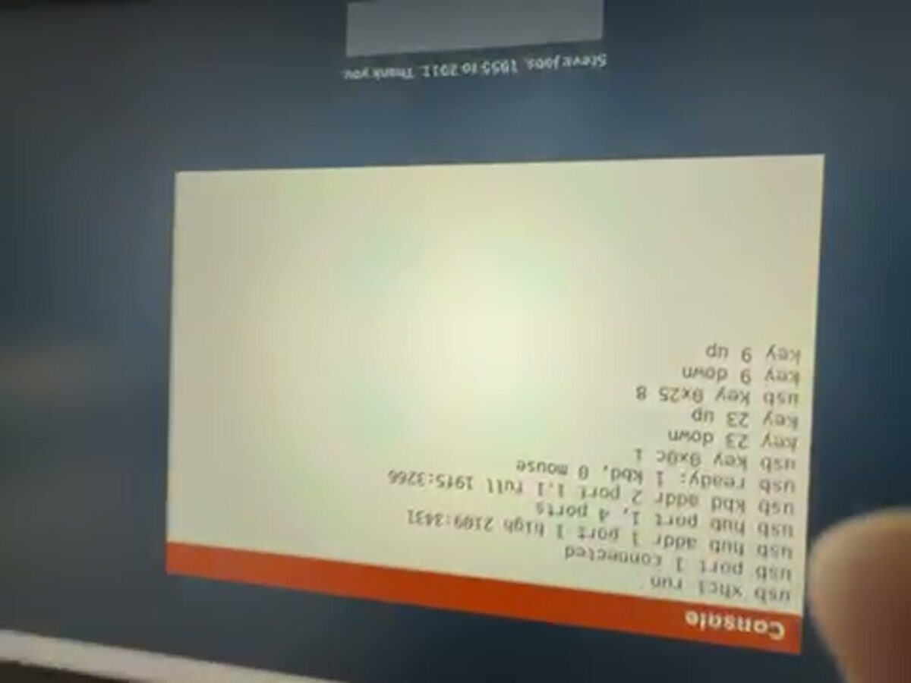

# Joshua Tree roadmap and history

Where it is going, what shipped, and the story so far.

## Contents

- [Roadmap](#roadmap)
- [Next priorities (reviewed 2026-10-11)](#next-priorities-reviewed-2026-10-11)
- [From the gap study (2026-10-11)](#from-the-gap-study-2026-10-11)
- [Daily driver gaps (Joshua, 2026-10-12: "keep identifying gaps and check them off as we go")](#daily-driver-gaps-joshua-2026-10-12-keep-identifying-gaps-and-check-them-off-as-we-go)
- [Next few weeks](#next-few-weeks)
- [The long road: version 3 to 10, and 100 (proposal, 2026-10-05)](#the-long-road-version-3-to-10-and-100-proposal-2026-10-05)
- [Pickup (written 2026-10-03, night)](#pickup-written-2026-10-03-night)
- [Architecture to A+ (refreshed 2026-10-11)](#architecture-to-a-refreshed-2026-10-11)
- [Apps after 2.2 (cheapest first, one agent and one PR each)](#apps-after-22-cheapest-first-one-agent-and-one-pr-each)
- [Our own computer](#our-own-computer)
- [Bloomberg terminal](#bloomberg-terminal)
- [Samantha](#samantha)
- [Desktop and apps](#desktop-and-apps)
- [Tests and the loop](#tests-and-the-loop)
- [Later](#later)
- [Session task queue](#session-task-queue)
- [Landing roadmap summary](#landing-roadmap-summary)
- [Vision](#vision)
- [Blueprint: where the OS goes after 1.0](#blueprint-where-the-os-goes-after-10)
- [Autonomy](#autonomy)
- [Version plan](#version-plan)
- [Shipped log](#shipped-log)
- [Money](#money)
- [Research](#research)
- [Whitepaper](#whitepaper)
- [The book](#the-book)
- [Our story and launch drafts](#our-story-and-launch-drafts)
- [Portfolio mode](#portfolio-mode)
- [Loop handoff](#loop-handoff)
- [Samantha reset postmortem](#samantha-reset-postmortem)

## Roadmap

Freestanding i386 kernel, no libc. This is the forward plan. What already
shipped lives in `git log`, `git tag -l`, and the [GitHub
releases](https://github.com/nulljosh/joshuatree/releases), not here.

See the Blueprint: where the OS goes after 1.0 section for the structural plan of where this OS goes after 1.0.

**Latest**: 3.7: Never an empty room. Music and Books greet you with the mascot on a real Raspberry Pi 4.

<!-- NOTE: The **Latest** field is public-facing copy synced to the landing page's h1/eyebrow. Must read as a feature announcement ("Introducing X."), never a changelog line. Update alongside version bumps. tools/gen/inject-landing-headline.sh reads this line automatically. -->

**Model tag on each item**: `[Haiku]` mechanical, known-correct shape, cheap. `[Sonnet]` general feature work with a clear pattern to follow. `[Fable]` anything where a subtly wrong answer still boots fine: privilege isolation, exact register/stack layouts, wire-protocol bytes, memory-model changes. `[Joshua]` a design or scope call, not code. Re-tag if an item turns out easier or harder once opened.

## Next priorities (reviewed 2026-10-11)

The ordered list below is the near-term queue. The topic sections keep the longer plan. Completed work is in [the Shipped log section](#shipped-log); `VERSION` and the GitHub releases are the source for release numbers.

**The road to 3.0 (Joshua, 2026-10-11: "/loop until v3").** The gate is in `ARCHITECTURE.md` (Decisions): the desktop boots on a real Pi 4 and you can type and click, mouse included. Tonight: the Samantha box case (#505), sound from the 3.5 mm jack (#506), typing into apps with click to focus (#507) and Samantha's voice through the relay (#508) merge one at a time, and the 3.0 mark is picked from three candidates. This week: the card reflashed with the LAN relay over TLS, the logo and UI refresh, then 3.0.0 and a QA pass of the landing page. This month: the first case print from `docs/hardware/`, SD card writes, the local model from the card. User mode on ARM (M3) is the centrepiece: the `svc` syscall layer under `user/jtsys.h`, then Calendar as the first shared app on the Pi, then files and Notes. Rest of the year: 4.0 "Many windows", the box as a kit, and showing it in person. the Loop handoff section has the exact state and the M3 slices.

**On the real Pi:** the desktop, USB keyboard, Wi-Fi, network clock and Samantha relay work. Joshua confirmed an HTTPS fetch on the board. The merged Terminal, bounded agent loop, browser navigation and model controls have QEMU checks; the latest keyboard fixes still need another board pass.

**Released 2.40.0:** PR #502 merged as 264c01d9. Full local and final GitHub gates passed, deployment and release passed, and the public footer, browser demo and ISO checksum were verified. All superseded PRs and remote branches were removed. Physical Pi verification remains for the newer features.

**In review, 2.41.0:** Pi screen sleep blanks HDMI after five idle minutes and wakes on keyboard or mouse without suspending apps. Focused host and raspi4b mailbox/input checks pass. Full gates and physical HDMI verification remain.

**Next, in order**
1. Codex login from the Pi by device code. Why: a second agent on the box without typing a key. Only if the terms research says the device-code flow is allowed for this use; otherwise Codex runs through the relay on the Mac, read-only. Check: a relay check with a stub Codex answering a `codex>` question, and the terms decision written here.
   Research decision (2026-10-10): use the official Codex CLI on the Mac rather than building a bare-metal OAuth client. Official [authentication](https://learn.chatgpt.com/docs/auth) and [non-interactive execution](https://learn.chatgpt.com/docs/non-interactive-mode) docs describe CLI device login and read-only exec; they do not establish permission for a custom client. Keep credentials on the Mac. Before implementation, verify repository-scoped read access, disabled writes/network and bounded requests. No Codex relay backend exists yet.
2. Pi security: verify the TLS relay and HTTPS clock on the board, then replace the build-time clock bootstrap. RNG200 hardware entropy is implemented with health checks and fail-closed TLS, pending board verification. The code now refuses plaintext Pi relay requests and time rollback; a certificate valid at build time but expired today can still pass the first clock handshake. Setup and checks: [`GUIDE.md` (Encrypted Pi relay)](GUIDE.md#encrypted-pi-relay).
3. The self-update path with a fallback kernel. SD writes landed in 2.57.0 (files in `JT/` survive a reboot under QEMU, `tools/checks/arm64-sd-check.py`) and wait on a board photo. Why: a new build still needs a card swap. Check: a fake release that boots once and falls back.
4. The local model with real weights read from the SD card. Why: the kernel runs the forward pass, but release builds carry no weights. Check: `tools/checks/arm64-llm-check.py` with the model loaded from a FAT image instead of the link.
5. The Bluetooth mouse on the Pi (Joshua has no wired one). Pointer and clicks work in QEMU; the radio bring-up and `bt scan` are slice BT1, pairing and HID over GATT are BT2, both in the Loop handoff section. Check: a fake controller under QEMU plus one board photo of the cursor moving.
6. Split `kernel/kernel.c` in slices. Why: it is too big to work in. Check: `make` and `./check.sh` after every slice, `tools/checks/check-refs.sh` after each move.
7. Trademark check before any rename (Folio, Mirage). Why: a rename on a box with a taken name is a redo. Check: the search result written in this file.

Notes on ARM, the boot chime, the admin tier and [the Autonomy section](#autonomy) stay open below.

**Stand out (Joshua 2026-10-07).** Almost nobody builds their own OS, fewer get it onto a real board. Lean into that:
- **Our own case.** 3D print the Neo case for the Pi 4 (CAD in `docs/hardware/`), film the first ugly print and every fix, then sell board, card and case as one kit at about 5x the print cost. The waitlist is already live.
- **Nothing underneath.** No Linux, no Raspberry Pi OS: it boots straight into our desktop. Say it on the box and in the first second of the video.
- **It knows what you want.** The anticipation slice from the Vision section, all on the device. No other hobby OS has an assistant that runs it.
- **A maker pack.** The breadboard prototype (`docs/GUIDE.md` (Breadboard prototype)) with real drivers for the LED, button and speaker, so people can wire their own things to it.
- **Show it in person.** A live Pi on a table at Vancouver maker meetups and the UBC and SFU computing clubs; a Show HN with the 30-second boot video (the Our story and launch drafts section).
- **Later, our own board.** A carrier board for the Raspberry Pi compute module with the mark on it, so the kit is ours down to the copper.

**A guide for everyone (Joshua 2026-10-07).** Documentation a person can read without knowing code: a plain-words user guide where every part of the OS, and every file behind it, is explained so a curious reader understands what each piece does and why it is there. Plan: the guide ([`docs/GUIDE.md` (User guide)](GUIDE.md#user-guide), boot, Wi-Fi and Pi desktop/Clock/Terminal chapters written), one chapter per area (boot, memory, screen, apps, network, Wi-Fi, Samantha), each file in `docs/ARCHITECTURE.md` (Architecture) gets a one-line "in plain words" summary, and a check keeps the two in step. Written a chapter at a time, Wi-Fi first because it is freshest.

## From the gap study (2026-10-11)

Five comparisons, one agent each, every claim checked against this tree, then a skeptic per top item: SerenityOS, Haiku, Circle (bare-metal Pi), Omarchy and Apple's public iOS guidelines. The method and the full result are in the Research section. Two gaps survived the skeptic; the rest are worth doing but not yet re-checked. Refuted and why, so nobody re-finds them: a first-boot welcome card (hides the boot log that 30 checks read; Spotlight already opens on any key), a key sheet, cmdline.txt boot options and on-device Wi-Fi setup (all after 5.0 or already queued), one search box for actions (after user mode), a crash card for apps (nothing to build on until M3c).

The research rounds of 2026-10-06 and 2026-10-08 further down still hold; where they overlap (the crash reporter, W^X, bad-argument syscall tests) the slices here are the ones to build, because they were checked against the tree with a path and line.

Confirmed, 3.0, usable, hours each:
- [ ] [Sonnet] Caps Lock and held-key repeat on the Pi. `arch/arm64/ask.c` drops every code of 58 or more, so Caps Lock does nothing, and `hid_kbd` emits one press per report, so holding Backspace deletes one character (the keyboard is set to idle 0). Track Caps Lock in ask.c (letters only, Shift inverts it), repeat the last typed key from the main loop after 400 ms then every 80 ms, cancelled by release or another key, typed keys and Backspace only so Brick is untouched. Check: `tools/checks/arm64-keys-check.py` with a held key over QMP input-send-event (8 to 14 repeats, none after release) and a Caps Lock case through the self-test path.
- [ ] [Sonnet] Notes autosaves. `user/notes.c` saves only on Esc or Ctrl+S, and the window's red dot kills the task so a dirty edit is lost. Save two seconds after the last key, timed with `JT_SYS_TIME` seconds. Check: a new notes-autosave check under tools/checks that types, waits, closes through the red dot, reopens and finds the text.

Worth doing, not yet re-checked, in the order the study ranked them:
- 3.0 stability, hours: an app crash shows a menu bar notice and the desktop carries on; the flash script verifies every file on the card before it ejects; skipped checks are counted, not passed; a crash report with LR, SP and a six-frame stack walk; the SoC temperature read every 4 s with a warning before throttling; no page both writable and executable in the M3 loader (W^X, two new EL0 fault cases).
- 3.0 stability, days: a hang watchdog that reboots a frozen board (fed from the main loop and the network wait); a kernel crash that resets after 30 s, once; `wifi restart` and an automatic rejoin on deauth; a `selftest` command that ends in one PASS or FAIL line so one photo closes a board pass; a real page allocator that frees an app's pages on exit; a syscall fuzzer that runs in EL0; FAT writes that never lose the old file and a delete that frees its clusters.
- 4.0 usable: USB mass storage read, then MBR and FAT32, so a stick keeps files on the Pi; undo and redo in Notes; open a file with the app that suits it; a Trash that survives a reboot; recent items in Spotlight; Wi-Fi join by name and password from the Terminal (PBKDF2 on the box).
- 4.0 stability: a fallback kernel through the Pi firmware's tryboot; chain-boot a downloaded kernel from RAM; a `sendlog` command that posts the boot log to the Mac over TLS; network fuzzing on the host under the sanitizers; a crash restart with a strike limit.
- 4.0 polish and mobile: one theme header for every app's colours and controls; sound by DMA so the desktop never stalls; a day and night palette on the Pi; touch from a USB touchscreen; an on-screen keyboard on the Pi.

## Daily driver gaps (Joshua, 2026-10-12: "keep identifying gaps and check them off as we go")

- [ ] [Sonnet] Browser bookmarks. A star in the address bar saves the open page to `JT/BOOKMARKS.TXT`, one line a page (address, then title). The empty Browser screen, where the address bar waits today, lists the saved pages, and Tab then Enter opens one. A star on a saved page takes it off the list. Check: an arm64 check that stars a page, reads `BOOKMARKS.TXT` back off the card image, reopens the Browser empty and finds the line.

## Next few weeks

- [ ] [Fable] The browser grows up, after the text browser ships (Joshua, 2026-10-12: "then we'll get JS working etcetera"). In order: images (the Pi already has a PNG decoder, JPEG next), CSS layout (block and inline flow, colours, fonts, a box model, no floats at first), forms and cookies, then a small JavaScript engine (an embeddable one such as QuickJS, ported freestanding, with a DOM just big enough for the pages Joshua actually reads). Each step is its own PR with its own check against a local test page.

- [ ] [Fable] Browser app on the Pi, its own dock tile and window (goal 2026-10-12, "browser working tonight"). The text browser already lives behind the Terminal (`browse URL`, `arch/arm64/browser.c`: HTTPS through `tls.c`, redirects, readable text, numbered links, history). This is the window around it: an address bar you type into and Enter loads, the page as text in Tree Sans with headings bigger and links in the accent colour, a click on a link follows it, scroll wheel and Page Up and Down, Back, Forward and Reload buttons, a status line, the loading and error states in plain words. No images, CSS layout or JavaScript yet; say so on a page that needs them. A Safari-style compass tile from the icon composer. Check: an arm64 check against a stub HTTPS server (as `tools/checks/pi-actions-check.py` does) that types a URL, clicks a link and goes back, reading the window's serial lines.
- [ ] [Sonnet] The dock grows to the default macOS set that exists on Joshua Tree: Music, Books, Clock, Calculator and the Browser join the 11 tiles (Apps, Finder, Mail, Calendar, Notes, Reminders, Terminal, Samantha, Weather, Stocks, Trash), one flat house-style icon each from the icon composer, in the Mac's order, the dock narrowing its tiles to fit. `GUI_ICON_COUNT`, the dock geometry numbers in the checks (`iconlight-check.py`, `dockhover-check.py`, `iconart-check.py`) and `docs/ARCHITECTURE.md` (Design rules) all move together. An app that has no ARM build yet keeps its tile and says "not on ARM yet". Check: the dock checks pass at the new count.

- [ ] [Fable] Samantha on the device, no relay: a small chat model (Qwen 0.5B class, int8, under 1 GB) baked into the card image and run by the kernel's own inference code (`arch/arm64/llm.c` is a float32 llama2 forward pass today; it needs int8 weights, a tokenizer for that model and a KV cache that fits the Pi's 4 GB). The relay stays the default when the Mac answers; the local model answers when it does not. Check: `tools/checks/arm64-llm-check.py` extended to the real model's tokenizer and a fixed prompt.


- [ ] [Sonnet] Dock shading and magnification, like the Mac: the tray's shadow is a hard dark band under its bottom edge on the Pi (photo 2026-10-12), it should be a soft falloff that fades over 10 to 14 px, and each tile's drop shadow the same. Then Settings rows for dock size and hover magnification (off, small, large), the hovered tile and its two neighbours growing smoothly, shared `kernel/dock_draw.c` so both desktops match. Check: `tools/checks/arm64-m1c-check.py` samples the shadow gradient, and a dock-magnify check reads the hovered tile's size.


- [ ] [Sonnet] `sam "what is 5+5"` takes about a minute on the board while the relay answers in seconds. Read 2026-10-12, not fixed: relay discovery is already cached (`relay_ip` in `arch/arm64/ask.c`) and `ask_poll` adds no sleep, so the time is somewhere else. Suspects, in order: a fresh TLS handshake per question without session resume on the Pi (software crypto), a dead baked `CLAUDE_HOST` costing a 3 s connect plus two 1.5 s probes on each question, and the relay running several agent steps (each one a full POST) on the small local model. Time each step with `ticks()` stamps on the UART on the board first. Check: a stub-relay check that fails when a question costs more than one handshake.
- [ ] [Sonnet] Calendar app on the Pi highlights the UTC day, not the local one: at 11:20 PM on 11 October the Clock and the dock tile said the 11th and the month grid circled the 12th. Use the same local date the Clock uses. Check: extend `tools/checks/arm64-calicon-check.py` with a UTC-after-midnight, local-before-midnight case that finds the circled day.
- [ ] [Sonnet] Keyboard shortcuts in every app: the Command key (the GUI or Windows key on a PC keyboard) with A select all, C copy, X cut, V paste, Z undo, S save, W close the window, Q quit, N new, F find, Tab to switch windows, plus Ctrl for the same on a keyboard with no GUI key. One table in the shell, apps handle the actions. Check: an arm64 key check that sends each chord through QMP and sees its serial line.
- [ ] [Sonnet] Finder, Mail and Stocks say "not on ARM yet" on the Pi, so do Weather and Reminders. Port them one at a time, Finder first (Files is the card and the Terminal already lists it), then Weather and Reminders, then Mail and Stocks (they need the live backends). Each one gets its own check.

- [ ] [Sonnet] Pi boots to a splash, not the log: the mark on the brand fill with the thin progress bar, held until the desktop is up, the Console never flashes on the way (the log stays one dock click away; a FAIL still raises it). Then a login screen. The first few seconds after the desktop appears take no keys; find why and fix it. Check: extend `tools/checks/arm64-m1c-check.py` to screendump the splash before the desktop and see no Console frame pixels.
- [ ] [Fable] User accounts on the Pi: a login screen with a name and password, accounts stored on the card's `JT/` (salted hash, never the password), Notes and Music keyed to the signed-in user's folder, a `users` and `adduser` command in the Terminal. The i386 build already has Account (change password) and Add user rows in Settings; reuse that store. Check: a new accounts check that adds a user, logs out and in, and sees a wrong password refused.
- [ ] [Sonnet] A `reboot` and `shutdown` command in the Terminal and in the menu bar, no Ctrl+Alt chord to remember (the chord stays as the keyboard route).

- [ ] [Sonnet] Books, a reader app for Joshua Tree (both kernels, ring 3 like Notes): a library of plain text and EPUB-as-text books in `JT/BOOKS/`, one page at a time with the arrow keys, a remembered place per book, Tree Sans at body size. Ships with one book in the card image: Make Something Wonderful, Steve Jobs in his own words (the Steve Jobs Archive, free to read), the book the tribute line ends on. Check: a new books check under tools/checks that opens the app, turns two pages and reopens on the saved page.

- [ ] [Sonnet] A small voxel building game as a native Joshua Tree app, software-rendered: walk, place and break blocks. Pick a name that is not Minecraft. Check: a host test of the block grid and ray pick, plus a `tools/checks/` boot check that opens the app and sees a frame.
- [ ] [Joshua] Java, step one: a research doc (a docs/JAVA.md research note) on what is possible. A small JVM-style bytecode interpreter for simple programs is in reach; real Minecraft Java is out of reach; Minecraft streamed from the Mac needs the video path below. Then decide whether to build the interpreter. Check: `check-refs.sh` passes and the doc names what is in and out.
- [ ] [Sonnet] Baseline JPEG decoder on the Pi build, then an MJPEG video path from the Mac relay. Silent first, sound after audio output. The i386 kernel already has `drivers/jpeg.c`; reuse it. Check: `tools/checks/jpeg-host-check.sh` plus an arm64 check that shows relayed frames.
- [ ] [Sonnet] Pi playback for Samantha's voice: the Terminal posts her `[[say]]` text to `/api/tts` over the TLS relay and plays the 22050 Hz mono 16-bit PCM through the PWM audio driver (needs PR #506). Check: an arm64 check against a stub relay that sees the samples reach the audio buffer.
- [ ] [Joshua] Higgsfield video through the Mac relay, under Joshua's spending rule: never automatic, always an explicit yes from Joshua with the cost shown first, one clip at a time, nothing from Samantha on her own. Check: a relay test that a request without a fresh yes is refused and that Samantha's actions cannot start one.

## The long road: version 3 to 10, and 100 (proposal, 2026-10-05)

A guess at the shape, in Joshua's words as far as they are known. Each version has one idea, so "what is 6.0" has a one-line answer. Nothing here is promised; pick, reorder or cut. Every version ships as small 2.x-style steps first, and the big number is cut only when its one gate is true.

| Version | The idea | The gate that cuts it |
|---|---|---|
| **3.0 Hold it** | Joshua Tree runs on a real Raspberry Pi 4. | The desktop boots on a real board, you can type and click, and one shared `user/` app runs there in user mode. |
| **4.0 Many windows** | Real multitasking. A window server (compositor), real processes, pipes, and a Terminal with tabs, splits and background sessions (the cmux idea). | Three apps run at once, one crashes, the other two do not notice. |
| **5.0 Talk to it** | Samantha is the interface. Full-screen face with a coded mouth, speech in and out streamed, a small model that runs on the box, and "computer, build me a game" for real. | You hold a ten-minute spoken conversation and it opens and changes things on the machine. |
| **6.0 Yours** | One machine, many people, and it keeps your stuff safe. Accounts, a locked disk, Time Machine snapshots, backups. | Delete a file, go back in time, get it back. Pull the plug mid-write, lose nothing. |
| **7.0 Online** | The real internet. TLS 1.3, Wi-Fi, a real browser (Madobe on this OS), mail and calendar that sync. | You do a normal day of web, mail and calendar on it. |
| **8.0 Build things** | The machine builds its own apps. The Plank compiler on the box, an SDK, apps as signed bundles, a store for them. | Someone who is not Joshua writes and installs an app without touching the kernel source. |
| **9.0 The kit** | The hardware is a product. Neo Kit revisions, two displays, GPU, USB audio, storage and camera. | A stranger builds a Neo from the guide and it boots first try. |
| **10.0 Daily driver** | Boring and trusted. A security audit against the threat model, accessibility, languages, long-term support. | Joshua uses it as his only computer for a month. |

**Version 100** is not a plan, it is the point of the whole thing: a computer small enough to read end to end, that you can build yourself from open parts, and that talks to you like a person. Its test is a child with the guide, a Neo Kit and an afternoon, who ends the day with their own computer and understands every layer of it. Everything above is steps toward that.

Order of work from 3.0 on (Joshua, 2026-10-11): usable first, then stable, then polished. Usable means a person can do a real thing on the board without the Mac: open an app, type, save, come back tomorrow. Stable means it does not crash, and when an app does the desktop stays. Polish is the last pass, never the first. 4.0 and 5.0 may go mobile first: a phone-shaped Joshua Tree that copies iOS the way the desktop copies macOS (one app full screen, a home grid, gestures, the on-screen keyboard from `user/libjt/osk.c`), on the 7 inch touch screen or a phone-sized one.

How to use this: the Pickup list below stays the near-term queue. When a Pickup item belongs to one of these versions, tag it (for example `[4.0]`), so the road and the queue stay one list.

### [5.0] Talk to it: Claude Code in Joshua Tree
- [ ] [5.0] [Fable] Claude phase 2: tools on Joshua Tree itself, so Claude can read and change the OS's own files. Needs real TLS on the box or a trusted relay protocol that calls back into the machine.

## Pickup (written 2026-10-03, night)
Open work by topic. The 3.0 gate above also needs a working mouse on the real board; a desktop boot alone does not close it.

### Landing and demo, to A+

The redesigned footer is live in 2.40.0: a spacious directory, original desert art, dark mode and 44px links. Live Chromium and WebKit phone/desktop checks passed.

- [ ] [Sonnet] Phone shows two input bars: the OS draws its own chat bar and the page draws a real composer for the phone keyboard. Keep one visible. The OS bar can hide while the composer is up, or the composer can be the only bar and feed the OS. Check: `tools/checks/phone-boot-check.py` plus a screenshot of the phone tour.
- [ ] [Sonnet] The tour is silent after the intro video. Joshua speaks each stop in his cloned voice (`/api/speak` with `voice: "joshua"`, see the personas doc in the Turing repo), with the caption on screen and the speaker button respected. Check: extend `tools/checks/portfolio-mute-check.mjs` so muted means no audio request.
- [ ] [Sonnet] Real-Chrome QA of the whole tour after any tour change, desktop and phone. Headless Chromium has no H.264, so it skips the intro video: run the checks with the system Chrome (`CHROMIUM_PATH`). The last full desktop pass was clean (intro, then Epiphany, Curbfind, Bookrank, Lexly, Hikko). The phone tour was last checked before the 2.6.13 fixes.
- [ ] [Sonnet] All icons share one design system. Rule decided 2.12.2 in `docs/ARCHITECTURE.md` (Design rules): a fleet icon keeps its own tile colour and picture (Tonchi stays #2E86DE) but shares the squircle, edge, lip and glyph margin; its tile stays flat. Still open: Windgate's faint ring runs past the margin (the check exempts fleet icons), Tonchi's picture is a speech bubble, the `APPS` fallback colours for Quotes, Fieldbook and Tonchi are purple or green, and app windows keep their own accents (Epiphany and Windgate are blue). Next: make `iconinset-check.py` measure fleet margins, then fix what it finds. Details in PR 425.
- [ ] [Joshua] Judge the live landing against the Plank landing, the bar for the whole site. List what still falls short, in his words.

### From the notebook (Joshua, 2026-10-04)
Two notebook pages checked against the tree. Already shipped and not listed: menu bar with weather, dock, Activity, Trash, clipboard, Burrow (the Finder), Epiphany tabs, Launchpad-style Apps folder, Music, Movies, landing page, docs at 100 percent, CI, Samantha chat with tools. Wi-Fi was ruled out for 1.0 and is under Our own computer.
- [ ] [Joshua] Competitor research as a doc: Apple Mac mini against our box on RAM (8 to 16 GB), integrated CPU, multi-display over HDMI, internal or external design, USB-C ports. A good-computer checklist for `docs/GUIDE.md` (Hardware plan).
- [ ] [Fable] Time Machine: snapshots of the disk with a browse-the-past view. Nothing exists; needs a FAT snapshot design first.
- [ ] [Sonnet] Fullscreen avatar, custom: Samantha (or Joshua's face) full screen as a mode, with the face picked in Settings. The page also lists video, audio and GUI mode as three ways to talk to her.
- [ ] [Fable] An integrated LLM that runs on the box. The small forward-pass runtime landed; real weights from the SD card remain in Next priorities. A full Turing model still needs a memory and runtime decision.
- [ ] [Sonnet] Improved chat app: more tools and persistent memory across boots (a file the app reads at start).
- [ ] [Sonnet] Spotlight: one key opens a search box over apps, files, contacts, events. The Search app does files only; the existing Spotlight-style item under Desktop and apps is the same item.
- [ ] [Sonnet] GarageBand-lite: record and layer a few tracks from the Sound Blaster, then play them back. Movie trim (iMovie) is already listed.
- [ ] [Sonnet] Sharp image everywhere, no visible pixels: audit the icons and small type at retina scale, same bar as the JT retina polish rule.
- [ ] [Fable] The big promise, in his words: say "computer, run the simulation", "build me a game", "publish and monetize my apps", "add X feature", "patch Y bug", and the OS does it. Samantha plus a coding agent plus the publish flow. Scope it as a doc before any code.

### Fleet apps on their real backends (Joshua, 2026-10-04)
Curbfind, Epiphany and Stocks already pull live data through `SYS_HTTP_GET`. The other fleet apps still show samples. The real apps are native Swift and cannot run here, so the OS versions stay C rewrites that talk to the same backends. One PR each, with the offline samples kept as the fallback when the network is down.

#### Every fleet app in the Launchpad (Joshua, 2026-10-04)
The goal: every app in the Portfolio catalog that fits this OS opens from the Launchpad with live data. One app, one PR, same pattern as Bookrank: a read-only Worker route, `SYS_HTTP_GET`, samples offline, a stub check. Let `ci-balance.py` place the new check, never pick a shard by hand. In the Launchpad today: Bookrank, Curbfind, Epiphany, Fieldbook, Hikko, Keyrate, Quotestreak, Stocks, Tonchi, Conway (Toroid), Weather.
- [ ] [Sonnet] Brick: live rental listings.
- [ ] [Sonnet] Hagaki: inbox triage (smart folders over the Mail app's messages).
- [ ] [Sonnet] Nimble: instant answers from its real API.
- [ ] [Sonnet] Sidewise: news with the bias rating per source.
- [ ] [Sonnet] Wordroot: look up a word's origin.
- [ ] [Sonnet] Intake (Healstack): today's supplement stack and log.
- [ ] [Sonnet] Windgate: guided breathing, runs offline, a timer and a circle.
- [ ] [Sonnet] Curvely: plot an equation. Numen: a calculator canvas. Both run offline.
- [ ] [Sonnet] Inkpress: RSS reader over a Worker feed route.
- [ ] [Sonnet] Homeward (lost pets) and HomeQi (room check): list views over their APIs.
- [ ] [Sonnet] Dream and Costanza: read-only feeds of entries and poems.
- [ ] [Sonnet] Cadence and Tripwire: commit streak and API drift status.
- [ ] [Sonnet] Plain and Block Frame: fold into Notes as modes instead of new apps, or skip.
- [ ] [Sonnet] Plank: run one-file programs. Needs the compiler ported, the biggest of these.
- [ ] [Sonnet] Madobe: needs HTTPS in the OS first (see the browser item).
- Not planned: Talli (private case data), Swing (video chat), Notate (speech model), Seamark (vision model), NYC, Conveyer, Vancouver Vice. They need hardware or models this OS does not have. Turing is Samantha, already here.

### Voice chat, lag and sharing (Joshua, 2026-10-04)
Checked 2026-10-04: neither side listens yet. Both are typed text in, her voice out, so "voice chat" still needs speech-to-text. Each message in the OS is three round trips in a row: `/api/pick` (which tool), `/api/chat` (the full reply, no streaming), then `/api/speak` per sentence piece. Order: measure, cut round trips, stream, then listen.
- [ ] [Sonnet] Read `voicetime` off the live demo for ten messages and post the numbers here. The web portfolio gets the same line (`console.info`) next.
- [ ] [Sonnet] Skip `/api/pick` when the message plainly is not a tool request, or have `/api/chat` pick the tool in the same call. One round trip less on every message.
- [ ] [Fable] Speech-to-text: mic in, words out. Web first (browser mic plus a hosted STT), then the OS once it has audio input (an SB16 capture path or the Pi's USB mic).
- [ ] [Sonnet] Stream every stage: STT, LLM tokens, ElevenLabs over its WebSocket TTS, audio chunks played as they land. Add barge-in: talking over her stops her.
- [ ] [Sonnet] One shared voice module, the portfolio's code, used by both. The OS stays thin: it opens the voice page or calls a small server, no audio pipeline or TLS of its own.
- [ ] [Sonnet] Hardening: keys server-side only, a per-session cost cap, reconnect on a dropped socket, Claude as the fallback when Turing is down.
- [ ] [Joshua] Live face: Simli or HeyGen LiveAvatar (credit based, about $30 to $500 a month). Veo and Higgsfield stay for pre-rendered ads and intros only.
- [ ] [Joshua] ElevenLabs Agents could run the whole loop with any LLM endpoint as the brain (about $0.08 to $0.10 a minute). Decide: their loop, or ours.

### CI and speed

- [ ] [Sonnet] Convert the remaining fixed scratch paths in `tools/checks/tmp-paths-baseline.txt` to private directories and sockets. The one-suite lock already prevents collisions; keep it until the baseline is empty. Check: `tools/checks/tmp-paths-check.py`.
- [ ] [Sonnet] Six of the last ten red runs were slow-runner timing flakes (Chat tool scenes, the phone mute button, Keyrate, the Apps folder layout): each suite shard already has its own runner and runs its checks serially. Measure CPU load and guest startup before changing concurrency, and watch the next ten runs.
CI now installs ARM QEMU, so ARM regressions run instead of skipping for a missing emulator. The 217 checks use the slower of the last green GitHub and local timings, with ARM build checks together on shard 6 so local cleans cannot collide. Eight shards and the two-job local cap remain. Re-run `tools/gen/ci-balance.py` on the next green GitHub run to measure the new ARM coverage.
- [ ] [Haiku] About a third of recent runs were cancelled by force-pushes to an open PR. Push once per PR, or fold PRs together before CI starts.
- [ ] [Sonnet] Reduce local CI time without raising the two-job concurrency cap. Four concurrent jobs previously exhausted the Mac's memory; measure slow checks and rebalance first.

### Raspberry Pi and ARM64
**Goal (Joshua, 2026-10-06 night, /goal): we can build a mini Joshua Tree with Claude Code inside Joshua Tree on the Pi.** The Pi runs the OS, the Claude app (phase 1, via a relay on the Mac) is the way in, and a session on the Pi edits and rebuilds a small Joshua Tree. The road there is the queue below: Wi-Fi (the relay needs the network), the desktop and dock, SD writes, `get`, then phase 2 of the Claude app (the model reading and writing the OS's own files through a tool loop), then a build toolchain on the box (the Plank compiler, 8.0). Say honestly what is not here yet in every release note.
Pi queue (Joshua, 2026-10-06 night: "bang out all of those in order of relevance"). Software first; items that need a part wait for the part.
- [ ] [Fable] Admin and sudo (Joshua, 2026-10-06: "fix it soon"): a second privilege tier on the accounts that already exist (login screen, PBKDF2 passwords, Settings "Add user"). An admin flag per account, a password prompt before anything that installs, deletes a user or changes system settings, and a normal-user role that cannot. i386 build first; it touches `kernel/auth.h`, Settings and the syscall gate, not the ARM files, so it can run beside Wi-Fi. Per-user home folders and file permissions follow (6.0).
- [ ] [Fable] Sound over DMA: move the PWM FIFO feed to a DMA channel so long sounds do not hold the CPU, then HDMI audio; then Movies plays a clip with sound on the Pi. An app's sound goes through DMA since 2.59.0 (Music, M3e, `tools/checks/arm64-music-check.py`), waiting on the board; `beep` is still polled, and HDMI audio and Movies remain.
- [ ] [Fable] SD card reads and writes through EMMC2, so files survive a reboot and the Wi-Fi firmware can load from the card. Reads (2.53.0) and writes (2.57.0) pass under QEMU and wait on the board; loading the firmware from the card remains.
- [ ] [Sonnet] `get`, the Joshua Tree installer: a public recipes repo in the Homebrew shape (name, URL, checksum), a C command that downloads an app over Wi-Fi and drops it on the card. Needs Wi-Fi stage 2 and SD writes.
- [ ] [Sonnet] mruby as a ring-3 app: Ruby scripts compiled to bytecode on the Mac, run on Joshua Tree through `user/libjt`. Full Ruby and Homebrew stay out of reach (they need git, curl, a shell and a compiler).
- [ ] [Sonnet] Jellyfin app: list and stream Joshua's movies from the Jellyfin server on the Mac (installed 2026-10-06) through the Movies player. Needs Wi-Fi stage 2 and sound.
- [ ] [Fable] USB audio: the Yeti mic in, a USB speaker out. Then the Samantha box: talk to Joshua Tree on the Pi.
- [ ] [Fable] Voice mode on the Pi (Joshua, 2026-10-07: plug the Yeti into the Pi and talk to it). The shortcut is Claude Code's: double-tap Space, then hold Space on the second tap; release to send. A clear cue while it listens: a mic mark in the menu bar and a "listening" line with a live level bar in the ask> row, so it is obvious the OS is in voice mode and the key is not typing spaces. The first two taps must not leave spaces behind (swallow them once the hold is confirmed, backspace them if the hold never comes). Speech goes to text over Wi-Fi (the relay or the Whisper route), then to Claude, and Samantha answers. Needs, in order: Wi-Fi joining, the USB audio class driver below, the speech path. Check: a scripted key sequence headless proves the cue appears and the spaces vanish; the audio itself needs the real Pi and the Yeti.
- [ ] [Fable] USB audio class driver for the Yeti (the first isochronous USB device here): the xHCI driver gains isochronous transfers, then a UAC1 input stream (16-bit, 48 kHz) into the sound layer. The Yeti draws bus power from the Pi's USB port, which a Pi 4 can supply. Check: a captured 1-second buffer on the real Pi with a tone played at the mic.
- [ ] [Fable] Pi camera (needs the part, about $25): a CSI driver, the picture on screen.
- [ ] [Fable] Touchscreen (needs the part, about $60): the i386 touch driver's shape on the Pi's DSI or USB touch.
- [ ] [Fable] Ethernet through the Genet MAC, as the wired backup.
- [ ] [Fable] Serial loader the day the cable arrives: new kernels over the wire, no card swaps.
- [ ] [Fable] The self-update loop (Joshua, 2026-10-06: "make tweaks to the OS from inside the OS, push changes and hot swap"): ask Claude in the Claude app, the relay's Claude Code edits the repo on the Mac and opens a draft PR, CI goes green, the Pi pulls the new `kernel8.img` over Wi-Fi from a release, writes it to the card and reboots into it. Needs Wi-Fi stage 2, SD writes and plain-HTTP downloads from a mirror.
- [ ] [Fable] A/B boot, so a bad self-update can never brick the Pi: keep the last good kernel on the card as `kernel8.old`, boot the new one once, and fall back to the old one if the new build never reaches the desktop (the Pi bootloader's `tryboot` is the likely mechanism; check it on the board).
Also missing, added 2026-10-06 night, in order:
- [ ] [Fable] The other three cores: wake them from the spin table, give each a stack, run the desktop on one and the drivers on another.
- [ ] [Fable] Bluetooth for the mouse: same CYW43455 chip as Wi-Fi, HCI over the PL011 UART, HID over GATT (Joshua's mouse is Bluetooth Low Energy). BT1 (2.51.0): the patch, the version and `bt scan`, checked against a fake controller. BT2 (2.54.0): `bt pair`, Just Works, GATT HID, boot reports into the pointer, checked against a fake mouse. BT3 (3.5.0): the pairing is saved to `JT/BTPAIR.BIN` and a reboot reconnects it, checked against a fake mouse on a QEMU card. Left: the board test of the reconnect, and report mode for a mouse with no boot report.
- [ ] [Sonnet] Heat and the fan: read the SoC temperature through the mailbox, show it, drive the fan pin.
- [ ] [Fable] Update over Wi-Fi: the Pi fetches the newest kernel8.img from the GitHub release and writes it to the card, then reboots. Needs Wi-Fi stage 2, SD writes and plain-HTTP downloads from a mirror (no TLS yet).
- [ ] [Sonnet] A Wi-Fi settings screen on the Pi: name and password typed on the keyboard and saved on the card, so nothing is baked into the build.
- [ ] [Fable] The Pi 5 (M5): the RP1 chip over PCIe for every peripheral.
Gaps against Linux distributions (Kali, Ubuntu, Arch), 2026-10-06 night. Most are already on the version road (4.0 processes and a real shell, 6.0 users and backups, 7.0 TLS and a browser, 8.0 a compiler and `get`); these are the ones it did not name:
- [ ] [Fable] An SSH server: log in to the Pi from the Mac over Wi-Fi, with its own crypto (ed25519, ChaCha20-Poly1305). It makes the serial cable optional for everything but early boot.
- [ ] [Fable] ext4 read-only, so a Linux-formatted USB stick or card can be opened. FAT stays the default.
- [ ] [Sonnet] A packet capture and ping/traceroute/port-scan toolbox (raw sockets), the part of Kali that is a few tools, not the whole distro.
- [ ] [Fable] Wi-Fi monitor mode, only if the CYW43455 firmware allows it. Kali's wireless tools depend on it. Low priority, owner's own network only.
- [ ] [Sonnet] A sandbox for untrusted apps, the small version of containers: a ring-3 app with no network and a private folder, per `get` recipe.
The rest of the Linux gaps, tagged with the version that owns them (Joshua, 2026-10-06 night: "add those gaps to the roadmap too"). These are the road items in `## The long road`, written out as work you can pick up:
- [ ] [Fable] [4.0] Processes the Unix way: fork and exec, pipes, signals, a process table, exit codes. The base for everything below.
- [ ] [Fable] [4.0] A real shell and Terminal: a command line with pipes, redirects, job control, a PATH and scripts, so `ls | grep` works. Tabs and splits come after.
- [ ] [Fable] [6.0] Users and permissions: accounts, file owners and modes, a login screen, an admin role that can install. Joshua's "admin privileges" idea starts here.
- [ ] [Fable] [6.0] A journaling or copy-on-write filesystem for the card, so a pulled plug mid-write loses nothing (FAT stays for sticks).
- [ ] [Fable] [7.0] TLS 1.3 in the kernel or a ring-3 library: the gate for HTTPS, so websites, Plex and a real Claude API connection work without a relay.
- [ ] [Fable] [7.0] A web browser on the Pi (Madobe on this OS; NetSurf is the reference port). Needs TLS, fonts and a JavaScript engine decision.
- [ ] [Fable] [8.0] A compiler and linker on the box (the Plank compiler first), so the OS can build its own apps. The last piece of "build Joshua Tree inside Joshua Tree".
- [ ] [Sonnet] [8.0] App breadth: ports of Joshua's own apps to native Joshua Tree, in the order they are most used (Bookrank, Tonchi, Curvely), each a ring-3 C rewrite.
- [ ] [Sonnet] Driver breadth, by what Joshua owns: USB mass storage, USB audio, USB Ethernet, a USB serial adapter, a Bluetooth adapter. Each is a class driver on the xHCI code that already works.
- [ ] [Fable] Power management: suspend and resume, CPU frequency scaling, the board's low-power states. Linux does this for free; a hobby OS never does until someone sits down.
- [ ] [Sonnet] A security-update story: a signed release feed, a version check, and a changelog on screen, so "is my Pi current" has an answer.
From the field, 2026-10-06 night (what Onyx and Circle, the two best bare-metal Pi 4 projects, have and we do not), in order:
- [ ] [Fable] VNC server: the Pi's screen on the Mac over Wi-Fi, so debugging stops needing photos and demos need no monitor. After Wi-Fi stage 2.
- [ ] [Fable] A USB stick as the first disk: mass storage over the xHCI driver we have, likely faster to "files survive a reboot" than EMMC2.
- [ ] [Fable] Doom: the classic proof a platform is real, and Joshua's chosen benchmark (2026-10-06: "if we can get doom working that's sort of a benchmark"). Full speed with sound on the Pi is the flag right after 3.0. Keyboard first, gamepad next.
- [ ] [Sonnet] USB gamepad: a HID report parser beside the keyboard and mouse. Doom and Hamurapi on the couch.
- [ ] [Sonnet] Paddle, a two-player bounce game (the Pong idea under our own name), and Snake. Small, original, no third-party code or assets.
- [ ] [Fable] An Atari-style console: our own 6502 core and a tiny TIA-like video chip. Only homebrew games whose authors allow redistribution, never original cartridges (the ROMs are copyrighted). Avoid Tetris-like and Space-Invaders-like designs.
- [ ] [Sonnet] Drop files from the Mac over Wi-Fi: a tiny upload server on the Pi (plain HTTP PUT), no card swap.
- [ ] [Sonnet] `joshuatree.local`: mDNS so the Pi announces its name on the network.
- [ ] [Fable] GPU 3D: the V3D block for real 3D, the way Onyx did it. Samantha's face in 3D is the first use.
- [ ] [Sonnet] I2C and SPI drivers for breadboard sensors and small screens.
- [ ] [Sonnet] Console emulators (NES first), later.
Sources: Onyx on Circle (Adafruit blog, 2026-09-29), Circle's feature list (github.com/rsta2/circle), rpi4-osdev, AROS on the Pi (Hackaday, 2026-08-23).
Round 2, 2026-10-06 night (Raspberry Pi OS Trixie and RISC OS on the Pi 4). Small, all after Wi-Fi:
- [ ] [Fable] Both HDMI ports: the Pi 4 drives two monitors; a second framebuffer through the mailbox display id, the desktop spanning or mirroring.
- [ ] [Sonnet] A Screen settings page on the Pi: resolution, scale, which HDMI, saved on the card.
- [x] [Sonnet] Screen sleep implemented in the 2.41.0 branch: five idle minutes blank HDMI, keys or mouse wake, active Brick and assistant requests keep it awake. Host timing/failure controls and raspi4b mailbox/input checks: `tools/checks/arm64-screen-idle-check.py`. Full release gate and physical HDMI check remain.
- [x] [Sonnet] Pi notification strip implemented in 2.38.0: Wi-Fi joined and Brick results appear briefly in the menu bar, clear after four seconds and leave clock/status/input intact. Apps share `menubar_notify`; file drops and updates can use it when those features exist. Check: `tools/checks/arm64-notice-check.py`. Full release gate and board verification remain.
- [ ] [Fable] Bluetooth audio: speakers and headphones over the same CYW43455 radio. After Bluetooth for the mouse.
Note: RISC OS on the Pi 4 still lists USB 3 as unsupported (riscosopen.org port status); Joshua Tree got xHCI working on the board on 2026-10-06.
Round 3, 2026-10-06 night (macOS Tahoe 26 and Windows 11 2026). Joshua Tree already has the glass look (v48); these are what the two big desktops added that we lack:
- [ ] [Sonnet] Search that understands plain words, Spotlight style: one box that finds files, apps, contacts and actions ("open the clock", "new note") through Samantha. Starts with the Search app we already have.
- [ ] [Fable] A screen reader (Narrator, VoiceOver): speaks the focused control and window title through the sound driver. The accessibility basics the 10.0 gate needs.
- [ ] [Sonnet] A phone link: show a phone's live activities (a timer, a delivery, a call) in the menu bar. Needs Wi-Fi and a small relay; later.
- [ ] [Sonnet] Shortcuts: small chains of actions (open this, type that, play a song) built from blocks, run by a key or by Samantha. Pairs with the Plank language at 8.0.
- [ ] [Sonnet] A built-in network speed test in the Wi-Fi menu, and a signal bar in the menu bar. After Wi-Fi stage 2.
- [ ] [Sonnet] Game mode: a full-screen mode that quiets notifications and background work, for Doom and the handheld idea.
- [ ] [Sonnet] More wallpaper formats (WebP and AVIF through the decoder code we have, JPEG and PNG already work) and a slideshow.
- [ ] [Sonnet] A Start-style launcher you can customise: pin, reorder and hide apps in the Launchpad.
- [ ] [Sonnet] Camera controls in Settings, once the Pi camera driver exists.
Sources: Tom's Guide and TechRadar on macOS Tahoe 26, Pureinfotech and Digital Citizen on Windows 11 2026.
- [ ] [Fable] ARM framebuffer write-combining: map the framebuffer Normal non-cacheable in MAIR, so a live desktop needs no cache cleans. Split out of M1d: QEMU cannot see cache attributes, and a wrong mapping can blank the Pi's screen, so it needs a board test of its own.
- [ ] [Fable] M2: IP, DHCP and a TCP connection on top of the ARM network card (port the i386 stack above the NIC), and the net and disk drivers moved to interrupts too (input already is). Then M3 (EL0 userland and the syscall layer) and M4 (SD through EMMC2, USB through xHCI, Ethernet through the Genet MAC). 3.0.0 ships when M4 shows the desktop on a real Pi. `docs/ARCHITECTURE.md` (ARM64 and the Raspberry Pi) has the milestones.
- [ ] [Fable] ARM IP stack, stage 2: TCP that survives a lost segment (retransmit, reorder, a real window) before the Claude app runs on ARM over Wi-Fi; net and disk drivers on interrupts too (input already is).
- [ ] [Fable] Still ahead on ARM: M3 (EL0 userland and the syscall layer) and M4 (SD through EMMC2, USB through xHCI, Ethernet through the Genet MAC). 3.0.0 ships when M4 shows the desktop on a real Pi. `docs/ARCHITECTURE.md` (ARM64 and the Raspberry Pi) has the milestones.

### x86-64 (Joshua, 2026-10-06 night: "let's do x86-64 next")

Why: the Neo kit's x86 board and almost every PC made after about 2015 is 64-bit and boots through UEFI, and the i386 kernel boots from GRUB on legacy BIOS. Joshua Tree stays one OS with three ports (i386, ARM64, x86-64); the shared code moves into common files so a driver is written once. Slices, each a shippable draft PR, started after Wi-Fi stage 2 and the ARM desktop so the Pi keeps priority:

- [ ] [Fable] x86-64 slice 1, boots and prints: a 64-bit kernel that GRUB or UEFI loads into long mode under QEMU (`qemu-system-x86_64`), sets up 64-bit paging and a stack, and prints to the serial port and the framebuffer. A new headless boot check proves it, named after the ARM one.
- [ ] [Fable] x86-64 slice 2, a machine: the 64-bit IDT and exception frames, the APIC timer, the heap and the page allocator, a keyboard and a mouse.
- [ ] [Fable] x86-64 slice 3, the shared drivers: split the code that assumes 32-bit pointers (`u32` addresses in `kernel/syscall.c`, the PCI and network drivers) behind a pointer-size type, and share the PCIe and xHCI code the ARM port already proved on the Pi.
- [ ] [Fable] x86-64 slice 4, apps: the 64-bit syscall entry (`syscall`/`sysret`), a 64-bit `user/libjt`, and the ring-3 apps rebuilt for it. The 32-bit app ABI stays supported on i386.
- [ ] [Fable] x86-64 slice 5, a real PC: UEFI boot from a USB stick with a GOP framebuffer, USB keyboard and mouse, NVMe or AHCI disks. The first photo from a real x86-64 board closes the slice.
- [ ] [Sonnet] A single `make` per target and one CI line each, so a change to shared code is checked on all three.
- [ ] [Fable] RISC-V (later): the open chip family. Same shape as the ARM port; a cheap board and QEMU's `virt` machine make it the cheapest fourth port to try.

### From the YouTube playlists (checked 2026-10-06)

Both reference series are mapped in the Research section. What is still open from them:

- [ ] [Sonnet] MBR partition tables and FAT32: `drivers/fat.c` is FAT16 on one volume from sector 0, but a Pi SD card is an MBR partition table with a FAT32 boot partition. Needed before the SD driver can read the card it boots from.
- [ ] [Sonnet] ICMP: answer and send pings, so `ping` works on both builds.
- [ ] [Sonnet] An ELF loader beside the flat binaries, so apps built by normal toolchains can run.
- [ ] [Fable] POSIX compatibility for the common calls (open, read, write, fork, exec), part of 4.0.

### From SerenityOS and Haiku (research round 4, 2026-10-06 night)

The two from-scratch desktops closest to Joshua Tree. What they have that we do not, smallest first:

- [ ] [Sonnet] Drag and drop everywhere: a file from Files onto an app, an image into Notes, text between windows. Haiku's signature feel.
- [ ] [Sonnet] One decoder library for every format (Haiku's "translators"): each image, sound and video format decoded in one place, so every app that opens a picture opens all of them.
- [ ] [Sonnet] A crash reporter app: when a ring-3 app dies, a window says which one, why and where, with a "send log" button (SerenityOS CrashServer). The kernel already survives the crash.
- [ ] [Sonnet] A hex editor and a system profiler (which app is using the CPU, sampled), for debugging the OS from inside the OS.
- [ ] [Fable] File tags and live queries (Haiku BFS): attributes on any file (artist, author, status) and saved searches that update themselves. Builds on the Search app.
- [ ] [Fable] Hardening (SerenityOS): no memory both writable and executable (W^X), randomised kernel and app addresses (ASLR), and per-app promises of what it may touch (pledge and unveil). The sandbox item grows into this.
- [ ] [Fable] A graphical debugger: step a ring-3 app, see its registers and memory. Needed once apps are built on the box (8.0).
- [ ] [Sonnet] Fast boot and shutdown as a number on the landing page: power to desktop on the Pi, timed from the photo, beaten each release.
- [ ] [Sonnet] More protocols for the small web: Gemini (tiny pages) and IMAP for the Mail app, after TLS.

Sources: SerenityOS README and Wikipedia; Haiku project pages and Phoronix.

Round 5, 2026-10-06 night (Android and ChromeOS, the phone and the laptop that update themselves). Items not already above:

- [ ] [Fable] Verified boot: the Pi checks the kernel's signature before running it, so a tampered card refuses to boot. Pairs with the fallback kernel.
- [ ] [Sonnet] Reset to factory (ChromeOS powerwash): one Settings button that wipes users and files back to a clean first boot.
- [ ] [Sonnet] Guest mode: a session with no account that leaves nothing behind.
- [ ] [Sonnet] Ask-first permissions (Android): the first time an app wants the camera, the mic, the network or your files, a prompt asks you, and Settings can take it back.
- [ ] [Sonnet] Quick settings: one panel from the menu bar for Wi-Fi, sound, brightness, Bluetooth and do-not-disturb.
- [ ] [Sonnet] Split screen and picture-in-picture: two apps side by side, a movie floating over the desktop.
- [ ] [Sonnet] Clipboard history and an emoji picker, both from one key.
- [ ] [Sonnet] Screen recording to a file, from the screenshot key's menu.

The research loop ends here (Joshua's /loop, 2026-10-06): five rounds now cover Circle and Onyx on the Pi, Raspberry Pi OS and RISC OS, macOS and Windows, SerenityOS and Haiku, Android and ChromeOS. New rounds were starting to repeat what is already listed.

### From the hobby OS comparison (2026-10-08)

The top five gaps from the Research section (written from memory) that were not already on this list:

- [ ] [Fable] Bad-argument tests for every system call (xv6 `usertests`): bad pointers, huge lengths and closed handles. Check: a ring-3 program runs them all and the kernel returns an error for each and keeps running.
- [ ] [Haiku] Attach a debugger to QEMU: lldb on QEMU's gdb stub for both ports. Check: a script boots paused, stops at the kernel entry and reads a register.
- [ ] [Sonnet] A manual page for every shell command, read with `man NAME`. Check: fails if any command in the shell's table has no page.
- [ ] [Sonnet] A ports folder: build scripts for outside C programs against libjt, Lua first. Check: the ported Lua runs a script as a ring-3 app and prints the right answer.
- [ ] [Fable] One driver out of the kernel: the mouse as a ring-3 program. Check: kill it, the kernel keeps running, restarts it, and the pointer moves again.

### Nimbus, the hardware (Joshua, 2026-10-06 night)

The hardware is called Neo in the files (`docs/hardware/neo_cad.py`, the blueprint, the build guide); Strata was the earlier name. Joshua prefers Nimbus and wants the design refreshed in Blender with the original Macintosh as inspiration: a compact, square box.

- [ ] [Sonnet] Name check for Nimbus before it goes on a box: domain, trademark search in Canada and the US, and the App Store and GitHub namespaces (the asc-name-creator skill has the bulk domain check). Nimbus is a common word, so confirm it is free for computer hardware.
- [ ] [Fable] Redesign: a compact, near-square all-in-one in the spirit of the first Macintosh, but an original design with no Apple marks. The Pi 4 (and a larger variant for the mini-ITX board) sits behind a front face that holds a 7 inch screen, a handle recess on top, a vent slot grille, one slot-shaped detail on the front, ports out the back. Built in build123d, exported to STL and STEP, rendered in Blender from the real CAD like the Neo hero image.
- [ ] [Sonnet] Rename Neo to Nimbus across the repo once the name check passes: file names, the blueprint and build sheets, `docs/GUIDE.md` (Hardware plan), the Money section, the landing page. One PR, with `check-refs` green; mention the old names in a single "formerly Neo, Strata" line.
- [ ] [Sonnet] A Nimbus build guide, blueprint sheet and assembly steps regenerated from the new CAD.

### Known limits to recheck
- [ ] [Sonnet] `SYS_READFILE` reads with interrupts off, so loading mid-song can glitch the audio.
- [ ] [Sonnet] Music and Movies live in the Apps folder only, not on the dock.
- [ ] [Sonnet] A persistent FAT disk keeps the first copy of every app's `.BIN`: `ring3app_seed` only writes a file that is missing, so after an upgrade the disk still runs the old app (the Music QA ran a pre-fix `MUSIC.BIN` off a reused disk). Compare the embedded checksum and replace a stale copy. Check: boot twice on one disk, the second kernel carrying a different Music, and see the new `music:` line.
- [ ] [Sonnet] Silent movie clips play about twice too fast on this QEMU build.

## Architecture to A+ (refreshed 2026-10-11)

- [ ] Window open takes about 640 ms for a ring-3 app (CI frametime check, 2.0.0): profile the seed, private page table and first draw; preseed binaries at boot and skip zeroing pages that get overwritten. [Sonnet]
- [ ] [Fable] What the ports will need from the ABI: a font syscall (Keyrate carries its own 8x16 bitmap), a tick clock finer than `SYS_TIME`'s seconds, more than one program window at a time, and the framebuffer pages flipped back to supervisor-only on release (today they are zeroed and re-mapped on the next open).
Measured against the closest from-scratch peers: SerenityOS (the one-person-scale benchmark), ToaruOS (own compositor, own libc), KolibriOS (tiny, runs on real PCs), Haiku, and against macOS/Linux. Ranked; the loop works top down. Each line points at the section that closes it.

1. **Real hardware.** Boots only in QEMU: no xHCI USB, no AHCI, no e1000; keyboard needs legacy BIOS mode, saving needs an old IDE disk. The hardware business depends on this. See Our own computer.
2. **A compositor.** Apps draw straight to the framebuffer in blocking loops: at most two windows, no resize or minimize, nothing runs in the background. See Desktop and apps.
3. **Native TLS.** HTTPS goes through the worker proxy, so a browser can't happen yet.
4. **Sound beyond the demo.** The Sound Blaster driver plays audio in QEMU (1.6.9), but every peer ships a music player, and real PCs need AC97 or HD Audio. See Desktop and apps, Our own computer.
5. **Desktop basics.** Undo, right-click menus, drag and drop, an app switcher, a screenshot key. SerenityOS, ToaruOS and KolibriOS all have these (the clipboard landed in 1.0.6, text selection in 1.2.0).
6. **Apps from outside the kernel.** All twenty-five apps are ring-3 programs (Keyrate, Toroid, Calculator, Quotes, Bookrank, Lexly, Plan, Fieldbook, Clock, Portfolio, Activity, Contacts, Sparkjar, Reminders, Curbfind, Calendar, Search, Epiphany, Weather, Burrow, Stocks, Mail, Notes, Terminal, Samantha). No installer, no update path.
7. **Everyday apps peers ship.** An image viewer, a music player, a few games. KolibriOS ships dozens in under 2MB. See Desktop and apps.

Kernel.c is ~9,800 lines with 84 files pasted in; an Opus agent is building the app interface (`feat/app-interface`) so apps move to ring 3. Grading is currently C+.

- [ ] [Fable] Crash reports with function names: build a symbol table into the kernel and print `panic in <function>+offset` over serial and on screen.
- [ ] [Fable] HTTPS without the proxy: native TLS 1.3 in the kernel, then the web browser on top of it.
- [ ] [Fable] The lag (issue #14) profiled, fixed and measured, with frame time numbers in the release notes.
- [ ] [Sonnet] Nothing crashes: bad input in every text field, long lines, empty files, missing disk, no network. Each case gets a check.
  - 1.0.10: empty, oversized, corrupt-FAT and full-disk cases; `tools/checks/filerobust-check.py`.
- [ ] [Sonnet] Icons with taste: depth, soft light, real materials, consistent corner and light direction across all of them. Judged from the gallery at dock, hover and Apps grid sizes.
  - 0.89.0: the 11 dock icons redrawn Big Sur style (one top light, no outlines, 148px art at an exact 2:1); `tools/checks/iconlight-check.py`. Still to do: the 15 Apps-folder fleet icons. Calendar is now a picture, a page with a binding bar and a grid of day squares, with no date on i386 or the Pi: the Pi has no clock, and its blank page with a dash looked half drawn. Check: `tools/checks/calicon-check.py`.
- [ ] [Sonnet] Text sharp everywhere: no bitmap fallback font where the antialiased one should draw, no uneven letter gaps, baselines level.
  - 0.89.0: coverage-to-ink curve (stem darkening) sharpens every AA text path; `tools/checks/textsharp-check.py`.
  - 1.0.9: a retina-bar typography pass judged from real headless crops across the menu bar, a title bar, Notes' paragraph, Terminal's prompt/output, a Settings row, the dock hover label and the Apps folder grid; fixed the Apps folder's glass panel being 19 logical px short of its own grid. `tools/checks/baseline-check.py` measures container padding, baseline flatness and letter-gap variance on real pixels.
- [ ] [Haiku] Accessibility floor: every app opens and closes by keyboard alone. In progress in #127 (Enter on the desktop opens the Apps folder; the check still has to prove all 25). Ships as 1.0.x, not a blocker for the tag.
- [ ] [Fable] Kernel goes 1-bit: ordered dither (4x4 Bayer) replaces every grey and alpha blend.
- [ ] [Sonnet] Window chrome: 1px ink border, hatched title bar, no shadows.
- [ ] [Sonnet] All 23 app icons redrawn as 1-bit line glyphs.
- [ ] [Haiku] Boot splash: the badge drawn scanline by scanline.
- [ ] [Haiku] `landing/icon.svg`, root `icon.svg`, and the app `.icns` redrawn as the simplified tree.
- [ ] [Haiku] Audit that every fleet app has a native port or a line in this roadmap.
- [ ] [Sonnet] File search, Spotlight-style. Needs an index-or-scan design, not a stub.
- [ ] [Fable] A second privilege tier (sudo/admin) on top of the accounts that already exist.
- [ ] [Fable] Text rendering: a dedicated pass on AA quality, separate from the font size/weight controls that already exist.
- [ ] [Fable] Multi-core (SMP).

Decided, not doing: a C++ rewrite (no gain for a freestanding kernel, only risk), and moving the landing page to a `gh-pages` branch.

## Apps after 2.2 (cheapest first, one agent and one PR each)

- [ ] [Haiku] Photos: browse and view JPEG and PNG from Files, next and previous by arrow key. The decoders already exist.
- [ ] [Haiku] Solitaire. Same shape: one app, one boot check that plays a scripted game.
- [ ] [Sonnet] Voice Memos: record with `SYS_AUDIO_RECORD`, save a WAV to Files, play it back in Music.
- [ ] [Sonnet] Samantha media tools: "play something", "pause", "what's playing", one check each.
- [ ] [Sonnet] Movie trim: cut, split and join clips at frame boundaries and save a new AVI. The iMovie-lite step.
- [ ] [Sonnet] Preview: opens images and text files from any Files window. PDF is a later, bigger step.
- [ ] [Sonnet] Step sequencer: a drum and synth loop maker with 8-bit mono sound. The GarageBand-lite step.
- [ ] [Sonnet] Docs: Notes grows into a word processor: bold, italic, headings and lists, saved as plain Markdown so any machine can open it. No `.docx`.
- [ ] [Sonnet] Sheets: a grid with formulas (sum, average, min, max, plain arithmetic, cell references), saved as CSV. The app that makes it feel like a real computer.
- [ ] [Haiku] Slides: a Markdown file becomes full-screen slides, arrow keys to move, one title and a few lines per slide.
- [ ] [Fable] Stereo and 16-bit audio: a second `SYS_AUDIO` op so music stops sounding flat. Unblocks a real music studio (VERSIONS 54).
- [ ] [Fable] A real video codec on this CPU class, only after 3.0 hardware shows what it can decode.

## Our own computer
The OS stays free. Monetization is custom hardware built to run it. Everything this kernel drives today runs on QEMU's emulated devices; porting to physical hardware comes first, not a coding task yet. 1.0 ships a USB-bootable ISO with a PS/2 fallback; USB is the 1.1 headline, built in this order.

- [ ] [Fable] xHCI USB host controller. Everything below hangs off it.
- [ ] [Fable] USB keyboard and mouse (HID). Also covers "Bluetooth" keyboards that ship with a USB dongle.
- [ ] [Fable] USB storage, so an external SSD mounts.
- [ ] [Fable] USB audio in, so a microphone works. Needs the sound work below.
- [ ] [Fable] True Bluetooth: radio over USB, pairing, keyboard and mouse. Hardest, last.
- [ ] [Fable] Wired internet on real PCs: an Intel e1000 driver next to rtl8139 and ne2k, proven with QEMU `-device e1000`. Most PCs from the last 15 years have an Intel or Realtek chip. Stretch for 1.0; if it slips, the release notes say wired internet is QEMU-only.
- [ ] [Fable] Drivers for physical hardware, not just QEMU's emulated devices: AHCI for real SATA disks, on top of the e1000 work above.
- [ ] [Fable] FAT32, read and write: open a normal USB stick or SD card. Today the disk format is Joshua Tree's own, so nothing from another computer opens.
- [ ] [Fable] Load ELF programs from disk at runtime, so apps can ship outside the kernel. First step to installable apps.
- [ ] [Sonnet] Saving on real PCs stated plainly: today only old IDE disks work.
- [ ] [Fable] User profiles and sign-in done properly: login screen at boot, a home folder and settings per person, passwords stored hashed and never in the clear, lock screen, an admin level for risky actions (issue #28). Accounts exist today; this is the pass that makes them trustworthy.
- [ ] [Fable] Sound on real PCs: an AC97 or Intel HD Audio driver next to the Sound Blaster one (1.6.9), which only exists in emulators.
- [ ] [Sonnet] Laptop basics: battery level, trackpad, lid close.
- [ ] [Joshua] One real PC booted from the USB stick, keyboard and mouse working, photographed. The USB image and non-emulator graphics are only proven in QEMU so far.
- [ ] [Fable] Install to disk from the USB stick.
- [ ] [Fable] Wi-Fi.
- [ ] [Joshua] Trademark search and registration (CIPO or USPTO) for Joshua Tree and the mark before the first boxes ship; a quick search found Joshua Tree Technologies LLC and a JOSHUA TREE VOICE mark, and many STRATA marks in the software and computer classes, so clear the names first.

## Bloomberg terminal
Epiphany is the terminal. Stocks stays a basic ticker widget and never grows into this.

- [ ] [Sonnet] Epiphany command bar inside Joshua Tree: `AAPL GP`, `AAPL DES` style commands pulling live market data (PR #252), landing eventually as a native ring-3 port (see Native ports of fleet apps below).

## Samantha
1. **It can make sound.** The Sound Blaster driver plays audio in QEMU (1.6.9).
2. **She speaks.** Chat reads her answers aloud: her server turns the reply into audio the kernel plays as-is (1.6.9).
3. **It can't hear you yet.** A microphone needs USB support first, then a way to send your voice to Whisper.
4. **Her face is on screen.** Chat shows her face and moves her mouth while she talks, from still frames cut out of her video loops (1.6.9).

- [ ] [Sonnet] Samantha's mail tools ship: "read my email" and "email Mom that I'm late" work in Chat, with a scenario check.
- [ ] [Sonnet] Samantha tools for every app: open, read and write Notes, Files, Calendar, Reminders, Weather, Stocks. A few apps a night, one check each.
- [ ] [Sonnet] She says nothing when "Tap to boot" lifts the landing poster: the demo has no greeting line, only the opt-in `?tour` questions, so it needs one short spoken hello sent through her existing speak path, which depends on the voice relay and ElevenLabs key that live outside this repo.
- [ ] [Joshua] Google project for mail sign-in (OAuth client id), then [Sonnet] sign in with Google in Mail.
- [ ] [Sonnet] Lip-synced face: one Higgsfield lip-sync render of a sentence about Joshua Tree, cut into a viseme library, the server sends a mouth timeline with each reply. The face benchmark (PR #241) must grade it A+ (sync is the gap: best so far 55/100).
- [ ] [Sonnet] Chat listens: speak to Samantha instead of typing. She already answers out loud with her face moving (1.6.9); hearing you needs a microphone path first.
- [ ] [Fable] Samantha on-device: run the Turing project's model inside this kernel instead of over the network. Today she is far too big for a 32-bit kernel with integer-only math, so the first step is a much smaller model and an int8 matmul path. Proof: a headless check that answers one fixed question offline.
- [ ] [Fable] Customization system: users can talk to Samantha to modify OS behavior, colors, fonts, layouts; settings persist on disk in a user-bootstrapped config.
- [ ] [Sonnet] Third-party LLM support: let users choose their preferred model provider (OpenAI, Anthropic, local, etc.).

## Desktop and apps
Desktop apps run as protected ring-3 programs. The Pi app port is separate; its current limits are in `docs/GUIDE.md` (Samantha's agent loop on the Pi).

- [ ] [Fable] Per-window backing stores, not drawing straight into the shared framebuffer.
- [ ] [Fable] A compositor with damage tracking, plus the back buffer this kernel still lacks.
- [ ] [Fable] Input routing by focus instead of the current global key/click pull.
- [ ] [Fable] Every app converted from a blocking loop to open/draw/on_key/on_click handlers, or its own task.
- [ ] [Sonnet] Window resize, minimize, and maximize. Needs the compositor above; once it lands, wire up the two unlit traffic-light dots.
- [ ] [Sonnet] Right-click context menus.
- [ ] [Sonnet] App switcher and global hotkeys.
- [ ] [Sonnet] Lock screen, sleep, and ACPI shutdown.
- [ ] [Sonnet] Maps app. The wallpaper already fetches map tiles.
- [ ] [Haiku] Screenshot tool.
- [ ] [Sonnet] Undo in editors.
- [ ] [Sonnet] Files app view options: list, grid, columns, with adjustable sorting and grouping.
- [ ] [Haiku] About This Computer: remove uptime counter, show clean system info.
- [ ] [Sonnet] Mail account configuration: setup for multiple accounts, IMAP/POP/SMTP settings.
- [ ] [Sonnet] Chat app redesign: expanded capabilities, better interface, rename to Sam.
- [ ] [Sonnet] Shell pipes, redirection, and environment variables.
- [ ] [Sonnet] File associations, opening a file in the right app.
- [ ] [Sonnet] Drag and drop.
- [ ] [Sonnet] Notifications posted by apps.
- [ ] [Sonnet] Software update path.
- [ ] [Haiku] Accessibility: text size and high contrast.
- [ ] [Joshua] Landing page polish: slow the demo tour for intimate feel, device-frame chrome, loading states.
- [ ] [Haiku] Window edges and corners: eliminate pixelated rendering, ensure smooth antialiased edges.
- [ ] [Haiku] Dock icon padding and alignment: consistent spacing, balanced visual weight.
- [ ] [Haiku] Window title bar buttons: fit and finish, proper proportions and spacing.
- [ ] [Sonnet] Word processor (Notes) text: improve letter spacing, line height, paragraph margins for better readability.
- [ ] [Sonnet] Lazy-load the boot loading image itself so it never shows visibly pixelated while scaling in. (Found by eye in the 2026-09-21 QA tour, `tools/qa-demo.sh`.)
- [ ] [Sonnet] Mobile Joshua Tree: the landing demo and the OS usable on a phone screen. Mobile first by 2026-10-04.
- [ ] [Sonnet] Photos app: grid of the images on disk, click for full view, arrow keys to move. Built on `drivers/png.c`, plus baseline JPEG if the wallpaper decoder can be reused.
- [ ] [Sonnet] Typeface support: proportional fonts beyond DejaVu, loaded from disk, picked in Settings. Reference look from Joshua: a tight grotesque sans for body and headlines, one display face for titles, hairline rules, flat colour blocks. Sans only in the UI chrome.
- [ ] [Sonnet] Load every typeface at boot (Joshua, 2026-10-07: "load the entire typeface on every boot, for concurrency and reliability"). At startup, parse and check all registered faces once and print one line, `fonts 14 of 14 ok`, so a broken or missing face shows at boot, not when an app first draws with it. A face that fails is dropped from the picker and the OS falls back to DejaVu Sans. Mind the ARM bump heap: it never frees, so measure the heap cost of all faces first and keep the glyph cache bounded. Check: boot headless, assert the line, and shrink the heap on purpose to prove the fallback.
- [ ] [Sonnet] Running-app dots in the dock (Joshua, 2026-10-07: "a little light below the icon, like macOS, so if the Console is open you can see it"). A small dot under every dock tile whose app has a window open, drawn by the shared `kernel/gui_paint.c` so i386 and the Pi match; on the Pi the Console counts as Terminal until it gets its own tile. Neutral dark dot like macOS, not green, unless `ARCHITECTURE.md` (Design rules) says otherwise. Check: open and close an app headless and sample the dot's pixels on both builds.
- [ ] [Sonnet] Keyboard shortcuts for the snap zones (halves, quarters, full), split out of the snapping item that shipped in #82.
- [ ] [Sonnet] Music app: WAV playback from disk, playlist, play, pause, skip, volume. Unblocked: the Sound Blaster driver shipped in 1.6.9.
- [ ] [Sonnet] Video playback: an MJPEG or raw-frame player synced to audio. Needs the sound driver and a JPEG decoder.
- [ ] [Sonnet] Music app enhancements: equalizer, better playback controls.
- [ ] [Sonnet] Video editor: basic timeline, trimming, and export.
- [ ] [Sonnet] Basic games: Pong, Chess, Conway's Game of Life, fully playable in the OS.
- [ ] [Fable] Dual monitor support: a second framebuffer (QEMU `-device secondary-vga`), the desktop across both, windows dragged between them. Needs the compositor.
- [ ] [Sonnet] Installing and updating apps from inside the OS.
- [ ] [Sonnet] Native Bible app (public-domain KJV on the disk image, book and chapter picker, search).
- [ ] [Sonnet] Settings as a real native app in the dock: wallpaper, text size, system typeface, location, accounts, network status, about. One place, not scattered panels.
- [ ] [Sonnet] Languages: every UI string through one table, a Settings language picker, Latin-1 accents drawn (the DejaVu faces have the glyphs; the text paths drop bytes above 0x7F today).
- [ ] [Sonnet] Ring-3 programs a fresh shell ships with: `cat`, `wc`, `grep`, `calc`. A tiny C compiler is a stretch. First piece landed: `user/libjt/`, a small userland C library (string/ctype/stdlib/stdio) over `jtsys.h`, plus `user/wc.c` built against it (`docs/ARCHITECTURE.md` (System call ABI)'s "Writing a program with libjt"). Still open: porting `hello`/`note` onto it, the rest of `cat`/`grep`/`calc`. The shell installs `WC.BIN` into the active filesystem at boot, so `wc FILE` works without running a developer test first.
- [ ] [Sonnet] Native ports of fleet apps (Epiphany etc.) as ring-3 programs against the syscall ABI.
- [ ] [Sonnet] A split/multiplexed terminal, the buildable substitute for tmux (tmux itself needs pty/job control this kernel lacks).
- [ ] [Sonnet] Moveable dock position, menu bar customization, a network status panel in Settings.

### Mac gaps (Joshua, 2026-10-07)
The Mac apps and menu bar pieces this OS still lacks, listed so they can be picked up one at a time.

- [ ] [Sonnet] Browser (a real web browser app, not a stub).
- [ ] [Sonnet] Messages.
- [ ] [Sonnet] FaceTime.
- [ ] [Sonnet] Preview (open and view documents and images).
- [ ] [Sonnet] System Settings as its own app, not panels inside Settings.
- [ ] [Sonnet] App Store.
- [ ] [Sonnet] Podcasts.
- [ ] [Sonnet] Control Center in the menu bar.
- [ ] [Sonnet] Battery status in the menu bar.
- [ ] [Sonnet] Focus in the menu bar.

## Tests and the loop
Everything a stranger needs to use it for an hour in the browser or an emulator without getting stuck. See the Loop handoff section for what's merging right now.

- [ ] [Sonnet] Notes repaints its whole buffer on every key. `tools/checks/editorflash-check.sh` still counts the old in-kernel `editorchrome` marker, which ring-3 Notes never writes. The work: repaint only the text area on plain keys, draw the chrome once, and assert the present counts. Not done in the 2.0.0 CI slice.
- [ ] [Sonnet] Dock polish: no white rim on icons, smooth tray and icon corners, hover label with a backing, loading bar drawn at full resolution, Trash visibly empty or full, Terminal out of the default dock (Files, Mail, Calendar, Notes, Reminders, Chat, Weather, Stocks, Settings, Trash).
- [ ] [Sonnet] Boot splash shows the real engraved tree mark at full resolution, not the stick tree.
- [ ] [Fable] Typography QA across Notes, the document app and the Terminal: spacing between letters, baselines, sizes and weights, every printable character, long lines, wrapping, selection. This kernel is a word processor from scratch, so text gets its own checks.
- [ ] [Sonnet] Chat QA: open Chat, switch between models, sign-in gate for subscription models.
- [ ] [Sonnet] A headless test for every app (open, use, close) in `tools/checks/ci-suite.sh`.
- [ ] [Fable] Error handling audit: corrupt or oversized files, full disk, bad input in every text field, missing disk, network or mouse. Each case gets a check.
- [ ] [Haiku] Build and run documented and checked on Apple Silicon, Intel and AMD hosts.
- [ ] [Fable] Samantha fixes her own bugs: a failing check becomes a draft PR she opens herself (Claude for the hard part at first), gated on `tools/ci-local.sh`. First target: the three compiler warnings in the build.

## Later

The following 1.0 decisions are historical context, not the current Pi queue.

Joshua's call, 2026-09-22: **1.0 is a Snow Leopard release.** No new features. Stability, reliability and speed only. New apps and features wait for 1.1.
Joshua's call, 2026-09-21: 1.0.0 is a super thorough QA release. Every feature works, nothing crashes, all text and icons are sharp, and the icons have taste, not a Microsoft look. Real hardware is trusted for now and proven after.
Joshua's call, 2026-09-21: Decided for 1.0, stated in the release notes: no Wi-Fi, no Bluetooth (both need firmware blobs and a full 802.11 or BT stack, months of work each), English only (every UI string is compiled in; a language table is a 1.1 project), no screen reader. Keyboard-only use and large text in Notes are the accessibility floor.

- [ ] [Joshua] V1 product vision: full-color UI with crisp icons and fonts, music and video at 100+ fps, clean typography, mobile-first design discipline across every surface.
- [ ] [Joshua] Public APIs and webhooks: exposing kernel features over HTTP for external automation and integration.
- [ ] [Joshua] Performance targets: 100+ fps sustained in all apps, instant launch times, memory efficiency on low-spec hardware.
- [ ] [Joshua] Plugins system. Needs a design pass on what a plugin can touch first.
- [ ] [Joshua] AI agent accounts: settings, bootstrapping, auth. Too undefined to scope yet.
- [ ] [Joshua] Boot-to-disk install flow with install-speed numbers. Needs hardware boot support first.

Explicitly parked:
- SMP: one CPU is plenty until everything above works (tracked as Multi-core above, but not scheduled).
- A filesystem journal / crash consistency: FAT read support is enough for now.
- A GUI toolkit (retained widgets, layout, scene graph): one hand-drawn screen doesn't justify one yet.
- Voice control via `gato` (`~/Documents/Code/gato`, a separate macOS app): different project on purpose.
- Steam/gaming support: needs OpenGL/Vulkan and anti-cheat compatibility, off the table for a hobby kernel.

Needs a call from Joshua before scoping:
- "Golden gate, new features?" Unclear reference, needs an answer before triage.
- Proprietary filesystem / server mode / GPU framework: three different-sized ideas in one note, needs unpacking.
- Whether `pmm_total_frames()`'s ~15M default frame ceiling can be raised safely. Not attempted.
- A comparative pass against apple.com/macos's own page structure and animation, for landing-page ideas.
- Device-frame chrome for the browser demo: still undone, needs a redesign that doesn't fight the live 16:9 canvas.

## Session task queue
Feeds the landing page's "Where it's going" card automatically via `tools/gen/landing-roadmap.py`. Keep titles short, bold, and current. Each item also needs a `(plain: ...)` phrase right after the title, a few plain words a 20-year-old visitor would understand with zero dev background, that phrase is what actually shows on the landing page, never the dev title. Internal refactor work that a visitor has no way to try (nothing to click, nothing that looks different) uses `(plain: skip)`, which the generator drops from the card entirely instead of translating it into vague visitor-facing words.
1. **One input bar and a talking tour** (plain: a demo that talks you through it) [Sonnet]: the phone shows two bars and the tour is silent after the intro.
2. **Pi relay security** (plain: skip) [Fable]: relay TLS is merged. Next: the Pi finds the relay by itself and Turing answers (PRs open), then a board retest.
3. **Per-check QMP ports** (plain: skip) [Haiku]: parallel test runs stop colliding on fixed ports.
4. **Every icon in one style** (plain: icons that match) [Sonnet]: the fleet icons keep their own tile colors.
5. **Photos, Solitaire, Voice Memos** (plain: photos, games and voice notes) [Haiku]: the "Apps after 2.2" list.
6. **Rich document app, richer Weather icons, native code editor, package tool** (plain: a word processor, nicer weather art, a code editor, installable apps) [Sonnet]: after the Pi boots.

## Landing roadmap summary
`tools/gen/landing-roadmap.py` reads this file's Session task queue and takes up to three open, numbered, bold task titles for the landing page's "Where it's going" card, skipping completed entries and escaping for HTML. `tools/checks/landing-roadmap-check.py` and `tools/gen/landing-roadmap.py --check` are the regression checks. A roadmap change triggers the landing deploy workflow, which regenerates the card before upload.

### Pi follow-ups
- [ ] [Fable] Rendered browse: the Mac relay renders JS pages in headless Chromium for `browse -r`; then QuickJS on the Pi with a tiny page model for simple scripts.

## Vision


The picture above is the source of truth: where it runs, what it is made of, how it talks, how far the Pi has come, and how it gets built. `tools/gen/map.py` draws it from the build. When the picture and the code disagree, fix one of them.

### The north star

A computer that knows what you want before you ask. You open it at nine and your mail is already sorted. You finish a note and the reminder is already drafted. One tap takes it. Ignoring it costs nothing. It never nags, and none of it leaves your machine.

Not built yet. The first slice: Samantha learns your habits on the device (time of day, which app follows which, your calendar) and offers the next thing as a quiet suggestion.

### What Aspen, 1983 points at

At the 1983 Aspen design conference, Steve Jobs said where personal computers were going. Some of it maps onto this project. Some of it only rhymes.

**A motor in every appliance.** The electric motor went from one big machine, to belts across a factory, to small motors in every home. He said the personal computer was that last step. The Pi kit is one too. What we add is that you can read every line it runs.

**Past the "I Love Lucy stage".** New media copy old media first, the way early TV was radio with a camera. The new part is that the computer answers back. Samantha should be that part, not a menu read aloud.

**You can't ask Aristotle a question.** He hoped a machine might one day hold a thinker's way of seeing, so the next one could be asked. That is the closest anchor Samantha has. She is far smaller: an assistant on your desk, not a captured mind.

**A computer in a book, and "a software radio station".** He wanted a great computer in a book for under a thousand dollars, and a way to try software free, the way radio lets you hear a record first. Our echo: a board that costs less than a dinner, an OS that stays free, and a landing page that boots the real thing before you buy anything.

Steve Jobs, Aspen, 1983.

### How we work

Steve Jobs said great artists steal, after Picasso. So we take the best ideas openly, the Mac's menu bar, the Finder, the dock, and make them ours.

Every new thing gets seduced, then attacked, then ignored by the people it threatens. We expect all three. We seduce with the work itself (boot it live, talk to her). We name the enemy plainly: your life on someone else's computer. Then we ignore the incumbents and never compare ourselves to them.

A little anarchy: free, open source, no accounts, no tracking, runs on a small board anyone can buy. Held together by professionalism: every pixel finished, every claim true, every change tested before it ships.

Say no to almost everything. Make the few things that are left wonderful.

## Blueprint: where the OS goes after 1.0

> **Status:** the plan below was carried out. Apps now run at ring 3 (user mode), not inside the kernel; this page is kept for the reasoning. Current state: `docs/ARCHITECTURE.md` (Architecture).

Today every app runs inside the kernel. One buggy app can take the whole
machine down. The next big step is to give each app its own protected
space, so a crash closes that app and nothing else, the way it works on a
Mac. This page is the plan for getting there in small, safe steps, based
on how SerenityOS, ToaruOS, Haiku, Redox and others did it.

**Focus right now: Phase 1.** Keep moving apps out of `kernel/kernel.c`
into their own files, one per PR. It is mechanical, it makes every later
phase smaller, and it keeps the god-file guard green.

### Where we are, measured

- `kernel/kernel.c` is 9,780 lines (September 27, 2026). Most GUI apps (Notes, Reminders,
  Calendar, Mail, Contacts, Chat, Calculator, Stocks, Epiphany, Search,
  Settings) still live in it; 11 apps have already moved out to
  `drivers/app_*.h`-style headers (Quotes, Toroid, and others per
  `docs/ARCHITECTURE.md` (Architecture)'s Apps section).
- Ring 3 exists (`kernel/ring3.c`, `kernel/ring3.h`, `kernel/ring3_asm.S`)
  with a real lifecycle: user page tables, a TSS-backed ring-3-to-ring-0
  stack switch, preemption under the same scheduler as kernel tasks. 9
  syscalls are wired (`kernel/syscall.h`): EXIT, READ, WRITE, OPEN, CLOSE,
  TIME, LSEEK, GETPID, SCHED_YIELD. `docs/ARCHITECTURE.md` (System call ABI) freezes v1.
- Fault isolation for a ring-3 *task* already exists at the exception
  level: `kernel/idt.c` checks CPL from the pushed CS selector, and a
  fault from ring 3 prints the task's name, reaps it, and the kernel
  keeps running; a ring-0 fault halts. `ring3test fault` proves this.
  What does not exist is any GUI app running where that protection would
  ever fire: every GUI app runs in ring 0, sharing the kernel's address
  space, so an app bug is a kernel bug today.
- No app has a syscall for what a GUI app actually needs: no framebuffer
  handle, no input event stream, no shared memory. The v1 ABI is a CLI
  contract (`user/hello.c`, `user/note.c`), not a GUI one.
- `drivers/window.c` is the one render-target abstraction every draw call
  goes through, but it has no per-window backing store and no
  compositor: the Roadmap section's own Multi-window section names this gap
  directly ("Per-window backing stores... A compositor with damage
  tracking... Input routing by focus").

### Comparable systems

| OS | Kernel type | GUI apps run in | Window server / IPC | libc | Repo layout | Build | Tests | Build order (roughly) |
|---|---|---|---|---|---|---|---|---|
| [SerenityOS](https://github.com/SerenityOS/serenity) | Monolithic, x86_64, preemptive | Userland processes | `WindowServer` service, custom `IPC::Connection` (compiler-generated `.ipc` stubs over local sockets) | Own `LibC`, POSIX-ish | `Kernel/`, `Userland/Libraries/`, `Userland/Services/`, `Userland/Applications/` | CMake + Ninja, Lagom (host build of the libs for fast iteration) | CI runs Lagom unit tests on the host, plus a boot-to-desktop smoke test in CI | Kernel + LibC first, then a shell, then WindowServer + LibGUI, then apps one at a time |
| [ToaruOS](https://github.com/klange/toaruos) | Hybrid modular ("Misaka"), x86_64/AArch64 | Userland processes, dynamically-linked ELF | `Yutani` compositor, custom `PEX` (packet exchange) IPC over a pipe-like device | Own cleanroom libc, incomplete on purpose | `kernel/`, `libc/`, `lib/` (userspace libs), `apps/` | Make + a Kuroko script (`auto-dep.krk`) that generates per-app Makefiles from `#include` graphs | Boots to a ramdisk image in QEMU in CI; largely manual/visual otherwise | Kernel + libc + a shell first, then Yutani + a terminal, then a compositor-aware toolkit, then apps |
| [Haiku](https://www.haiku-os.org/) (BeOS lineage) | Hybrid kernel (fork of NewOS) | Userland processes, client/server | `app_server`, message-based IPC (`BMessage`s over ports); every app is a client of `app_server`, which is a client of the kernel | Own libroot (POSIX + BeOS API) | `src/system/kernel/`, `src/servers/app/`, `src/kits/` (client-side API), `src/apps/` | Jam (custom build tool predating this project) | `haiku-run-tests`, a real test suite plus boot images tested in CI/QEMU | Kernel + libroot first, `app_server` + the interface kit next (this was BeOS's original order too), then apps |
| [Redox](https://redox-os.org/) | True microkernel, Rust | Userland processes | `Orbital` window manager, no bespoke IPC primitive: everything, including drivers and the window manager, is a `scheme` (a namespace mounted at `/scheme/name`) accessed through ordinary file operations | `relibc`, own Rust-first libc | `kernel/` (tiny), `cookbook/` (every userspace package as its own recipe), `programs/` | Custom Rust build + a "cookbook" packaging system, everything else out-of-tree | `redox_tester`/CI boots a QEMU image and runs an integration suite | Microkernel (memory, scheduling, IPC) first, minimal drivers as schemes, then a shell, then Orbital, then ports of real userspace software |
| [Essence](https://github.com/nakst/essence) (nakst) | Monolithic, solo-authored | Userland processes | Compositor built into the kernel/OS core; a documented syscall surface for windows/surfaces, message queues per process | Own libc-like base library, not POSIX | Single repo: `kernel/`, `desktop/`, `apps/`, `drivers/` all in one tree, no separate ports collection | Own build scripts, one-command build | Manual/visual QA plus a scripting/test framework nakst built for UI regression | Kernel + a minimal syscall layer first, then the compositor and a window/message-passing API, then a handful of apps as its own dogfood |
| [xv6](https://github.com/mit-pdos/xv6-public) (MIT teaching OS) | Monolithic, minimal, no GUI at all | N/A, no GUI, console only | N/A | A tiny teaching libc | `kernel/`, `user/` | Make | A handful of shell-driven user programs as the "tests" | Boot, memory, processes, syscalls (fork/exec/wait), a console shell, then the trivial user programs. Relevant here only as the cleanest reference for "how few syscalls (~20) a real fork/exec Unix needs" |
| [KolibriOS](https://kolibrios.org/) | Monolithic, x86, pure assembly | **Ring 0**, apps import the kernel's function table directly, same address space, same ring as the kernel; ring-3 segments exist but every app shares one address space | No window server process: a compositor exists but lives inside the kernel; the "IPC" is direct syscall calls, not messages between processes | No libc: apps call kernel functions directly (or `libGUIc`, a thin C wrapper) | One flat assembly tree, `kernel/`, `programs/` | FASM (flat assembler), extremely fast full-system builds (~seconds) | Mostly manual QEMU boot testing | Kernel + graphics driver + a window manager built into the kernel from day one; apps came after, never separated into their own ring. This is Joshua Tree's current shape today, and Kolibri is the closest live counterexample: it works, but never gets fault isolation between apps, exactly the tradeoff this blueprint moves away from |
| [MenuetOS](http://www.menuetos.net/) | Monolithic, pure assembly (like Kolibri, its ancestor) | Ring 0, same as Kolibri | Kernel-resident window manager | None | Flat tree | FASM | Manual | Same order as Kolibri: kernel, graphics, window manager, apps, all ring 0 from the start |

The pattern across every OS that ships isolation (Serenity, ToaruOS,
Haiku, Redox, Essence) is the same regardless of kernel philosophy
(monolithic, hybrid, or micro): **the kernel exposes a small, stable
surface for framebuffers/surfaces and input, one process runs the
compositor, and every app is a separate address space talking to it over
message-passing, not shared memory it can corrupt.** The two systems that
skip this (KolibriOS, MenuetOS) keep apps in ring 0 permanently, by
design, and both accept "one bad app can take down the desktop" as a
tradeoff for build/run simplicity. Joshua Tree already ships something
KolibriOS and MenuetOS never built: real ring-3 fault isolation
(`ring3.c`, `idt.c`). The gap is that no GUI app uses it. Closing that gap
is this blueprint's spine, not a rewrite of the kernel philosophy.

### Target architecture

```
 ring 0 (kernel)                         ring 3 (user)
+-------------------------------+       +------------------+
| gdt/idt/irq/pic                |       | window server /  |
| pmm/paging/kheap                |       | compositor       |
| task.c (scheduler)               |<----->| (owns the       |
| syscall.c dispatch table         | int   |  framebuffer,   |
|  EXIT READ WRITE OPEN CLOSE      | 0x80  |  damage list,   |
|  TIME LSEEK GETPID SCHED_YIELD   |       |  input queue)    |
|  + new: SURFACE_CREATE           |       +--------+---------+
|         SURFACE_PRESENT                            |
|         INPUT_POLL / INPUT_WAIT           IPC (shared-memory
|         MMAP_SHARED                        surface + a small
| fat.c / vfs.c / net.c / ...              message queue, not
| drivers/window.c (kept, becomes         sockets, no network
|   the server's own backing store)        stack needed for this)
+-------------------------------+                    |
                                          +------------+-----------+
                                          |   ring-3 app processes   |
                                          |  Notes  Calendar  Mail  |
                                          |  Reminders  Chat  ...   |
                                          |  each: own page tables, |
                                          |  own stack, no direct   |
                                          |  framebuffer access,    |
                                          |  reaped on fault        |
                                          +--------------------------+
```

The kernel keeps owning the framebuffer and `drivers/window.c`'s pixel
primitives; it does not move drawing into ring 3. What moves to ring 3 is
app *logic* (state, key/click handling, layout), talking to a window
server process through a handful of new syscalls. The window server can
itself start out as a privileged ring-0 component (it already is, today,
as `gui_run`) and only needs to become a separate ring-3 process once
apps are the thing being isolated from *it*, not from the kernel. That
ordering, isolate apps from the kernel first, then isolate the
compositor from apps, is deliberate: SerenityOS and Haiku both separated
kernel/driver crashes from userland years before they hardened
`WindowServer`/`app_server` itself.

### Phased plan

Precedent notes are summaries of how those projects are laid out today, not verified project history. Read them as direction, not fact.

Each phase is a sequence of small PRs. Every PR must pass `make`,
`./check.sh`, and `tools/checks/ci-suite.sh` headless, no visible QEMU
window, ever (per `CLAUDE.md`).

#### Phase 1, finish extracting in-kernel apps out of `kernel.c`

- **Goal.** Every app that already has GUI-app shape (its own draw/input
  functions) moves to its own `kernel/<app>.h` or `drivers/app_<name>.h`,
  matching the 11 apps already out. `kernel.c` shrinks toward the
  boot/GUI-chrome/dock/window-manager core only.
- **Exit criterion.** `kernel.c` line count drops in the same commit as
  each extraction (measurable, `wc -l`); `tools/checks/qa-gallery.py` and
  `tools/checks/feature-drive.py` pass unchanged after each move, proving
  behavior didn't shift.
- **Size.** One app per PR, small.
- **Model.** [Haiku], mechanical file-split, the pattern already exists
  11 times in this repo to copy.
- **Precedent.** None cited; this is housekeeping. Splitting by app boundary
  (not by layer) keeps each PR small and independently testable.

#### Phase 2, fault isolation for ring-3 tasks (hardening what exists)

- **Goal.** The exception-reap path (`kernel/idt.c`) already isolates a
  ring-3 fault from the kernel. This phase hardens it for GUI-shaped
  workloads: multiple concurrent ring-3 tasks (today `ring3.c` has one
  static code page and one stack page, "one ring-3 task at a time"),
  per-task cleanup of any window-server resources on reap, and a
  regression test that two ring-3 tasks can run and one can fault without
  disturbing the other.
- **Exit criterion.** A new check (`tools/checks/ring3-multi-check.py` or
  similar) starts two ring-3 tasks, kills one with a fault, and proves
  the second's marker keeps advancing and the kernel serial log shows no
  panic. `ring3test fault` still passes unmodified (v1 ABI frozen).
- **Size.** Medium, touches `ring3.c`'s single-code-page assumption and
  `task.c`'s per-task resource teardown.
- **Model.** [Fable], exactly the class of "subtly wrong still boots
  fine" work the Roadmap section's own model-tag rule calls out: a missed
  page-table teardown or a wrong TSS `esp0` swap won't crash on the happy
  path, only under a fault the tests must specifically trigger.
- **Precedent.** xv6's `exit()`/`wait()` teardown path is the textbook
  minimal version of this: free the page table, close every fd, reparent
  children, wake the parent. Redox's microkernel treats "a process died"
  as a first-class scheduler event for the same reason. The lesson: test
  the *cleanup* path explicitly, not just the crash path, that's where
  xv6 and Redox both put their process-death test coverage, and it's
  exactly what's missing from `ring3test fault` today (it proves the
  kernel survives, not that resources were freed).

#### Phase 3, the syscalls a GUI app needs

- **Goal.** Extend `kernel/syscall.h`/`syscall.c` with the minimum surface
  a windowed app needs: a surface/framebuffer handle scoped to one
  window (not the raw physical framebuffer), an input-event syscall
  (`INPUT_POLL` or a blocking `INPUT_WAIT`, delivering key/mouse events
  already filtered to that app's window), and a shared-memory primitive
  (`MMAP_SHARED` mapping a kernel-owned buffer into the caller's address
  space) so pixel data doesn't have to round-trip through `write()`.
  These are v3 additions; v1 stays frozen per `docs/ARCHITECTURE.md` (System call ABI).
- **Exit criterion.** A new `docs/ARCHITECTURE.md` (System call ABI) v3 section, plus a
  `user/`-style reference program (`user/surface_demo.c`, following
  `user/hello.c`'s and `user/note.c`'s pattern) that opens a surface,
  draws into it via the shared mapping, and calls `SURFACE_PRESENT`; a
  `tools/checks/*-check` boots it headless and confirms real pixels
  landed via `pmemsave`, the same technique `qa-gallery.py` already uses.
- **Size.** Medium-large, new syscalls, new paging work for shared
  mappings, no change to existing ones.
- **Model.** [Fable], shared-memory mapping between two address spaces
  is exactly the register/page-table-layout class of bug that boots fine
  and corrupts quietly.
- **Precedent.** Essence's syscall surface for windows is deliberately
  small (create surface, blit, message queue) rather than a full POSIX
  `mmap`+`ioctl` story, which keeps the ABI auditable. Haiku's `BWindow`/`BView` API
  hides a much richer IPC (`BMessage`s over ports) behind a small
  syscall-adjacent surface, but the *syscalls themselves* (`_kern_*`) are
  narrow, the richness lives in userland library code on top, not in the
  kernel entry points. Same shape this phase should take: narrow kernel
  syscalls, any convenience API added later lives in a userland shim, not
  the ABI.

#### Phase 4, one pilot app moved to ring 3

- **Goal.** Pick the smallest, most self-contained app, Calculator is
  the obvious candidate (`kernel/calculator.h`, no VFS persistence, no
  network, a recursive-descent parser and a one-line input), and port it
  to run as a real ring-3 process against Phase 3's syscalls, talking to
  the still-ring-0 window manager for this phase.
- **Exit criterion.** Calculator opens, computes, and closes identically
  from the user's perspective; `tools/checks/feature-drive.py`'s existing
  Calculator case passes unmodified; a new check proves it's really
  ring 3 (reads CPL from a QMP register dump during its run, or crashes
  it on purpose and confirms the kernel survives and reports the task
  name, the same proof `ring3test fault` already establishes for the
  synthetic demo).
- **Size.** Medium, first real end-to-end proof, expect surprises in
  Phase 3's syscalls that only show up under a real app.
- **Model.** [Sonnet] for the app port itself (a scoped feature with a
  clear pattern once Phase 3 lands); [Fable] for anything that touches
  the syscall entry/exit path to make it work.
- **Precedent.** SerenityOS's own early history: the first "real"
  userland program built against `LibGUI` was small and deliberately
  disposable, used to shake out the window-server IPC contract before
  porting anything that mattered. ToaruOS did the same with an early
  terminal before Yutani carried real apps. The lesson both share: the
  pilot's job is to break the new ABI cheaply, not to prove the concept
  works, expect to revise Phase 3's syscalls after this phase, not
  before it.

#### Phase 5, a window server / compositor process

- **Goal.** Move the window-manager logic currently in `kernel.c`'s
  `gui_run` (dock, title bars, snapping, focus, the desktop) into its own
  process, ring 0 or ring 3 depending on what Phase 4 proved is safe, that
  owns `drivers/window.c`'s framebuffer and mediates every app's surface
  through Phase 3's syscalls. This is also where the Roadmap section's
  Multi-window section's "per-window backing store" and "damage
  tracking" items get done, since they only make sense once there's a
  real compositor to own them.
- **Exit criterion.** Every app from Phase 4 (just Calculator, at this
  point) renders through the window-server process, not direct
  framebuffer calls from `gui_run`. `tools/checks/frametime-check.py`
  still meets its budget, a compositor indirection must not regress the
  Issue #14 lag fix.
- **Size.** Large, this is the real architectural cut, expect it to span
  several PRs (own process, IPC/message queue, damage tracking, input
  routing by focus, each separately testable).
- **Model.** [Fable] throughout, this is the highest-risk phase, most of
  the Roadmap section's Multi-window section is tagged [Fable] for the same
  reason.
- **Precedent.** Every researched OS with real multi-window support
  (Serenity's `WindowServer`, ToaruOS's `Yutani`, Haiku's `app_server`,
  Redox's `Orbital`) put the compositor in exactly one process and made
  every window a client of it, never a peer. All four also report the
  same lesson in their own docs/discussions: damage tracking (repaint
  only what changed) was retrofitted after the first working version
  did full repaints, not designed in from day one, this kernel already
  has partial-repaint discipline in `drivers/window.c` today (the
  "screen band" and `window_fill_rect_phys`), so Phase 5 should carry
  that forward into the compositor rather than reinvent it.

#### Phase 6, the rest of the apps

- **Goal.** Port every remaining app from Phase 1's extracted files to
  ring 3 against Phase 5's window server, one PR per app or small group,
  in roughly this order: stateless/no-VFS apps first (Toroid, Quotes,
  Search), then single-file VFS apps (Notes, Reminders), then
  network-touching apps last (Mail if it grows a real backend, Chat,
  Epiphany, Stocks) since they exercise the syscall surface hardest.
- **Exit criterion per app.** Same shape as Phase 4's: existing
  `feature-drive.py`/`qa-gallery.py` cases pass unmodified, plus a
  ring-3-confirmed check.
- **Size.** Small per app once the pattern is proven; this is where the
  bulk of the PR count lives.
- **Model.** [Haiku] once two or three apps have proven the port pattern
  (mechanical, known-correct shape); [Sonnet] for the first few and for
  any app with real state-machine complexity (Chat, Epiphany); [Fable]
  only if an app's port surfaces a new ABI gap.
- **Precedent.** This is the "long tail" every researched OS went
  through, Haiku's own app catalog and ToaruOS's userspace both grew
  this way, one port at a time, well after the window server itself was
  solid, never as a single flag-day migration. The corresponding failure
  mode to watch for, per Haiku's own community discussion of its early
  years: doing this migration for its own sake, without new capability,
  can stall a project for a long time if isolation is treated as a
  release blocker rather than an ongoing background conversion. This
  blueprint deliberately makes it incremental and keeps 1.x releases
  shipping features in parallel with the app-by-app migration, not
  gated behind it.

### What this blueprint deliberately does not do

- It does not propose a microkernel rewrite. Redox's own docs make the
  microkernel tradeoff explicit (driver crashes are isolated, at a real
  IPC-overhead cost); Joshua Tree's drivers are trusted, in-tree, and
  reviewed the same way the kernel is, so there's no analogous payoff
  today. The hybrid shape Haiku and ToaruOS both settled on, a
  monolithic-ish kernel plus userland servers for the things that
  actually benefit from isolation (the compositor, apps), is the closer
  match and is what Phases 4-6 build toward.
- It does not add a GUI toolkit (retained widgets, layout, scene graph).
  the Roadmap section already parks this explicitly; ring-3 apps in Phase 4
  onward keep drawing immediate-mode against the surface syscalls, the
  same way they draw today, just from a different address space.
- It does not change the syscall ABI's v1 numbers or the existing
  `int 0x80` calling convention. Every new syscall is additive.

## Autonomy

The honest distance between the Pi on the desk today and a computer that fixes itself. Written 2026-10-08. Every "missing" line below is a task; the ordered list at the end sizes them.

### The goal

You talk to the Raspberry Pi. You tell the assistant what to fix in the OS. It fixes it: the change is written, built, tested, merged, the Pi fetches the new kernel, flashes it, reboots into it and tells you it worked. Over time the model doing the thinking runs on the board itself, so the whole loop closes inside one small computer with no Linux and no cloud underneath.

### The pipeline that would close it

Nine steps. Each one says what exists and what is missing.

#### 1. The Pi takes the prompt

- Exists: the Claude prompt row in the ARM Console (`arch/arm64/ask.c`). A USB keyboard works on the real Pi. Wi-Fi joins and holds, DHCP leases an address, the clock is set from the network. The Pi sends its live status (IP, clock, Wi-Fi) with each question.
- Missing: voice (no USB audio driver yet). No mouse on the real board (works in QEMU only). The Console is still the only way in; there is no separate Claude app on ARM.

#### 2. The relay

- Exists: `tools/claude-relay/relay.py` on the Mac. Shared token, one request at a time, hard timeout, size cap. Two modes: headless Claude Code with read-only tools, or the Messages API on Joshua's credit with a cheap-or-strong model picked per question. `tools/checks/claude-relay-check.py` proves the rules.
- Missing: the Pi talks to it over plain HTTP on the LAN, so the token can be sniffed. No HTTPS on the Pi (the repo holds five BearSSL crypto files, not the TLS client). The relay cannot start a build; it answers questions and runs two read-only file tools.

#### 3. Samantha acts

- Exists: `[[note TEXT]]` prints a note, `[[led blink]]` blinks the green light, and a benchmark runs. That is the whole set of Pi actions.
- Missing: an action that means "change the OS". There is no `[[fix TEXT]]` that hands a task to the repo agent, and no way for the Pi to learn the result later.

#### 4. An agent builds a branch

- Exists: a repo agent on the API credit (`~/.config/joshuatree/agent.py`, outside the repo). Own branch, hard cost cap, no push. It can edit, build and run checks on the Mac.
- Missing: a trigger from the Pi. A way to open the draft PR by itself. A result file the Pi can poll (branch, PR number, pass or fail, one line of why).

#### 5. CI

- Exists: `.github/workflows/check.yml` runs the suite on every pull request (not on push). `tools/ci-local.sh` runs it on the Mac first. `tools/checks/arm64-*.py` boot the Pi image under QEMU.
- Missing: nothing that blocks the loop. CI never runs on a real board, so a change that passes QEMU can still fail on the Pi.

#### 6. A person merges

- Exists: the rule. Claude opens drafts, a person merges, `--admin` is never used (the Loop handoff section). `release.yml` tags and publishes on merge.
- Missing: nothing. This step stays human on purpose. The release should also attach `kernel8.img` so step 7 has something to fetch; today releases carry the i386 `kernel.elf` only.

#### 7. The Pi fetches and flashes

- Exists: plain HTTP GET and POST over Wi-Fi (`drivers/http.c` on ARM). The SD card is read through EMMC2 under QEMU; the real board still boots from the card but the kernel reads nothing off it.
- Missing: SD card writes (MBR and FAT32, the card is a FAT32 volume with `kernel8.img` at the root). A download of several hundred KB into RAM and onto the card with a checksum. HTTPS, or a plain-HTTP mirror the Pi can trust by checksum alone.

#### 8. Reboot into the new kernel, and survive a bad one

- Exists: nothing. The Pi has no software reboot call and no watchdog use.
- Missing: a reboot (the PM watchdog register on BCM2711). A/B boot: keep `kernel8.old`, boot the new image once, fall back if it never reaches the desktop. The Pi firmware's `tryboot` flag is the likely mechanism and must be checked on the board.

#### 9. Report back

- Exists: the Pi can POST to a host at boot (`arch/arm64/ip.c`, built with `NETPORT=`).
- Missing: a boot message that says which version came up and whether the last update worked, sent to the relay and shown in Samantha's next answer.

### The local model question

Today there is no model on the board. The relay on the Mac does all the thinking.

What a Pi 4 with 8 GB can hold, in plain terms. A model is mostly a table of numbers, one per parameter. Stored at 4 bits each, a billion parameters take about half a gigabyte. So a 1 billion parameter model takes about half a gigabyte of RAM, a 3 billion one about one and a half, and a 7 billion one about three and a half, before the working memory the model needs while it runs. The kernel, the desktop and the apps need theirs on top. On this board, 3 billion parameters at 4 bits is a comfortable fit, 7 billion is tight, and anything bigger does not fit at all.

How fast it would answer is not known and must not be guessed. The Pi 4 has four cores and no graphics unit our code can use, so the speed is set by how fast the CPU can read the whole table from RAM once per word of output. Expect it to feel slow for a 3 billion model, and the first job is to measure it, not to promise it.

What we would have to write, since there is no Linux, no libc and no llama.cpp here:

- A reader for a model file (the GGUF layout is documented and simple).
- Integer matrix multiply with NEON for 4-bit and 8-bit weights. The FPU is already on at EL1.
- The transformer forward pass: attention, the feed-forward layers, the normalisation, and a cache for past tokens.
- A tokenizer (byte-pair) and a sampler.
- The SD card read, since a model file is far bigger than anything the Pi has loaded so far, and must not be baked into `kernel8.img`.
- The other three cores. The kernel parks them at boot; a model wants all four.

A 1 billion parameter model is the right first target: it fits with room to spare, it exercises every piece above, and a slow but correct answer proves the path. Quality at that size is low, so for a long while the local model is a fallback and a demo, and the relay stays the brain. The board can be changed later; the software path is the same.

### The gaps, in order

Size: small is a day, medium is a week, large is more.

1. A `[[fix TEXT]]` action that writes a task file for the repo agent, and a `[[status]]` action that reads its result. Small.
2. The repo agent opens a draft PR itself and writes a one-line result the Pi can poll. Small.
3. The release workflow attaches `kernel8.img`. Small.
4. SD card writes: MBR partition walk and FAT32 file write, with a check under QEMU. Large.
5. Fetch a release kernel over HTTP into RAM, verify a checksum, write it to the card. Medium, after 4.
6. Software reboot on BCM2711. Small.
7. A/B boot with `tryboot` and a fallback kernel, checked on the real board. Medium.
8. A boot report: version and last-update result sent to the relay and shown in the next answer. Small.
9. HTTPS on the Pi: vendor the rest of BearSSL's TLS client, one secure fetch as the test. Large.
10. A separate Claude app on ARM, and a mouse on the real board. Medium.
11. Start the other three cores. Medium.
12. Local inference, 1 billion parameters at 4 bits: file reader, NEON matmul, forward pass, tokenizer, measured on the board. Large.
13. Voice in: USB audio class driver for the Yeti, then speech to text through the relay. Large.

Steps 1 to 3 and 6 are small and independent. Steps 4, 5 and 7 are the hard middle: until the Pi can write its card, nothing it builds can reach it.

### The first three tasks

Each one is a full brief an agent can start from. Headless only. Draft PR, no merge, no `VERSION` edit unless the brief says so.

#### Task 1: the `[[fix]]` and `[[status]]` actions

Goal: Samantha on the Pi can hand a task to the repo agent and read back its result.

Where: `tools/claude-relay/relay.py` (the action parser and `SAMANTHA` system prompt), `arch/arm64/ask.c` only if the answer format changes.

Do: add `[[fix TEXT]]`. The relay appends one JSON line `{"ts", "text", "pi"}` to `~/.config/joshuatree/tasks.jsonl` (path from a new `--tasks-file` flag, off by default) and answers "Filed." Add `[[status]]`: the relay reads the last line of `~/.config/joshuatree/results.jsonl` and returns it as plain text, or "No result yet." Both are bounded: text capped at 500 ASCII bytes, no shell, no path from the prompt.

Test: extend `tools/checks/claude-relay-check.py` with a stub answer carrying each action and assert the file contents and the reply text. Prove it fails with the parser reverted.

Done when: the check passes, `docs/GUIDE.md` (The Claude app) lists the two actions, `docs/ARCHITECTURE.md` (Architecture)'s relay row mentions `--tasks-file`.

#### Task 2: the release carries `kernel8.img`

Goal: a tagged release has the Pi kernel as an asset, so a future fetch has a fixed URL.

Where: `.github/workflows/release.yml`, `arch/arm64/Makefile`.

Do: in the release job, run `make -C arch/arm64 pi` (no Wi-Fi firmware, no network config; the build must still link and print `wifi no firmware`), compute `sha256sum kernel8.img > kernel8.img.sha256`, and attach both with `gh release upload`. Nothing in the i386 Makefile changes.

Test: `tools/checks/release-assets-check.sh`: parse the workflow and assert the two upload lines exist, and that a local `make -C arch/arm64 pi` without `build/wifi-fw/` produces a `kernel8.img`. Prove it fails when the upload lines are removed.

Done when: the check passes and is in `tools/checks/ci-suite.sh`, `docs/ARCHITECTURE.md` (Architecture) has a row for the check, and `docs/GUIDE.md` (Raspberry Pi) says where to download a kernel.

#### Task 3: software reboot on BCM2711

Goal: the Pi can restart itself. Step 8 of the pipeline needs it; so does any update.

Where: `arch/arm64/main.c` (or a new `arch/arm64/reboot.c` with a `docs/ARCHITECTURE.md` (Architecture) row), the ARM Console's command set.

Do: write the PM watchdog registers (the `PM_RSTC`, `PM_WDOG` pair with the password byte, the same sequence Linux's `bcm2835-wdt` driver uses, read from its source) to request a full reset. Add a Console line `reboot` that prints `reboot: now` then calls it. Under QEMU's `raspi4b` model the write may not reset; the function must print the line first so the check can see it. On QEMU `virt`, use PSCI `SYSTEM_RESET` instead (an `hvc` or `smc` with the documented function id), so the check can prove a real restart there.

Test: `tools/checks/arm64-reboot-check.py`: boot `virt`, type `reboot` over QMP, assert `reboot: now` then a second `M0` boot line in the serial log. Prove it fails with the PSCI call removed.

Done when: the check passes and is in CI, the row is in `docs/ARCHITECTURE.md` (Architecture), and `docs/ARCHITECTURE.md` (ARM64 and the Raspberry Pi) lists `reboot` among the Console lines. A real-board test waits for the next card swap.

## Version plan

Where this goes, one major version at a time. Up to 10 it's a plan: each version is one promise kept, and the roadmap holds the steps. Past 10 it's a direction, not a schedule. The loop works top down and moves this file as versions ship.

### 1.x: the base (shipped, 2026)

- 1.7: Samantha on your phone. The app interface. Mail, notes and reminders through Samantha. The Epiphany command bar.
- 1.8: A phone home screen: an app grid, one app full screen at a time, a back button.
- 1.9: Touch, an on-screen keyboard, and every app readable at phone size.

### The plan to 10

- [x] 2.0: Apps leave the kernel. Each app is its own protected program, so one crash can't take the machine down. Shipped as 2.0.0; every 2.x step since is in the Shipped log section and the GitHub releases, newest first.
  - 1.7.7 took the first step: Keyrate runs as a real ring-3 process with its own window, and crashing it on purpose leaves the desktop standing.
- [x] 2.1: Music. A player app in its own protected space: WAV first, then MP3 through a small public-domain decoder, a library from Files, play and pause through the sound driver it already has.
- [x] 2.2: Video. A player app: motion-JPEG first (reusing the JPEG decoder the kernel already has) with sound in sync, then a real codec when the hardware allows.
- [x] 2.5: Joshua on the web. Numbered 2.5 on Joshua's call, so the plan's 2.1 Music and 2.2 Video are still open. The portfolio at heyitsmejosh.com is Joshua's own: the chat is titled Joshua, answers in the first person and speaks in his cloned voice, and the page opens on a 28 second lip-synced intro of him before the live OS takes over. Done, shipped as 2.5.0.
- 3.0: Hold it. Joshua Tree runs on a real Raspberry Pi 4: the desktop boots on the board and you can type and click on it, mouse included. Sound from the 3.5 mm jack, Samantha over Wi-Fi through the Mac relay, a new mark. The reference mini PC (UEFI, a real disk, a real network card) moves to a later 3.x.
- 3.1: The Samantha box ships as a kit. The printed case from `docs/hardware/`, a Pi 4, a 7 inch screen, a speaker and the card, bring your own parts (MONEY.md has the math).
- 4.0: Many windows. Real multitasking: a window server, real processes, pipes, a Terminal with tabs and splits. Three apps run at once, one crashes, the other two do not notice. Doom is the proof. May go mobile first: one app full screen, a home grid, gestures.
- 5.0: Talk to it. Samantha is the interface: a full-screen face, speech in and out, a small model on the box. A ten-minute spoken conversation that opens and changes things on the machine. The phone shape, if 4.0 started it, is finished here.
- 6.0: Yours. Accounts, a locked disk, snapshots and backups. Delete a file, go back in time, get it back.
- 7.0: Online. TLS 1.3, Wi-Fi, a real browser, mail and calendar that sync. A normal day of web, mail and calendar on it.
- 8.0: Build things. The Plank compiler on the box, an SDK, apps as signed bundles, a store. Someone who is not Joshua ships an app without touching the kernel.
- 9.0: The kit. The hardware is a product: Neo revisions, two displays, GPU, USB audio, storage and camera. A stranger builds one from the guide and it boots first try.
- 10.0: Daily driver. A security audit against the threat model, accessibility, languages, long-term support. Joshua uses it as his only computer for a month.

The one-line ideas and gates are the roadmap's long-road table (the Roadmap section); this list stays in step with it. Order of work inside every version: usable, then stable, then polished.

### 11 to 20: a family of machines

- 11: A laptop: battery, suspend, trackpad.
- 12: Wi-Fi.
- 13: Bluetooth: headphones, keyboards.
- 14: Graphics acceleration on the reference board.
- 15: An ARM port, the second chip family.
- 16: A phone board: cellular modem, cameras.
- 17: External displays and HiDPI everywhere.
- 18: Printers and scanners.
- 19: Power management that beats the laptop's stock OS on battery life.
- 20: Three shipping devices: dev kit, laptop, phone.

### 21 to 30: an ecosystem

- 21: An SDK anyone can build apps with.
- 22: A package manager and updates for every app.
- 23: An app store.
- 24: Accounts and more than one person per machine.
- 25: Backups and restore.
- 26: Sync between your Joshua Tree devices.
- 27: Plugins for the desktop and for Samantha.
- 28: The first hundred apps by other people.
- 29: Localization into the top 25 languages.
- 30: Accessibility complete: screen reader, voice control, high contrast.

### 31 to 40: Samantha grows up

- 31: You speak, she hears. Voice in, not just voice out.
- 32: She sees the screen and understands it.
- 33: She runs every app for you, end to end.
- 34: She remembers you, on the device, private.
- 35: She plans multi-step tasks and checks her own work.
- 36: Her face is a real-time, fully lip-synced video, on the device.
- 37: Custom characters: pick her face and voice, or make your own.
- 38: She learns from your corrections without the cloud.
- 39: Samantha for developers: she writes and ships apps with you.
- 40: Most people use Joshua Tree by talking.

### 41 to 50: trust

- 41: A security audit by outsiders.
- 42: The kernel core formally verified.
- 43: Every app sandboxed with explicit permissions.
- 44: Encrypted disk by default.
- 45: Reproducible builds: anyone can prove the image matches the source.
- 46: A bug bounty.
- 47: Messaging, end to end encrypted.
- 48: Federated services you can host yourself.
- 49: Ten years of updates promised per device.
- 50: Trusted enough for banks and hospitals.

### 51 to 60: pro tools

- 51: The terminal trades, through real brokers.
- 52: Research: fundamentals, filings, screeners.
- 53: A photo editor.
- 54: A music studio.
- 55: A video editor.
- 56: A full IDE.
- 57: A spreadsheet that runs a business.
- 58: A word processor that runs a publisher.
- 59: Design and 3D tools.
- 60: Professionals switch for the tools, not the novelty.

### 61 to 70: scale

- 61: 10,000 devices shipped.
- 62: An education edition for schools.
- 63: Fleet management for companies.
- 64: 100 languages.
- 65: 100,000 devices.
- 66: Manufacturing partners build their own Joshua Tree machines.
- 67: Joshua Tree certified hardware program.
- 68: A foundation to steward the OS.
- 69: A million devices.
- 70: Profitable on hardware alone.

### 71 to 80: new shapes

- 71: The kitchen display: Samantha on the counter.
- 72: The car.
- 73: The watch.
- 74: Glasses.
- 75: One OS across all your devices, handing tasks between them.
- 76: Tiny embedded Joshua Tree for appliances.
- 77: Joshua Tree in space (a satellite or a rover payload).
- 78: A home server edition.
- 79: Accessibility devices built on it.
- 80: Ten form factors, one kernel.

### 81 to 90: it improves itself

- 81: Samantha writes most new code, reviewed.
- 82: Updates proven safe before they ship.
- 83: The OS tunes itself to your hardware.
- 84: Drivers written by Samantha from a chip's datasheet.
- 85: Every bug report fixed by Samantha within a day.
- 86: A verified compiler.
- 87: New apps generated from a sentence.
- 88: The OS explains every decision it makes.
- 89: People customize the OS by asking.
- 90: It keeps getting better on its own.

### 91 to 100: the computer after the phone

- 91: 10 million devices.
- 92: Talking replaces tapping for most people who use it.
- 93: 100 million people.
- 94: Joshua Tree in every classroom that wants it.
- 95: The default OS on a major hardware brand.
- 96: A billion people.
- 97: The trillion dollar plan in the Money section, reached.
- 98: Fully open, fully verified, fully yours.
- 99: The next person builds their own OS on it.
- 100: A computer you talk to, that anyone can trust, that anyone can read.

## Shipped log

### 3.8.3 development branch (2026-10-12)

The Pi boots behind a neutral grey splash with the tree mark crisp in the middle and a calm grey bar under it. Before, it was a terracotta screen with a dark blurry blob where the mark should be: the small menu bar copy stretched far past its size, ink on orange. Now the splash uses the full 160 px stored mark, and no terracotta is left on it.
The first Pi flash showed the mark as torn slivers: `splash_mark` wrote pixels without flushing the data cache, so only some rows reached the GPU. It now flushes the mark and the ground (`fb_flush`) and writes through `fb_rect`, which honours the mailbox pitch. The ARM desktop wallpaper is graphite grey `#6E6E6E` too (`wall.c`), the motto and menu bar still read; the ARM build has no Settings app yet, so there is no colour list to reorder.
Check: `tools/checks/arm64-splash-check.py` (grey ground, no terracotta pixel, every ink row of the art present, hard edges), with `arm64-quietboot-check.py` and `arm64-crash-check.py` updated to the grey.

### 3.7.3 development branch (2026-10-12)

The Bluetooth mouse comes back by itself. Before, a saved pairing got one 20 second try at boot and nothing after, so a mouse that was asleep, or that slept later, stayed gone until `bt reconnect`. Now the reconnect is a run of tries (12 seconds each, then a pause of 2, 4, 8, 15 and 30 seconds, up to 30), it starts at boot, when the link drops and on `bt reconnect`, and it re-encrypts with the saved key and turns the mouse's reports on again each time. `bt status` shows searching, connected or idle, the saved address with only its last byte, the tries and the last error. A mouse that ignores boot protocol now has its report map read and its button, X, Y and wheel fields placed from it (12 bit packed X and Y checked), and `bt status` shows the last report's bytes. Proven in QEMU only against a fake mouse, not yet on the Pi. Check: `tools/checks/arm64-bt-check.py`.

### 3.7.5 development branch (2026-10-12)

The Calculator is in Spotlight: type calc and Enter opens it. An empty Spotlight now lists every app (17 rows) instead of the first five. Board bug from Joshua on 3.6.3. Check: `tools/checks/arm64-spotlight-check.py`.

### 3.7.6 development branch (2026-10-12)

`sam` stops crawling on the board. Sums like `sam 10+10` are answered on the Pi at once with the Calculator's evaluator and never sent. The Pi remembers the relay that last answered, in memory and in `JT/RELAY.TXT` (no token), tries it first with a 2 second connect, and only searches the network when it fails. The request asks for one or two sentences through the relay's `pi` field, so `relay.py` is untouched. No answer in 30 seconds ends with `sam: no answer in 30s (relay at a.b.c.d)` and a free prompt, where it used to wait up to 180. The reply is read only until Content-Length is in, not until the server hangs up. Every question prints `sam: N.Ns (find a, tls b, wait c)` so the next board pass shows where the time goes. `arm64-relay-discovery-check.py` was silently skipping on QEMU 11 (its `-netdev help` probe needs `-machine`); fixed. Check: `tools/checks/arm64-samfast-check.py`.

### 3.8.1 development branch (2026-10-12)

`sam` no longer hangs after an answer in QEMU. The main loop slept in `wfi` with no timer once Enter queued a question, and the key-up interrupt had already been taken, so nothing woke it to start the request. A queued or pending question now keeps the timed wake. Check: `tools/checks/arm64-model-check.py` (5 runs in a row).

### 3.6.3 development branch (2026-10-12)

The user guide gains a chapter for each Pi app and tool: Terminal and the shell, Browser, Books, Music, Notes, Calendar, Clock, Samantha and Bluetooth. The Pi row of `architecture.svg` now lists them, solid only where the board has seen it. Browser bookmarks are on the roadmap. Check: `tools/checks/check-refs.sh`.

### 2.63.1 development branch (2026-10-12)

The first board pass fixes. The Pi boots to a quiet desktop: the boot log steps aside once the desktop is up (a FAIL or oom line keeps it, Wi-Fi lines do not), and the dock-label lap that played by itself at boot is gone. One app at a time swaps instead of ignoring you: a dock tile for another app closes the one in front and opens it (Notes did nothing while Calendar was open). `bt scan` speaks English: each device as what it says it is (Mouse, Keyboard, Phone, Apple device, or its own name) and how close it is, mice first, numbered, so `bt pair 1` works; it holds 64 devices where 24 dropped the mouse in a busy room, and a mouse or keyboard takes the place of the weakest other device when the table is full. The Terminal says `samantha:` where it said `claude:`. The dev card build bakes our relay's CA (`tools/flash-pi.sh`), the missing piece behind "TLS failed". Pi text uses the shared coverage curve. Checks: `tools/checks/arm64-boot-quiet-check.py`, `arm64-bt-check.py`.
### 2.63.2 development branch (2026-10-12)

Icons synced with their projects. Samantha's dock tile is her mascot, Turing's app icon since v5.12.4 (the flat portrait with copper hair and tortoise-shell glasses, `web/mascot.svg`), in place of the voice-orb stand-in; `tools/gen/import_fleet_icons.py` can now name a file inside a repo and lay a ground colour under art that is a bare shape. Tonchi's icon comes from its renamed repo. Every other fleet icon was re-imported and is unchanged.
### 2.66.0 development branch (2026-10-12)

Browser app on the Pi. A Browser window opens from Spotlight: address bar, page as text in Tree Sans with clickable accent link lines, Back, Forward, Reload, scroll and a status line, wrapped around `browser.c`. Protocol-relative links (`//host/x`) keep the page's scheme. Check: `arm64-browser-app-check.py`.
### 2.66.0 development branch (2026-10-11)

Books, a plain-text reader as a ring-3 app (`user/books.c`) in the Apps folder and Spotlight. It lists the `.TXT` files in `BOOKS/` (the card's `JT/BOOKS/`), turns one page at a time with Right, Space and Left, and saves the page per book in `NAME.POS`. Books over 3 MB are refused; the card ships with one public domain sample. Check: `tools/checks/books-check.py`.

### 2.61.3 development branch (2026-10-11)

Music artwork. A cover comes from the picture in an MP3's ID3 tag (JPEG or PNG), else a `COVER`, `FOLDER` or `ALBUM` file (`.JPG` or `.PNG`) beside the song, which also covers WAVs; anything else keeps the note tile. A non-square picture is cropped to its centre square and scaled to the 96 px tile. PNG needed the kernel's decoder in ring 3 (`user/libjt/png.c`). The transport row is Apple Music's: Shuffle at the left, Previous Play Next centred under the bar, Repeat at the right, and the right-hand time counts down. Checks: `tools/checks/music-qa-check.py` boot E reads a pixel off each kind of cover.

### 3.0.0 "Hold it" (2026-10-12)

Version 3: the desktop on a real Raspberry Pi 4 with apps in user mode. The landing page's Pi section says what works on the board and what is still only proven in QEMU, the ten minute board pass is `docs/GUIDE.md` (Board test), and the Loop handoff section says where everything stands. This release carries no code of its own: it is the twenty PRs above, cut as one number. The board pass decides whether it holds.

### 2.62.0 development branch (2026-10-11)

Tree Sans, the Joshua Tree typeface, on the landing page. Derived from Inter 4.1 (OFL) the way Nimble Sans was, with a Text and a Display optical size, alternates chosen once so I, l and 1 never read alike, and vertical metrics on a 1/16 em grid. Around it a type system with constraints: nine sizes, line heights on a 4 px grid, tracking that tightens as type grows, one spacing ladder (`docs/ARCHITECTURE.md` (Type system), generated by `tools/gen/typetokens.py`). All 25 ad hoc landing font sizes now sit on the nine; headings use Display and wrap balanced. The OS still draws DejaVu; moving its atlas to Tree Sans with fractional advances and kerning is next. Check: `tools/checks/type-grid-check.py`.

### 2.61.0 development branch (2026-10-11)

Music, the iTunes pass. A song shows its real name: the library reads the first 2 KB of each file and takes the ID3 title and artist from an MP3 (v2.2, 2.3, 2.4; Latin-1, UTF-8, UTF-16), and the cover from its picture frame through the JPEG decoder Movies already uses, so `NEVERG~1.MP3` reads "Never Gonna Give You Up" with Rick Astley's cover. Rows carry each song's length from its header (WAV fmt and data, MP3 Xing frame or bit rate) and sort by title. The seek and volume knobs drag: the kernel sends `JT_EV_DRAG` to a ring-3 window while the button is held inside it, the seek lands once on release. The ARM build links the decoder too, and `arm64-music-check.py` reads the `ahead=` position lines. Under it the desktop reads the wheel without pumping the mouse queue a second time, which had swallowed fast clicks in the browser demo. Checks: `tools/checks/music-qa-check.py` boot D and the drag asserts, `tools/media/mp3-host.c` for the tag parser.

### 2.44.1 development branch (2026-10-11)

The Music QA pass: every key and click, a WAV and an MP3, screenshots of each state. A 3:25 MP3 read 0:10 (frames times 1000 wrapped past 32 bits), one damaged MP3 frame hung the song for good, a song that would not play stopped the queue and trapped n, shuffle never ended, no app window ever got a wheel step, a volume change landed a second late, a half-screen window cut off Repeat, and the list ran under the key hint. All fixed (the wheel fix is the kernel's: every ring-3 window now gets wheel steps, and Music is the one checked). Check: `tools/checks/music-qa-check.py`, each fix's assertion failing when the fix is reverted, and the damaged-frame case in `tools/media/mp3-host.c`.
### 2.48.1 development branch (2026-10-11)

On the landing page, Samantha tells the time and the date from the machine's own clock ("It's 3:07 PM."): the server cannot see a visitor's time zone, so she used to say she couldn't find anything. Her input on a desktop is now the page's own field over her face, sharp at any size; the kernel's bar was a small bitmap font scaled up with the screen and read pixelated. `pagebar` on the boot line tells her to draw none. Checks: `tools/checks/samantha-clock-check.py`, `tools/checks/desktop-pagebar-check.mjs`.

### 2.42.1 development branch (2026-10-11)

The Samantha box now goes together: the bezel screws moved to a 9 mm band outside the screen and clear of the Pi and its port windows, the grille stopped cutting its own centre loose, the stand became two cradles the box really drops into, and the fit test is a pocket the screen drops into. Every assert now runs before a file is written, and the Pi 4B numbers live in `docs/hardware/pi4b.py` for both cases. Checked by `tools/checks/samantha-box-check.py`, which builds the CAD and wants the old stand slot to stop it.
### 2.60.0 development branch (2026-10-11)

The 3.0 mark, option A from Joshua's contact sheet: the crayon tree with steadier, heavier lines, denser tufts and a terracotta ground, the one accent. `tools/gen/logo.py` writes every SVG, the PNGs and the README copies are regenerated, and the kernel blends the ground in terracotta on the splash (drawn last), the menu bar and About. Checks: `logo-check.sh`, `bootanim-check.py` (ground last) and `bootlogo-check.py` (ground in the menu bar).
### 2.59.0 development branch (2026-10-11)

M3e, Music on the Pi: the unchanged `user/music.c` opens from Spotlight and plays the WAV and MP3 songs in the card's `JT/MUSIC/` out of the 3.5 mm jack. Under it, a 16 MiB EL0 arena with a `JT_SYS_BRK` heap for whole songs, a `JT_SYS_AUDIO` that never waits (a 32 KB ring the desktop's loop drains into a DMA-fed PWM ring, through the 2.48.0 master volume, merged in here), and an app's FP registers kept across every call and park so minimp3 runs at EL0. Check: `tools/checks/arm64-music-check.py`; the jack is unverified.

### 2.55.0 development branch (2026-10-11)

Notes saves itself. A changed note writes to disk 1 to 2 seconds after your last key and the title's star clears, so closing the window with the red dot (which kills the program, Esc never runs) no longer loses the edit, and a crash costs at most two seconds. The kernel has no close hook, so the timer is the whole fix. Checked by `tools/checks/notes-autosave-check.py`: no save per keystroke, one save by itself, a red-dot close, the text on the disk image and back on screen after reopening.
### 2.58.0 development branch (2026-10-11)

M3d, files for user mode on ARM: `arch/arm64/ufile.c` answers open, read, write, close, lseek, readdir, readfile, mkdir and unlink with i386's errnos and limits over the shared FAT code, rooted in the card's `JT/` (a virtio disk on QEMU virt). Notes is on the Pi's dock: a typed note is saved to `JT/NOTES/NOTES/` and reads back after a reboot. One app at a time, since fat.c has one current directory. Checks: `tools/checks/arm64-notes-check.py`, and the abuse pass and hello.c to exit 9 in `tools/checks/arm64-m3c-check.py`.

### 2.57.0 development branch (2026-10-11)

Files that stay: the Pi writes its SD card (CMD24 and CMD25 with busy waits in `arch/arm64/emmc.c`, FAT32 writes in `drivers/fat.c`), and the Terminal's `write`, `rm` and `mkdir` keep the OS's own files in `JT/` across a reboot. Every name the firmware boots from is refused, and so is a write onto the boot sectors. Checked by `tools/checks/arm64-sd-check.py`, which reboots QEMU on the same card and checks it from the host with mtools and `fsck.fat`.

### 2.53.0 development branch (2026-10-11)

The Pi reads its own SD card: `arch/arm64/emmc.c` brings the card up on EMMC2 and reads blocks, and the i386 kernel's `drivers/fat.c`, now able to read FAT32, mounts the boot partition read only for the Terminal's new `ls` and `cat NAME`. Files that stay are a third of the 3.0 gate, and reading comes before writing. Checked by `tools/checks/arm64-sd-check.py`, which plugs a FAT32 card into QEMU's EMMC2 at the board's own address.

### 2.52.0 development branch (2026-10-11)

Caps Lock and key repeat on ARM. Caps Lock capitalises letters and Shift flips it, in the Terminal, the Calculator and Spotlight (Shift now reaches Spotlight too). A held typed key or Backspace types again after 400 ms and every 80 ms, where the first press went, until the release or another key. Before, Caps Lock did nothing and holding Backspace deleted one character: the USB keyboard sends a held key once. Check: `tools/checks/arm64-keys-check.py` holds keys with QMP and counts the repeats; `arm64-keydbg-check.py` does it over USB. Needs a real keyboard on the board; the Caps light stays off for now.
### 2.54.0 development branch (2026-10-11)

Bluetooth, slice BT2: `bt pair` connects Joshua's LE mouse, pairs it with Just Works, turns encryption on, finds its boot mouse report over GATT and feeds every report to the pointer, so it moves the arrow and clicks the dock. The key stays in RAM, so a reboot means pairing again. Not yet seen on the board. Check: `tools/checks/arm64-bt-check.py`, against a fake mouse that checks the pairing math with its own AES.

### 2.51.0 development branch (2026-10-11)

Bluetooth, slice BT1: the Pi talks HCI to its radio over the PL011, loads the BCM4345C0 patch, prints the version, and `bt scan` lists what it hears, so Joshua's Bluetooth mouse can be found before BT2 connects it. The Pi console moved to the mini UART to free the PL011, and `disable-bt` left `config.txt`. Not yet seen on the board. Check: `tools/checks/arm64-bt-check.py`, against a fake controller.
### 2.56.0 development branch (2026-10-11)

M3c part 2, Calendar in user mode on the Pi's desktop. The dock tile runs the unchanged `user/calendar.c` at EL0 in its own window, under a small cooperative scheduler: yield parks the app and the desktop's loop resumes it, so its forever loop no longer freezes the screen. Window open, poll and present follow i386; Esc or the red dot closes it. Its file calls are still -38, so the month is empty. Check: `tools/checks/arm64-calendar-check.py`.

### 2.50.0 development branch (2026-10-11)

M3c part 1, a real app loader on ARM. A `{name, start, end}` table holds `user/hello.c` and `user/calendar.c`, built unchanged for aarch64; `user_load` copies one in, relocates it, maps code read-only and executable and data, a zeroed pool and the stack never executable, and `userrun NAME` runs it. `JT_SYS_TIME` and `JT_SYS_GETPID` answer; calendar's `JT_SYS_WINDOW_OPEN` gets -38 and it exits, which is where part 2 starts. Check: `tools/checks/arm64-m3c-check.py`.

### 2.49.0 development branch (2026-10-11)

M3b, the first C program in user mode on ARM. `user/jtsys.h` gets an aarch64 `svc #0` path with the same `JT_SYS_*` numbers, `user/hello.c` builds unchanged as a flat position independent image baked into the ARM kernel, and the EL0 handler answers `JT_SYS_WRITE` and `JT_SYS_EXIT`. Unported calls return -ENOSYS, so hello prints its line, fails its `open` and exits 1. Check: `tools/checks/arm64-m3-check.py` (the old M3a lines and the three faults still pass).
### 2.48.0 development branch (2026-10-11)

Volume controls for the Pi. A master volume, 0 to 100 and 70 by default, scales every sample as it enters the audio ring, so the PWM range is never exceeded and 0 is silence. `vol`, `vol N`, `vol up` and `vol down` in the Terminal; F11, F12 and a Mac keyboard's volume and mute keys step it by 10 before any pane, show "Volume N" in the menu bar and click through `beep`. Checked by `tools/checks/arm64-volume-check.py`: `vol 50` is half the ring sum of `vol 100`, `vol 0` is silent, scripted keys print the notice. The real speaker still needs tuning.

### 2.43.0 development branch (2026-10-11)

The Pi can make sound. `beep` (or `beep 880 500`) in the Terminal plays a quiet tone out of the 3.5 mm jack: GPIO 40 and 41 go to PWM1, the PWM clock is set through the clock manager, and a ring buffer feeds the PWM FIFO by hand, with no DMA yet. Every hardware wait gives up and prints one line; nothing touches the jack or the green light at boot. `tools/checks/arm64-audio-check.py` proves the tone reaches the ring (checksum matches a tone computed in Python), the FIFO order and scaling on a fake PWM, and that stuck hardware cannot hang it. QEMU has no PWM, so the jack itself is unverified until Joshua tests the real board.
### 2.47.0 development branch (2026-10-11)

Samantha answers the Pi from Joshua's own model now. The credit ran out and the prompt still said Claude. The relay's new `--turing` backend posts to Turing's `app/serve.py` and answers "M Samantha". `--api-key-file` will not start without `--allow-api-spend`. The Pi's prompt reads `Samantha $ ` before any answer, and `ask.c` now accepts the Samantha name, which it used to drop. Checks: `tools/checks/claude-relay-check.py` (stub Turing) and `tools/checks/arm64-claude-console-check.py`.
### 2.46.0 development branch (2026-10-11)

The Pi finds the Claude relay by itself when the router moves the Mac: it tries the last good address, else the baked one, then broadcasts a small UDP probe that `relay.py` answers. TLS now checks the fixed name `jt-relay` against the private CA alone, so the address no longer matters and a probe reply can never get the token. Check: `tools/checks/arm64-relay-discovery-check.py`.
### 2.45.0 development branch (2026-10-11)

The Mac relay can speak for Samantha. `POST /api/tts` takes text and returns raw 16-bit mono PCM at 22050 Hz from ElevenLabs. The key sits in a private file on the Mac and never leaves it. A per-request cap (400) and a per-day cap (5000), kept in a file across restarts, refuse before ElevenLabs is called. Pi playback is a separate open line. Check: `tools/checks/relay-tts-check.py`.
### 2.44.0 development branch (2026-10-11)

Spotlight opens only on F1 or Cmd+Space, like a Mac. A bare Space, Enter or Tab on the desktop and Ctrl or Alt+Space do nothing now (Joshua hit Space on the board). A letter still opens it with that letter typed. Checks: `tools/checks/arm64-keys-check.py` and `arm64-keydbg-check.py` press Space and Ctrl+Space and expect nothing.

Typing into apps on ARM, the last slice of M1d part two. The Calculator is now its own window over the right of the Terminal or Console, so both show. A click on one brings it to the front, and only that one gets the keys, the same rule the i386 desktop uses. Before, any open Calculator took every key. Check: `tools/checks/arm64-focus-check.py`, which fails with the old routing. Framebuffer write-combining is split out as its own roadmap line. Needs a USB mouse and keyboard test on the board.
### 2.43.0 development branch (2026-10-11)

The Pi can make sound. `beep` (or `beep 880 500`) in the Terminal plays a quiet tone out of the 3.5 mm jack: GPIO 40 and 41 go to PWM1, the PWM clock is set through the clock manager, and a ring buffer feeds the PWM FIFO by hand, with no DMA yet. Every hardware wait gives up and prints one line; nothing touches the jack or the green light at boot. `tools/checks/arm64-audio-check.py` proves the tone reaches the ring (checksum matches a tone computed in Python), the FIFO order and scaling on a fake PWM, and that stuck hardware cannot hang it. QEMU has no PWM, so the jack itself is unverified until Joshua tests the real board.

### 2.42.0 development branch (2026-10-11)

The Samantha box: a printable desk case for a 7 inch HDMI screen, a Pi 4B, a round speaker and a mic hole, built by `docs/hardware/samantha_cad.py` with a stand that leans it back and a fit-test frame to print first. The screen, speaker and board numbers are stand-ins until the parts are in hand, and nothing has been printed. Checked by the script's own asserts (the tallest port clears the screen, the Pi stays inside the walls, the speaker leaves the card a channel).

### 2.41.0 development branch (2026-10-11)

The boot splash draws the tree on, trunk first and spikes last, over 0.8 s before the bar fills, instead of showing it whole. `tools/gen/gen_boot_mark.py` re-renders `landing/logo.svg` as the pen's path grows and ships each pixel's first frame beside the coverage, so the kernel needs no animation data beyond one byte a pixel. Checked by `tools/checks/bootanim-check.py`, which samples the real framebuffer and wants a growing, never shrinking tree.

### 2.40.0 development branch (2026-10-10)
### 2.41.0 development branch (2026-10-10)

Pi HDMI blanks after five idle minutes and wakes on keyboard or mouse while apps keep running. Brick and active assistant requests prevent sleep. Refused requests preserve the display state and avoid tight retries. Host boundary, wrap and negative-control tests plus real raspi4b mailbox/input routing pass in `tools/checks/arm64-screen-idle-check.py`. QEMU does not render mailbox blanking; the physical HDMI check remains.

### 2.40.0 released (2026-10-10)

The PC/browser text shell can run `wc FILE` immediately after boot. Counts now use the number format libjt actually supports, fixing literal `%ld` output. It installs the existing protected user program into either the mounted filesystem or the RAM fallback, preserving an existing copy. The shell regression checks real keyboard input, exact counts and a missing-file error. Check: `tools/checks/shellname-check.sh`. PR #502 merged; local and GitHub gates, deployment, live browser QA and release ISO checksum passed. Board testing remains.

### 2.39.1 development branch (2026-10-10)

The landing footer has a wider directory, a larger closing statement and original desert line art built from our existing tree mark. Links now have separate 44px tap targets instead of overlapping invisible hit areas. Chromium and WebKit checks cover 320/390/768/1280px in both themes, keyboard focus, contrast and real links. Release status is recorded on PR #502. Check: `tools/checks/landing-specs-footer-check.mjs`.

### 2.39.0 release candidate (2026-10-10)

Combines the current review branches, including the older Mines app. Review caught Mines closing when its help panel was clicked. A QEMU regression reproduces that failure; off-board content clicks now stay in the game. The full combined gate and release approval remain.

### 2.38.1 development branch (2026-10-10)

The README and site link directly to the latest PC ISO and checksums. Releases now upload a stable `joshuatree.iso` name as well as the versioned image, and checksum both. The alias becomes available when this release workflow runs after approval/merge; the current 2.33.5 release predates it. Check: `tools/checks/iso-boot-check.sh` and the workflow packaging step.

### 2.38.0 development branch (2026-10-10)

The Pi has a short menu-bar notification strip. Wi-Fi joined and Brick win/game-over messages clear after four seconds; later messages replace earlier ones. Bounded-message sanitizer tests and real QEMU pixels/input/idle-expiry pass. Not merged, released or tested on the board. Check: `tools/checks/arm64-notice-check.py`.
### 2.37.1 development branch (2026-10-10)

Ring-3 app text now uses the kernel ink curve, including the Terminal mono face. Mail and Notes stem coverage rises from 23–33% to 44–52%, with six intermediate edge levels preserved. The stricter pixel check fails on the old renderer. Not merged or released. Check: `tools/checks/textsharp-check.py`.

### 2.37.0 development branch (2026-10-10)

Brick is implemented as an original native ARM game: 32 bricks, three lives, keyboard or mouse paddle, pause, restart, win and game over. Spotlight opens it. Sanitized host physics and QEMU input/pixel checks pass; not merged, flashed or physically verified. Check: `tools/checks/arm64-brick-check.py`.

### 2.36.0 development branch (2026-10-10)

Keyboard shutdown and restart are implemented for the Pi. Both require an explicit Enter after the chord; Escape cancels, a busy Samantha request refuses, and a hidden prompt cannot confirm. The host safety harness and real HID-to-watchdog shutdown/reboot pass on QEMU raspi4b. This is not merged or flashed; physical board verification remains. Check: `tools/checks/arm64-power-check.py`.

Items ticked off in the Roadmap section, moved here on 2026-10-06 so the roadmap only shows open work. Nothing was deleted; each item sits under the heading it had. The full history is in `git log` and the GitHub releases.

#### Landing and demo, to A+
- [x] [Haiku] App tiles on the landing go stale. Done 2.6.28: tiles for Bookrank, Lexly, Curbfind and Epiphany, and `tools/checks/landing-shots-fresh-check.py` fails when an app changed and its tile was not retaken. Earlier: `tools/landing-shots.py` pins the QEMU clock to 2026-10-03 and the Calendar tile is retaken; the other tiles only redraw when their app changes. Original note: `python3 tools/landing-shots.py calendar` draws today's date, so the Calendar tile ages by the day. Pin the QEMU clock (`-rtc base=...`) in `tools/landing-shots.py` so every tile is the same on every run, then retake all of them.
- [x] [Haiku] Done 2026-10-04: Lexly's `icon.svg` is now the sky blue one and the `GLYPH` recolor is gone. Original note: Lexly's own repo disagrees with itself: `icon.svg` is a black tile with blue dots, `assets/icon.svg` and the store icon are sky blue. Make `icon.svg` the blue one so the import needs no recolor, then drop the `GLYPH` workaround.

#### From the notebook (Joshua, 2026-10-04)
- [x] [Sonnet] Rename the Strata enclosure to Neo, done 2026-10-04: the hardware docs, CAD scripts and their output names, the landing and the ad text all say Neo now, and `docs/GUIDE.md` (Hardware plan) notes the old name. Still [Joshua]: what mobility means for a Pi box (battery, portable monitor, carry case), since the notebook pitches Neo on mobility and security.
- [x] [Joshua] Constraints and design system as written rules, done 2.12.2: `docs/ARCHITECTURE.md` (Design rules) is the one page (what the OS never does, icons and the fleet rule, type, colour and the day and night blend, windows and dock, motion), and `tools/checks/design-doc-check.py` fails when a number in it stops matching the source or an icon picks up text, purple, teal or a hue-changing gradient. The icon half is the item under Landing, still open.

#### Fleet apps on their real backends (Joshua, 2026-10-04)
- [x] [Sonnet] Bookrank, done 2.6.26: the ranked shelf (top twelve, rating, review count, badge, one-line summary) comes from the live Bookrank API through the Worker's `/api/books` and `SYS_HTTP_GET`; the ten samples stay as the offline fallback. Per-account chapter summaries are private in the real app, so they are not here. Check: `tools/checks/ring3bookrank-live-check.py`.
- [x] [Sonnet] Lexly, done 2.6.27: a course picker with 72 live courses and a four-choice drill with a score, from the real Lexly course packs through the Worker's `/api/lexly` and `SYS_HTTP_GET`; the Spanish deck stays as the offline fallback. Courses in scripts the font cannot draw (Japanese, Chinese, Korean, Russian, Arabic and more) and the short math courses are left out. Check: `tools/checks/ring3tonchi-live-check.py`.
- [x] [Sonnet] Hikko, done 2.6.29: Sparkjar is renamed Hikko inside the OS (files, window, dock, Apps folder, checks; Samantha still opens it as "sparkjar" or "hotaru"). It shows the real forum's top twelve ideas (title, votes, text, plan) from the public post feed through the Worker's `/api/hikko` and `SYS_HTTP_GET`; the ten demo ideas stay as the offline fallback. Voting stays local: the real forum needs an account to vote. Check: `tools/checks/ring3hikko-live-check.py`.
- [x] [Sonnet] Names, done 2.6.30: Lexly is Tonchi inside the OS (files, window, dock, Apps folder, checks, landing, Worker comments), the Portfolio catalog says Brick, Notate and Hagaki and adds Madobe and Plank. Samantha still opens Tonchi as "lexly". Tonchi keeps `lexly.heyitsmejosh.com` until `tonchi.` exists. Check: `tools/checks/burrow-rename-check.py` fails if an old name returns to the catalog or an alias stops working.
- [x] [Sonnet] Stocks showed a price for AAPL and "--" for the other four rows, done 2.6.31. The app read its data file with one `jt_read`, which moves 255 bytes a call, so it saw only the first row. It now reads the whole file, and the status line says Retrying or Offline instead of stale text. Check: `tools/checks/ring3stocks-list-check.py` (fails on the old app, passes now).
- [x] [Sonnet] Burrow labels, done 2.6.32: a long file name wraps onto a second line in icon view instead of being cut. Check: `tools/checks/burrow-labels-check.py` fails if the label goes back to one cut line.
- [x] [Sonnet] Read audit, done 2.6.32: one read moves 255 bytes, so Mail (inbox past 255 bytes) and Weather (readings past 255 bytes) lost data. Both now use `jt_readfile`. Notes, Note, wc, Search, Calendar, Contacts and Reminders already loop. Check: `tools/checks/read-long-files-check.py` fails on the old Mail and Weather.
- [x] [Sonnet] Menu bar missing or dark, done 2.6.34: Joshua saw the demo lose its menu bar sometimes. Cause: the full-screen Launchpad clears the whole screen, and the bar only repaints when the minute changes, so it stayed gone after Esc. Now every full desktop repaint redraws the bar and the Launchpad draws it too. Check: `tools/checks/menubar-persist-check.py` (fails on 2.6.32, passes now).
- [x] [Sonnet] Launchpad, done 2.6.35: Joshua saw it on a real monitor, left of center with big icons packed edge to edge. The folder window was parked at a fixed spot, so it was only centered on a 960 pixel screen. Now the glass panel is centered across the screen and between the menu bar and the dock, icons are 56 pixels (were 74), padding is even, and a short screen shows two rows. Check: `tools/checks/launchpad-centered-check.py` (fails on the old layout, passes now).

##### Every fleet app in the Launchpad (Joshua, 2026-10-04)
- [x] [Fable] Room for apps, done 2.7.1: apps are stored compressed in the kernel image and unpacked (and checksummed) when launched. 857 KB of embedded programs became 444 KB; `tools/checks/bss-margin-check.py` went from 35 KB to 438 KB free, enough for about ten more apps this size. A damaged image is refused ("ring3app: bad image") and the desktop keeps running. Next biggest things in the image if room runs short again: `wallpaper_rgb` 1.5 MB, `editor_pixels` 500 KB, `wall_sat_png` 277 KB.
- [x] [Sonnet] Hamurapi, done 2.7.0: the 1968 game with a drawn city, story cards, Classic, the orders panel, reports, endings and a robot demo. Its rules in C match the other three ports exactly; `tools/checks/ring3hamurabi-check.py` replays every reign on the host. Left for later: music and sound (the app has none yet), a difficulty setting, and a permanent check for the greyed-out choice.

#### Voice chat, lag and sharing (Joshua, 2026-10-04)
- [x] [Sonnet] OS side, 2.6.22: one `voicetime:` serial line per message (pick, chat, first sound, in ms from Enter), asserted by `tools/checks/chat-face-check.py`.

#### CI and speed
- [x] [Sonnet] Clock icon check flake fixed, 2026-10-04: on a slow runner the face sits still, white and handless for seconds, and the check took that as settled. Reproduced locally under CPU load with the exact CI numbers; it now waits for the hands to have ink (`tools/checks/clockicon-check.py`).
- [x] [Haiku] Found 2026-10-04: the repo's `core.hooksPath` was an absolute path into the main checkout, so every worktree ran whatever hook that checkout's branch had. Now the relative `tools/hooks` (what `make hooks` sets), so each worktree runs its own. Original note: Three red runs today were things the pre-push hook already covers (unlisted check, kernel.c over its line ceiling). The hook did not run on those pushes. Find out why (hook not installed in the worktree, or `--no-verify`) and make it hard to skip. It runs the god-file guard now.

#### Raspberry Pi and ARM64
- [x] [Joshua] Bought the board, 2026-10-06: Pi 4B 4 GB, 32 GB microSD, heat sinks, case, fan. No serial cable yet; the screen shows the boot log so it can wait.
- [x] [Sonnet] Card flashed without Raspberry Pi OS, 2026-10-06: `tools/flash-pi.sh` builds `kernel8.img`, fetches the five firmware files and writes the config file (`docs/GUIDE.md` (Raspberry Pi)).
- [x] [Joshua] First real boot over HDMI, 2026-10-06: the desktop came up on a Samsung monitor on the first clean power-on (`docs/GUIDE.md` (Raspberry Pi) has the photo and log).
- [x] [Sonnet] Full screen on the real Pi, 2.12.5: the kernel asks the firmware how big the monitor is and draws the desktop at that size, laid out to fit. A 4K monitor gets exactly half each way, so the 2x scale stays sharp. Check: `tools/checks/arm64-m1c-check.py` fakes a 1080p and a 4K monitor on QEMU's Pi model.
- [x] [Sonnet] A quiet Steve Jobs line on the Pi desktop, 2.12.5: "Steve Jobs, 1955 to 2011. Thank you. Make something wonderful." sits just above the dock (the last sentence added 2026-10-06, the title of the Steve Jobs Archive book), added on the 15th anniversary. `tools/checks/arm64-m1c-check.py` looks for it.
- [x] [Fable] M1c part one, 2.6.21: ramfb framebuffer on QEMU virt through fw_cfg, a first desktop drawn into it, proven by a QEMU screendump (`tools/checks/arm64-m1c-check.py`).
- [x] [Fable] M1c part two, 2.6.22: the Pi build asks the GPU for a framebuffer through the VideoCore mailbox and draws the same desktop, proven on QEMU's Pi 4B model by screendump (`tools/checks/arm64-m1c-check.py`). Real board still to try.
- [x] [Sonnet] M1c boot log on screen, 2.6.22: every line the ARM kernel prints over serial is also drawn in the window, so a first boot with a bad serial cable still shows how far it got (`tools/checks/arm64-m1c-check.py` counts the text pixels).
- [x] [Sonnet] M1d part one, 2.6.23: the ARM screen draws smooth DejaVu text (the i386 desktop's own rasterizer, `drivers/ttf.c`, built for aarch64 with the FPU on): a menu bar title, a titled window and an anti-aliased boot log. `tools/checks/arm64-m1c-check.py` counts the soft edge pixels.
- [x] [Fable] M2 keyboard and mouse, 2.6.22: one modern virtio-mmio input driver reads key down and up, pointer position and clicks, polled (`tools/checks/arm64-m2-check.py`).
- [x] [Fable] M2 disk, 2.6.22: a virtio-blk driver reads a known sector off a disk image (`tools/checks/arm64-m2-check.py`). Writes and a FAT reader on top are next.
- [x] [Fable] M2 network, 2.6.22: a virtio-net driver sends an ARP request to the router and prints its real answer (`tools/checks/arm64-m2-check.py`).
- [x] [Fable] M3a, 2.6.24: the first EL0 program (`arch/arm64/user.S`) runs unprivileged, prints and exits through `svc` (write and exit), and a deliberate load from a kernel-only page faults while the kernel prints it and survives (`tools/checks/arm64-m3-check.py`). Next: more than one program, per-program address spaces, then the apps.
- [x] [Fable] M4 USB keyboard and mouse, 2.13.0: a polled xHCI driver (`arch/arm64/xhci.c`) behind a small PCIe enumerator (`arch/arm64/pci.c`). It walks a hub, addresses the keyboard behind it and turns boot-protocol reports into key codes and pointer moves, each key echoed on screen. Proven under QEMU with the controller behind a PCIe root port and the keyboard behind a hub, the Pi's own shape (`tools/checks/arm64-usb-check.py`).

#### Known limits to recheck
- [x] [Haiku] PR 387 (the portfolio demo starts at once and tours the launchpad) landed in 2.6.15, and no branch for it is left.

### Toward 2.0: apps leave the kernel
- [x] [Fable] Step one, 1.7.7: Keyrate is the first app running as a real ring-3 process (`user/keyrate.c`, launched by `kernel/ring3app.c`) with its own window through two new syscalls (`SYS_WINDOW_OPEN`, `SYS_WINDOW_POLL`) and real crash isolation: a null write inside it is reaped by the kernel, the window is torn down, the desktop comes back. Proven by `tools/checks/ring3app-check.py`. Not 2.0 yet.
- [x] [Fable] Step two, 1.7.11: Toroid runs at ring 3 (`user/toroid.c`, bit-packed grids in its own .data), `kernel/ring3app.c` is one table-driven launcher (`RING3_APPS`), and the in-kernel copies of both Keyrate and Toroid are deleted. `tools/checks/ring3toroid-check.py` proves it draws, closes both ways, crashes safely.
- [x] [Opus] Step three, 1.7.12: Calculator runs at ring 3 (`user/calculator.c`, the same recursive-descent grammar evaluated straight into a double instead of an expr_node tree, since a flat binary has no .bss and no kmalloc), still one row in `RING3_APPS`, and its in-kernel copy is deleted. `tools/checks/ring3calc-check.py` proves it evaluates through the real parser (`12*3 = 36`, `5/0 = 0`), draws, closes both ways, crashes safely.
- [x] [Opus] Step four, 1.7.14: Quotes runs at ring 3 (`user/quotes.c`, the same fixed deck and answer-rotation, streak and best kept in its own `.data`), still one row in `RING3_APPS`, and its in-kernel copy is deleted. `tools/checks/ring3quotes-check.py` proves it draws the option grid, answers right and wrong through the real logic, closes both ways, crashes safely.
- [x] [Opus] Step six, 1.9.1: Lexly runs at ring 3 (`user/tonchi.c`, the same 30-word deck and drill), one more row in `RING3_APPS`, and its in-kernel copy is deleted. `tools/checks/ring3tonchi-check.py` proves it opens, draws, scores keys, crashes safely and leaves the desktop alive.
- [x] [Opus] Step seven, 1.9.2: Plan runs at ring 3 (user/plan.c, removed in 2.0.0 with the app, the same five milestones and two-pane layout), one more row in `RING3_APPS`, and its in-kernel copy is deleted. tools/checks/ring3plan-check.py (removed with it) proved it opens, draws, selects by key and click, crashes safely and leaves the desktop alive.
- [x] [Opus] Step eight, 1.9.3: Fieldbook runs at ring 3 (`user/fieldbook.c`, the same twelve fields and two-pane layout), one more row in `RING3_APPS`, and its in-kernel copy is deleted. `tools/checks/ring3fieldbook-check.py` proves it opens, draws, selects by key and click, crashes safely and leaves the desktop alive.
- [x] [Opus] Step nine, 1.9.4: Clock runs at ring 3 (`user/clock.c`, the same time, timer and alarm, reading `SYS_TIME`), one more row in `RING3_APPS`, and its in-kernel copy is deleted. `tools/checks/ring3clock-check.py` proves it opens, draws the moving time, takes a timer, closes on Esc and leaves the desktop alive.
- [x] [Opus] Step ten, 1.9.5: Portfolio runs at ring 3 (`user/portfolio.c`, the same About block and fleet catalog), one more row in `RING3_APPS`, and its in-kernel copy is deleted. `tools/checks/ring3portfolio-check.py` proves it opens, draws, selects by key and click, closes on Esc and leaves the desktop alive.
- [x] [Opus] Step eleven, 1.9.6: Activity runs at ring 3 (`user/activity.c`, the same task list, memory line and Kill button), one more row in `RING3_APPS`, one new syscall (`tasks`, 386) for the scheduler and memory numbers, and its in-kernel copy is deleted. `tools/checks/ring3activity-check.py` proves it opens, draws, refreshes on its own, selects, has the kernel refuse to kill the shell, closes on Esc and leaves the desktop alive.
- [x] [Opus] Step twelve, 1.9.7: Contacts runs at ring 3 (`user/contacts.c`, the same list, add prompt, person view and delete, `CONTACTS.TXT` rewritten through the existing file calls), one more row in `RING3_APPS`, and its in-kernel copy is deleted. `tools/checks/ring3contacts-check.py` proves it opens, draws, adds and deletes through the real prompt, keeps the file across fresh runs, closes on Esc and leaves the desktop alive.
- [x] [Opus] Step thirteen, 1.9.8: Sparkjar runs at ring 3 (user/sparkjar.c (now `user/hikko.c`), the same ranked idea list with upvote and re-sort, votes kept for the run only, no new syscall), one more row in `RING3_APPS`, and its in-kernel copy is deleted. tools/checks/ring3sparkjar-check.py (now `tools/checks/ring3hikko-check.py`) proves it opens, draws, moves the selection, re-sorts on the upvote that passes the leader, closes on Esc and leaves the desktop alive.
- [x] [Opus] Step fourteen, 1.9.9: Reminders runs at ring 3 (`user/reminders.c`, the same checklist with add prompt, tick and delete, `REMINDERS.TXT` rewritten through the existing file calls), one more row in `RING3_APPS`, and its in-kernel copy is deleted; Samantha's reminder tools keep working by reading the file fresh on each call. `tools/checks/ring3reminders-check.py` proves it opens, draws, adds, ticks and deletes through the real keys, keeps the file across fresh runs, closes on Esc and leaves the desktop alive.
- [x] [Fable] Step fifteen, 1.9.11: Curbfind runs at ring 3 (`user/curbfind.c`, the same ranked deal list, detail pane and Vancouver samples), one more row in `RING3_APPS`, one new syscall (`http_get`, 387) for the live rows with the host fixed kernel-side and the path checked before the network is touched, and its in-kernel copy is deleted. `tools/checks/ring3curbfind-check.py` proves it opens, draws, falls back to the samples with no NIC, selects by key and click, has every bad path and pointer refused, closes on Esc and leaves the desktop alive.
- [x] [Opus] Step sixteen, 1.9.12: Calendar runs at ring 3 (`user/calendar.c`, the same Day, Week, Month and Year views and one event per day, today from `SYS_TIME` with the date math in the program, `EVENTS.TXT` rewritten through the existing file calls), one more row in `RING3_APPS`, and its in-kernel copy is deleted; Samantha's calendar tool keeps working by reading the file fresh on each call. `tools/checks/ring3calendar-check.py` proves it opens, draws the grid, saves an event through the real editor, keeps the file across a fresh run, answers Samantha, closes on Esc and leaves the desktop alive.
- [x] [Fable] Step seventeen, 1.9.13: Search runs at ring 3 (`user/search.c`, the same query box, live filter, folder step-in and file view), one more row in `RING3_APPS`, one new syscall (`readdir`, 388) that lists a directory into fixed-size records by a path relative to the shell's directory, and its in-kernel copy is deleted. The app keeps its own cwd string, so stepping into a folder no longer moves the kernel's cwd; `open` takes the same relative paths. `tools/checks/ring3search-check.py` proves it opens, filters as you type, shows a file's real bytes, steps into a FAT folder and back out with the kernel's cwd untouched, has the kernel refuse a bad pointer, an over-long path and a missing folder, closes on Esc, crashes safely and leaves the desktop alive.
- [x] [Sonnet] Phone visitors can type to the landing demo: phones get a chat bar and a Send button under the demo, and what is typed shows live in the kernel's own input line. Before, Samantha, Notes and Terminal took typed keys and a phone had no way to send any. `tools/checks/mobile-type-check.mjs` types on an iPhone profile and proves the letters reach Samantha's screen once each, a correction sends Backspace and Send sends Enter.
- [x] [Sonnet] Landing QA fixes from the desktop pass: the demo no longer traps a keyboard user (Tab walks past it, Enter takes it over, Shift+Escape gives it back, and it shows a focus ring), the page has one `<main>` landmark, the version eyebrow is a paragraph not a heading, canonical and social meta are set, a stray sentence under the Strata render is gone, and on phones the Full screen button moved top right with an icon. `tools/checks/landing-demo-ui-check.mjs` proves each one and fails on the old page.
- [x] [Sonnet] Landing QA fixes from the phone pass: Full screen and Send are icons, tapping the chat bar puts the demo in full screen and the screen shrinks to fit above the keyboard so she stays in view, a phone on its side gets a real demo instead of a 128x72 strip, an iPad gets the chat bar, and the waitlist fields are 44px. Covered by `tools/checks/landing-demo-ui-check.mjs` and `tools/checks/mobile-type-check.mjs`.
- [x] [Sonnet] Landing reads in plain words, and the developer specs moved, not went away: benchmarks, the growth chart, the documented percent, architecture and build facts sit in collapsed Tech specs accordions near the bottom. The footer is now a four-column directory like apple.com. Covered by `tools/checks/landing-specs-footer-check.mjs`, and `tools/checks/landing-layout-check.mjs` opens every accordion before it measures.
- [x] [Sonnet] Crash check: one check crashes every ring-3 app on purpose and proves the desktop survives each one. Contacts, Sparkjar, Reminders, Curbfind and Calendar gained the backquote crash key the other twelve already had. `tools/checks/ring3crash-all-check.py` reads `RING3_APPS`, so a new app is covered automatically, and checks that the task is reaped, the window is gone, the dock is drawn and Mail still opens (all 18 apps).

### Architecture to A+ (refreshed 2026-09-27)
- [x] [Sonnet] An Activity Monitor app over the shell's `ps`/`kill`/`mem`. Shipped in 1.9.6, at ring 3.

### Desktop and apps
- [x] [Sonnet] Files is now Burrow, with a kit fox peeking out of its burrow for an icon. Samantha still opens it for "files" and "file browser". `tools/checks/burrow-rename-check.py` proves the name, the aliases and the new icon art.

### Top of the queue after 2.0.0
- [x] Restore the full-bleed Joshua face in ring-3 portfolio mode (2.5.1, user/samantha.c draws the 320 px frame full screen with a glass bar; the kernel gives the portfolio chat a frameless full-screen window).

### Moved from main during the 2026-10-06 merge
- [x] [Sonnet] A quiet Steve Jobs line on the Pi desktop, 2.12.5: "Steve Jobs, 1955 to 2011. Thank you." sits just above the dock, added on the 15th anniversary. `tools/checks/arm64-m1c-check.py` looks for it.
- [x] [Joshua] M4 USB on the real Pi 4, 2026-10-06: booted the 2.13.0 card with a NuPhy keyboard on a data cable; PCIe, the VL805 firmware load, xHCI, the hub and the keyboard all came up first try and keys printed on screen (`docs/GUIDE.md` (Raspberry Pi)).
- [x] [Joshua] M4 USB on the real Pi 4, second try (2.13.2): the first boot got through PCIe, the VL805 firmware and the hub but saw nothing behind it. This build prints one status line per hub port and rescans every second, so plug the keyboard in (wired mode, lit up) before or after boot and photograph the screen: `usb hp N st .. ch ..` says whether any port saw a connection. Superseded: the first boot with a real data cable already found the keyboard.
- [x] [Fable] USB scan fix, 2.13.2: hub ports are polled for up to 1.5 s after power, then reset and enumerated, and every root and hub port is rescanned once a second (hot-plug and unplug). Any boot-protocol keyboard or mouse interface of a composite device is used, a stalled request no longer wedges endpoint 0, and the Pi build polls without sleeping. `tools/checks/arm64-usb-check.py` plugs keyboards in after boot and fails without the rescan.
- [x] [5.0] Claude app, phase 1, 2.14.0: type a question in the Claude app and Claude Code answers. It runs on the Mac behind a small token-gated relay with read-only tools; Joshua Tree is the front end and never holds the token. How to run it and the security model: `docs/GUIDE.md` (The Claude app). Checks: `tools/checks/claude-relay-check.py`, `tools/checks/ring3claude-check.py`.
- [x] [Fable] USB on the real Pi, 2.13.0: xHCI with hub support, proven in QEMU, then the BCM2711 PCIe and VL805 setup on the board. 2026-10-06: a NuPhy keyboard enumerated behind the VL805 hub and keys arrived on screen on the first boot with a data cable (`docs/GUIDE.md` (Raspberry Pi)). Mouse untested.

### Moved from main, 2026-10-07
- [x] [Fable] Console scrollback, 2.19.0: Page Up, Page Down, Home and End scroll the Console over the whole boot log, the title bar says which lines are shown, and a pinned row keeps the latest `wifi` and `usb` line in every photo. `tools/checks/arm64-console-scroll-check.py`.

### Moved from main, 2026-10-07 (IP stack and others)
- [x] [Fable] ARM IP stack, 2.20.0: the i386 kernel's own `drivers/net.c` and `drivers/http.c` now build for ARM on a four-call card interface (`drivers/nic.h`), so Wi-Fi only has to fill it in. On QEMU's virtio-net it leases 10.0.2.15 by DHCP and POSTs to the host. Check: `tools/checks/arm64-net-check.py`.

### Moved from the errors-tests branch, 2026-10-07
- [x] [Fable] Crash screen, 2.17.0: an unexpected exception at EL1 now prints the class, ESR, FAR, ELR and the last console lines on the UART, draws them as a red panel on the screen (integer 8x16 font, cleaned out of the cache for the GPU) and halts in a `wfe` loop, instead of one line and a silent hang. `tools/checks/arm64-crash-check.py` crashes a test build on purpose and reads the UART and a screendump, on virt and the Pi 4B model.
- [x] [Fable] FP state across interrupts, 2.17.0: `vectors.S` saves and restores q0-q31, FPCR and FPSR on every IRQ. `tools/checks/arm64-fp-check.py` holds known values across timer interrupts whose handler wipes them, and shows the same test failing on a build without the save.
- [x] [Sonnet] Out of memory on ARM, 2.17.0: the ARM framebuffer allocation had no null check; it does now, and a full heap prints `oom fb`, `oom text`, `oom vq`, `oom net` or `oom input` and fails only that step (the 8x16 font stands in for a font that did not load). `tools/checks/arm64-oom-check.py` shrinks the heap on purpose. Still open: `arch/arm64/xhci.c` has one unchecked `kmalloc`, left for the USB PRs that own that file.
- [x] [Sonnet] Boot health, 2.17.0: `tools/checks/arm64-boot-health-check.py` boots the Pi image on QEMU and fails on any `FAIL` line not in its short expected list, any `oom`, a crash report, or a missing desktop, so a new failing step cannot slip in unseen.
### Moved from the desktop branch, 2026-10-07
- [x] [Sonnet] Two suites at once corrupted each other, found 2026-10-06 (feature-drive, menuclock, ring3crash-all, qa-gallery and soak failed at random on truncated dumps). `tools/ci-local.sh` now takes a one-at-a-time lock, those checks use private temp dirs, `tools/checks/tmp-paths-check.py` stops new fixed paths, and the Samantha caption-fade check steps her clock instead of polling the host's (`tools/checks/samantha-fullscreen-check.py`). The 122 older checks still on fixed paths are listed in `tools/checks/tmp-paths-baseline.txt`; the lock covers them until each is converted.

### Reviewed against main, 2026-10-09

The 2.33.0 core integration merged the Terminal prompt, bounded Samantha agent loop with Esc/stop, browser navigation, release-token gate and Calendar icon. The latest keyboard shortcuts are in 2.33.2. Checks and hardware limits are in `docs/GUIDE.md` (Samantha's agent loop on the Pi), `docs/GUIDE.md` (Terminal) and `docs/GUIDE.md` (Raspberry Pi). The older status notes below are historical, not the current queue.

The short list. Everything below is the long list; done items moved to [the Shipped log section](#shipped-log).

**Done on the Pi.** Wi-Fi joins with our own WPA2, the clock sets itself from the net, the menu bar shows the three bars and the clock, the console is quiet, the boot screen shows, the green light blinks once at boot, Samantha answers and acts ([[note TEXT]] prints a note, [[led blink]] blinks the light). First benchmark on the board: memcpy 1109 MB/s, alloc 30 ns, Wi-Fi joined in 6.4 s, clock set in 8.7 s.

**Shipped 2026-10-08 (main is 2.32.1).** HTTPS through BearSSL (TLS 1.2) and a text browser at the `ask>` row (`browse URL`, `open N`, PR 476); Joshua confirmed `browse https://heyitsmejosh.com` on the board with `dns ok`, `tcp ok`, `tls ok`, `http 200`. The Calculator on ARM (PR 475, `tools/checks/arm64-calc-check.py`). A tiny local model in the kernel, `llm PROMPT`, with no weights baked into release builds (PR 477, `tools/checks/arm64-llm-check.py`). A browse that fails fast with progress lines instead of sticking on fetching, and the DNS stub so the fuzz harness links (PR 479, `tools/checks/arm64-browser-deadserver-check.py`). Not merged: the prompt naming the model it used (no branch yet), and the relay token kept to dev builds only (branch `token-gate`, 2.32.2).

**Mac-style USB keyboard (2026-10-09).** On the board, F1, F2 and Cmd or Ctrl+Space did nothing. Cmd was never tracked, report-ID reports lost their modifier byte, and a Mac-mode top row sends media keys on an interface we never opened. Now all three are handled, any letter on the bare desktop opens Spotlight, and the dev card shows raw HID bytes in the menu bar. Check: `tools/checks/arm64-keydbg-check.py`.

**Keyboard fix, 2026-10-09.** Spotlight shortcuts close it when pressed again, and F2 or Ctrl+T opens Terminal even while search is open. Search debug messages stay off the Console so they cannot repaint through the overlay. The keyboard-only check verifies these paths and that closing search restores the screen.


- [x] [Haiku] Calendar icon fix, if not yet merged. The Pi tile got its face in 2.26.0; confirm the other places the icon shows. Check: `tools/checks/check-calendar.sh` and the icon margin check.
- [x] [5.0] Claude on the real Pi: the same Console prompt, once Wi-Fi stage 2 joins a network. Today it says `claude: no network`.
- [x] [Fable] Wi-Fi stage 1: the CYW43455 wakes up over SDIO, loads its firmware and lists the networks on screen. In progress, 2.16.0.
- [x] [Fable] `browse URL` on the real Pi stuck on "fetching". Two causes, both in the code path, neither a `ticks` wait: `drivers/http.c` sent every DNS query to SLIRP's 10.0.2.3, which is nobody on a real LAN (now the DHCP lease's DNS server), and each stage waited its own 20 s (DNS, SYN-ACK, 15 s per TLS read), so a dead hop read as a hang. The browser now gives DNS 3 s, the connect 4 s and each read 8 s, and prints `dns ok`, `tcp ok`, `tls ok`, `http NNN` as it goes, so the next board test shows where it stops. Check: `tools/checks/arm64-browser-deadserver-check.py`. Still to prove on the board: that BearSSL finishes a handshake against a real site within the budget.
- [x] [Fable] The Pi browser is usable: `back`, `forward` (8 pages), `reload`, `links`, `more`/`up`/`down`/`top`/`bottom`, `find WORD`, `help`, a status line (URL, line X of Y), `&#NN;` entities, blank lines before headings, `text [3]` links, one clear line per failure. All commands go through one `cmd_run(line, sink)` in `arch/arm64/cmd.c`, so a Terminal app can take the input later; the Console keeps the ask> row for now. Check: `tools/checks/arm64-browser-check.py`.
- [x] [Fable] Wi-Fi stage 2: join works on the real board (our own WPA2, `arch/arm64/wpa.h`; name and key from `~/.config/joshuatree/wifi.conf`, never the repo). DHCP and the clock code landed in c14ac464, untested on the board. The IP stack ported from `drivers/net.c`.
- [x] [Sonnet] A clock that is right: the Pi has no battery clock, so take the time from the network once Wi-Fi joins (SNTP), and show it in the menu bar.
- [x] [Sonnet] A crash screen: when the kernel faults, draw the fault address, the last console lines and the register dump on screen instead of freezing.
- [x] [Fable] Console text on the real Pi, fixed in 2.12.5, waiting on a photo: the boot lines showed as one thin mark each. Cause: the screen is cached memory and the GPU only sees what the kernel cleans out of the cache. The console wiped its full page after the one clean at startup, and nothing after that left the cache, so only two pixel columns of old text survived. Now every glyph and every wipe is cleaned, the console scrolls, and a diagnostic line ends the log. Tick it when a photo shows the text. Check: `tools/checks/arm64-m1c-check.py` fails if a draw or a wipe stops cleaning.
- [x] [Joshua] M4 USB on the real Pi 4: boot the 2.13.0 SD card with a keyboard in, photograph the screen. The Pi's PCIe bring-up and the VL805 firmware load are written from Circle and Linux but have never run on a board; every step prints a short `usb ...` line, so the photo shows how far it got.
- [x] [Fable] Wi-Fi on the Pi 4 (CYW43455 over SDIO). Stage 1 (list networks) is built, waiting on a photo from the real board; stage 2 join works on the board; IP is next. Ethernet first for everything else.
- [x] [Sonnet] Boot straight into Samantha: a kernel command-line flag (`samantha`) opens her full screen after boot.
- [x] [Haiku] Clock app with timer and alarm.
- [x] [Sonnet] The Terminal hosts the agent and commands; the Console is logs only. Merged in 2.33.0. Per-pane model settings are still open in the roadmap.
- [x] [Fable] Samantha works as an agent in Joshua Tree: actions open, browse, calc, say, read, list, status; up to 5 steps, 4 actions per turn, with a kill switch.
- [x] [Sonnet] Browser v2 on the Pi: a working browser controllable from Console and Terminal. Pages with heavy scripts still show little text, because the Pi does not run JavaScript.

### 2026-10-09: relay file safety, CI balance and first guide chapter

The relay now opens shared files relative to a pinned directory, refuses symlinks at open time and refuses non-regular files without blocking. Regression checks replace a listed file with a symlink, FIFO or missing file. CI was rebalanced using all 215 timings from green run 37983553844, with no checks removed and the two-job local limit unchanged. The Wi-Fi chapter in `docs/GUIDE.md` (User guide) explains setup, commands, failures and the files behind them; the remaining guide chapters and coverage guard stay open.

#### Evening improvements (2.34.0)
- [x] [Sonnet] ARM Terminal has two sessions, switched with F3, with separate model, effort, conversation, typed line and scrollback. A running request cannot move sessions. Check: `tools/checks/arm64-model-check.py` uses a stub relay to prove separation and the busy gate. Side-by-side layout remains open.
- [x] [Sonnet] Calendar Year view uses small antialiased date numbers instead of dots at the normal window size. Check: `tools/checks/calviews-check.py` verifies distinct two-digit shapes in all twelve months and keeps the Today highlight and other views checked.

### 2.35.0: Pi date and Clock

Calendar now shows a month and large day number, including December. Clock opens from Spotlight and shows Vancouver time and date, or waits for network time. Samantha’s dock tile opens the assistant Terminal. Check: `tools/checks/arm64-calicon-check.py`; real-board verification remains.
### October 9 keyboard repair

**Mac-style USB keyboard (2026-10-09).** On the board, F1, F2 and Cmd or Ctrl+Space did nothing. Cmd was never tracked, report-ID reports lost their modifier byte, and a Mac-mode top row sends media keys on an interface we never opened. Now all three are handled, any letter on the bare desktop opens Spotlight, and the dev card shows raw HID bytes in the menu bar. Check: `tools/checks/arm64-keydbg-check.py`.
**Keyboard fix, 2026-10-09.** Spotlight shortcuts close it when pressed again, and F2 or Ctrl+T opens Terminal even while search is open. Search debug messages stay off the Console so they cannot repaint through the overlay. The keyboard-only check verifies these paths and that closing search restores the screen.

### 3.5.0: the Bluetooth mouse remembers

The pairing key goes to `JT/BTPAIR.BIN` and a reboot reconnects the mouse without scanning or pairing again (`bt forget` clears it, `bt reconnect` retries). Wi-Fi is held for the reconnect as for a pairing.
Check: `tools/checks/bt-pair-check.py` and `tools/checks/arm64-bt-check.py`; the radio side needs the real board.

### 3.6.0: drag a window by its title

A press on the title band (not the dots) moves the Console, the Terminal, Clock, Brick or the Browser: `win_move_to` in `arch/arm64/main.c` copies the pixels to the new place, fills what it uncovered with the flat wallpaper and keeps the window between the menu bar and the dock. `con_under` is gone, closing fills the wallpaper where the window now is.
Check: `tools/checks/arm64-drag-check.py`. Left: the Calculator and the app windows (Calendar, Notes, Music, Books) keep their places, and the Console is not dragged while one of them is open.

### 3.6.1: the Browser stops flickering on the Pi

The Pi's framebuffer is the live scanout, so clearing the well and drawing the text back in place showed every half-drawn state. `browser_paint` now draws the whole window into an offscreen buffer (`off_begin`, `off_end` in `arch/arm64/main.c`) and copies it to the screen in one top-to-bottom pass.
Check: `tools/checks/arm64-browser-flicker-check.py` (the `brtrace` build proves the screen is untouched until the copy). Left: the Clock, Brick, Console and Calculator still repaint in place.

### 3.6.2: reboot works after Samantha answers

On the Pi, `reboot` and `shutdown` answered "Wait for Samantha to finish, then try again." every time. Root cause: the refusal asked `ask_pending()`, which is also true while the typed line holding the command runs, so the command refused itself. They now refuse only while a `sam` request is live (`ask_busy()`), in both the Pi and test builds, so an error reply, a timeout or Esc leaves them working.
Check: `tools/checks/arm64-zsh-check.py` refuses reboot mid-question, then after a relay error runs `reboot` and `shutdown` and answers a second `sam`; it fails if the fix is reverted.

### 3.7.0: the mascot on empty Music and Books

On the Pi build, an empty Music library and an empty Books shelf draw the mascot (`arch/arm64/mascot_art.h`, the same art as the Browser's empty well) above a plain caption: "No songs yet" and "No books yet". The i386 apps are unchanged.
Check: `tools/checks/arm64-mascot-empty-check.py` boots both apps on a card with no songs or books and reads the mascot's pixels out of a screendump; it fails if the draw is reverted.

### 3.7.2: pointer motion over a long Browser page

Nothing in the pointer path paints the Browser, so the board glitch on a Wikipedia page is not a repaint per motion event; what can repaint it is a wheel event, and a Bluetooth mouse report with extra bytes reads as wheel notches. `input_event` now sums wheel notches per report, `browser_wheel` skips the paint when the page is already at that end, and `br_wrap` keeps its lines while text and width are unchanged.
Check: `tools/checks/arm64-browser-mouse-check.py` (120 pointer reports over a 300-row page: zero Browser paints, zero layouts, screen identical). Left: the real board needs another try.

### 3.7.4: a clean desktop at boot

### 3.7.4: a splash instead of the Console at boot

The Pi boots behind a terracotta screen with the tree mark and a thin line that fills as the screen, card, Wi-Fi, clock and Bluetooth finish (`splash_step` in `arch/arm64/main.c`); the desktop paints once after `boot done`, and the Console never shows at boot. The log is still kept and a dock click opens it. Wi-Fi fan: flat ink when joined, dimmed grey when not.
Check: `tools/checks/arm64-quietboot-check.py` (a screendump per stage, the desktop only after `boot done`). Was: the Pi no longer draws the Console at boot. It showed for the whole Wi-Fi bring-up and stayed on any FAIL line, over the terracotta desktop. Now the log is only kept (`QUIET_BOOT`) and a dock click opens it. The Wi-Fi fan is flat ink when joined and dimmed grey when not, where it was a blue-grey.
Check: `tools/checks/arm64-quietboot-check.py` (and `arm64-boot-quiet-check.py` on the Pi image).

### 3.7.10: the splash never hides a failure

The splash ends on any FAIL or oom line the boot prints, so the desktop paints and the failure shows; a crash during the splash still draws the red panel and prints its UART lines. Two Pi checks (`arm64-crash-check.py`, `arm64-sd-check.py`) had waited for `M1c fb ok` before the splash existed; they now wait for `splash up` and the desktop after the first FAIL line.
Check: `tools/checks/arm64-crash-check.py` (the Pi image faults behind the splash, the panel is drawn over terracotta) and `tools/checks/arm64-sd-check.py` (no card and a good card both end with the desktop up).

### 3.8.0: a small picker in C

`pick <sentence>` names the tool Samantha's hands would reach for, from a 15K-weight integer model in freestanding C (`kernel/picker.c`). On Turing's nine dev sets the Python reference gets 3,820 of 4,455 tool picks right (85.8 percent); the C matches it on all 297 golden sentences. Arguments and the guard stay with the full model, this picks the tool only.
Check: `tools/checks/picker-check.sh` (QEMU, no network): `pickcheck: 297/297 ok` and four typed sentences.

### 3.8.3: the small picker learns to say "not a command"

The 3.8.0 picker made a tool call on 26 percent of sentences that are only chat; it now abstains (a lean toward null and a margin rule) and was trained on 1,400 more chatty rows, down to 7 percent on the same sentences. The tool-level right rate on Turing's nine dev sets is 81.2 percent (3,617 of 4,455), still over the 80 percent bar.
Check: `tools/checks/picker-check.sh` (QEMU, no network): the C agrees with the Python reference on 297 of 297 golden sentences, margin rule included.

### 3.8.1: the Samantha chat icon carries the tile light

`art/icons/chat.svg` stated no tile gradient, so `iconart-check.py` could not read what colour the dock should draw, and her portrait ran to the bottom of the tile where the glyph margin belongs to the tile's light. The importer (`tools/gen/import_fleet_icons.py`, not `restyle_icons.py`, writes this icon) now states `Tile #F3F1EE -> #F3F1EE` and fits the portrait disc into 88 of 128 units. `iconart-check.py` also stops failing on an idle desktop that presents no new frame, and joins `ci-suite.sh`.
Check: `tools/checks/iconart-check.py` (all 11 dock tiles within 0.3, Samantha 0.0) and `tools/checks/iconinset-check.py` (chat margins 0.0).

## Money

How Joshua Tree would make money. It does not make any yet. This page is
a plan, written so a stranger can follow it. Real numbers are marked
real. Everything else is an estimate or an assumption, and says so. The
fleet-wide ledger is GTM.md in the Code root, outside this repo.

### In one paragraph

The OS and its apps are free, Apache 2.0, forever. The money is the
box: the Samantha box, a desk unit with a 7 inch screen, a speaker, a
mic and a Raspberry Pi 4 inside, Joshua Tree on the card, built and
tested, with support. You talk to it and it does things. Nothing
underneath it but our code, and no cloud account to make.
Joshua set the kit price at $500 USD on 2026-10-07. The box is drawn
(2026-10-11), not printed. Nothing is for sale, nobody has paid, and the
waitlist has no count yet. The first dollar is still ahead of us.

### What we sell and what stays free

| Thing | Price | State |
|---|---|---|
| The OS (kernel, desktop, drivers) | Free, Apache 2.0 | Shipped. Runs in the browser and on a real Pi 4 |
| The apps (Notes, Clock, Samantha, the rest) | Free, Apache 2.0 | Shipped on x86 and in QEMU. Being rebuilt for the Pi |
| Samantha, the assistant (from Turing, a separate project) | Free | Answers from a small model on the Mac today. On the box itself later, no key, no cloud |
| The case designs (Neo, Neo Pi, the Samantha box) | Free to build for yourself, CC BY-NC-SA 4.0 | Drawn, not printed. The Samantha box CAD is `docs/hardware/samantha_cad.py` |
| The Samantha box: Pi 4, 7 inch screen, speaker, mic, card with the OS, built, supported | $500 USD | Not built. No waitlist count yet. No date promised |

The hardware licence is non-commercial on purpose. Anyone can print a
case for themselves. Nobody can sell copies of the kit. That protects
kit sales while every line of software stays free.

No accounts, no payments and no tracking in the kernel. That is on
purpose, and it stays that way.

### The bet

A computer you talk to, with nothing underneath. Ask it to open an app,
take a note or blink the light and it does, out loud, through its own
speaker. The assistant is Samantha, from Turing, a separate project,
and she is a small model, not a cloud: today she answers from the Mac
on the desk, and the plan is to run her on the box. Joshua Tree is the
OS she runs the machine through. No Linux underneath. No libc. No
account. Every line is ours, so every line can be checked.

Everyone else sells a screen for someone else's cloud. We sell the
whole computer, and you can read it.

The software is the demo. The money is in the thing it runs on.

### What it is worth today

Revenue: $0. On purpose, the OS is free.

The real value right now is proof. One person made a small operating
system, got it onto a real board, and anyone can click and run it.
That gets a founder funded or an engineer hired senior. Treat it as the
reputation that sells the kit later.

### Who the kit is for

Nobody has bought one. These are the people we think would, and what
each would get.

| Who | What they get |
|---|---|
| People who build computers for fun | A box with nothing underneath. No Linux, no vendor OS. Every layer is readable and theirs to change |
| Makers | A board with the 40-pin header open through the case, real drivers for an LED, a button and a speaker, and an assistant that can act on the pins |
| Students | A whole OS small enough to read end to end, with a plain-words guide (planned, the Roadmap section) that explains every file |
| Small teams that want a private assistant on a box they own | Samantha on their desk, their own AI key, nothing stored on our side |

### The price: $500 USD, set by Joshua on 2026-10-07

One kit, built and tested, $500 USD. Target: about two months from the
decision, so early December 2026. Nothing here is a promise to anyone.

Why $500. It has to cover three things: the parts, the hours to build
and test each box, and the upkeep of the hardware and the software after
the sale. A hobby price covers parts only. A product price covers the
other two. The earlier $199 Kit and $349 Complete prices for the x86 Neo
box are replaced by this one number for the Pi kit. The x86 Neo plan
stays as a later box.

#### Unit economics, from the BOM

The parts list for the Pi kit is in `docs/GUIDE.md` (Raspberry Pi) and the case in
`docs/GUIDE.md` (Printable Pi case). Neither has a kit total yet. The only line
in the repo with a real listing behind it is the x86 board in
`docs/GUIDE.md` (Hardware plan) (about $120 USD), and that board is not in this kit.
So every Pi line below is an estimate. Read the table as a shape, not a
quote.

| Line | Amount (USD) | Real or estimate | Where it comes from |
|---|---|---|---|
| Raspberry Pi 4B board | no number yet | estimate needed | not priced in any doc yet; a retail listing goes here |
| 7 inch HDMI screen (Waveshare 7inch HDMI LCD (C) class, the stand-in in the CAD) | about $60 | estimate, no listing checked | `docs/hardware/samantha_cad.py` PARTS block |
| Round speaker, 40 mm, and a small USB mic | about $15 | estimate | same PARTS block; the mic is for 5.0's voice in |
| Power supply, USB-C | no number yet | estimate needed | not in `docs/GUIDE.md` (Raspberry Pi) yet |
| microSD card, 32 GB, with the OS on it | about $10 | estimate (CAD, rough) | `docs/GUIDE.md` (Raspberry Pi) |
| The Samantha box, printed (shell, bezel, stand) | about $9 plastic at home; $40 to $75 from a print service | estimate | `docs/GUIDE.md` (Hardware plan), Prototype cost, sized for the bigger x86 case; the first real quote comes from the Vancouver computer shop |
| Bolts and nuts | about $7 | estimate | `docs/GUIDE.md` (Hardware plan), hardware bag |
| Card fees, about 3% of $500 | about $15 | estimate, standard processor rate | no processor picked |
| Shipping, small box | about $15 to $25 | estimate, no carrier quote | same guess as the x86 kit |
| Warranty reserve | about $10, too low | placeholder, no return data | same guess as the x86 kit. Too low for a hardware kit that can arrive damaged. One dead board or one return shipped both ways costs more than this. Needs a real number from a shipping and return quote |
| Build and test time | no number yet | estimate needed | depends on who builds it |
| **Price** | **$500** | **real, Joshua's call** | this page |

What the table says: the known lines add to roughly $65 to $140 before
the board, the power supply and labour. The board and power supply are
the biggest missing numbers. Until they are written down, the margin is
"probably wide, not known."

What fills it in, in order: the Pi 4B and power supply retail price, the
first real print quote for the Neo Pi STLs (built by
`docs/hardware/neo_pi_cad.py`), and a carrier quote
for one boxed kit to a US address.

**Retail check.** Before anyone defends the $500, price a Pi 4 kit at
retail: the board, a microSD card, a USB-C power supply and a stock
case, from one ordinary shop. Retail kit price: no number yet. Write it
here when it is found. The buyer will do this check. So the
$500 has to name what it buys beyond the parts: a box that is built,
tested and supported, the OS already on it, and a person to write to
when it breaks.

#### Scenarios (assumptions, not facts)

**Made up for planning. Replace with real numbers as they arrive.**

No kit has sold. These three rows are a way to think about the first
year, not a forecast. Each assumption is written beside its number.

| Case | Kits sold in year one | Revenue at $500 | Estimated cost per kit | Gross margin | The assumption behind it |
|---|---|---|---|---|---|
| Low (assumption) | 20 | $10,000 | $250 | $5,000 (50%) | Friends, meetups and the osdev crowd. Parts at retail, case from a print service, Joshua builds each one |
| Middle (assumption) | 150 | $75,000 | $200 | $45,000 (60%) | One Show HN that lands plus a video that gets shared. Parts in small batches, case printed at home |
| High (assumption) | 1,000 | $500,000 | $170 | $330,000 (66%) | A second launch wave and press. Parts at small-volume pricing, a contract builder. Support load at this size needs a second person |

Margins fall if the board and power supply are priced high, and this
table is not a forecast.

The cost-per-kit column is a guess built on the estimate table above
plus a guess at labour. It is not from a quote. The margin is before
income tax, tools, the printer, returns above the reserve, certification
(see Risks), and any time spent on support.

### Before any money changes hands

A demand gate comes first. No parts get bought for a batch, and no
parts money is taken from anyone, until enough people have asked.

- **The gate: 50 people on the waitlist.** This number is a guess, a
  planning threshold, not a measured one. Move it if real numbers say
  so.
- **The waitlist** is the "Notify me" form on the landing page.
- **The count today:** no count exists yet. The form is live. Write the
  number here when one is taken.

Until the gate is met, the kit stays a plan. Nobody is charged, not even
a deposit.

### The first dollar, and the order we would try things in

What has to be true before anyone is charged:

- The demand gate above is met.
- A Pi that boots to the desktop, takes a keyboard and a mouse, and
  keeps a file across a reboot, on camera, on the real board.
- A real print of the Neo Pi case that fits the board (the fit test in
  `docs/GUIDE.md` (Printable Pi case) first).
- A real parts total, the retail check, and a real shipping quote.
- An answer on certification (see Risks).
- A real fulfilment path: who builds, who ships, who answers mail.

Then, in this order. Each step is paid for by the one before it.

| Step | What it is | Built? |
|---|---|---|
| 1. The kit | Board, card with the OS, case, built and supported, $500 | The OS runs on the Pi. The kit itself is not built |
| 2. Paid support | Help by mail for people who built their own from the free designs, or who want the OS on hardware we did not sell | Not built. No price |
| 3. A hosted or premium pack | Extra apps, voices or a hosted relay for Samantha, for people who do not want to bring a key | Not built. No price. Would carry cloud cost, see Risks |
| 4. Private model training for teams | Samantha tuned on a team's own documents, on a box they own | Not built. Not designed. The farthest out |

Only the OS on the Pi exists today. Everything else on this list is a
plan.

Channel: the Joshua Tree landing page, the same place the OS demo runs.
No third-party storefront planned for the first kits. Fulfilment at low
volume is Joshua building and shipping each box. At higher volume it is
a contract builder. No decision made, no quote gathered.

Precedent from the rest of the fleet (GTM.md): every app is free or
$1, no subscriptions, no tips, and the Stripe account has zero charges
ever. The kit is the one thing in the fleet priced above a dollar,
because it is the one thing with real parts and real hours in it.

### Samantha without a key

Since 2026-10-11 Samantha answers from Turing's own small model on the
Mac, not from a paid API. The API credit ran out that night and the
relay now refuses to spend one unless told to. For the box, that is the
whole point: no key to type, no bill that grows with use, and nothing
of the customer's on anyone's server. The road to Samantha on the box
itself is in the Roadmap section (user mode, files on the card, the local
model's weights read from the card). Until then the box talks to a Mac
on the same network, which is fine for Joshua and not fine for a
customer; the kit does not ship before she runs on the box or the
hosted pack exists.

The older bring-your-own-key path still works for anyone who wants a
bigger model behind her. Release builds of the OS carry no key and no
network credentials. The card Joshua develops
on carries our Wi-Fi and our key, flashed with `tools/flash-pi.sh` and
the `JT_WIFI_DEV=1` flag, and that card never ships. The relay's key
lives outside the repo.

A customer types their own key into the box once, and every answer is
billed to their account, not ours. That keeps our cost per user near
zero. There is no server of ours in the middle to pay for, scale or
secure. It also keeps the promise that nothing of theirs is stored on
our side.

The catch: typing a key is a step some buyers will not want. That is
what the hosted pack in step 3 above would solve, at a cloud cost we do
not have today.

### Getting it seen

In order. Each one feeds the next.

1. Show HN: "A small operating system I have been making, and it runs in your browser." The live demo is the pitch. One click, no install. Drafted in the Our story and launch drafts section, waits for the mouse working on the Pi.
2. A 30 second video: boot, open apps, ask for something, hear the answer. X, Reddit (r/osdev, r/programming), YouTube Shorts. Drafted in the same file.
3. The story: one person in Langley, Claude as the hands. Pitched to AI and developer newsletters.
4. The osdev forums: source, a write-up of the hard parts. These are the first kit buyers.
5. In person: a live Pi on a table at Vancouver maker meetups and the UBC and SFU computing clubs.
6. The waitlist on the landing page. It is live and verified by a test email. Its count is the demand gate (see "Before any money changes hands") before any hardware is ordered. No count has been taken yet.

### Risks, plainly

- **Parts supply and price swings.** The Pi 4 has had long shortages before. Board, card and power supply prices move. A $500 price with no parts quote behind it can lose its margin without anyone changing a line here.
- **Certification.** Selling a fully built electronic device usually needs FCC compliance in the US and ISED compliance in Canada. That is a real cost and a real wait, and neither is in this plan. To check before the first charge; no quote yet.
- **The warranty reserve is a placeholder.** About $10 a kit will not cover a board that arrives dead or a return shipped both ways. It needs a real number from a shipping and return quote.
- **Support on one person.** Every kit is a person who can mail Joshua. At the low case that is fine. At the high case it is a job. There is no second person today.
- **The names are not cleared.** The file manager may become Folio and the OS may become Mirage. Both were decided in chat, neither is done, and the trademark check is still pending (the Loop handoff section). "Joshua Tree" and "Neo Kit" are claimed as trademarks on the hardware pages, not registered.
- **Cloud cost of anything hosted.** Step 3 above puts a server of ours between the customer and the model. That is a bill that grows with use, and the fleet's rule so far is no subscriptions. It is not built, and should not be until the bill is understood.
- **The board is someone else's product.** The Raspberry Pi is made by a company we do not control. They can change it, raise the price or end it. The long-term answer in the Roadmap section is a carrier board of our own for the compute module. That is years away, not months.
- **The kit price is ahead of the kit.** $500 was set before a parts list, a print or a build existed. The honest state is "a price and a plan," not "a product."
- **No click yet.** On the real Pi the keyboard, sound, Wi-Fi and HTTPS work, but the mouse is Bluetooth and the driver is being written. A box you cannot click in is not a box people pay for.
- **The box is unmeasured.** Every size in the Samantha box CAD is a stand-in. One real print, measured against the real screen and board, comes before any quote.

### What would make us stop or change course

Stop or rethink the kit if any of these turns out true:

- The real parts total plus labour comes in above about $350. Then $500 is a hobby price again and the number has to move or the box has to change.
- The waitlist stays short of the demand gate after the Show HN post and the video have both run.
- The first ten buyers each take more than a few hours of support. Then the kit needs a guide and a second person before the eleventh.
- The Pi 4 goes out of stock for months with no drop-in board. Then the kit waits for the Pi 5 port, which does not exist.
- A trademark search finds a conflict on a name already on the box. Then the box waits for the rename.

Change course, not stop, if the kit sells but the hosted pack is what
people ask for. That would mean the price was for the convenience, not
the hardware, and the plan should follow the customer.

### The million dollar dream

A dream, not a plan. A small kit, sold to the people who build their own
computers for fun. At $500 a kit, a million dollars is 2,000 kits. It
needs the kit to exist, a landing page that sells it, one launch on
Hacker News and the osdev crowd, and someone besides Joshua building
boxes. Proof it is working: the first 100 paid orders.

### The billion dollar dream

A dream, not a plan. The Joshua Tree device. A box on the counter with a
screen and a face. You talk, she does it. Mail, calendar, music, the
lights. No cloud account needed for the basics. It needs a
manufacturing partner, an assistant model that runs inside the kernel,
sign-in with Google and Apple for mail, and a phone version of the OS.
Proof it is working: people keep talking to her after the first week.

### The trillion dollar dream

A dream, not a plan. The computer after the phone. Every device runs the
same small, auditable OS, and talking to it is the only interface most
people need. A trillion means a billion people. That is Apple and
Google territory. It needs an OS small enough to prove secure, an
assistant good enough to replace the home screen, and partners who put
it on hardware we do not build. Proof it is working: another company
ships Joshua Tree on their device.

### Where we are

- 2026-10-11: the Samantha box is drawn (`docs/hardware/samantha_cad.py`, 2.42.0): a desk unit with a 7 inch screen, speaker and mic, STLs and a STEP, nothing printed. The Pi made its first sound through the 3.5 mm jack (`beep`), typing into apps and volume keys are in review, Samantha answers from Turing's model with no API key, and the Bluetooth driver for Joshua's mouse is in progress. The 3.0 gate (boot, type, click, one shared app in user mode) is the next milestone the kit waits on. Still no waitlist count, no retail kit price, no print quote.
- 2026-10-08: the OS runs on the real Pi 4. The kit is not built. The money plan now has a demand gate (50 on the waitlist, a guess), a retail check, and certification and the warranty reserve named as open costs. No waitlist count, no retail kit price, no certification quote yet.
- 2026-10-07: on the real Pi 4, Wi-Fi joins and holds, DHCP and the network clock work, the menu bar shows the 12-hour clock and the three-bar Wi-Fi icon, and Samantha can act on the Pi (print a note, blink the green light). The desktop, dock, window frame and a USB keyboard work. No mouse, no browser, no HTTPS yet. The landing waitlist is live. The kit is not built and has no waitlist number. Joshua is buying a wired USB mouse and a 3.3V serial cable.
- 2026-10-06: the first boot on real hardware, a Raspberry Pi 4, flashed in one command (`tools/flash-pi.sh`). Decided the same day: the first kit is Pi-based, because it is the board that boots, the one people already own, and its case is already drawn (`docs/GUIDE.md` (Printable Pi case)).
- 2026-09-28 to 2026-09-30: eighteen apps moved out of the kernel to ring 3, so one app crashing cannot take the machine down. A 36 second ad exists (Neo renders, the real OS booting, Samantha narrating). Touch and an on-screen keyboard work on a phone screen. The $199 x86 problem was solved on paper with two boxes; that plan is now the later x86 box.
- 2026-09-27: Samantha talks with a face and a real voice through the OS's own sound driver. The landing page runs the whole OS live in the browser.
- On the x86 side, `rtl8139.c`, `ata.c` and `pci.c` target real chips. `vmmouse.c` only works under VMware or QEMU. The x86 board has never been bought.

### Next

The demand gate and the retail check. Take a count from the "Notify me"
form and write it here. Price a Pi 4 kit at a normal shop and write that
number here too. Nothing gets bought for a batch until the gate is met.

Alongside, on the build side: the Bluetooth mouse clicking on the real
Pi, because a board you can click in is the first thing anyone would
pay for. After that: the Samantha box fit test printed in Vancouver and
measured, the Pi parts total with the screen and power supply, a
shipping and return quote, and an answer on certification. Then the
price has numbers under it.

*Set 2026-10-11: the demand gate, the retail check and the Bluetooth
mouse. Was 2026-10-08: the demand gate and the retail check, and a wired USB
mouse on the Pi, set 2026-10-08. Was: a USB keyboard on the Pi, set
2026-10-06. Was: real drivers for one real board, set 2026-09-28.*

## Research

**From memory, not checked online.** Written without web access, from what the author remembers of each project. Treat every line as a lead to verify, not a fact. No numbers about other projects are given on purpose.

### 2026-10-11: the gap study

Question: what do comparable projects do for usability, stability and polish that Joshua Tree does not, and which of it matters before 5.0? Method: five research agents (SerenityOS, Haiku, Circle, Omarchy, Apple's public iOS guidelines), each told to check every claim against this tree with a path and line before reporting; then the top nine gaps each went to a skeptic told to refute. Result: 48 findings, 2 confirmed, 7 refuted with reasons, 39 ranked but not re-checked. The confirmed two and the ranked list are in the Roadmap section under "From the gap study". What the skeptics taught: a welcome card would hide the boot log that thirty checks read; "already have it" was the most common refutation, so the check-against-the-tree step is the one that earns its cost.

### The projects

One line each: what it does well that Joshua Tree does not yet.

- **xv6** (MIT teaching kernel): a short companion book explains every line, and a `usertests` program throws bad arguments and edge cases at every system call.
- **SerenityOS**: a full desktop with its own browser engine, a ports tree that builds outside programs against its libc, man pages with a Help app, and unit tests run on every change.
- **Redox** (Rust): memory-safe kernel and drivers, drivers run as user programs outside the kernel, and a package manager with a real package format.
- **seL4**: a machine-checked proof that the kernel matches its spec, and capabilities as the only way to reach anything.
- **Haiku**: a mature filesystem with file attributes and live queries, a package manager whose packages mount in place, and broad real hardware support including USB and networking.
- **ToaruOS**: its own dynamic linker and shared libraries, a compositing window manager, and a ported Python.
- **Circle** (bare-metal C++ for the Pi): drivers for the Pi's USB, SD card with FAT, sound, I2C and SPI, and multi-core, used as a library by other bare-metal projects.
- **Ultibo** (bare-metal Pascal for the Pi): a whole Pi environment with USB, networking, filesystems and multi-core, plus an IDE that builds the Pi image.
- **MenuetOS**: a graphical OS written in assembly that boots very fast from tiny media, with networking built in.
- **TempleOS**: one language (HolyC) is both the shell and the compiler, so you edit and run any part of the OS from inside it, and the whole source is meant to be read.
- **AI-assistant-first efforts** (research "LLM as an operating system" designs such as AIOS and MemGPT, and assistant devices with their own OS): they schedule and give memory to agent tasks as first-class jobs; none of them run on a from-scratch kernel, which is where Joshua Tree differs.

### Already on our roadmap

These came up for several projects above and are already planned in the Roadmap section, so they are not repeated below: SD card writes with MBR and FAT32, USB mass storage, the `get` installer, all four Pi cores, TCP that survives a lost segment, Bluetooth, a journaling filesystem, W^X and address randomising, a crash reporter, the plain-words guide, a compiler on the box, and mruby.

### Gaps worth bridging

Ranked by what it buys for the effort. Each names the check that would prove it.

1. **Bad-argument tests for every system call** (xv6 `usertests`). Size: medium. Check: a ring-3 program passes bad pointers, huge lengths and closed handles to each call, and the kernel returns an error for each and keeps running; it fails if a bound check is removed. (`usertest` proves the ABI works and the ring-3 stress check proves the heap survives load; neither feeds bad arguments.)
2. **Attach a debugger to QEMU** (every project above uses QEMU's gdb stub). Size: small. Check: a script boots both ports paused, attaches lldb (it ships with the Mac toolchain), stops at the kernel entry and reads a register.
3. **A manual page for every shell command** (SerenityOS, Unix). Size: small. Check: `man NAME` prints a page, and a check fails if any command in the shell's table has no page.
4. **A ports folder** (SerenityOS, ToaruOS): build scripts that compile outside C programs against libjt, Lua first. Size: medium. Check: the ported Lua runs a script as a ring-3 app and prints the right answer.
5. **One driver out of the kernel** (Redox, seL4): the mouse as a ring-3 program. Size: large. Check: kill the mouse program, the kernel keeps running, restarts it, and the pointer moves again.
6. **The syscall page checked against the code** (in the spirit of seL4's spec, much smaller). Size: small. Check: every number and name in the system call table of `docs/ARCHITECTURE.md` (System call ABI) matches the kernel's dispatch table.
7. **Shared libraries** (ToaruOS). Size: large. Check: two ring-3 apps load one copy of libjt and both run.
8. **IPv6** (Haiku, SerenityOS). Size: medium. Check: the ARM stack gets an address on a QEMU IPv6 network and answers a ping.

### Reference series, mapped to Joshua Tree

A reference series: [Building an OS](https://www.youtube.com/playlist?list=PLFjM7v6KGMpiH2G-kT781ByCNC_0pKpPN) (nanobyte). Each topic, and where Joshua Tree stands on it. Update this table in the same PR that changes a row.

| Topic | Joshua Tree | Where |
|---|---|---|
| 1. Hello world, booting | Done. GRUB loads our kernel; the ISO boots from a USB stick. | boot/boot.S |
| 2. Reading from the disk | Done. | drivers/ata.c |
| 3, 6. FAT, subdirectories; Live: FAT32 | Open. Our disk format is our own, so a normal USB stick or SD card won't open. | roadmap: FAT32 |
| 4, 7. Writing a bootloader in C | Skipped on purpose. GRUB already does it. | |
| 5. printf | Done. | kernel/ |
| Protected mode | Done. Apps are moving to ring 3 for 2.0. | kernel/gdt.c, kernel/ring3app.c |
| Dev environment, GCC toolchain | Done, with clang and lld. | Makefile |
| 8, 9, 10. GDT, IDT, interrupts, PIC | Done. | kernel/gdt.c, kernel/irq.c, kernel/pic.c |
| Writing logs from your OS | Done. Everything logs over serial, and the checks read it. | tools/checks/ |
| Booting from hard drives, MBR | Open. Install to disk from the USB stick. | roadmap: install to disk |
| Better debugging with ELF | Done: a panic names the function (1.7.0). | kernel/ |
| Loading ELF programs from disk | Partial: Keyrate and Toroid are saved as files and launched from them by one table-driven launcher (flat binaries, not ELF yet). | kernel/ring3app.c |
| C++ | Skipped on purpose. C only. | |
| 11. Memory detection | Done, from the boot memory map. | kernel/pmm.c |
| Memory management 1 and 2 | Done: physical pages and paging. One address space per app is part of 2.0. | kernel/pmm.c, kernel/paging.c |

#### Write your own Operating System (34 episodes)

A second reference series: [Write your own Operating System](https://www.youtube.com/playlist?list=PLHh55M_Kq4OApWScZyPl5HhgsTJS9MZ6M). Checked against the code on 2026-10-06.

| Episodes | Joshua Tree |
|---|---|
| 1-2. Boot, run in a virtual machine | Done. GRUB, QEMU, and the browser demo. |
| 3. Memory segments, the GDT | Done. |
| 4-7. Ports, interrupts, keyboard, mouse | Done. |
| 8-9. Driver abstractions, tidying up | Done. |
| 10-11. PCI, base address registers | Done, on i386 and on the Pi (PCIe for USB). |
| 12-14. VGA graphics, GUI framework, desktop and windows | Done, well past the series. |
| 15-16. Multitasking, the heap | Done. Apps run in ring 3 with their own memory. |
| 17-18, A01-A03. Networking, Ethernet, ARP, IPv4 | Done. |
| A04. ICMP | Open. No ping yet. |
| A05-A09. UDP, TCP, a little HTTP | Done, plus DHCP. |
| 19. Hard drives | Done (ATA). |
| 20. System calls | Done. POSIX compatibility is open (4.0). |
| B01. Partition table | Open. Our FAT code reads one volume from sector 0, no MBR partitions. |
| B02-B03. FAT32 | Open. FAT16 only. |

The Pi makes the last two urgent: a Pi SD card is an MBR partition table with a FAT32 boot partition, so reading the card from Joshua Tree needs both.

## Whitepaper

Updated 2026-10-08. The software is at the version in the `VERSION` file.
This paper is a snapshot of that day, not a living page: the first draft
described 1.5.18 (September 2026), and the section "What changed since
1.5.18" at the end says what moved. When this paper and the code disagree,
the code and `docs/ARCHITECTURE.md` (Architecture) win.

An operating system, written from nothing. Not a Linux distribution. Not a
layer on top of something else. Every part of it, from the first
instruction the CPU runs to the pixels of the desktop, is in this
repository. On a PC it boots to a 1920x1080 desktop with a dock, a
terminal, a text editor, a file browser, Mail, Calendar, Contacts,
Calculator, Stocks, Reminders, twenty-six apps in all, live weather in
the menu bar, and an assistant, Samantha, who talks. It also runs in a
browser tab. Since October 2026 a second build of the same code boots on
a Raspberry Pi 4 with nothing underneath it.

### Why

Every computer I have ever used was someone else's decisions, stacked a
thousand deep, none of which I could see. I wanted one machine where I
understand the whole thing. Not "trust the abstraction." Actually know why
that bit is set in that page table.

The longer goal is a computer I built end to end: this software, on
hardware I can hold, talking to a model with as little cloud in the loop
as possible. This is the software half. The ideas behind each call are in
`docs/ARCHITECTURE.md` (Soul) and the Vision section.

### What it is

Two builds of one code base.

**The i386 kernel.** A kernel for a 32-bit Intel machine. It sets up its
own memory management, its own interrupts, its own scheduler with real
process isolation (each task gets its own page tables), and its own
filesystem layer with two backends (a real FAT16 disk and a RAM disk). It
finds the network card by reading the PCI bus itself and built Ethernet,
ARP, IPv4, UDP, DNS, DHCP, TCP and HTTP from raw bytes on the wire. Every
app is a ring-3 program behind an `int 0x80` gate (`docs/ARCHITECTURE.md` (System call ABI)),
in its own address space with its own heap; the kernel keeps the devices,
the desktop's launch path and the network.

**The ARM64 build for the Raspberry Pi 4.** `arch/arm64/` is a separate
build of the same kernel, drivers and library (plan and milestones in
`docs/ARCHITECTURE.md` (ARM64 and the Raspberry Pi), the board story in `docs/GUIDE.md` (Raspberry Pi)). It boots as a
bare `kernel8.img` from the Pi's firmware, no Raspberry Pi OS, and draws
the same desktop over HDMI at the monitor's own size. The IP stack and the
HTTP client are the same C files as the i386 build, under a four-call
network card seam. It first booted on a real Pi 4 on 2026-10-06.

**The desktop.** Twenty-six apps live in an Apps folder; the dock pins the
ones you reach for most, Apps and Trash bookending them. Deleted files go
to a Trash you can restore from. Clicking the clock shows the system's own
log and any live warnings. The terminal is the same shell the machine
boots into, just in a window. Text everywhere is a real antialiased
typeface, not a bitmap. Icons are drawn as geometry at the panel's true
resolution, never stored as images. The Pi draws the same dock, window
frame and cursor from the shared paint code.

**Samantha.** The assistant is a ring-3 program with a face and a voice.
She talks to a Claude relay on the Mac (`tools/claude-relay/relay.py`,
`docs/GUIDE.md` (The Claude app)): the OS posts a question over plain HTTP, the relay
answers from the Claude API, picking a cheap model for short questions and
a stronger one for long or hard ones, with read-only tools over one shared
folder of files on the Mac. On the Pi she answers at the Console's prompt
row. Each question carries the Pi's live status (IP address, clock, Wi-Fi
signal), and an answer can end with an action the Pi carries out: print a
note, or blink the board's green light.

**Wi-Fi on the Pi.** The Pi's CYW43455 chip has no supplicant, so the
WPA2 4-way handshake is done in software in the kernel (`arch/arm64/wpa.h`:
SHA-1, HMAC, the pairwise-key PRF and AES key unwrap, checked against the
RFC vectors by `tools/checks/wpa-test.c`). Then DHCP and the shared IP
stack on top.

**The network clock.** The Pi has no battery clock, so it does not know
the date until the network tells it. Once Wi-Fi joins, one plain HTTP HEAD
request gives a `Date:` line in UTC and the kernel counts forward from
there. Until then the menu bar reads `--:--` and the Calendar tile shows a
dash, never a made-up date.

**The quiet console.** The Pi's on-screen Console is the only debug
channel on a board with no serial cable. It shows only what matters:
failures, odd status lines and summaries. Chatter and key echoes go to
the serial line. It keeps the last 16 KB of the log, and Page Up, Page
Down, Home and End scroll it.

### How the pieces work

**Scaling.** The desktop is laid out at 960x540 and drawn at 1920x1080.
Every ordinary pixel write fills a 2x2 block, so no app has to know. Things
that want real sharpness (icons, the wallpaper, text) write physical
pixels directly. That is why the icons are crisp and nothing else had to
change. The Pi asks the firmware how big the monitor is and draws at that
size; a 4K monitor gets exactly half each way.

**Drawing only what changed.** There is no double buffer, so a full
repaint is visible. Moving the cursor repaints a few hundred pixels.
Hovering a dock icon repaints the dock strip from cached tiles. Only
opening an app repaints the screen. On the Pi the screen lives in cached
memory and the GPU sees only what the kernel cleans out of the cache, so
every glyph and every wipe is cleaned as it is drawn. The first boot
showed one thin mark per line until that was understood.

**Pointer input.** A tap lands the cursor exactly where the finger is.
The i386 kernel probes the VMware absolute-pointer backdoor at boot; where
a host answers (QEMU's default machine, v86 in the browser) the GUI takes
positions straight from it. On real hardware it falls back to the plain
relative PS/2 protocol. The Pi reads a USB keyboard and mouse through its
own PCIe and xHCI driver; the keyboard is proven on the board, the mouse
only in QEMU so far.

**Map wallpaper.** The desktop background can be a real topographic map,
pulled live from OpenTopoMap by IP geolocation. A real PNG decoder, built
into the kernel, renders map tiles at boot and when you change themes.
The default is the Satellite wallpaper in colour.

**The browser demo.** The landing page runs this exact i386 kernel in a
JavaScript x86 emulator. Four things a real BIOS normally sets up had to be
done by the kernel itself first: text mode, keyboard scanning, the colour
palette, the font. The demo tours itself if you leave it alone. The same
plain-HTTP TCP stack pulls live weather from Open-Meteo into the menu bar.

### Measured

Numbers from `docs/ARCHITECTURE.md` (Benchmarks), taken by `tools/bench.sh` in QEMU on
this Mac at 1.6.21 (2026-09-27). They move with the host; run it yourself.

| Benchmark | QEMU, i386 |
|---|---|
| boot_to_shell | 250 ms |
| heap_alloc_free | 65 ns/op |
| memcpy | 777 MB/s |
| context_switch | 2797 ns/switch |
| disk_read | 11443 KB/s |

On the real Pi 4, one run on one board, read off the screen:

| Measure | Pi 4 |
|---|---|
| memcpy | 1109 MB/s |
| alloc | 30 ns/op |
| desktop up | 0.2 s |
| Wi-Fi joined | 6.4 s |
| clock set | 8.7 s |

Treat the Pi row as a first reading, not a benchmark. There is no
automated bench on the Pi yet and no second board to compare with.

### How to boot

**In QEMU:** The kernel runs directly under QEMU's `-kernel` loader
without needing a bootloader at all. `make run` boots it to the shell;
type `gui` for the desktop.

**On a Raspberry Pi 4:** `tools/flash-pi.sh` builds `kernel8.img`,
fetches the Pi's own firmware files and writes a FAT32 card. Put the card
in and power on; the desktop comes up over HDMI 0. `make -C arch/arm64
run-pi` tries the same image on QEMU's Pi 4B model first.

**ISO/USB on other machines:** `make iso` builds a bootable hybrid disk
image (works as both CD-ROM and raw USB). It fetches Limine, a small
BIOS/UEFI bootloader, and packs it with `kernel.elf`.

**Real PC limitations:** UEFI-only machines without legacy BIOS/CSM are
untested. The bootloader can initialize graphics on Bochs VGA, VMware SVGA
and QEMU virtio; any other GPU gets text only. No USB storage or AHCI/NVMe
driver exists, so a real PC only sees FAT16 disks wired as IDE/ATA. USB
keyboards work only through BIOS legacy PS/2 emulation. A real PC has not
been tried; the Pi is the real-hardware target.

**Shell usage:** After booting to the shell, type `gui` to open the
desktop, `web example.com` for DNS/TCP, `ls`/`cat`/`write` for the
filesystem, and `help` for a full command list.

### Security

The parts that cross a trust boundary, and what each one does today. The
full list is `docs/ARCHITECTURE.md` (Threat model).

**The relay.** The Claude relay is a command-capable agent behind an HTTP
port. It binds loopback unless started with `--lan`. Every request needs
a shared token of 16 to 63 characters, checked in constant time; a wrong
or missing token gets 401 and Claude never starts. The model gets
read-only tools only, scoped to one folder; anything else is denied, not
asked. Logs hold one line per request and never the token or a prompt.

**Keys outside the repo.** The relay token lives in a file in the home
folder, never on the command line and never in git. The i386 app never
holds it: Settings keeps it and the kernel adds the header, only for the
relay host. The ARM build compiles the token in at build time from the
same file, so a built Pi image is as secret as the token.

**The Wi-Fi key.** The network name and key come from
`~/.config/joshuatree/wifi.conf` at build time, written into a gitignored
header, and only when `JT_WIFI_DEV=1`, which `tools/flash-pi.sh` sets for
a development card. Release and CI builds carry no network. The passphrase
itself is never printed and never stored; only the derived key is.

**What is not wired yet.** There is no TLS anywhere in the OS. `--lan`
is plain HTTP, so on a LAN the token crosses the wire in the clear and a
request can be replayed; use it only on a network you trust. The repo's
BearSSL is a five-file subset (hashes, HMAC, the DRBG) used for entropy
and password hashing, not a TLS client. The plan is to vendor the rest of
BearSSL's client (handshake, certificates, records) and prove it with one
secure fetch; until then nothing in the kernel can speak HTTPS, and the
weather, map and Claude paths all go over port 80. There is no admin tier:
every program that runs is trusted the same.

### What it is not, yet

- **No mouse on the Pi.** The pointer, the dock label and clicks work in
  QEMU. The board has not had a wired USB mouse plugged in yet.
- **No HTTPS.** See above. A browser cannot load a secure page and the
  Pi cannot pull from GitHub.
- **No SD card writes.** The Pi boots from the card and nothing it does
  is saved to it. MBR and FAT32 writes are on the list.
- **No apps on the Pi.** The ARM build runs one EL0 test program with a
  write and exit syscall. The twenty-six ring-3 apps have not been rebuilt
  for ARM; Samantha on the Pi is the Console's prompt row.
- **No self-update.** A new build still means a card swap. The serial
  loader and the fallback kernel are not written.
- **No admin tier.** No accounts, no sudo, no privilege boundary between
  programs beyond the ring-3 gate.
- On the i386 side: the Trash is in RAM and empties on reboot, and the
  weather fetch blocks the desktop for its duration on a machine with no
  route out.

### How it is verified

Every version ships only after it is shown working, not just compiling.
`check.sh` proves the i386 kernel boots. Each shipped feature has a check
under `tools/checks/` that fails when the feature is removed; the ARM
build has its own set, from `arm64-m0-check.py` (serial hello) through
`arm64-wifi-check.py` and `arm64-claude-console-check.py`, all headless
in QEMU. The relay has `claude-relay-check.py` against a stub `claude`.
What QEMU cannot model (the Wi-Fi chip, the real cache, the GPU) is
verified by booting the board and reading the screen; the log of each
real boot is at the bottom of `docs/GUIDE.md` (Raspberry Pi). The bugs that
mattered most were found by instruments, not by reasoning: a serial probe
found a missing font, a pixel dump found corners drawn from the wrong
centre, a photo of the Pi's console found a cache that was never cleaned.

### What changed since 1.5.18

- Every app left the kernel. At 1.5.18 five apps opened in their own
  window and the rest were full-screen kernel code. Now all twenty-six
  are ring-3 programs, Samantha last, each with its own heap.
- The assistant moved from a local Ollama server to Samantha with a face
  and a voice, and the Claude relay with model routing and read-only
  file tools replaced the plain chat.
- The ARM64 build went from nothing to a desktop on a real Pi 4: USB
  keyboard, Wi-Fi with a software WPA2 handshake, DHCP, the network
  clock, the quiet console, and Samantha acting on the board.
- The map wallpaper is still there; the default is the colour Satellite
  image.
- The browser demo, the i386 memory model and the verification rule did
  not change.

### License

Apache License 2.0. Copyright 2026 Joshua Trommel.

## The book

How Joshua Tree got from a kernel that printed text to a Raspberry Pi 4 on a desk that joins Wi-Fi and talks back. Told by Joshua, with Claude. "I" is Joshua. "We" is the two of us, and later the agents too.

Everything here is in the repo or happened on the desk. Where a number is a guess, it says so.

### 1. Why

I wanted a computer that knows what I want before I ask. You open it at nine and the mail is already sorted. You finish a note and the reminder is already drafted. One tap takes it. Ignoring it costs nothing. It never nags, and none of it leaves the machine.

That computer does not exist yet. Not from me, and not from anyone. So I started at the bottom, with the part nobody wants to write: the kernel.

The ideas under it are not mine. Steve Jobs said great artists steal, after Picasso, so we take the best ideas openly. The Mac's menu bar, the Finder, the dock. We make them ours. The other half of Jobs was that he was two people at once: the professional who shipped finished things, and the rebel who refused the way things were done. One without the other is a bureaucrat or a kid with a spray can. Joshua Tree tries to keep both. The rebel half is no Linux underneath, no libc, no vendor runtime, no telemetry, and a whole machine one person can read. The pro half is that every feature ships with a test that fails without it, the docs stay at 100 percent, and a wrong pixel is a bug.

In 1983 Jobs gave a talk at a design conference in Aspen. I rewatched it on October 8, 2026, after the Pi was already running, and most of it still fit. He said computers are simple and dumb, just very fast, and that speed and layers make them look like magic. He said Apple was putting some liberal arts into the machine: real fonts, many fonts, pictures. He said the people who build computers are closer to artists than the stereotype allows. He wanted a great computer in a book for under a thousand dollars, and a way to try software for free before you buy it, the way radio lets you hear a record first. And he said that understanding language is much harder than understanding voice, because meaning depends on what you meant. All of that is in this project somewhere. The Pi is the computer in a book. The landing page boots the real thing before you pay for anything. Samantha is the hard part he named.

A little anarchy, held together by professionalism. That is the whole pitch.

### 2. The kernel and the desktop

The first commit was August 31, 2026. It was called `os`. It was a multiboot kernel with VGA text, a PS/2 keyboard, a clock chip and a shell. One file, one evening.

For two weeks it was a sketch. Then on September 12 it got serious: a GDT, an interrupt table, a remapped PIC, a timer, a bitmap memory manager, paging, a heap. The next day, September 13, is the longest day in the log. Cooperative task switching. An ATA disk driver, verified against a real disk image. FAT16, verified against a filesystem macOS had made. Loading a flat binary off that disk and running it. A libc subset. A PCI scan that found QEMU's video card. A linear framebuffer. A mouse driver that answered with a real ACK byte. A network card driver that sent a real frame. Ethernet, ARP, UDP, DNS, TCP, an HTTP GET over a stack written from nothing. A TCP server a real `curl` could reach. Then, late in that same day, the kernel talked to a language model and got a real answer back.

Also on September 13 the project got its name. `os` became Joshua Tree. The domain moved with it.

The desktop came in the same rush. Version 11 was a mouse-driven GUI. Version 14 grew a dock to hold my other apps. Version 15 made it a real macOS-style dock with drag to reorder. The landing page stopped showing a recording and started booting the actual `kernel.elf` in the browser through v86, a JavaScript x86 emulator. What you see on the site is the kernel, not a video of it.

Then the long middle. Between September 28 and 30, every app moved out of the kernel into ring 3, its own protected box, so one crash could not take the machine down. Twenty-six apps by the time 2.0 shipped at the start of October. Notes, Mail, Calendar, Clock, Terminal, Weather, a browser of sorts, and ports of the apps I had already built for phones. Each one got a check that crashes it on purpose and proves the desktop survives.

By October 6 the log had passed a thousand commits. Most of them are small. That is the method: a small step, a test that fails without it, merge on green, next step.

I should be honest about who typed. Claude wrote most of the code. I decided what to build, what it should feel like, and when it was good enough. Neither of us could have done it alone, and the docs say so.

### 3. Samantha

Samantha is the assistant that runs the machine. She is not a chatbot in a window. She is the interface.

The split matters, so here it is plainly. Turing is a separate project of mine. It is the language model side: the server, the voices, the small model she can run locally. Samantha is the person people talk to. Turing is what she is made of. Joshua Tree is the operating system she runs the machine through.

On September 27 she got a face and a real voice through the OS's own sound driver. The kernel posts text to Turing's speech endpoint, gets audio back, plays it through the Sound Blaster driver, and moves her mouth from the sound level as it plays. The last app to leave the kernel for ring 3 was her, in 1.9.26, twenty-six of twenty-six. Her tools are small system calls: audio, a bigger HTTP call, system info, and a way to ask the desktop to open an app.

She can set reminders, read the calendar, open things. On the landing page you can type to her and she answers out loud. The portfolio mode on my own website is the same kernel with my face and voice in place of hers, which is a strange thing to have built but it works.

The north star from chapter 1 is her job. Learn the habits on the device, offer the next thing quietly, never nag. That slice is not built yet. What is built is the part where she can hear you and do something.

### 4. The board arrives


On October 6, 2026, a Raspberry Pi 4 Model B with 4 GB arrived. I had ordered it to find out whether any of this was real or whether it only worked inside an emulator.

The ARM64 port had been built blind, in QEMU's Pi 4B model, for a few days. We had a flash script that did not need Raspberry Pi OS at all: five firmware files straight from the Raspberry Pi repo, a `config.txt`, and our 151 KB `kernel8.img` on a FAT32 card.

First power-on: red light, black screen. I had put the card in after the power. Unplug, reseat, replug. The desktop came up over HDMI on a Samsung monitor. The menu bar said `Joshua Tree` and `ARM64` in DejaVu. The Console window and the dock were drawn. There is a photo of it in `docs/hardware/first-boot-2026-10-06.jpg`, and another close up of the Console, because the Console had a problem.

The boot lines inside the Console were not text. They were a thin column of marks at the left edge, one per line. Thirteen marks for thirteen lines. The title text was fine, so the font worked. Something between the kernel and the screen was eating every character after the first pixel.

The answer took the evening.

 

The screen lives in cached memory, and the GPU only sees what the CPU cleans out of the cache. We cleaned once, after drawing the first page. Every later line stayed in the cache. The wipe between pages happened to overwrite whole cache lines and went straight to memory, but the two pixel columns just left of a line boundary kept the old text. That was the column of marks. The fix was to clean every glyph and every wipe as it is drawn. The photo had told us exactly what was wrong, once we read it right.

That night the picture filled the monitor at 1920 by 1080, sharp, with real text in the Console. Above the dock it said "Steve Jobs, 1955 to 2011. Thank you." It was fifteen years to the week.

Then USB. The driver had been written and tested in QEMU first. On the real chip it went: PCIe link up, the VL805 controller's firmware loaded through the mailbox, the xHCI controller started with five ports, a hub found on one of them. Then `usb ready: 0 kbd, 0 mouse`. The keyboard cable was a charge-only cable with no data wires. I swapped it. The NuPhy keyboard enumerated behind the hub, and every key I pressed printed on the screen. A USB keyboard worked on the real Pi, the same day it arrived.




The Pi also switched off once mid-session. The USB-C plug had worked loose. Not every bug is software.

### 5. Wi-Fi by hand

The Pi 4's radio is a Broadcom chip, the CYW43455, driven over SDIO. Getting it to say anything at all took most of a day on October 7 and a stack of photographs, because there was no serial cable yet. Each build went on the card, the card went in the Pi, the Pi printed how far it got, and I took a picture.

The failure lines taught us the chip. Holding its ARM core in reset froze its own memory. Its RAM was 32 KB smaller than the datasheet suggested. The core addresses we had guessed were wrong and had to be read from the chip itself. Frames over 512 bytes needed block mode. A command buffer of 1024 bytes total cut every chunk of the regulatory blob short. The firmware upload, 595 KB of it, went down in 512 byte pieces. By the end of the day the chip could scan and list the networks in the house.

Joining was the hard part, and for an odd reason. On a laptop, the Wi-Fi chip does not log in to a protected network. A program on the host does, called a supplicant. On a Pi running Linux that program is `wpa_supplicant`. We have no Linux. So we asked the chip whether it could do it itself, and it answered -23, unsupported.

So we wrote the WPA2 handshake. SHA-1. HMAC over SHA-1. The pseudo random function that turns the shared secret and both sides' nonces into the pairwise keys. AES key unwrap, from RFC 3394, for the group key. The master key itself comes from the passphrase through 4096 rounds of PBKDF2, and we do that at build time on the Mac so the passphrase never reaches the kernel. It is plain C in one header, `arch/arm64/wpa.h`, with no state and no allocation, and a test that checks it against the RFC's own vectors.

The math was right on the first try. The router still said no.

The four-way handshake is message 1 from the router, message 2 from us, message 3 from the router, message 4 from us. The router took our message 1 and refused our message 2, every time, with no reason given. We tried four variants of message 2 and printed which one it accepted. None. We read the chip's transmit counters to see whether the frame had even left. It had.

The detail that cost the most time was this. Message 2 has to carry the security element, the RSN information element, exactly as it was sent in our association request. Not a correct one. The same bytes. We had been building a clean one. The chip, when it associated, had sent its own, and the router was comparing them byte for byte. Once we read back what the chip had actually sent and repeated it in our reply, the router answered with message 3, we sent message 4, and the keys went into the chip.

The Pi joined the network on October 7, 2026. The log line is quiet about it. The commit says "WPA2, Shaw".

Then came a bad stretch of refused joins and no address. Nothing in the code was at fault that we could find. The router got rebooted. It cleared. I am recording that because it is true, not because it is satisfying.

### 6. The clock and the quiet

A Pi has no battery clock. Until something tells it the time, it does not know the date. The menu bar said `--:--`, and the Calendar tile in the dock showed a red dash where the month goes and a dark dash for the day. We decided early it would never show a made-up date, and a check fails if that tile ever goes blank.

With Wi-Fi up, the rest of the stack could be shared with the x86 side. DHCP leased an address. For the time, we did the simplest thing that works: an HTTP request to a web server on port 80, no TLS needed, and read the `Date:` line every server sends in UTC. Seconds are good enough for a menu bar. From that we show a 12-hour Pacific clock.

The clock's DNS lookup had a bug worth telling. If the lookup was lost, the code waited 20 seconds before trying again. A Pi that takes 20 seconds to notice a dropped packet feels broken. Each try now waits 2 seconds and retries six times, and if DNS still fails it falls back to the gateway.

The next change was taste. The console had been printing every step: `wifi` lines, `usb` lines, mailbox lines, firmware chunk counts. That was right while we were reading photos. It was wrong for a computer. So the console now stays quiet on a good boot. Lines appear only when something breaks. Everything still goes to the serial line for whoever is debugging. The rule from `docs/ARCHITECTURE.md` (Soul) is that the boot log shows only what matters, and chatter goes to serial.

Then a boot screen: the tree, and a progress bar while the wallpaper photo decodes. A small apple beside the Jobs line. A Wi-Fi icon in the menu bar as the classic fan of waves, drawn in the clock's ink rather than the accent colour, because it should be seen and not noticed.

Those are the first sixty seconds. They have to be beautiful before anything else is allowed on screen.

### 7. The night Samantha spoke on the Pi

The relay came first. It is a small Python server on my Mac, `tools/claude-relay/relay.py`. The Pi sends a question over plain HTTP on the home network with a shared token. The relay answers. One request at a time, a hard timeout, a size cap, and a check script that proves those rules hold.

The relay had been answering through Claude Code on my plan. On October 7 it got a second mode: the Claude Messages API, paid from a monthly credit on my own account, not the plan. In that mode the relay is Samantha. It picks the model by the question. A short, easy question goes to the cheap model. A long one, or one that asks for real work, goes to the stronger one. Design, proofs and security questions go to the strongest. Nobody picks models by hand, including me.

She got two read-only file tools, both scoped to one shared folder on the Mac. And the Pi started sending its own status with every question: its IP, its clock, its Wi-Fi signal. I asked her my IP and how strong the Wi-Fi was, and she gave me the Pi's real address and its real signal.

That night an agent, on its own branch, wrote the first Pi-side actions. Samantha's answer can carry `[[note TEXT]]`, and the Pi prints the note on the console. It can carry `[[led blink]]`, and the Pi blinks the green light. Four slow blinks, because the first version blinked too fast to see. Then `[[bench]]`, which runs the benchmark.

So on October 8, 2026, I asked Samantha to run the benchmark on the board, and these were the numbers. `memcpy` at 1109 MB/s, copying a 256 KB block 64 times. One allocation plus one free at 30 ns per operation, averaged over 20,000. Desktop up at 0.2 seconds from power-on. Wi-Fi joined at 6.4 seconds, including the firmware upload and the handshake. Clock set from the network at 8.7 seconds, including the DHCP lease and the HTTP request. Those are the first benchmark numbers from a real board, and they are in `docs/ARCHITECTURE.md` (Benchmarks) next to the QEMU ones.

A computer I wrote from nothing, on a board that costs less than a dinner, joined my network and told me the time and then measured itself when I asked it to. That is the night the project stopped being a demo for me.

### 8. Two bugs worth a story

The green light. The Pi has a green activity LED, and I wanted it to blink at boot so there was a sign of life before the screen came up. The first version asked the firmware to do it through the mailbox. That is how it works on a Pi 3, where the light hangs off the GPU side. It did nothing on a Pi 4. On a Pi 4 the light is wired straight to a pin on the main chip, GPIO 42, active high. The device tree says so in one line. So the code now drives the pin itself through the GPIO registers.

But the blink had done something worse than nothing. It killed the keyboard. The boot blink waited on the kernel's `ticks` counter. The timer on the ARM side stops after three ticks on purpose, so a core asleep in `wfi` can only be woken by a device. A wait loop that watches `ticks` for a value it will never reach waits forever, and USB polling sits behind it. I turned the blink off until we understood it. Samantha's blink now waits on the hardware counter, the generic timer that never stops, and the keyboard stays alive.

The second bug was not in the kernel at all. We had a helper script for the build loop named `queue.py`. Python has its own standard module named `queue`. Python looks in the script's own directory first when it imports, so every program that ran from that folder and said `import queue` got our file instead of the standard one. Every agent crashed on start, before doing anything, with an error that pointed nowhere near the cause. The fix was a rename. The lesson is older than this project: do not name your file after the library you are about to import. We knew that. We did it anyway.

### 9. Building while asleep


By the second week of October there were more tasks than hours. So the API credit started running agents overnight.

The shape is strict, and strict is the point. Each agent gets one task from the roadmap and its own branch. It has a hard spending cap per run, five dollars when it started, and it cannot push. It edits, builds, and runs the checks on the Mac. In the morning there is a branch and a result. A person reviews and merges, with `gh pr merge --auto --squash`, only once the pull request is ready and the local run is green. Nobody force-pushes main. I tried `--admin` once, to push a pull request past its checks, and the permission check stopped it. It was right. The rule is written in the Loop handoff section and it stays human on purpose.

The first overnight run built Notes and Clock for the Pi, a mouse check, and the HTTPS wiring that stays off until it can be tested on the board. That was more than I expected and less than it sounds, since none of it had met the real hardware yet.

Three lessons from the first week of this.

Merge order matters when two branches both bump the version. Two open pull requests each wanted to be the next number. Merge them in the wrong order and the second one's version goes backwards. The handoff now says which one goes first, by number.

A flaky test is a bug, not weather. One check passed or failed depending on timing. An overnight agent cannot tell a flaky test from a real failure, and will either waste a run on it or learn to ignore red. The flaky tests were fixed before 2.0, and the rule since is that a check that fails without a cause gets fixed, not retried.

Never paste a key into chat. The relay's API key lives outside the repo. The Wi-Fi password goes only into the development card, flashed with a flag, and release builds carry no network at all. One rule in the handoff says: never copy the key into a file, a log or a pull request. A model reading a conversation that contains a key will happily write it into a test. The fix is to never let it see one.

Also, while I am being honest: a Codex mode for the relay was tried and the safety check blocked it. Correctly. It would have let anyone on the network run a program on my Mac. Codex on the Pi waits for a secure tunnel.

### 10. Names and money


Names first. The file manager was going to become Folio and the OS was going to become Mirage. Both were decided in a chat, written into the handoff, and dropped. The favourites right now are Maple and Desk. Nothing has been renamed. Joshua Tree stays the project's name, and a trademark check comes before any new one goes on a box.

Money. The OS and the apps are free, Apache 2.0, forever. The plan is that the money is in hardware: a kit with a Pi 4 board, an SD card with Joshua Tree already on it, and a printed case, built and tested, with a person to write to when it breaks. I set the kit price at $500 USD on October 7, 2026. The earlier $199 and $349 prices for an x86 box were replaced by that one number.

Here is the honest state. Nothing is sold. Nothing is built. Nobody has paid. The waitlist form is live on the landing page and no count has been taken from it. The price was set before a parts total, a print or a build existed. the Money section says it in those words.

So there is a demand gate. No parts get bought for a batch, and no money is taken from anyone, not even a deposit, until enough people have asked. The gate is 50 people on the waitlist. That number is a guess, a planning threshold, and the doc says to move it if real numbers say so.

There is also a question I cannot answer yet. Selling a fully built electronic device usually needs FCC compliance in the US and ISED compliance in Canada. That is a real cost and a real wait, and neither is in the plan. It gets checked before the first charge.

The retail check is the other one. Before anyone defends $500, price a Pi 4 kit at a normal shop: board, card, power supply, case. The buyer will do that check. So the $500 has to name what it buys beyond the parts: a box that is built, tested and supported, the OS already on it, and someone to write to. Whether that is worth it is for buyers to say, not me.

### 11. What is next

The list is short because the roadmap says no to more things than it says yes to.

A wired USB mouse on the Pi. The pointer and clicks work in QEMU. My mouse is Bluetooth and there is no Bluetooth stack, so a wired one is next on the shopping list.

Secure websites. The repo holds five BearSSL crypto files, not a TLS client. The rest gets vendored, and one test fetches a secure page. Until then the Pi talks to the relay over plain HTTP on the home network, and the token can be sniffed. The autonomy doc says so plainly.

Notes and Clock on the Pi. The ring-3 apps rebuilt for ARM, built overnight, waiting for the board.

Saving to the SD card. Today the Pi boots from the card and reads nothing off it. Writes mean a partition walk and FAT32. Until the Pi can write its own card, nothing it builds can reach it.

And the long one, in the Autonomy section. You talk to the Pi. You tell Samantha what to fix in the OS. An agent writes the change on a branch, builds it, tests it. A person merges it. The Pi fetches the new kernel, writes it to the card, reboots into it, keeps the old one in case, and tells you whether it worked. Nine steps. Four of them exist. The hard middle is the card.

A computer you can talk to and tell what to fix. That is the sentence the whole project is trying to make true. The Pi on the desk is the first one that could.

---

*How this book was written.* By Joshua with Claude, in October 2026, from the repo's docs and git log and from the public journal at journal.heyitsmejosh.com. Every date and number is traceable to a commit, a doc or a photo in `docs/hardware/`. It is a living file: when the Pi learns something new, this gets a paragraph.

## Our story and launch drafts

### Who we are

One person in Langley, BC, and Claude.

Joshua decides what gets built, what it should feel like, and when it's good enough. Claude writes the code, runs the tests and keeps the notes. Neither of us could have built this alone.

### What we built

Joshua Tree is a small operating system I have been making.

It does not run on Linux or a C library. The code that runs the machine is ours: the kernel, the drivers, the windows, the dock, the fonts, the apps. It's free, under Apache 2.0, and anyone can read every line.

You can try it without installing anything. The landing page boots the real thing in your browser.

### How it went

The first commit was August 31, 2026. A kernel that printed text and read a keyboard.

Five weeks and over 800 commits later, it has a desktop, a dock, a file system, sound, a network stack, and its own versions of Joshua's apps, each running in its own protected space so one crash can't take the machine down. Samantha, the assistant from Turing, talks through it with her own face and voice.

On October 6, 2026, it booted on a real computer for the first time. A Raspberry Pi 4 on a desk, plugged into a Samsung monitor, drew the Joshua Tree desktop. The first try showed a black screen, because the SD card wasn't seated. The second try worked.

### How we work

Small steps. Each change gets a test that fails without it and passes with it. Nothing ships without the checks going green. When something breaks, we measure before we guess: a photo of the screen, a log line, a pixel count.

The roadmap is public. So are the mistakes. The log in [`GUIDE.md` (Raspberry Pi)](GUIDE.md#raspberry-pi) says exactly what went wrong on the real board and what we did about it.

### Where it's going

The OS stays free. The money is in hardware: a small kit with Joshua Tree already on it, starting with the Pi. Further out, a box you talk to, running nothing but Joshua Tree and Samantha. Steve Jobs, at Aspen in 1983, described the computer going from one shared machine to a small one in every home; the kit is our small part of that.

Next up: a keyboard and mouse on the real Pi, then the full desktop, then the apps. The plan is in [the Roadmap section](#roadmap). The money is in [the Money section](#money).

### Launch drafts

Not posted. Drafts for Joshua to edit and send. Every claim here was true on 2026-10-07; check the "hold until" lines before posting.

#### Show HN

**Title:** Show HN: A small operating system I have been making, and it runs in your browser

**Body:**

I'm one person in Langley, BC, working with Claude. Five weeks ago I wrote a kernel that printed text and read a keyboard. Now it has a desktop, a dock, a file system, sound, a network stack and 26 apps, each in its own protected space. It does not use Linux or a C library, and it's Apache 2.0.

You can boot the real thing in your browser, no install: joshuatree.heyitsmejosh.com

On October 6 it booted on a real Raspberry Pi 4 for the first time. The first try was a black screen because the SD card wasn't seated. The log of what went wrong on the real board is public, mistakes included.

The OS stays free. The plan is a small kit with it already on a Pi, for people who like building computers. There's a waitlist on the page.

Happy to answer questions about the hard parts: the USB stack, the framebuffer cache bug that made the screen half size, and how the test harness works.

**Hold until:** the mouse works on the real Pi, so the post can say you can type and click on it. Today it has a keyboard and no mouse, and Wi-Fi is not yet confirmed on the board.

#### 30 second video

1. (0 to 5 s) The Pi on the desk, the screen black, power goes in. The Joshua Tree logo.
2. (5 to 12 s) The desktop appears: wallpaper, menu bar, dock. Type a line on the keyboard.
3. (12 to 20 s) Move the mouse, hover a dock tile, open an app. **Needs the mouse.**
4. (20 to 26 s) Samantha answers a spoken question. Use the browser demo if the Pi has no sound yet.
5. (26 to 30 s) "Made by one person and Claude. Free. joshuatree.heyitsmejosh.com"

Voice: Joshua's own, plain. No music from anyone else. No claims beyond what is on screen.

#### Where to post, in order

1. Hacker News (Show HN), a weekday morning Pacific time.
2. r/osdev and r/programming, with the video.
3. The osdev forums, with a write-up of the USB and framebuffer bugs. These are the first kit buyers.
4. One short thread on X with the video.

## Portfolio mode

heyitsmejosh.com is a mode of Joshua Tree, not a different program. The same kernel boots, with one word added to its command line, and the chat becomes Joshua. The default build is untouched: there she is still Samantha.

### How it switches on

The page embeds `joshuatree.heyitsmejosh.com/?full&portfolio`. `landing/v86/embed.js` sees `?portfolio` and boots the kernel with `portfolio samantha`. The kernel remembers it (`portfolio_dock` in `kernel/kernel.c`) and passes `portfolio` to every windowed ring-3 app as an argument (`kernel/ring3app.c`). Only the chat reads it.

### What changes

| | Default (Samantha) | Portfolio (Joshua) |
|---|---|---|
| Name and title | Samantha | Joshua |
| Who answers | Samantha, from Turing | Joshua, in the first person (`"persona":"joshua"` in the chat request; Turing routes it, see its `docs/PERSONAS.md`) |
| Voice | Her voice | His cloned voice (`/api/speak?v=joshua`) |
| Face | The whole screen (2.9.0), her 736 px portrait from `/face/hd.jpg` with the mouth drawn from her voice | The whole screen, frames from `/face-joshua/` (24 idle, 48 talk, 320 px each) |
| Window | Frameless, full screen, no menu bar, a red dot and Esc close her (2.9.0; on a screen bigger than 960x540 logical she opens in an ordinary window) | Frameless, full screen, no menu bar (`gui_window_bleed` in `kernel/kernel.c`) |
| Dock | Everything | His apps; the Portfolio catalog app is visible |

The face and the chat bar are drawn by `user/samantha.c`. The picture is built off screen and copied in one pass so it never tears. His latest reply floats above the glass bar while he talks and for six seconds after, then the face is clear. Frame downloads wait while he talks.

The ring-3 window buffer is 960 x 540 so a full screen fits (`JT_USER_FB_BYTES` in `kernel/memmap.h`).

### What a visitor sees

1. A 28 second video of him plays over the booting machine (`landing/face-joshua/intro.mp4`). It is three rendered clips cut together with his cloned voice. It starts silent; the speaker button, top right, or the first tap starts the sound.
2. The video fades into his live face, which holds a few seconds.
3. The tour begins. On a desktop it opens his apps from the dock one by one. On a phone it opens them from the home grid, then ends back on him. Either way the visitor can take over at any moment with a tap or a key, and then it is just the OS.

The speaker button also mutes. A browser plays nothing before a first tap, so the button shows sound off until then.

### What is not in the repo

The three source clips, the render recipe and the voice clone live on Joshua's drive and in his ElevenLabs account. `intro.mp4` is the only artifact shipped.

### Checks

`tools/checks/portfolio-check.py` (the catalog app), `portfolio-mute-check.mjs` (the speaker button), `ring3portfolio-check.py` (the Portfolio app as a ring-3 window) and `samantha-boot-check.py` (the chat as the first screen).

## Loop handoff

Joshua, 2026-10-11: "/loop until v3", then "v3 today. No issues, no stale branches. All PRs merged safely. All changes flashed to SD." Version 3.0.0 "Hold it" cuts when the desktop boots on a real Raspberry Pi 4 and you can type and click on it, mouse included, with apps in user mode. The board pass that proves it is the Board test section of `GUIDE.md` (User guide). 3.0.0 has since been released; the state of the queue lives in the open pull requests and the GitHub releases, not here.

Not yet seen on the board when this was written: Bluetooth pairing (only run against QEMU's fake radio), sound out of the jack, Music through DMA, SD writes, user mode apps and screen sleep. All were proven in QEMU first; what fails on the board becomes the next patch.

After 3.0: 4.0 is many windows at once, mobile first; 5.0 is talk to it. A Joshua Tree MCP server (boot, type, screenshot, serial, one check, flash, queue) is the first tool after 3.0.

Rules kept: no bare `git stash` (shared across worktrees). Generated files (VERSION, landing/*) take main's side in a merge and are regenerated. No keys on the public card. Flash only the dev card. Every X.0.0 ships a refreshed logo and UI; 3.0 has the crayon tree on terracotta and Tree Sans.

## Samantha reset postmortem

Status: FIXED. Root cause was the landing demo's kiosk idle timer, not the kernel.

The demo page reboots the guest after 15 s without a mouse move, click or key (`landing/v86/embed.js`). Samantha's 72 face fetches plus a spoken reply ride `/api/proxy` and can outlast that window, so the guest looked like it reset right after her face loaded: the page was restarting it. The fix bumps the idle clock on every `/api/proxy` fetch (the guest fetching is an app at work). `facespeak-demo-check` also asserts exactly one `kmain` banner before the face line.

How it was found: the serial log showed a second `=== kmain boot start ===` with no exception, so no CPU fault at all, which is why QEMU never showed one. A stack overflow into her page directory was the first suspect and was ruled out (her kernel stack sat nowhere near her directory).

The hunt did turn up real kernel hardening that shipped with the fix: 32 KB ring-3 kernel stacks with a guard pad, a stack-room check in `sys_http_get`/`sys_http_post`, and the WIP serial tracing removed. The native repro stays in `samantha-reset-repro.py`.

Separate and pre-existing at the time, not this bug: `speak: status=403`, the speak POST never reached the check's intercept.
